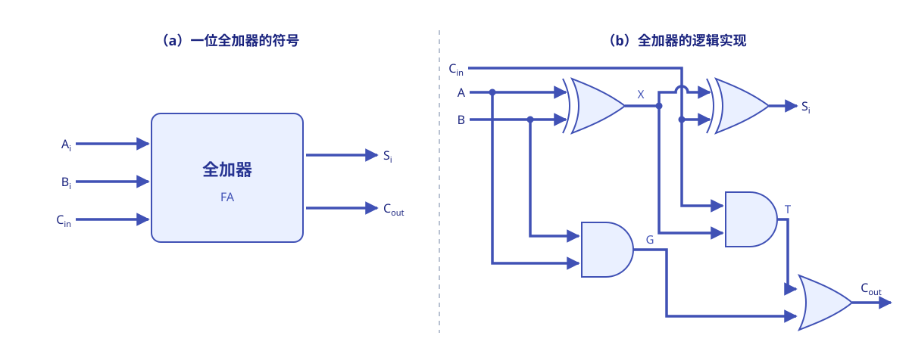
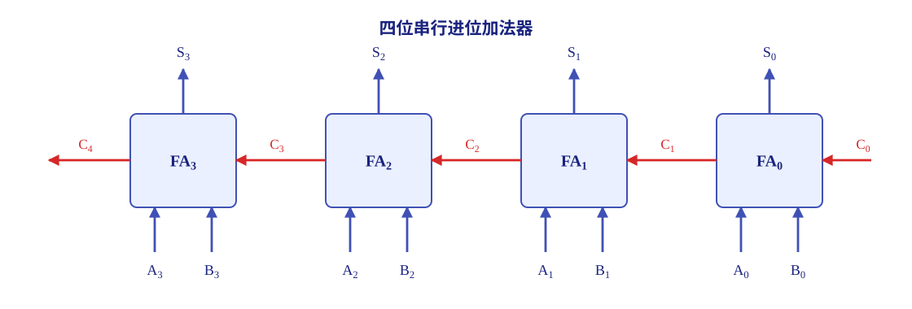
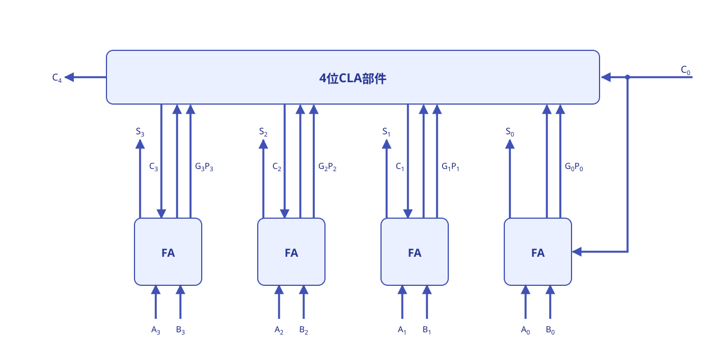
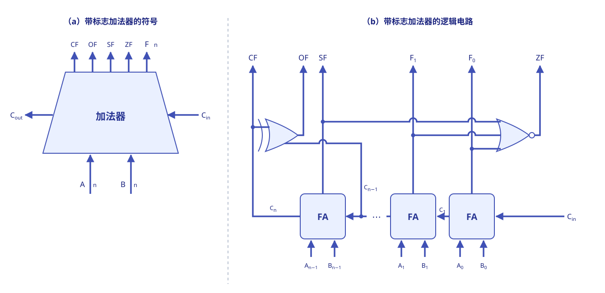
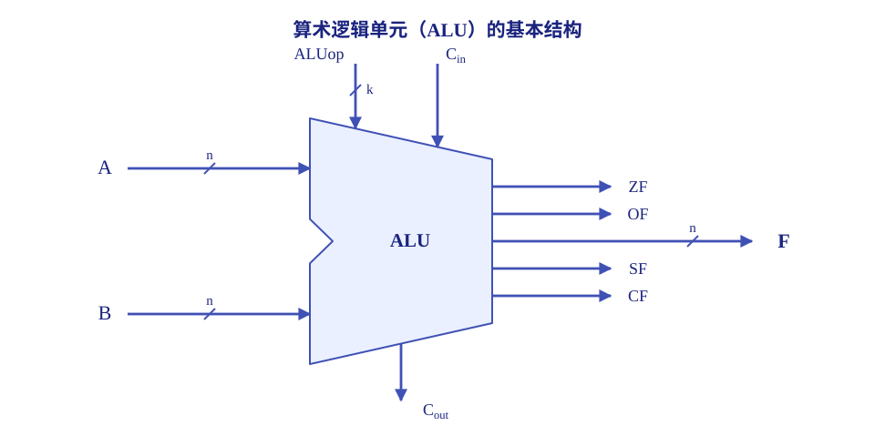
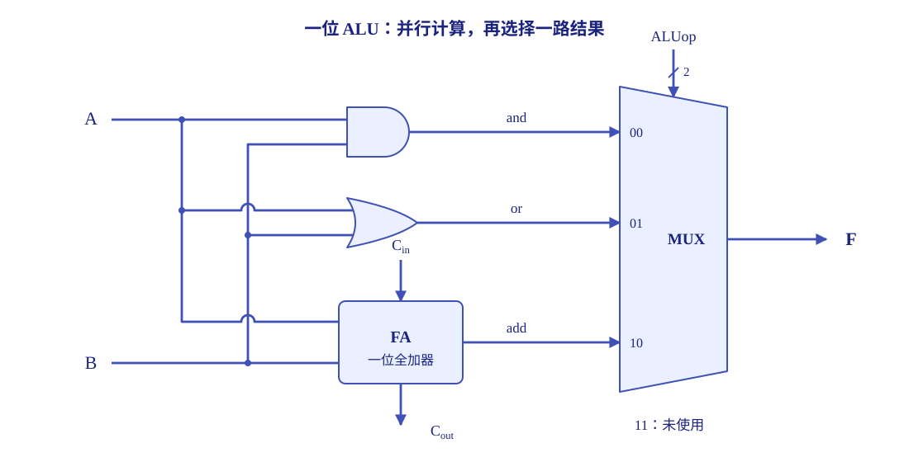
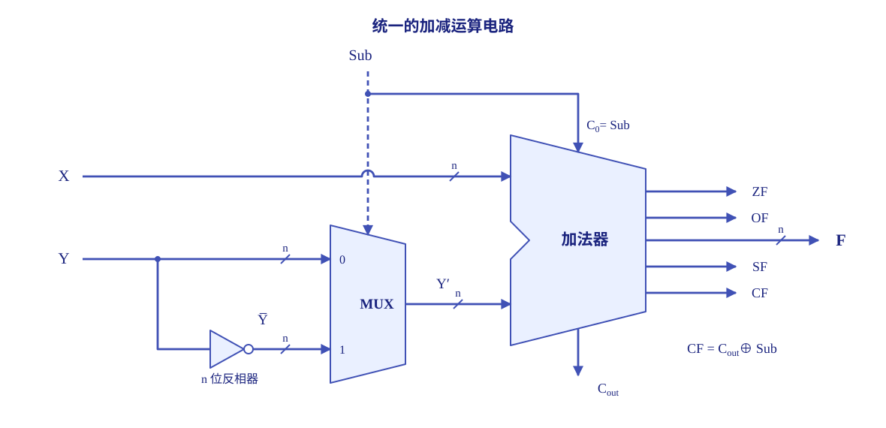
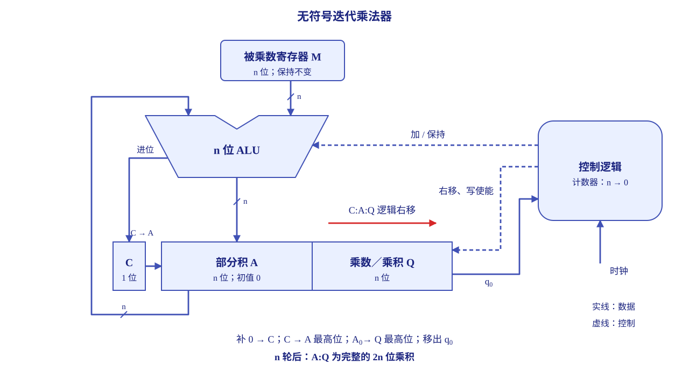
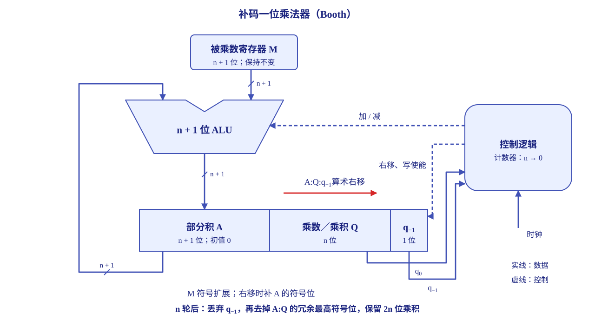
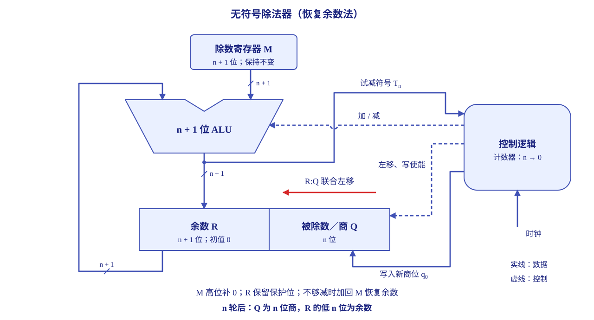

# 数据的表示与运算

## 进制

读者朋友们可能在接触这个专业之前就知道，在计算机系统内部所有信息都采用 **二进制** 进行编码。

??? question "为什么会用二进制？"
    我们提供一个参考的解释。这主要是因为：

    -   二进制只有两个状态，只需要使用具有两种稳定物理状态的物理器件即可表示每一位（高电平表示 1，低电平表示 0 等），硬件实现成本低。
    -   二进制的两个状态恰好对应逻辑值的 true 和 false，为计算机实现逻辑运算和程序的条件判断提供了直接支持；
    -   二进制下的运算规则极为简单（后续介绍），可通过基本的逻辑门电路高效实现各类算术与逻辑操作。

### 进位计数制

那么什么是“进制”？这是“进位计数制”的简称，也就是“逢 $r$ 进一”。我们给出一个形式上的定义：

$$
\sum_{i=-m}^{n} K_i r^i
$$

其中 $r$ 称作基数；$r^i$ 是第 $i$ 位的位权；$K_i$ 是第 $i$ 位的数码，取值范围为从 $0$ 到 $r-1$ 的整数。常见的进位计数制包括十进制、二进制、八进制、十六进制等。

小数点左边最低位的位权为 $r^0=1$，再向左依次为 $r^1,r^2,\ldots$；小数点右边则依次为 $r^{-1},r^{-2},\ldots$。

<center class="centered-table" markdown="1">

| 进制 | 基数 | 可以使用的数码 | 常用后缀 |
| :---: | :---: | :---: | :---: |
| 二进制 | $2$ | $0,1$ | B |
| 八进制 | $8$ | $0\sim7$ | O |
| 十进制 | $10$ | $0\sim9$ | D，通常省略 |
| 十六进制 | $16$ | $0\sim9$、A$\sim$F | H |

</center>

我们也可以用下标标明基数，如 $(1010)_2$；程序中还常用 `0x` 作为十六进制整数的前缀。

### 进制的转换

这里我们就不展开所有换算过程了，大家或多或少都了解过这方面的方法和诀窍。

??? example "换算时为什么要以小数点为界？"
    以 $(101101.011)_2$ 为例：

    $$
    \begin{aligned}
    (101\;101.011)_2&=(55.3)_8,\\
    (0010\;1101.0110)_2&=(2D.6)_{16}.
    \end{aligned}
    $$

    只有从小数点开始分组，才能保证各组的位权与目标进制对应。整数部分的最高位前、小数部分的最低位后补 $0$ 都不改变数值；在小数点附近随意补 $0$ 则会改变位权。

    再看十进制数 $13.625$：整数部分连续除以 $2$，所得余数依次为 $1,0,1,1$，逆序得到 $1101$；小数部分的过程为

    $$
    0.625\times2=1.25,\qquad
    0.25\times2=0.5,\qquad
    0.5\times2=1.0,
    $$

    顺序取整数部分得到 $101$，因此 $(13.625)_{10}=(1101.101)_2$。

!!! tip "十进制有限小数不一定是二进制有限小数"
    一个有理数能用有限位二进制精确表示，当且仅当它能写成 $k/2^t$ 的形式，其中 $k$ 为整数、$t$ 为非负整数。换句话说，约分后的分母必须是 $2$ 的幂。

    例如，$0.625=5/8$ 可以精确写成 $(0.101)_2$；而 $0.1=1/10$ 的分母含有因子 $5$，二进制小数部分会无限循环，增加有限个二进制位仍不能精确表示它。反过来，任何有限位二进制小数都可以精确地转换为有限位十进制小数。

## 编码

### 真值与机器数

我们平时写的 $+5$、$-5$，表达的是数本身的实际大小和正负，这个实际数值称为 **真值**。机器中不能直接存储数学意义上的正、负号，因而需要把符号和数值一起编成二进制位串，这样的编码称为 **机器数**。

同一段位串的真值取决于采用的编码规则。例如，`1000 0101` 按无符号整数解释是 $133$，按[原码](#原码)整数解释是 $-5$，按[补码](#补码)整数解释则是 $-123$。因此，“看到了哪些位”和“这些位代表什么数”是两个需要分清的问题。

下面统一用 $n$ 表示机器数的**总位数**。讨论原码、反码和补码时，最高位用作符号位，其余 $n-1$ 位为数值位。本部分先按整数说明各类编码；整数与小数的小数点约定见[定点整数与定点小数](#定点整数与定点小数)。

### 原码

**原码** 把最高位单独用于表示符号：$0$ 表示非负，$1$ 表示负；其余 $n-1$ 位保存真值的绝对值。例如，八位原码中：

$$
[+5]_{\mathrm{原}}=0,0000101,\qquad
[-5]_{\mathrm{原}}=1,0000101.
$$

逗号仅用于分隔符号位与数值位，不占存储位置。原码的对应关系很直观，不过正零和负零会得到不同的编码：

$$
[+0]_{\mathrm{原}}=0,00\cdots0,\qquad
[-0]_{\mathrm{原}}=1,00\cdots0.
$$

原码的范围关于原点对称，便于直接读出符号和绝对值，也适合将乘除运算的符号处理与数值处理分开。不过，用它实现加减时需要分别判断符号和绝对值大小，硬件处理比较复杂。

### 反码

**反码** 可以看作从原码得到[补码](#补码)的一个中间形式：非负数的反码与原码相同；负数保留原码的符号位，把数值部分逐位取反，**末位不加 $1$**。因此八位编码中，$-5$ 的原码为 `1000 0101`，反码为 `1111 1010`，在反码上再加 $1$，才得到补码 `1111 1011`。

反码也有两种零：正零为 `0000 0000`，负零为 `1111 1111`。它的表示范围与同位数原码相同，因而既没有消除双零，也没有获得补码的额外最小负数，现代计算机很少用它表示整数。

### 补码

**补码** 的主要好处是让符号位也参与运算，从而通过加法器统一处理加法和减法。对 $n$ 位整数，把编码整体看作一个 $0\sim2^n-1$ 的无符号位串时，补码定义为

$$
[x]_{\mathrm{补}}=
\begin{cases}
x, & 0\le x\le2^{n-1}-1,\\
2^n+x, & -2^{n-1}\le x<0.
\end{cases}
$$

这里的 $2^n$ 称为 **模**。若两个整数相差 $2^n$ 的整数倍，它们就具有相同的低 $n$ 位；也就是说，在模 $2^n$ 意义下相等。负数的补码取 $2^n-|x|$，正是利用这个关系把负数映射到一个非负的编码值。

例如，八位补码中 $-5$ 的编码为 $2^8-5=251$，即 `1111 1011`；丢弃超出八位的进位后，它与 `0000 0101` 相加得到全 $0$。补码加减的具体过程见[补码加减运算](#补码加减运算)。

真值与补码互相转换时，可以使用下面的方法：

-   **非负数**：补码与原码一致，在数值前补足 $0$ 即可。
-   **负数求补码**：先把绝对值写成 $n$ 位无符号二进制数，再把这 $n$ 位逐位取反、末位加 $1$，保留低 $n$ 位。
-   **负补码求真值**：对整个 $n$ 位位串逐位取反、末位加 $1$，把所得位串按无符号数读作绝对值，再加上负号。

这里对**整个 $n$ 位**取反加一，可以正确处理最小负数。例如，八位补码 `1000 0000` 取反加一仍为 `1000 0000`，按无符号数解释得到绝对值 $128$，所以原数是 $-128$；不能把它直接按原码解释。

也可以直接用位权读出补码真值。若位串为 $b_{n-1}b_{n-2}\cdots b_0$，则

$$
x=-b_{n-1}2^{n-1}+\sum_{i=0}^{n-2}b_i2^i.
$$

最高位的权为负，而其余位仍为正权。因此，补码的低 $n-1$ 位并不等于负数的绝对值。

<center class="centered-table" markdown="1">

| 真值或特征 | $n$ 位补码 |
| :---: | :---: |
| $0$ | `00…0`，正零与负零统一 |
| $-1$ | `11…1` |
| 最大正整数 $2^{n-1}-1$ | `01…1` |
| 最小负整数 $-2^{n-1}$ | `10…0` |

</center>

补码比相同总位数的原码多表示一个最小负数，且零的编码唯一。

### 移码

**移码** 将真值统一加上一个固定的偏置值，使整个数值范围平移到非负区间，主要用于表示浮点数的阶码。若字长为 $n$ 位，并取偏置值 $2^{n-1}$，则

$$
[x]_{\mathrm{移}}=x+2^{n-1},\qquad
-2^{n-1}\le x\le2^{n-1}-1.
$$

以八位移码为例，偏置为 $128$，$-5$ 的移码为 $123$，即 `0111 1011`；$+5$ 的移码为 $133$，即 `1000 0101`。它有几个方便使用的性质：

-   零的编码唯一，为 `10…0`。
-   编码全 $0$ 对应最小真值 $-2^{n-1}$，编码全 $1$ 对应最大真值 $2^{n-1}-1$。
-   只需把同位数补码的最高位取反，就能得到这里定义的移码。
-   把移码整体按无符号数比较时，编码越大，真值也越大，因而便于比较阶码。

!!! warning "移码的偏置并不总是最高位的位权"
    上面“补码最高位取反即得移码”的结论，以偏置为 $2^{n-1}$ 为前提。[IEEE 754 浮点格式](#ieee-754-标准的浮点数)中，$k$ 位阶码字段使用的偏置是 $2^{k-1}-1$，例如八位阶码的偏置为 $127$，并且还有保留的阶码编码。因此，不能直接套用前面的最高位取反规则。

### 编码之间的比较

各类编码对应的整数范围、定点小数范围与零的编码，集中列在[定点数的表示范围](#定点数的表示范围)中。

同位数时，非负数的原码、反码、补码相同；负数则要按各自的规则解释。在同为负数的前提下，原码数值部分越大，真值反而越小；补码和反码的数值部分越大，真值也越大。跨越正、负两类进行比较时，要先考虑符号，不能把整个位串直接当作无符号数比较。

### BCD 码

计算机保存的是二进制比特，但一串比特所遵循的解释规则可以不同。除了按二进制位权解释整个数值，也可以按十进制数位分别编码：**二进制编码的十进制数**（Binary-Coded Decimal，BCD）就是这种表示方式。

例如，采用常见的 **8421 BCD 码** 时，用 4 位二进制编码一位十进制数码，十进制的 59 编码为 `0101 1001`。每组只使用 `0000` 至 `1001` 表示 0 至 9，另外六种组合不作为合法的十进制数码。若把同一串 `0101 1001` 直接看成一个无符号二进制整数，则得到的是 89。这里的差别来自解释规则：BCD 保留了十进制数位的结构，普通二进制整数按二进制位权整体求值。

## 整数和小数的表示

-   根据小数点位置是否固定，计算机中的数值表示分为**定点**（fixed-point）表示和[**浮点**](#浮点数的表示)（floating-point）表示两种。
-   根据使用场景的不同，计算机中的数值表示还可以分为**无符号**和**有符号**两类。
-   计算机可以表示**整数**和**小数**两类数。

### 定点数的表示

#### 定点整数与定点小数

**定点** 的含义是事先约定小数点的位置，而不是在存储器中再存放一个小数点。

<center class="centered-table" markdown="1">

| 表示方式 | 小数点的约定位置 | 示意形式 |
| :---: | :---: | :---: |
| 定点整数 | 数值部分最低位之后 | $s\,b_{n-2}\cdots b_1b_0\boldsymbol{.}$ |
| 定点小数 | 符号位之后、数值部分最高位之前 | $s\boldsymbol{.}b_{n-2}\cdots b_1b_0$ |

</center>

这里的定点小数主要指**纯小数**。同样一段数值位，在定点整数中最低位的权为 $1$，在定点小数中最低位的权为 $2^{-(n-1)}$。若编码规则相同，把对应定点整数的真值除以 $2^{n-1}$，就得到定点小数的真值。

硬件并不需要在位串里寻找小数点，但解释结果时必须知道这一约定。前面的[编码](#编码)规定了位串如何表示符号和数值，这里的小数点约定则进一步决定各位对应的实际位权。

#### 整数的表示

##### 无符号整数

**无符号整数** 不设符号位，所有位都用于表示非负数值。对 $n$ 位位串 $b_{n-1}\cdots b_0$，其真值为

$$
x=\sum_{i=0}^{n-1}b_i2^i,\qquad 0\le x\le2^n-1.
$$

因为不需要为符号保留一位，相同字长下，无符号整数的最大值大于有符号整数的最大值。例如，八位无符号数从 `0000 0000` 到 `1111 1111`，可表示 $0\sim255$，适合计数等只涉及非负整数的场合。

##### 有符号整数

**有符号整数** 需要同时表示正负和数值。原码、反码、补码都可以完成编码，而现代计算机通常采用[补码](#补码)，其优势见前面的编码说明，表示范围见[定点数的表示范围](#定点数的表示范围)。

例如，同为八位编码，补码整数的范围是 $-128\sim127$。最高位为 $1$ 的位串，在无符号解释中仍是较大的非负数，在补码解释中则是负数；究竟采用哪种解释，由数据类型和指令规定，而不是由位串自己决定。

#### 定点数的表示范围

<center class="centered-table" markdown="1">

| 编码 | $n$ 位整数的表示范围 | $n$ 位定点小数的表示范围 | 零的编码 |
| :---: | :---: | :---: | :---: |
| 原码 | $[-(2^{n-1}-1),\,2^{n-1}-1]$ | $[-(1-2^{-(n-1)}),\,1-2^{-(n-1)}]$ | 两种 |
| 反码 | $[-(2^{n-1}-1),\,2^{n-1}-1]$ | $[-(1-2^{-(n-1)}),\,1-2^{-(n-1)}]$ | 两种 |
| 补码 | $[-2^{n-1},\,2^{n-1}-1]$ | $[-1,\,1-2^{-(n-1)}]$ | 一种 |
| 移码，偏置 $2^{n-1}$ | $[-2^{n-1},\,2^{n-1}-1]$ | 本节用于整数阶码 | 一种 |

</center>

### C 语言中的整数类型及类型转换

#### 常用整数类型

C 语言提供 `short`（`short int`）、`int`、`long`（`long int`）等整型；在这些类型前加上 `unsigned`，就得到对应的无符号类型。它们省略 `signed` 或 `unsigned` 时是有符号类型。具体位数依赖编译器和目标平台，做题时应先读取题目给出的字长条件。

<center class="centered-table" markdown="1">

| 类型 | 本节例子采用的位数 | 补码有符号范围 | 对应无符号范围 |
| :---: | :---: | :---: | :---: |
| `short` / `unsigned short` | $16$ | $-32768\sim32767$ | $0\sim65535$ |
| `int` / `unsigned int` | $32$ | $-2^{31}\sim2^{31}-1$ | $0\sim2^{32}-1$ |
| `long` / `unsigned long` | 依平台或题设确定 | 由总位数代入补码范围 | 由总位数代入无符号范围 |

</center>

`char` 也是整型，常见实现中占八位，不过不能把它一律当作无符号数。下文的位级示例统一以**十六位 `short`、三十二位 `int`、有符号数采用补码**为前提，不能仅由“系统是六十四位”就推断 `long` 的宽度。

!!! info "区分机器题设与 C 语言的实现约定"
    普通 `char` 的符号性由实现决定，需要明确符号时应使用 `signed char` 或 `unsigned char`。此外，以下“截去高位”的有符号窄化示例采用题目常见的截位约定；在 C11 中，若源值不能由目标有符号类型表示，结果由实现定义，或者产生由实现定义的信号，不能把截位视为所有 C 实现必须遵守的规则。可参考 [C11 草案 N1570 的 6.2.5、6.3.1.3](https://www.open-std.org/jtc1/sc22/wg14/www/docs/n1570.pdf)。

#### 位截断与位扩展

类型转换可以写成 `(目标类型)表达式`。分析这类题目时，先看**位数是否变化**，再看源类型和目标类型是有符号还是无符号，最后按目标类型解释结果。

**长类型转换为短类型**，在题设采用保留低位的规则时，丢弃超出目标字长的高位，再用目标类型解释留下的位串。例如：

```c
int x = 40000;
short y = (short)x;
```

此时 `x` 的三十二位编码为 `0x00009C40`，保留低十六位后得到 `0x9C40`，最高位为 $1$，所以 `y` 的补码真值为 $40000-2^{16}=-25536$。这里改变的是类型转换后的数值，不能用“原来的 `int` 加法溢出”解释，因为原值 $40000$ 本身可以由三十二位 `int` 表示。

**短类型转换为长类型**，高位需要填充，常见的两种方式是：

-   **零扩展**：源类型为无符号数时，高位补 $0$。
-   **符号扩展**：源类型为补码有符号数时，高位重复原来的符号位。非负数补 $0$，负数补 $1$。

当目标类型能够表示源值时，这样扩展可保持数值不变。例如：

```c
short a = -5;
int b = a;
unsigned short u = (unsigned short)a;
unsigned int v = u;
```

<center class="centered-table" markdown="1">

| 变量 | 位模式 | 真值 | 转换过程 |
| :---: | :---: | :---: | :---: |
| `a` | `0xFFFB` | $-5$ | 十六位补码 |
| `b` | `0xFFFFFFFB` | $-5$ | 从 `a` 符号扩展 |
| `u` | `0xFFFB` | $65531$ | 同位宽，转为无符号解释 |
| `v` | `0x0000FFFB` | $65531$ | 从 `u` 零扩展 |

</center>

扩展方式依据的是**转换前的源类型**。同样是位串 `0xFFFB`，从 `a` 扩展要补 $1$，从 `u` 扩展则补 $0$。如果将负数转成更宽的无符号类型，目标值本来就不能继续为负，因此还需要按照无符号转换的模规则解释，不能说任何扩展都保持真值不变。

#### 相同字长下改变符号性

在本节补码模型下，相同字长的有符号数与无符号数互相转换，可以表现为**位模式不变、解释方式改变**。例如，上面 `a` 和 `u` 的编码完全相同，但前者的最高位具有补码的负权，后者的所有位都具有正权，所以真值相差 $2^{16}$。

对 $n$ 位无符号目标类型，转换所得值与原值模 $2^n$ 同余，并落在 $0\sim2^n-1$ 内。因此，负数 $-5$ 转为十六位无符号数得到 $2^{16}-5=65531$；转为三十二位无符号数则得到 $2^{32}-5=4294967291$。

反向转换时，若无符号值不大于目标有符号类型的最大值，数值保持不变；若超出该范围，则应按前面提示框中的 C 实现约定或题目明确给出的补码规则处理。

### 浮点数的表示

前面的定点数把小数点固定在约定的位置，而**浮点数**会把表示数值所需的比例因子一起保存下来，让小数点的位置可以随阶码变化。一般可以写成：

$$
N=(-1)^s\times M\times R^E.
$$

其中，$s$ 决定正负；$M$ 是非负的**尾数**，用来保存有效数字；$E$ 是**阶码所表示的指数真值**；$R$ 是约定的基数，通常为 $2$，也可以采用 $4$ 或 $16$。存储时不必为每个数再保存一次基数。

**阶码位数主要决定表示范围，尾数位数主要决定有效精度**。例如，某种 32 位浮点格式采用 1 位符号、7 位阶码和 24 位小数尾数，阶码使用偏置为 $64$ 的[移码](#移码)，便可以用较少的位保存很大或很小的数。不过，这种一般格式与后面的 IEEE 754 格式并不相同，不能把两者的阶码偏置和小数点位置混用。

同一个非零数可能有不止一种写法，例如：

$$
(0.00101)_2\times2^5=(0.101)_2\times2^3=(1.01)_2\times2^2.
$$

为了尽可能利用有限的尾数位，需要约定一种**规格化**形式。若一般二进制格式把原码尾数的小数点放在最高数值位之前，规格化要求最高数值位为 $1$，即 $\frac12\le M<1$。具体计算时，先看清题目规定的尾数编码和小数点位置；IEEE 754 则采用下面的 $1.f$ 形式。

!!! note "表示范围与表示精度"
    相同总位数下，浮点数把一部分位交给阶码，因而可以覆盖更广的数量级；这不代表它能表示更多不同的实数。$n$ 位存储总共仍只有 $2^n$ 种比特模式，浮点格式还会把其中一些模式用于特殊值。

    定点数在选定尺度后，相邻数值之间的间隔固定；浮点数的间隔则随数量级变化。比较两者精度时，必须同时说明尺度与数值所在的区间，不能直接认为所有定点数都比浮点数精确。无论采用哪种表示，有限位二进制都无法精确保存所有实数，原因见[进制的转换](#进制的转换)。

#### IEEE 754 标准的浮点数

##### 存储格式与隐藏位

IEEE 754 的二进制浮点格式把存储位划分为**符号字段 $s$、阶码字段 $e$ 和尾数字段 $f$**。这里用 $E$ 表示指数真值，用 $e$ 表示存储的无符号阶码编码，避免把两者混淆。

<center class="centered-table" markdown="1">

| 格式 | 总位数 | 符号位 | 阶码位数 | 尾数字段位数 | 规格化有效位数 $p$ | 阶码偏置 $B$ |
| :---: | :---: | :---: | :---: | :---: | :---: | :---: |
| 单精度（binary32） | 32 | 1 | 8 | 23 | 24 | 127 |
| 双精度（binary64） | 64 | 1 | 11 | 52 | 53 | 1023 |

</center>

对于**规格化数**，真值为：

$$
N=(-1)^s\times(1.f)_2\times2^{e-B},\qquad E=e-B.
$$

二进制规格化尾数的小数点前总是 $1$，因此不必把这个 $1$ 实际存下来，这就是**隐藏位**。$f$ 只保存小数点后的部分，所以 23 位尾数字段可以提供 24 位二进制有效数字，52 位尾数字段可以提供 53 位。

若阶码字段有 $q$ 位，IEEE 754 的偏置为 $B=2^{q-1}-1$，与前面普通移码采用的 $2^{q-1}$ 不同。它还保留了全 $0$、全 $1$ 阶码用于特殊编码，因此规格化数的阶码范围是：

- **单精度**：$1\le e\le254$，即 $-126\le E\le127$。
- **双精度**：$1\le e\le2046$，即 $-1022\le E\le1023$。

阶码采用偏置表示后，在规格化范围内可以直接按无符号编码比较指数大小，这也方便后面加减运算时进行[对阶](#对阶)。

??? example "把一个数写成 IEEE 754 单精度编码"
    以 $-6.5$ 为例，先写出二进制规格化形式：

    $$
    -6.5=-(110.1)_2=-(1.101)_2\times2^2.
    $$

    因此符号位 $s=1$，阶码字段 $e=2+127=129=(10000001)_2$；隐藏小数点前的 $1$ 后，尾数字段为 `101`，在后面补 $0$ 至 23 位：

    ```text
    1 | 10000001 | 10100000000000000000000
    ```

    按四位一组重新划分，得到 `C0D00000H`。反向解码时，也要先分出这三个字段，再恢复隐藏位并减去偏置，不能直接把整个 32 位串当成补码整数。

##### 特殊编码与非规格化数

全 $0$ 或全 $1$ 的阶码不能继续套用规格化数公式。对单、双精度格式，可以用同一张表区分：

<center class="centered-table" markdown="1">

| 阶码字段 $e$ | 尾数字段 $f$ | 表示内容 | 真值或含义 |
| :---: | :---: | :---: | :---: |
| 全 $0$ | 全 $0$ | 有符号零 | $+0$ 或 $-0$，由 $s$ 决定 |
| 全 $0$ | 非全 $0$ | 非规格化数 | $(-1)^s(0.f)_2\times2^{1-B}$ |
| 既非全 $0$，也非全 $1$ | 任意 | 规格化数 | $(-1)^s(1.f)_2\times2^{e-B}$ |
| 全 $1$ | 全 $0$ | 无穷大 | $+\infty$ 或 $-\infty$，由 $s$ 决定 |
| 全 $1$ | 非全 $0$ | 非数 NaN | 无有效的实数值，如无效运算的结果 |

</center>

**非规格化数**也称次正规数。它与规格化数有两个区别：隐藏位改为 $0$，指数固定为 $1-B$。因此，单精度非规格化数的指数仍是 $-126$，双精度仍是 $-1022$，而不是直接把阶码字段 $e=0$ 代入 $e-B$。

引入非规格化数，可以在 $0$ 与最小规格化正数之间再表示一批很小的数。数值继续减小时，尾数前面的零越来越多，可用的有效数字逐渐减少，这就是**渐进下溢**的基本想法。

$+0$ 和 $-0$ 的编码不同，但通常的数值比较把它们看作相等。$+\infty$ 大于所有有限数，$-\infty$ 小于所有有限数；NaN 则用来表示不能得到有效数值的情况。判断编码时要先检查阶码，再检查尾数，不能把全 $1$ 阶码一概解释成无穷大。

##### 表示范围与数值间隔

最小规格化正数取最小非零阶码和全 $0$ 尾数；最大有限正数取最大可用阶码和全 $1$ 尾数。非规格化数中，只有尾数字段的最低位为 $1$ 时，得到最小的可表示正数。

<center class="centered-table" markdown="1">

| 边界 | 单精度 | 双精度 |
| :---: | :---: | :---: |
| 最小规格化正数 | $2^{-126}$ | $2^{-1022}$ |
| 最大有限正数 | $(2-2^{-23})2^{127}$ | $(2-2^{-52})2^{1023}$ |
| 最小非规格化正数 | $2^{-149}$ | $2^{-1074}$ |
| 最大非规格化正数 | $(1-2^{-23})2^{-126}$ | $(1-2^{-52})2^{-1022}$ |

</center>

有限负数的范围关于零对称。注意，“最小规格化正数”不等于“最小可表示正数”，后者还要考虑非规格化数；无穷大也不属于有限数的范围。

对于指数真值同为 $E$ 的规格化数，尾数字段最低位相差 $1$ 时，两个数的间隔为：

$$
\Delta=2^{E-(p-1)}.
$$

因此，数量级增大一倍，相邻数的间隔也会增大一倍。以单精度为例，在 $[1,2)$ 内间隔为 $2^{-23}$，在 $[2,4)$ 内为 $2^{-22}$；在 $[2^{24},2^{25})$ 内间隔已经是 $2$，所以不能表示这个区间中的每个整数。这说明**浮点数的绝对间距随数量级增大，有效位数则保持不变**；它不是在整个数轴上均匀分布的。

### C 语言中的浮点数类型

下面采用考题中常见的模型：`int` 是 32 位补码整数，`float` 使用 IEEE 754 binary32，`double` 使用 binary64。`long double` 的长度与格式依赖具体实现，不能只根据类型名字断定它一定是某种固定宽度。

在这个模型下，`float` 有 24 位二进制有效数字，`double` 有 53 位。**表示范围足够大与能够精确保存原值，是两个不同的条件**；转换时必须分别检查。

<center class="centered-table" markdown="1">

| 转换 | 能否精确保持原值 | 需要关注的问题 |
| :---: | :---: | :---: |
| `int` → `float` | 不一定 | 范围足够，但某些整数需要超过 24 位有效数字，转换时可能[舍入](#舍入) |
| `int` → `double` | 能 | 32 位 `int` 的全部数值都在 `double` 的范围和有效精度之内 |
| `float` → `double` | 有限数能 | `double` 能精确保存每个有限 `float` 的原值；但不会消除该值在更早计算中已有的误差 |
| `double` → `float` | 不一定 | 有效位减少可能造成舍入；范围缩小还可能导致上溢或进入非规格化范围 |
| `float` / `double` → `int` | 只有可表示的整数值能 | 舍去小数部分，向零截断；整数部分越界时不保证得到有效结果，见下方说明 |

</center>

`float` 可以精确表示 $[-2^{24},2^{24}]$ 内的所有整数，但这不是说超过这个区间的整数全部不能精确表示。比如 $2^{24}+2$ 可以表示，而 $2^{24}+1$ 不可以；决定因素是该整数在对应数量级上是否恰好落在可表示数的间隔上。

!!! info "浮点数转整数越界，不保证按低位截断或回绕"
    对有限浮点数转换为整数，C 先丢弃小数部分，向零截断。若得到的整数部分不能由目标整数类型表示，则行为未定义，不能套用[整数类型转换](#c-语言中的整数类型及类型转换)中截取低位的分析方法。例如，`(int)3.9` 为 `3`，`(int)-3.9` 为 `-3`，但不能假定越界的浮点值转换后一定得到某个固定整数。

    参见 [C11 委员会草案 N1570，6.3.1.4](https://www.open-std.org/jtc1/sc22/wg14/www/docs/n1570.pdf)。

混合运算还需要分清**运算之前的转换**和**结果保存时的转换**。常见情况下，`int` 与 `float` 运算会先将整数转换为 `float`；`float` 与 `double` 运算会先将 `float` 转为 `double`。但赋值给更宽的类型，并不能自动修复前面已经产生的精度损失：

```c
int i = 16777217;          // 2^24 + 1
float f = (float)i;       // 在默认就近舍入下变成 16777216
double d = (double)f;    // 精确保存 f，仍然是 16777216
double exact = (double)i; // 可以精确保存 16777217
```

上例中的 `double` 有能力表示原来的整数，但 `d` 转换的是已经舍入过的 `f`，不会回头恢复 `i`。因此，不能把“转成精度更高的类型”理解为“找回之前丢失的有效数字”。

### 数据的宽度和存储

#### 数据的宽度与单位

**位**（bit，记作 b）表示一个二进制位，是最小的信息单位；通常所说的**字节**（byte，记作 B）包含 8 位，是常见的基本存储与寻址单位。容量单位中的大写 B 与小写 b 不能混用。

在组成原理题目常用的二进制容量约定下，$1\text{ KB}=2^{10}\text{ B}$、$1\text{ MB}=2^{20}\text{ B}$、$1\text{ GB}=2^{30}\text{ B}$。计算时应先看清题目使用的是位还是字节，以及前缀对应的进制约定。

**字**（word）是体系结构约定的数据组织单位，其长度依架构而定；**字长**通常指 CPU 进行整数运算的数据通路宽度，通常与通用寄存器宽度相同，反映一次能够处理的整数数据位数。两者不能仅凭名称混为一谈。例如，x86 中仍把 16 位称作一个字，32 位称作双字，但这不表示相应处理器的机器字长只能是 16 位。

同样，“32 位机器”也不意味着所有数据类型都占 32 位，更不意味着任何指令、地址或浮点数的长度都必须等于机器字长。

#### 大端方式与小端方式

在**按字节编址**的内存中，每个地址对应一个字节，多字节数据占据一组连续地址。大小端讨论的是：一个数据内部的各个字节，按什么顺序放进这些地址。

以四字节数 `12345678H` 为例，`12H` 是**最高有效字节**（MSB），`78H` 是**最低有效字节**（LSB）。这两个名称由字节对数值的贡献决定，与图上画在左边还是右边无关。

- **大端方式**（big endian）：低地址保存最高有效字节，高地址保存最低有效字节。
- **小端方式**（little endian）：低地址保存最低有效字节，高地址保存最高有效字节。

假设这个数从地址 `1000H` 开始存储：

<center class="centered-table" markdown="1">

| 存储方式 | `1000H` | `1001H` | `1002H` | `1003H` |
| :---: | :---: | :---: | :---: | :---: |
| 大端 | `12H` | `34H` | `56H` | `78H` |
| 小端 | `78H` | `56H` | `34H` | `12H` |

</center>

大小端改变的是**字节之间的顺序**，不是把每个字节内部的二进制位也倒过来。恢复小端多字节数值时，应按有效性从高字节到低字节重新组合；不过，看到连续的机器代码字节时，仍要先识别指令中各字段的边界，不能把整条指令当成一个整数全部逆序。

#### 边界对齐

**边界对齐**要求数据的起始地址是其对齐值的整数倍。如果某个数据要求按 $a$ 字节对齐，则起始地址 $A$ 应满足：

$$
A\bmod a=0.
$$

在一个采用 32 位字、每次按对齐的 4 字节边界访问的简化模型中，字节可以放在任意地址，半字通常按 2 字节对齐，字通常按 4 字节对齐。一个 4 字节字若从地址 $4$ 开始，落在同一组访问范围内；若从地址 $3$ 开始，则横跨 $[0,3]$ 与 $[4,7]$ 两组，需要分别取得两边的数据再拼接。

因此，按边界对齐通常有利于减少跨边界访问。具体要访问几次还取决于数据宽度、存储系统和处理器实现，不能只凭“已经对齐”就断言任何数据都恰好完成一次物理访存。

为了让后续成员满足对齐要求，编译器可能插入**填充字节**。它们占空间，但不属于程序声明的有效成员数据，是一种用存储空间换取访问便利的做法。

#### 结构体的对齐与填充

在题目采用的常见布局规则下，结构体需要同时满足：

1. 每个成员的起始地址满足自身的对齐要求。
2. 结构体整体满足其成员中的最大对齐要求。
3. 结构体总大小是这个整体对齐值的整数倍；末尾不够时也要补齐，保证数组中的下一结构体仍能正确对齐。

具体对齐值依编译器、目标平台及相关设置而定。下面假设 `char`、`short`、`int` 的大小与对齐值分别为 1、2、4 字节，并采用上述规则：

```c
struct A {
    int a;
    char b;
    short c;
};

struct B {
    char b;
    int a;
    short c;
};
```

<center class="centered-table" markdown="1">

| 结构体 | `a` 的偏移 | `b` 的偏移 | `c` 的偏移 | 填充位置 | 总大小 |
| :---: | :---: | :---: | :---: | :---: | :---: |
| `A` | 0～3 | 4 | 6～7 | 偏移 5 | 8 B |
| `B` | 4～7 | 0 | 8～9 | 偏移 1～3、10～11 | 12 B |

</center>

两者声明的成员类型完全相同，但顺序不同，会改变中间的填充数量。计算时应从头逐个放置成员：先把当前偏移补到该成员的对齐边界，再加上成员大小，最后把结构体总长度补到整体对齐值的倍数。

边界对齐决定成员放在哪些地址，大小端决定多字节成员内部怎样排列；它们是两个不同的问题。分析结构体的内存图时，可以先算偏移和填充，再按题目给出的大小端逐字节填写成员值。

## 运算方法和运算电路

### 基本运算部件

计算机中的各种基本运算最终都要落实到**组合逻辑电路**上实现，复杂运算还需要控制逻辑与寄存器来组织多步操作，而加法又是一切算术运算的基础。所以我们在这里介绍的部件都以加法为核心功能。

运算器除了 ALU，还包含移位器、通用寄存器组和保存运算状态的寄存器。下面先从一个二进制位的相加出发，再把它扩展为能够处理多位数据的部件。在逻辑表达式中，相邻变量的乘积表示“与”，$+$ 表示“或”，$\oplus$ 表示“异或”；这里的逻辑“或”需要与算术加法区分开。

#### 一位全加器

只考虑两个一位二进制数 $A_i$、$B_i$ 相加、不考虑低位进位的部件称为**半加器**：其本位和为 $A_i \oplus B_i$，向高位的进位为 $A_iB_i$。

而在多位加法中，第 $i$ 位还必须加上从低位传上来的进位。能同时处理“两个本位加数 + 低位进位”的部件就是**全加器**（Full Adder，FA）：输入为 $A_i$、$B_i$ 与进位输入 $C_{\mathrm{in}}$，输出为本位和 $S_i$ 与进位输出 $C_{\mathrm{out}}$。

全加器的真值表如下：

<center class="centered-table" markdown="1">

| $A_i$ | $B_i$ | $C_{\mathrm{in}}$ | $S_i$ | $C_{\mathrm{out}}$ |
| :---: | :---: | :---: | :---: | :---: |
| 0 | 0 | 0 | 0 | 0 |
| 0 | 0 | 1 | 1 | 0 |
| 0 | 1 | 0 | 1 | 0 |
| 0 | 1 | 1 | 0 | 1 |
| 1 | 0 | 0 | 1 | 0 |
| 1 | 0 | 1 | 0 | 1 |
| 1 | 1 | 0 | 0 | 1 |
| 1 | 1 | 1 | 1 | 1 |

</center>

由真值表可写出全加器的逻辑表达式：

$$
S_i = A_i \oplus B_i \oplus C_{\mathrm{in}},
\qquad
C_{\mathrm{out}} = A_iB_i + (A_i \oplus B_i)C_{\mathrm{in}}.
$$

进位表达式由两项构成，恰好对应产生进位的两条途径：

- $A_iB_i$：两个加数本位都为 $1$，本位**直接产生**进位；
- $(A_i \oplus B_i)C_{\mathrm{in}}$：两个加数本位恰有一个为 $1$，把低位传来的进位**传递**到高位。

这两种途径分别对应后面[并行进位加法器](#并行进位加法器)中的**进位生成函数**与**进位传递函数**。

<figure markdown="1">
{:width="92%"}
</figure>

#### 串行进位加法器

把 $n$ 个全加器首尾相接——每一位的进位输出直接作为相邻高位的进位输入——就得到 $n$ 位**串行进位加法器**。图中以 4 位为例：最低位的输入进位记为 $C_0$，各位产生的进位依次为 $C_1$、$C_2$、$C_3$，最高位向外的进位为 $C_4$。

<figure markdown="1">
{:width="92%"}
</figure>

串行进位加法器结构简单、所用元件少，但 速度慢：高位的和必须等进位从低位开始逐级“串行”传上来以后才能确定。设一位全加器从进位输入到进位输出的延迟为 $2T$（$T$ 为一级门电路的延迟，对应进位表达式中的一个与门加一个或门），则 $n$ 位加法器在最坏情况下要经历 $n$ 次进位传递，总延迟约为 $2nT$，**与位数成正比**。因此，串行进位加法器只适用于位数较少、对速度要求不高的场合。

#### 并行进位加法器

既然进位表达式 $C_{\mathrm{out}} = A_iB_i + (A_i\oplus B_i)C_{\mathrm{in}}$ 本身只有两项，不妨把它当作**递推式**逐级代入展开。为此定义

$$
G_i = A_iB_i \quad(\text{进位生成函数}),
\qquad
P_i = A_i \oplus B_i \quad(\text{进位传递函数}),
$$

并约定第 $i$ 位的进位输入为 $C_i$、进位输出为 $C_{i+1}$（最低位的输入进位为 $C_0$），则

$$
C_{i+1} = G_i + P_iC_i.
$$

把递推式逐级代入展开，每位进位都化成了 $G$、$P$ 与 $C_0$ 的组合（以 4 位为例）：

$$
\begin{aligned}
C_1 &= G_0 + P_0C_0,\\
C_2 &= G_1 + P_1G_0 + P_1P_0C_0,\\
C_3 &= G_2 + P_2G_1 + P_2P_1G_0 + P_2P_1P_0C_0,\\
C_4 &= G_3 + P_3G_2 + P_3P_2G_1 + P_3P_2P_1G_0 + P_3P_2P_1P_0C_0.
\end{aligned}
$$

展开后可以看到：各级进位**都不再依赖低位的进位传递**，只要 $G_i$、$P_i$ 和 $C_0$ 就绪，就可以由专门的进位逻辑**同时（并行）算出**，这就是**并行进位加法器**，又称先行进位／超前进位加法器（Carry Look-Ahead Adder，CLA）。同时，本位和也可由传递函数直接得到：$S_i = P_i \oplus C_i$。

代价是：位数越多，各级展开式的项数和每一项需要的输入数都会增加（$C_i$ 的展开式有 $i+1$ 项），电路越复杂。因此实际中常采用**分组并行进位**：组内并行进位，组间再并行（两级先行进位）或串行，在速度与成本之间折中。

<figure markdown="1">
{:width="92%"}
</figure>

#### 带标志加法器

加法器不仅要给出结果，还要提供判断结果特征的信息。在 $n$ 位加法器上增加**标志位生成逻辑**，即得到**带标志加法器**，一般产生四个标志：

<center class="centered-table" markdown="1">

| 标志 | 名称 | 含义 |
| :---: | :---: | :---: |
| CF | 进位／借位标志 | 加法时取最高位进位 $C_n$；减法时取 $\overline{C_n}$ 表示借位 |
| OF | 溢出标志 | $OF = C_n \oplus C_{n-1}$，只对有符号数（补码）有意义 |
| SF | 符号标志 | 取结果的最高位，$SF = F_{n-1}$ |
| ZF | 零标志 | 结果各位全为 $0$ 时置 $1$ |

</center>

- **CF（Carry Flag）**：无符号数运算的进位／借位标志。加法时取最高位的进位 $C_n$；减法用补码实现，$A-B$ 通过 $A+\overline B+1$ 完成，若最高位向外产生进位（$C_n=1$）说明 $A\ge B$、没有借位，因此若约定 CF 在发生借位时置 $1$，减法时就应取 $CF=\overline{C_n}$。以 $Sub=0$ 表示加法、$Sub=1$ 表示减法，则可以统一写成 $CF=C_n\oplus Sub$。
- **OF（Overflow Flag）**：有符号数（补码）的溢出标志。当最高位进位与次高位进位不同（$OF = C_n \oplus C_{n-1}$）时发生溢出，即结果超出了补码能表示的数值范围。
- **SF（Sign Flag）**：符号标志，直接取结果的最高位 $F_{n-1}$，将保存的 $n$ 位结果按补码解释时，结果为负则 $SF=1$；若运算发生了溢出，它不能直接代表准确数学结果的正负。
- **ZF（Zero Flag）**：零标志，结果的各位全为 $0$ 时置 $1$（可用结果各位“或非”得到）。

这些标志是条件转移等指令进行判断的依据，通常与运算结果一起送入程序状态字寄存器。

<figure markdown="1">
{:width="92%"}
</figure>

#### 算术逻辑单元

**算术逻辑单元**（Arithmetic Logic Unit，ALU）是 CPU 中执行运算的核心部件，本质上是一个组合逻辑电路。它以**带标志加法器**为核心，再加上逻辑运算部件（与、或、非、异或等）和移位部件等：

- 输入端：两个 $n$ 位操作数 $A$、$B$（以及可能的进位输入），外加来自控制器的**操作控制信号**；
- 输出端：运算结果 $F$ 以及标志位 CF、OF、SF、ZF。

一种常见的实现方式是，操作控制信号同时作用于各个运算部件，各部件并行算出候选结果，最后由多路选择器选出所需的那一路作为输出。因此，ALU 一般只完成加、减、与、或、非、异或、移位等基本运算；乘、除等较复杂的运算通常通过多次调用 ALU 并配合移位、加法迭代完成，或交由专门的乘除部件实现，这里我们[后面介绍](#定点数的乘除运算)。

若操作控制信号有 $k$ 位，就最多能够区分 $2^k$ 种操作。例如，要在“与、或、加法”三种操作中选择一种，至少需要 2 位控制信号。

<figure markdown="1">
{:width="92%"}
</figure>

下面把一位 ALU 展开：与门、或门和全加器分别产生候选结果，再由多路选择器选择输出；这里的进位输出来自全加器。

<figure markdown="1">
{:width="92%"}
</figure>

两位 ALUop 分别用 00、01、10 选择与、或、加法，11 在此例中未使用。

### 定点数的移位运算

二进制数每向左移动一位，各位的位权就扩大为原来的两倍；每向右移动一位，各位的位权就缩小为原来的一半。因此，在位宽允许的情况下，移位可以配合加减法实现乘除运算。不过，寄存器的位数是固定的，移出的位会丢失，**左移要考虑溢出，右移要考虑精度损失**。

#### 逻辑移位

逻辑移位把操作数看作无符号数，空出来的位置都补 $0$：

- **逻辑左移**：最高位移出，最低位补 $0$。左移一位且没有移出 $1$ 时，结果等于原数乘以 $2$；若移出了 $1$，则完整结果已经超出当前位宽。
- **逻辑右移**：最低位移出，最高位补 $0$。对于无符号整数，右移一位等于除以 $2$ 后舍去小数部分。

例如，4 位无符号数 `0011` 表示 $3$，左移一位得到 `0110`，即 $6$；右移一位得到 `0001`，即 $1$。而 `1010` 表示 $10$，左移一位只能留下 `0100`，其值为 $4$，所以已经不能表示真实结果 $20$。

#### 算术移位

算术移位需要保留有符号数的数值含义。这里讨论计算机中常用的**补码算术移位**，符号位也在整个字长内一起移动。

<center class="centered-table" markdown="1">

| 操作 | 移位与补位规则 | 数值上的含义 |
| :---: | :---: | :---: |
| 算术左移一位 | 最高位移出，最低位补 $0$，位操作与逻辑左移相同 | 没有溢出时，相当于乘以 $2$ |
| 算术右移一位 | 最低位移出，最高位补原符号位 | 相当于除以 $2$ 后向负无穷方向取整 |

</center>

对于**左移一位**，可以观察原来的最高两位：若两位不同，则新符号位与原符号位不同，说明溢出。例如，4 位补码 `0011`（$3$）左移得到 `0110`（$6$），没有溢出；`0101`（$5$）左移得到 `1010`（$-6$），则发生溢出。负数也是如此：`1101`（$-3$）左移得到 `1010`（$-6$）没有溢出，而 `1011`（$-5$）左移得到 `0110`（$6$）就溢出了。

如果连续左移多位，必须考虑**每一步**是否溢出，不能只比较最初和最终的符号。例如，`0101` 连续左移两位得到 `0100`，前后的符号虽然相同，中间却已经溢出，结果也不等于 $5\times 4$。

算术右移补符号位，是为了维持负数在高位的符号扩展。例如，4 位补码 `1011`（$-5$）右移一位得到 `1101`（$-3$）；此时 $-5/2=-2.5$，结果向负无穷取整为 $-3$。若被移出的最低位为 $1$，就损失了精度；若它为 $0$，则右移一位可以精确完成除以 $2$。

!!! note "移位与整数除法的舍入方向"
    补码负奇数的算术右移会向负无穷取整，而后面讨论的有符号整数除法按向零截断产生商。例如，$-5$ 算术右移一位得到 $-3$，但 $-5\div 2$ 向零截断的商是 $-2$，因此不能把这两种操作直接等同起来。

### 定点数的加减运算

#### 补码加减运算

补码的好处在运算时就很明显了：**符号位和数值位可以一起参与加法，减法也可以转化成加法**。设操作数和结果的字长均为 $n$ 位，则

$$
\begin{aligned}
[A+B]_{\text{补}}&\equiv [A]_{\text{补}}+[B]_{\text{补}}\pmod{2^n},\\
[A-B]_{\text{补}}&\equiv [A]_{\text{补}}+[-B]_{\text{补}}\pmod{2^n}.
\end{aligned}
$$

这里的运算仍遵循二进制的“逢二进一”，只是**最终只保留低 $n$ 位**，最高位向外的进位不写入结果。如果数学结果没有超出 $n$ 位补码的表示范围，留下的就是正确结果的补码；如果超出了范围，电路仍会给出一个 $n$ 位结果，但它已经不能表示正确的真值，需要进行[溢出判别](#补码加减运算的溢出判别)。

例如，用 4 位补码计算 $5+2$ 和 $5-2$：

$$
\begin{aligned}
5+2&:\quad 0101+0010=0111,\\
5-2&:\quad 0101+1110=(1)0011.
\end{aligned}
$$

其中 `1110` 是 $-2$ 的补码，括号中的进位被舍去，因此两个结果分别是 $7$ 和 $3$。可见，**舍去最高位进位不等于发生有符号溢出**，后者判断的是结果真值能否由当前位宽表示。

#### 统一的加减运算电路

为了让同一个加法器同时完成加法和减法，可以引入控制信号 $Sub$。令 $Y'$ 为实际送入加法器的第二个操作数，则每一位满足

$$
Y'_i=Y_i\oplus Sub,\qquad C_0=Sub,
$$

因而整个部件计算

$$
F=\left(X+Y'+Sub\right)\bmod 2^n.
$$

- 当 $Sub=0$ 时，$Y'=Y$、$C_0=0$，得到 $F=(X+Y)\bmod 2^n$。
- 当 $Sub=1$ 时，$Y'=\overline Y$、$C_0=1$，得到 $F=(X+\overline Y+1)\bmod 2^n=(X-Y)\bmod 2^n$。

也可以像教材中的电路一样，用反相器生成 $\overline Y$，再由多路选择器在 $Y$ 和 $\overline Y$ 之间选择。两种画法表达的是同一件事：减法时对第二个操作数按位取反，并把最低位进位输入置为 $1$。

<figure markdown="1">
{:width="92%"}
</figure>

当减数 $B$ 是最小负数时，$-B$ 无法单独由同位宽的补码准确表示；公式中的 $[-B]_{\mathrm{补}}$ 此时应按模 $2^n$ 的位串理解。不要把它理解成先在 $n$ 位有符号类型中求出一个可表示的 $-B$：电路直接执行取反加一，并根据原操作数的符号或实际进位判断最终减法是否溢出。

这套电路既能处理无符号数，也能处理补码有符号数。**电路只计算位串，数值的解释由使用它的指令决定**。例如，4 位运算 `0000 - 0001` 得到 `1111`：按补码解释是正确的 $-1$；按无符号数解释则是 $15$，说明发生了借位。各个标志的定义见[带标志加法器](#带标志加法器)，这里需要根据操作数的解释选择相应标志，而不能混用有符号溢出和无符号进位／借位的判据。

#### 补码加减运算的溢出判别

补码加法只有**同号相加**才可能溢出，补码减法只有**异号相减**才可能溢出。下面三种方法只是观察同一次运算的不同位置，判定结果是一致的。

**第一种方法：比较操作数与结果的符号。** 设原操作数的符号位分别为 $a_s$、$b_s$，结果的符号位为 $f_s$，则

$$
\begin{aligned}
V_{\text{加}}&=\overline{a_s}\,\overline{b_s}f_s+a_sb_s\overline{f_s},\\
V_{\text{减}}&=\overline{a_s}b_sf_s+a_s\overline{b_s}\,\overline{f_s}.
\end{aligned}
$$

加法可以理解为“两个正数相加却得到负数，或两个负数相加却得到非负数”；减法则是“正数减负数却得到负数，或负数减正数却得到非负数”。式中的加号表示逻辑或，$V=1$ 表示溢出。

例如，4 位补码 `0111 + 0011 = 1010`，即 $7+3$ 得到一个按补码解释为 $-6$ 的结果，属于正溢出；`1001 + 1101 = (1)0110`，即 $-7+(-3)$ 得到 $6$，属于负溢出。

**第二种方法：比较符号位的进位输入和进位输出。** 两者不相同时就溢出，这正是前面[带标志加法器](#带标志加法器)中生成 OF 的判据。因此，既不能只看最高位向外有没有进位，也不能把这个进位直接当成有符号溢出。

**第三种方法：使用双符号位。** 这种补码也被称为变形补码。先将两个操作数各自扩展一位符号位，再按补码规则进行加减，并检查结果的两个符号位。设高、低符号位依次为 $s_1s_0$：

<center class="centered-table" markdown="1">

| $s_1s_0$ | 含义 |
| :---: | :---: |
| `00` | 结果非负，没有溢出 |
| `01` | 正溢出，即结果超过原位宽的最大正数 |
| `10` | 负溢出，即结果小于原位宽的最小负数 |
| `11` | 结果为负，没有溢出 |

</center>

所以 $V=s_1\oplus s_0$。例如，将上面的 $7+3$ 改用双符号位书写，得到 `00 111 + 00 011 = 01 010`，两个符号位为 `01`，说明结果对原来的 4 位补码而言正溢出。高符号位仍能指示数学结果的符号，但低符号位已经发生变化。

#### 利用减法结果比较大小

比较两数不必真的把差保存下来，只要让加减电路执行一次 $A-B$，观察对应的[标志位](#带标志加法器)即可。

<center class="centered-table" markdown="1">

| 大小关系 | 将 $A,B$ 解释为无符号数 | 将 $A,B$ 解释为补码有符号数 |
| :---: | :---: | :---: |
| $A=B$ | $ZF=1$ | $ZF=1$ |
| $A>B$ | $ZF=0$ 且 $CF=0$ | $ZF=0$ 且 $SF\oplus OF=0$ |
| $A<B$ | $CF=1$ | $SF\oplus OF=1$ |

</center>

对于无符号数，够不够减就直接决定了大小关系。对于有符号数，如果没有溢出，可以直接看差的符号；一旦溢出，保存下来的差的符号就与数学结果相反，需要用 OF 修正。

例如，在 4 位补码下比较 $7$ 与 $-3$，电路执行 `0111 - 1101 = 1010`。虽然结果最高位为 $1$，但这次运算有正溢出，故 $SF\oplus OF=1\oplus 1=0$，结合 $ZF=0$，可以判断 $7>-3$。

#### 原码的加减运算

原码需要把符号和数值分开处理，所以不能像补码那样把整个编码直接相加。加法遵循“同号求和，异号求差”的原则：

- 两数同号时，将绝对值相加，结果取共同的符号；若数值部分容纳不下这个和，则溢出。
- 两数异号时，先比较绝对值，再用较大的绝对值减去较小的绝对值，结果取绝对值较大者的符号；若绝对值相等，则结果为 $0$。

减法则先改变减数的符号，再按上述原码加法处理。例如，$(-5)-(-2)$ 先改写为 $(-5)+(+2)$，两数异号，数值部分计算 $5-2=3$，结果取负号，所以得到 $-3$。

这就需要额外判断符号、比较绝对值，并选择加法还是减法，控制逻辑比补码加减法复杂，这也是计算机普遍用补码完成整数加减运算的原因。

### 定点数的乘除运算

#### 原码乘法与无符号乘法

原码乘法可以把符号和数值分开处理：乘积的符号位等于两个乘数符号位的异或，数值部分则是两个绝对值的乘积。因此，先掌握无符号数相乘，就能完成原码乘法的数值计算。

设 $n$ 位乘数为 $Y=\sum_{i=0}^{n-1}y_i2^i$，则

$$
X\times Y=\sum_{i=0}^{n-1}(Xy_i)2^i.
$$

每个 $y_i$ 只有 $0$、$1$ 两种取值，所以每个部分积要么是 $0$，要么是移到相应位置的 $X$。这就是二进制乘法能够分解为“判断乘数位、加法、移位”的原因。两个 $n$ 位无符号数相乘，完整乘积最多需要 $2n$ 位。

硬件不必为每个部分积单独准备一个长寄存器。下面采用**部分积与乘数联合右移**的实现，记寄存器之间的冒号为按高位到低位拼接：

<center class="centered-table" markdown="1">

| 部件 | 位宽与初值 | 作用 |
| :---: | :---: | :---: |
| 被乘数寄存器 $M$ | $n$ 位，装入 $X$ | 整个过程中保持不变 |
| 部分积寄存器 $A$ | $n$ 位，初值为 $0$ | 保存乘积逐渐形成的高半部分 |
| 乘数／乘积寄存器 $Q$ | $n$ 位，初值为 $Y$ | 尚未处理的乘数位逐渐被乘积低位替代 |
| 进位位 $C$ | $1$ 位，初值为 $0$ | 保存 $A+M$ 向高位的进位 |
| 计数器 | 初值为 $n$ | 控制处理 $n$ 个乘数位 |

</center>

<figure markdown="1">
{:width="96%"}
</figure>

每轮依次完成以下操作：

1. 检查 $Q$ 的最低位 $q_0$。若 $q_0=1$，计算 $A+M$，将低 $n$ 位写回 $A$，进位写入 $C$；若 $q_0=0$，不进行加法，令 $C=0$。
2. 将 **$C:A:Q$ 整体逻辑右移一位**：$C$ 移入 $A$ 的最高位，$A$ 的最低位移入 $Q$ 的最高位，原 $q_0$ 移出，最左端补 $0$。这一步之后 $C$ 为 $0$。
3. 计数器减 $1$，未到 $0$ 就继续下一轮。**最后一轮也要完成右移**，然后才结束。

经过 $n$ 轮，完整的 $2n$ 位乘积就在 $A:Q$ 中。特别要注意，加法产生的进位不能提前丢弃，因为它还要在本轮右移时进入 $A$ 的最高位。

例如，计算 4 位无符号数 $11\times 7$，初始 $M=1011$、$A=0000$、$Q=0111$：

<center class="centered-table" markdown="1">

| 轮次 | 本轮 $q_0$ | 加法后或不加时的 $C:A$ | 整体右移后的 $C:A:Q$ |
| :---: | :---: | :---: | :---: |
| 1 | 1 | `0:1011` | `0:0101:1011` |
| 2 | 1 | `1:0000` | `0:1000:0101` |
| 3 | 1 | `1:0011` | `0:1001:1010` |
| 4 | 0 | `0:1001` | `0:0100:1101` |

</center>

所以乘积为 `0100 1101`，即 $77$。原码数 $(-11)\times(+7)$ 的数值部分也按同样的方法求出，再附上由异或得到的负号即可；这里 4 位是绝对值的位宽，不包含原码的符号位。

**得到完整乘积和把乘积截成一个字长，是两个问题。** 完整的 $2n$ 位结果可以容纳两个 $n$ 位无符号数的乘积；若指令只保留低 $n$ 位，则当高半部分 $A\ne 0$ 时发生截断溢出。例如，上例完整结果正确，但只保留低 4 位就只剩 `1101`，已经不能表示 $77$。

#### 补码乘法的基本实现

补码有符号乘法可以采用 **Booth 一位乘法**，让符号位和数值位一起参与运算。它与上述迭代乘法器的结构相似，主要区别是控制逻辑允许加法、减法以及不操作，并且联合寄存器执行算术右移。

仍令 $Q$ 保存 $n$ 位乘数，在它右侧增设一位 $q_{-1}$，初始为 $0$；每轮根据 $q_0q_{-1}$ 决定如何修改部分积 $A$：

<center class="centered-table" markdown="1">

| $q_0q_{-1}$ | 对 $A$ 的操作 |
| :---: | :---: |
| `00` | 不操作 |
| `01` | $A\leftarrow A+M$ |
| `10` | $A\leftarrow A-M$ |
| `11` | 不操作 |

</center>

完成所选操作后，将 **$A:Q:q_{-1}$ 整体算术右移一位**，最左端补 $A$ 的符号位；$A$ 的最低位进入 $Q$ 的最高位，原 $q_0$ 进入 $q_{-1}$。如此重复 $n$ 次，最后一轮也要移位，最终丢弃辅助位 $q_{-1}$，得到补码乘积。

这里有一个实现细节：若所有补码操作数都只用 $n$ 位，最小负数 $-2^{n-1}$ 取负时无法用 $n$ 位表示，而控制表中又包含减去被乘数的操作。为了让这个流程覆盖最小负数，可以将 $M$ **符号扩展为 $n+1$ 位**，并让 $A$ 也使用 $n+1$ 位且初值为 $0$；$Q$ 仍为 $n$ 位，迭代次数仍为 $n$。结束后 $A:Q$ 共 $2n+1$ 位，最高位是冗余符号扩展位，去掉它就得到所需的 $2n$ 位完整乘积。

<figure markdown="1">
{:width="96%"}
</figure>

若将完整的补码乘积截成低 $n$ 位，只有在**高 $n$ 位全部等于低 $n$ 位的符号位**时，才没有截断溢出。例如，8 位乘积 `1111 1010` 表示 $-6$，高 4 位恰好是低 4 位 `1010` 的符号扩展，所以 $-6$ 仍能由 4 位补码表示；而 `0000 1010` 表示 $10$，高 4 位不是低 4 位的符号扩展，截断后就会溢出。

乘法后的溢出状态应按具体乘法指令的约定检查；若程序要求精确结果，可以在检测到溢出后进入错误处理或采用更宽的运算。

#### 乘法的几种实现方式

<center class="centered-table" markdown="1">

| 实现方式 | 基本思路与特点 |
| :---: | :---: |
| 迭代式乘法器 | 用 ALU、移位器、寄存器和控制逻辑，每轮处理一位乘数。若一次加减与一次移位各需一个时钟周期，$n$ 位乘法约需 $2n$ 个周期 |
| 阵列乘法器 | 并行生成各个部分积，再由加法器网络求和，以较多硬件换取更短的运算时间；若时钟周期足以容纳整个组合电路延迟，可以在一个周期内完成 |
| 用移位和加减指令实现 | 不依赖专门的乘法器，例如 $13X=(X\ll 3)+(X\ll 2)+X$；具体步数取决于乘数的分解和可用指令 |

</center>

#### 除法的准备与结果约定

整数除法希望得到商 $q$ 和余数 $r$，满足

$$
X=qY+r,\qquad |r|<|Y|.
$$

有符号整数除法的商按**向零截断**得到，非零余数与被除数同号。例如，$-13\div 3$ 的商为 $-4$，余数为 $-1$，因为 $-13=(-4)\times 3+(-1)$。

正式开始迭代前，需要先判断特殊情况：

1. **首先检查除数是否为 $0$**。除数为 $0$ 时不能继续运算，包括 $0/0$，都属于除法异常。
2. 除数不为 $0$ 时，若被除数为 $0$，或 $|X|<|Y|$，则商为 $0$、余数为 $X$，可以直接结束。
3. 其余情况进入移位与试商过程；有符号除法还要关注商能否由指定的位宽表示。

#### 无符号除法与恢复余数法

二进制除法和手算长除法相似：从被除数的高位开始，每次带下一位，判断当前部分被除数是否够减。够减就上商 $1$，不够减就上商 $0$。硬件可以把被除数和最终商复用同一个寄存器，并用另一个寄存器保存部分余数。

对两个 $n$ 位无符号数相除，令除数不为 $0$，初始设置如下：

- 除数寄存器 $M$ 保存除数，过程中保持不变。
- $Q$ 为 $n$ 位，初始保存被除数，迭代中逐步被商替换。
- $R$ 初值为 $0$，保存部分余数；从数值上看，初始的 $R:Q$ 就是将被除数高位补 $0$。
- 计数器初值为 $n$，一共生成 $n$ 位商。

实现中必须能判断试减是否够减，**不能简单把无符号的 $n$ 位差按补码符号解释**。可以使用额外的借位信号；为了把下面的流程写清楚，这里统一让 $R$ 使用 $n+1$ 位，除数也高位补 $0$ 到 $n+1$ 位，以保留试减所需的保护位。试减前的部分余数按无符号数理解，试减后的差则落在这 $n+1$ 位补码可以表示的范围内，因而可以用差的符号判断是否够减。

<figure markdown="1">
{:width="96%"}
</figure>

每轮执行：

1. 将 **$R:Q$ 整体逻辑左移一位**，$Q$ 的最高位进入 $R$ 的最低位，$Q$ 的最低位补 $0$，为当前商位留出位置。这相当于长除法中“带下一位”。
2. 计算试减 $T=R-M$。若 $T\ge 0$，说明够减，令 $R\leftarrow T$、$q_0\leftarrow 1$；若 $T<0$，说明不够减，令 $q_0\leftarrow 0$，并恢复试减前的 $R$。若已经把差写入 $R$，恢复操作就是再执行一次 $R\leftarrow R+M$。
3. 计数器减 $1$，未到 $0$ 就继续。**最后一轮完成试减、上商和必要的恢复后直接结束，不再额外移位。**

因为不够减时撤销了减法，所以这种方法叫作**恢复余数法**。每轮结束时都保证 $0\le R<M$；完成 $n$ 轮后，$Q$ 是商，$R$ 是余数，$R$ 的额外保护位可以去掉。

例如，计算 $13\div 3$，取 $n=4$，初始 $R=00000$、$Q=1101$、$M=00011$：

<center class="centered-table" markdown="1">

| 轮次 | 左移后的 $R:Q$ | 试减 $T=R-M$ | 当前商位 | 本轮结束的 $R:Q$ |
| :---: | :---: | :---: | :---: | :---: |
| 1 | `00001:1010` | `11110`（$-2$） | 0 | `00001:1010` |
| 2 | `00011:0100` | `00000`（$0$） | 1 | `00000:0101` |
| 3 | `00000:1010` | `11101`（$-3$） | 0 | `00000:1010` |
| 4 | `00001:0100` | `11110`（$-2$） | 0 | `00001:0100` |

</center>

最终 $Q=0100$，即商为 $4$；$R=00001$，即余数为 $1$，满足 $13=4\times 3+1$。

两个 $n$ 位无符号数相除，只要除数非零，商就不会超过 $2^n-1$，因此用 $n$ 位保存商不会溢出。这个结论针对的是这里讨论的两个 $n$ 位操作数，不能直接推广到更宽的被除数。

若用原码处理有符号除法，可以先对两个数的绝对值使用上述流程，再让商取两数符号位的异或，非零余数取被除数的符号；符号与数值仍是分开处理的。

#### 补码除法的基本实现

补码除法让符号位和数值位统一参与运算，硬件组成仍以除数寄存器、余数／商寄存器、ALU、移位与控制逻辑为主。与无符号除法相比，其初始化和试商控制需要考虑符号。

对于 $n$ 位被除数，先把它**符号扩展为 $2n$ 位**，也就是将低 $n$ 位装入 $Q$，高 $n$ 位的 $R$ 全部填成被除数的符号位；除数寄存器保存 $n$ 位除数，计数器设为 $n$。若输入本来就是 $2n$ 位被除数，则直接装入相应的高、低两部分。

随后循环执行联合左移与试商：每轮将 $R:Q$ 左移一位，控制逻辑根据当前余数和除数的符号、大小关系选择加法或减法，确定新商位，并按所采用的算法进行余数修正。与无符号恢复余数法相比，这里的符号判断和修正规则更复杂，不能直接套用“差为负就上商 $0$”的控制规则。底层试商算法在这里不继续展开，关注**符号扩展、加减与移位、最终商和余数的位置**即可。

完成运算后，$Q$ 保存商，$R$ 保存余数，非零余数与被除数同号。除数为 $0$ 或商溢出时，硬件需要报告异常，再交由相应的处理程序处理。

对于**两个 $n$ 位补码整数**相除，商溢出只有一种情况：

$$
\frac{-2^{n-1}}{-1}=2^{n-1}.
$$

也就是最小负数除以 $-1$，数学结果比该位宽能表示的最大正数还大 $1$。例如，4 位补码的 $-8\div(-1)=8$，而 4 位补码最大只能表示 $7$，因此溢出。

### 浮点数的加减运算

设两个数分别为 $x=M_x2^{E_x}$、$y=M_y2^{E_y}$，其中正负号暂时计入尾数。只有指数相同，尾数对应的数位才具有相同的权，才能直接相加减。因此，浮点数加减需要依次完成**对阶、尾数加减、规格化、舍入和溢出判断**。

#### 对阶

对阶遵循**小阶向大阶看齐**的原则。先求阶差，把指数较小的数的尾数向右移动，移动位数等于阶差，并把它的指数增大到与另一数相同。

例如：

$$
(1.01)_2\times2^3+(1.1)_2\times2^1
=
\bigl((1.01)_2+(0.011)_2\bigr)\times2^3.
$$

右移尾数并增大指数，不改变这个数的实际值。若采用大阶向小阶看齐，就需要左移较大指数的尾数；在固定宽度下，最高有效位可能被移出，因而不适合作为通常的对阶方式。

对于 IEEE 754 规格化数，要先恢复隐藏位，再移动数值部分，符号由单独的逻辑处理。右移后原来的隐藏位也会进入小数部分，空出的高位补 $0$。移出的低位应尽量作为附加位保留，参与后面的计算与舍入，而不是每移动一次就直接截断。

若操作数是非规格化数，应按其实际指数 $1-B$ 和尾数 $0.f$ 参加运算，不能把它当成指数为 $-B$ 的规格化数。

#### 尾数加减

对阶之后，对包含附加位的完整尾数进行加减。IEEE 754 把数的符号单独保存，尾数本身表示非负大小，因此可以把这一步理解为：

- 同号相加时，尾数大小相加，结果保留这个符号。
- 异号相加时，较大的尾数减去较小的尾数，结果取绝对值较大者的符号。
- 减法可以通过改变第二个操作数的符号，转化为加法。

虽然教材常把这称作“原码尾数加减”，硬件不一定需要另做一套原码运算器；控制逻辑可以根据符号和操作类型，选择无符号尾数的加法或减法，再确定结果符号。

#### 尾数规格化

尾数运算后，结果可能不再是 $1.f$ 的形式，需要通过移动尾数、反向调整指数，保持数值不变。

- **右规**：若非零尾数的绝对值达到 $2$，出现 `10.…` 或 `11.…`，则尾数右移一位，指数加 $1$。两个已对阶的规格化尾数相加，结果绝对值小于 $4$，所以这一步最多右规一次。
- **左规**：若尾数绝对值小于 $1$，则尾数左移一位，指数减 $1$，直到最高有效位移到小数点前。尾数相减后可能抵消很多高位，因此左规可能需要多次。

例如，前面的加法得到 $(1.101)_2\times2^3$，已满足规格化要求；而 $(1.001)_2-(1.000)_2=(0.001)_2$，则需要连续左规三次，并把指数减 $3$。

如果尾数全部为 $0$，应直接得到零，不需要继续寻找最高位的 $1$。如果指数已经到达最小规格化指数，尾数仍不足 $1$，则应转入非规格化形式，不能无限制地继续减小阶码。

#### 舍入

对阶和右规都可能产生超出目标精度的低位。最终结果写回标准格式时，需要通过**舍入**选取一个可表示的数。为了保留足够的判断信息，常使用三个辅助位：

<center class="centered-table" markdown="1">

| 辅助位 | 位置与含义 |
| :---: | :---: |
| 保护位 $G$ | 紧跟在最后一个保留位后面的第一位 |
| 舍入位 $R$ | 保护位后面的下一位 |
| 粘滞位 $S$ | 舍入位之后所有低位的逻辑或；其中只要有一个 $1$，就置为 $1$ |

</center>

粘滞位记录的是“更后面是否还有非零信息”，不能把它简单理解成舍入位之后的某一位。辅助位参与中间运算与舍入判断，但不作为尾数字段保存。

常用的四种舍入方向如下：

<center class="centered-table" markdown="1">

| 方式 | 选择规则 |
| :---: | :---: |
| **就近舍入，遇中间值向偶数舍入** | 选择距离真实结果最近的可表示数；若距离相等，则选择最低保留位为 $0$ 的那个。这是默认方式 |
| 朝 $+\infty$ 舍入 | 选择不小于真实结果的最小可表示数 |
| 朝 $-\infty$ 舍入 | 选择不大于真实结果的最大可表示数 |
| 朝零舍入 | 直接舍去不能保存的低位，结果的绝对值不会增大 |

</center>

对于默认的就近舍入，可以利用 $G$、$R$、$S$ 判断是否给**保留的尾数大小**加 $1$：

1. $G=0$：直接舍去低位。
2. $G=1$，且 $R$ 或 $S$ 为 $1$：超过中点，向保留尾数加 $1$。
3. $G=1$ 且 $R=S=0$：恰好位于中点；只有最低保留位为 $1$ 时才加 $1$，使结果的最低保留位为 $0$。

??? example "“向偶数舍入”看的是哪一位？"
    假设一种简化格式只保留小数点后的 3 位。

    - `1.0101000…` 位于 `1.010` 和 `1.011` 的正中间，前者最低保留位为 $0$，所以舍入为 `1.010`。
    - `1.0111000…` 位于 `1.011` 和 `1.100` 的正中间，后者最低保留位为 $0$，所以舍入为 `1.100`。

    这里的“偶数”指保留下来的二进制有效数码的末位为 $0$，并不是要求整个浮点数的真值为偶整数。

舍入加 $1$ 也可能使尾数从 `1.111…` 变成 `10.000…`，此时还要再右规一次，并检查新的指数。不能在舍入之前就认为最终阶码一定不再变化。

#### 溢出与很小结果的处理

尾数暂时超出 $1.f$ 的形式，可以通过右规修正；这与整个浮点数超出表示范围是两回事。真正判断结果能否保存，还要看规格化、舍入后的指数与格式边界。

- **上溢**：规格化与舍入后，所需指数仍超过该格式允许的最大指数。正结果过大称正上溢，负结果绝对值过大称负上溢。默认就近舍入下，上溢通常得到相应符号的无穷大，并设置溢出异常标志。
- **进入非规格化范围**：结果非零，但绝对值小于最小规格化正数。优先使用非规格化数保留结果，有效精度逐渐减少；若数值小到舍入后只能得到零，则保存相应符号的零。

!!! info "很小的结果不一定触发下溢异常"
    “结果是非规格化数”与“设置下溢异常标志”不能直接画等号。能精确表示的非规格化结果不一定触发下溢异常；通常需要同时考虑结果很小以及是否不精确。上溢的最终结果也与舍入方向有关，并非所有模式都一律返回无穷大。默认浮点异常处理通常设置标志并继续执行，设置异常标志不等于程序一定被中断。

    这些细节可参考 Oracle 的[渐进下溢说明](https://docs.oracle.com/cd/E19059-01/stud.10/819-0499/ncg_math.html)与[浮点异常处理](https://docs.oracle.com/cd/E19059-01/stud.10/819-0499/ncg_handle.html)。

!!! note "浮点数乘以 2 与位移"
    把一个正常范围内的二进制浮点数乘以 $2$，可以从数值上理解为指数加 $1$，但仍要考虑规格化、非规格化以及溢出边界。不能把整个存储编码直接左移一位，当作浮点数乘以 $2$。

### 遇到“溢出”时先确定讨论的对象

做题时需要先确认操作数类型、运算种类和结果保存的位数，再选择判据。关于[加减法中的 CF 与 OF](#带标志加法器)、[补码加减运算的溢出判别](#补码加减运算的溢出判别)、[乘除法结果的位宽](#定点数的乘除运算)和[浮点结果的范围检查](#浮点数的加减运算)，可以直接回到对应位置核对。

### 本章小结

复习时，我们可以沿着下面几条线索回看本章，各个问题的解释放在对应小节中。

<center class="centered-table" markdown="1">

| 回顾的问题 | 对应内容 |
| :---: | :---: |
| 为什么底层选择二进制，哪些小数能够精确表示？ | [进制](#进制) |
| 一个二进制串怎样对应实际数值？ | [编码](#编码)、[整数的表示](#整数的表示) |
| 相同位数下，表示范围、有效精度和可表示数的个数有什么区别？ | [浮点数的表示](#浮点数的表示)、[IEEE 754 标准的浮点数](#ieee-754-标准的浮点数) |
| 阶码为什么使用偏置，保留的阶码编码有什么作用？ | [移码](#移码)、[IEEE 754 标准的浮点数](#ieee-754-标准的浮点数) |
| 从位运算到乘除运算，硬件如何逐步实现？ | [基本运算部件](#基本运算部件)、[定点数的乘除运算](#定点数的乘除运算) |

</center>
