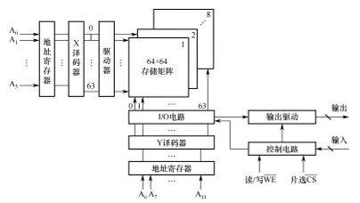
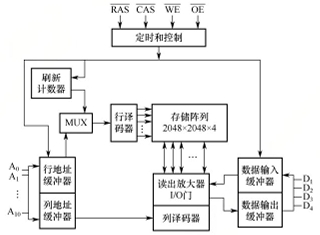

# 存储系统

计算机希望存储器同时具备 **速度快、容量大、成本低** 三个特点，但单一存储介质很难兼顾这三者。因此，我们需要把不同特性的存储器组织起来，让常用的信息靠近 CPU，让大量暂时用不到的信息存放在容量更大的低速部件中。

## 存储器概述

### 存储器的分类

同一个存储器可以从不同角度分类。

#### 按存储元件分类

| 类型 | 表示信息的物理状态 | 典型器件 |
| --- | --- | --- |
| 半导体存储器 | 电荷、电压等电学状态 | SRAM、DRAM、Flash |
| 磁表面存储器 | 磁性材料的磁化状态 | 磁盘、磁带 |
| 光存储器 | 光介质的反射率、相变状态等 | 光盘 |

#### 按存取方式分类

| 类型 | 存取特点 | 典型应用 |
| --- | --- | --- |
| 随机存取 | 按地址访问任意单元，存取时间基本不随位置改变 | 半导体主存、Cache |
| 顺序存取 | 必须沿一定顺序寻找信息，耗时与信息所在位置有关 | 磁带 |
| 直接存取 | 先定位到目标区域，再在区域内寻找和读写信息 | 机械磁盘 |
| 相联存取 | 按内容或内容特征查找，而非直接给出存储地址 | [TLB](#快表tlb) 等高速查找部件 |

!!! tip "随机存取中的“随机”表示能直接访问任意地址，而不是随机选一个位置。"
    机械磁盘虽然能定位到指定扇区，但寻道和旋转等待时间随位置变化，因此在这组分类中属于直接存取存储器。

#### 按信息的可更改性分类

- **可读可写存储器**：正常工作时允许读取和改写信息，如 RAM。
- **只读存储器**（Read-Only Memory，ROM）：正常工作时主要用于读取固定信息。部分类型允许在特定条件下重新编程，见[非易失性存储器](#非易失性存储器)。

RAM 和 ROM 都可以采用随机存取方式。所以，“随机存取”和“只读”并不是互相排斥的属性。

#### 按信息的可保存性分类

- **易失性存储器**：断电后信息丢失，如 SRAM、DRAM。
- **非易失性存储器**：断电后仍可保存信息，如 ROM、Flash、磁盘和光盘。

!!! info "此外，还可以考察读操作是否改变原有信息。"
    **破坏性读出** 会改变存储元的状态，读出后必须立即再生；**非破坏性读出** 不需要这种恢复操作。它与是否易失是两个不同的问题，具体比较见 [SRAM 与 DRAM](#sram-与-dram)。

### 主存储器的组成和基本操作

**主存储器**（Main Memory）由存储体、地址译码电路、读写电路及控制电路等组成。在存储器的语境中有几个相似的概念：

- **存储元**，也称记忆单元：保存一个二进制位的基本器件。
- **存储单元**：具有同一个地址的一组存储元。按字节编址时，一个单元包含 8 个存储元。
- **存储体**，也称存储矩阵或存储阵列：大量存储单元的集合。

CPU 访问主存时，需要给出 **地址、数据和读写控制信号**。在基本组成模型中，**存储器地址寄存器**（MAR）保存目标地址，**存储器数据寄存器**（MDR）暂存要写入或刚读出的数据。

读操作的过程可以概括为：CPU 将目标地址送入 MAR，经地址线送到主存；地址译码器选中对应位置，控制电路执行读操作；读出的数据经数据线送入 MDR，再交给 CPU。

写操作则是在给出地址的同时，将待写数据送入 MDR；主存在写控制信号作用下，把数据线上的内容写入选中的位置。

#### 编址单位与寻址范围

在上述基本模型中，**MAR 位数等于地址线位数，MDR 位数等于数据线宽度**。设地址为 $n$ 位，则最多能区分 $2^n$ 个地址。地址线的位数据决定了主存的最大可寻址容量；而最终的最大可寻址容量还取决于每个地址对应多大一个单元：

$$
\text{最大可寻址容量}=2^n\times\text{编址单位大小}.
$$

例如，36 位地址、按字节编址时，可寻址 $2^{36}\mathrm{B}=64\mathrm{GB}$，寻址范围是 $0 \sim 2^{36}-1$；若数据线宽度为 64 位，则一次可传送（并行存取）$64/8=8$ 字节。

!!! warning "地址宽度和数据宽度决定不同的事情"
    计算地址范围时，先确认按字还是按字节编址。芯片通过引脚接收地址的方式还可能采用[分时复用](#dram-芯片的关键技术)，不能直接把物理地址引脚数当作完整地址的位数。

### 存储器的层次化结构

为了缓解存储系统在容量、速度和成本之间的矛盾，现代计算机普遍采用多级存储器结构。从靠近 CPU 到远离 CPU，典型的层次是：

$$
\text{CPU}\longrightarrow\text{寄存器}\longrightarrow\text{Cache}\longrightarrow\text{主存}\longrightarrow\text{辅存}.
$$

以 CPU 作为顶层，越靠近 CPU 的上层，通常容量越小、速度越快、每位成本越高；越远离 CPU 的下层，则容量更大、速度更慢、每位成本更低。

其中，Cache——主存、主存——辅存是两组主要层次，它们各自承担不同任务：

| 层次 | 主要解决的问题 | 信息调度 | 透明性 |
| --- | --- | --- | --- |
| Cache—主存 | CPU 与主存的速度差异 | 硬件自动完成 | 对程序员透明 |
| 主存—辅存 | 程序需要的存储空间超过物理主存 | 硬件与操作系统协同完成 | 对应用程序员透明 |

CPU 可以直接访问 Cache 和主存；辅存中的程序和数据需要先调入主存。主存因此是连接 CPU、Cache 与辅存的枢纽。

上层通常保存下层中当前活跃信息的副本（上层作为下层的高速缓存），使系统在大多数访问命中上层时，平均速度接近上层，而容量和单位成本接近下层。实现这一效果需要[局部性原理](#程序访问的局部性原理)；主存—辅存层的地址管理进一步形成了[虚拟存储器](#虚拟存储器的基本概念)。

!!! tip "副本不要求各层的数据时刻完全相同"
    某个主存块被 Cache 缓存后，CPU 的修改可能先停留在 Cache 中，再按[写策略](#cache-的一致性问题)更新主存。层次关系描述的是信息的来源和缓存关系。

### 存储器的主要性能指标

#### 存储容量

容量可以写成“单元数 $\times$ 每单元位数”。例如，$8\mathrm{K}\times8$ 位表示 $2^{13}$ 个 8 位单元，总容量为 $8\mathrm{KB}$。

!!! info "常用指代"
    $\mathrm{K}=2^{10}$、$\mathrm{M}=2^{20}=2^{10}\mathrm{K}$、$\mathrm{G}=2^{30}=2^{10}\mathrm{M}$、$\mathrm{T}=2^{40}=2^{10}\mathrm{G}$、$\mathrm{P}=2^{50}=2^{10}\mathrm{G}$、$\mathrm{Z}=2^{60}=2^{10}\mathrm{T}$。

#### 存取时间与存储周期

**存取时间** $T_a$ 指完成一次读或写操作所需的时间：对于读操作，指从有效地址送达，到数据有效输出；对于写操作，指从有效地址送达，到数据写入指定位置。

**存储周期** $T_m$ 指同一存储器连续启动两次独立读写操作所需的 **最短间隔**。一次操作结束后，存储器可能还需要恢复内部状态，因此通常有

$$
T_m\ge T_a.
$$

读出后必须再生的存储器，恢复时间尤其不能忽略。在计算时，应仔细区分“多久能完成一次访问”和“多久能再次启动同一模块”。

#### 存储器带宽

**带宽** 是单位时间内能够传输的最大数据量。若单个存储模块每个存储周期传送 $w$ 位，则理想带宽为

$$
BW=\frac{w}{T_m}\,\text{bit/s}.
$$

例如，存储周期为 $50\mathrm{ns}$，每周期传送 64 位，则带宽为 $1.28\mathrm{Gb/s}=160\mathrm{MB/s}$。注意小写 b 表示位、大写 B 表示字节，换算时相差 8 倍。

单模块的存储周期限制其启动频率；采用[多模块存储器](#多模块存储器)后，可以通过并行工作提高总带宽。

## 主存储器

现代主存储器一般由半导体随机存取存储器（RAM）和只读存储器（ROM）构成。它们**都支持[随机访问](#按存取方式分类)**。

### 半导体随机存取存储器

#### SRAM 与 DRAM

两者均为易失性存储器。

**静态 RAM**（Static RAM，SRAM）用双稳态电路保存信息，以两个稳定状态分别表示二进制 0 和 1；典型存储元由六个晶体管（六晶体管 MOS）构成。只要电源存在，电路就能保持状态；读操作不破坏原有信息（非破坏性读出），也无须周期性刷新。

**动态 RAM**（Dynamic RAM，DRAM）用栅极电容上的电荷保存信息，有电荷表示 1，无电荷表示 0；典型存储元由一个晶体管和一个电容构成。电容会漏电导致电荷逐渐丢失，因此即使没有访问，也要定期刷新；读操作会改变原有电荷（破坏性读出），还需要立即再生。

| 比较项 | SRAM | DRAM |
| --- | --- | --- |
| 存取速度 | 较快 | 较慢 |
| 集成度 | 较低 | 较高 |
| 每位成本 | 较高 | 较低 |
| 主要用途 | Cache | 大容量主存 |

#### 存储芯片的组成

芯片在[主存基本组成](#主存储器的组成和基本操作)（存储体）的基础上，通过地址引脚（对应地址译码器）、数据引脚（对应 I/O 读写电路）和控制引脚（对应控制电路）与外部连接。

-   控制电路部分具有两种信号控制线：**片选信号** 决定芯片是否参与当前访问；**读写控制信号** 决定执行什么操作。
-   I/O 电路负责读写，有信号放大的作用。
-   地址译码有两种常见组织：
    - **单译码**：将 $n$ 位地址直接译成 $2^n$ 条选择线。结构直观，但规模较大时输出线很多。
    - **双译码**：将地址分成行、列两部分，分别译码，用行列交叉位置确定目标单元。若行、列地址各占 $n/2$ 位，两个译码器的选择线总数约为 $2\times2^{n/2}$，远少于 $2^n$。

一个单元若包含多位，可把阵列理解为多个 **位平面**：同一行列位置在各位平面上的位同时被访问，共同构成该单元的数据。

<figure markdown="1">

<figurecaption>存储芯片的结构（王道）</figurecaption>
</figure>

#### DRAM 芯片的关键技术

???+ note "地址引脚复用"
    DRAM 通常让行地址和列地址共用同一组引脚，以分时复用的方式，**先送行地址，再送列地址**，分别由行地址选通信号 $\overline{RAS}$ 和列地址选通信号 $\overline{CAS}$ 锁存。

    设芯片组织为 $2^n\times w$ 位，阵列有 $R$ 行、$C$ 列，阵列地址位数为 $n$，则

    $$
    RC=2^n,\qquad n_r=\log_2R,\qquad n_c=\log_2C,\qquad n=n_r+n_c.
    $$

    采用行列地址复用时，需要的物理地址引脚数为

    $$
    n_{\mathrm{pin}}=\max(n_r,n_c).
    $$

    <figure markdown="1">
    
    <figurecaption>一个 4M$\times$4 位DRAM芯片的逻辑结构图</figurecaption>
    </figure>

    在上图中，$4\mathrm{M}\times4$ 位 DRAM 需要 22 位完整地址；采用 $2048\times2048$ 的阵列时，行列各需 11 位，因此只需 11 个地址引脚；另有 4 个数据引脚，因此每个芯片可以同时读写 4 位数据。

    ??? info "阵列设计优化"
        为了减少地址引脚，应让行列数尽可能接近；又因为[刷新按行进行](#dram-芯片的关键技术)，行数越少，刷新开销越低，在此基础上通常取行数不大于列数。所以，通常将阵列设计为行数略小于或等于列数的近似正方形结构。

    !!! warning "这里只是对引脚的复用。地址线不宜复用，因此地址线宽度等于地址位数。"

???+ note "刷新与再生机制"
    前面已经提到 DRAM 采取破坏性读出，因此读后需要立即 **再生** 用于恢复一次破坏性读出后的信息：若读出为 0，则将电容充分放电；若读出为 1，则重新充电。
    
    我们前面还提到，DRAM 需要定期 **刷新** 用于防止电荷随时间流失，或者说维持所存信息。DRAM 刷新通常以 **整行为单位**，一行的各列、各位平面一起恢复；所以刷新时只需要向芯片提供行地址和 $\overline{RAS}$ 信号即可对选中的某一行的所有单元执行读操作。可以看出，刷新实际上是利用了读后再生的行为。

    所以，若阵列有 $R$ 行，完成全芯片刷新只需要 $R$ 次行刷新。对于一个 $2048\times2048\times4$ 位的阵列需要 2048 次行刷新，而不是对每个位平面分别执行 2048 次。芯片内部集成了一个 **刷新计数器**，自动产生所需的行地址。刷新计数器需要 $\lceil\log_2R\rceil$ 位，即和行地址的位数相同。

    此外，我们定义 **刷新周期** 指<u>同一行</u>两次刷新之间允许的时间间隔，这与前面定义的[存储周期](#存取时间与存储周期)不同。所以，若要求在 $T_r$ 内刷新全部 $R$ 行，均匀安排时应平均每隔不超过 $T_r/R$ 启动一次行刷新。需要注意，刷新占用的时间会影响正常访问。

???+ note "行缓冲"
    DRAM 芯片内部设有 **行缓冲器**，通常由 SRAM 实现。激活某行后，该行的数据进入行缓冲器，相当于缓存被选中行的所有列的数据；后续列访问可从已激活的行中选出所需数据。
    
    若一行有 $C$ 个（就是 $C$ 列）$w$ 位单元，则行缓冲器容量为

    $$
    C\times w\,\text{bit}.
    $$

    即容量就是该 DRAM 芯片一行中所有存储单元的数据总量。

    !!! info "突发传输"
        这一缓存设计为 **突发传输**（burst transfer）提供了支持，即只需先提供起始地址，随后连续传输相邻单元（可在每个时钟周期连续输出一个存储单元的数据），减少反复寻址的开销，显著提升带宽。

!!! info "同步 DRAM"
    目前更广泛使用的是**同步 DRAM**（SDRAM）。与传统的异步 DRAM 不同，SDRAM 的命令和数据传输受系统时钟协调，将 CPU 发出的地址和控制信号锁存，在规定的若干时钟周期后返回数据。这使得 SDRAM 能够以 CPU-主存总线的较高速率运行；可以实现突发传输，显著减少甚至避免插入等待状态。
    
    **DDR SDRAM** 在时钟上升沿和下降沿都传送数据；同样的外部时钟频率和总线宽度下，理论数据传输率是单沿传输的两倍。

### 非易失性存储器

#### ROM 与闪存

ROM 属于非易失性存储器。ROM 适合保存需要长期保留、正常运行时较少修改的信息，其位密度高于 SRAM 等可读写存储器。不同类型的主要区别是 **能否编程、怎样擦除以及能否再次编程**：

| 类型 | 编程与擦除特点 |
| --- | --- |
| 掩模式 ROM（MROM） | 制造时固化内容，用户不能修改 |
| 可编程 ROM（PROM） | 用户可进行一次性编程 |
| 可擦除可编程 ROM（EPROM） | 可通过紫外线整片擦除，再重新编程；但擦写次数有限、速度较慢 |
| 电可擦除可编程 ROM（EEPROM） | 可用电信号擦除和重写 |

!!! info "有关 Flash..."
    Flash（闪存）是一种在 EPROM 基础上发展而来的非易失性存储器。它兼具断电保存、支持电擦除和可在线重写的特点，常用于保存 BIOS 等启动固件或构建大容量非易失性设备。现代主板普遍采用 Flash 存储器来存储 BIOS，用户可通过厂商提供的工具直接在系统中擦除重写（早期的 BIOS 是固化在 MROM 或 EPROM 中的）。
    
    它的 **读写性能不对称**：读取较快（接近 RAM），写入和擦除较慢，而且擦写次数有限。因此，支持改写不等于能满足 DRAM 主存所需的访问性能。

#### 固态硬盘

**固态硬盘**（Solid State Drive，SSD）是在闪存芯片阵列之外加入控制单元构成的存储设备。它继承了 Flash 非易失、无机械部件、读取速度快的重要特性。因而它具有功耗低、抗震性能强等优势；但同时其写入寿命受限于闪存的擦写次数。

### 多模块存储器

多模块存储器把主存组织成多个可独立工作的存储模块，利用空间并行提高吞吐率。根据地址如何分配到各模块，多模块存储器可以分为下面两类。

#### 连续编址

设有 $m$ 个模块，每个模块有 $k$ 个单元。连续编址时，地址高位表示体号，低位表示体内地址：

$$
\text{体号}=\left\lfloor\frac{A}{k}\right\rfloor,\qquad
\text{体内地址}=A\bmod k.
$$

第 0 体保存地址 $0\sim k-1$，第 1 体保存 $k\sim2k-1$，依此类推。

顺序访问一段连续地址时，往往一直使用同一个体，因此难以让多个体同时发挥作用。

这里仍是按地址进行的随机存取；连续编址只是模块之间的地址分配方式，与[磁带式的顺序存取](#按存取方式分类)不是同一个概念。

#### 交叉编址（低位交叉）

低位交叉编址把连续地址轮流分配给不同模块，此时低位被用作体号：

$$
\text{体号}=A\bmod m,\qquad
\text{体内地址}=\left\lfloor\frac{A}{m}\right\rfloor.
$$

当 $m=2^q$ 时，地址低 $q$ 位就是体号，其余高位是体内地址。以四体为例：

| 存储体 | 保存的地址 |
| --- | --- |
| $M_0$ | $0,4,8,12,\ldots$ |
| $M_1$ | $1,5,9,13,\ldots$ |
| $M_2$ | $2,6,10,14,\ldots$ |
| $M_3$ | $3,7,11,15,\ldots$ |

连续地址落在不同存储体中，因而可以显著提高存储器的吞吐率。采用交叉编址的多模块存储器也被称为交叉存储器。

交叉存储器可以采用轮流启动或同时启动两种方式。

???+ note "轮流启动"
    设单个模块（体）的存储周期为 $T$，总线每隔 $\tau$ 可以启动并承接一个字的传输。若每个模块一次模块访问的数据可以用一次总线传输完成，要让 $m$ 个模块（体）轮流启动而不间断，同一模块再次被访问时必须已恢复，即需要满足

    $$
    m\tau\ge T,\qquad m\ge\left\lceil\frac{T}{\tau}\right\rceil.
    $$

    在首字访问时间按 $T$ 计、连续地址分散到各模块且无冲突（换句话说，按每隔 $\dfrac 1m$ 个存取周期轮流启动各模块，即每隔 $\dfrac 1m$ 即可读或写一个数据；此时存取速度提高至 $m$ 倍）的模型中，连续读取 $n$ 个字的时间为

    $$
    t_{\mathrm{交叉}}=T+(n-1)\tau.
    $$

    作为对比，若逐次使用同一模块，则相应时间为 $t_{\mathrm{串行}}=nT$。
    
    由前面的关系式，在稳定传输阶段，每隔 $\tau$ 得到一个字，字长为 $w$ 位时，采用轮流启动的交叉存储器带宽可趋近 $w/\tau$ bit/s。

    !!! danger "访存冲突"
        若请求再次落到尚未恢复的存储体，就发生了 **访存冲突**，必须等待。
        
        分析一串请求时，要把前面冲突造成的延迟计入后续启动时刻。

???+ note "同时启动"
    若多个模块一次并行读/写的总位数不小于一个数据总线的宽度时，也可以采用同时启动方式。例如，8 个 $16\,\mathrm{M}\times8$ 位芯片共同提供 64 位数据，总容量为 $128\,\mathrm{MB}$。单个芯片每次传输 8 位，8 个芯片同步工作，就可以一次性提供 64 位数据。

    !!! tip "地址对齐"
        如果将本例放进实际实现的语境下，8 个芯片实际上是通过[位扩展](#位扩展)来共同提供 64 位数据，并共用同一组[片内地址线](#存储芯片的组成)。一次基本访问向各芯片提供相同的片内地址 $k$，每个芯片提供一个字节，合起来对应系统中的字节地址 $8k\sim8k+7$。

        需要注意的是，并行访问以连续 8 字节为单位进行，即每次读取的数据只能来自地址对齐的块。这里的 **访问块** 指起始地址为 8 的倍数、长度为 8 字节的地址区间 $8k\sim8k+7$，而不是某个存储模块内部的地址；相邻两个访问块对应同一组芯片中的两个相邻片内地址。

        一个 4 字节数据若从地址 6 开始，占用地址 $6\sim9$：地址 6、7 属于块 $0\sim7$，对应片内地址 0；地址 8、9 属于块 $8\sim15$，对应片内地址 1。由于各芯片共用片内地址线，一次基本访问只能提供一个共同的片内地址，因此需要两次基本访问，再提取并拼接所需字节。这也正是内存访问要求数据对齐的根本原因。

## 主存储器与 CPU 的连接

### 连接原理

CPU 与主存通过地址、数据和控制总线连接，其基本传送过程见[主存储器的组成和基本操作](#主存储器的组成和基本操作)。在连接多个芯片时，还要处理以下问题：

- **地址定位**：系统地址中的一部分选择芯片或芯片组，另一部分选择片内单元。
- **数据连接**：芯片的数据端口应与总线对应的数据位相接；共享同一组数据线的芯片要避免同时驱动总线。
- **控制连接**：读写控制和片选信号的作用、有效电平应匹配。信号上方的横线通常表示低电平有效。

未被选中的芯片通常通过三态输出使数据端口处于高阻态，允许多个芯片共享数据线。DRAM 的选择还可能结合行列选通信号完成，应以给定芯片接口为准。

一次传输位数与每秒传输次数共同决定理论总线带宽：

$$
BW_{\mathrm{总线}}=\text{总线位宽}\times\text{每秒数据传输次数}.
$$

### 主存容量的扩展

设现有芯片为 $N\times w$ 位，要构成 $M\times W$ 位的存储器。在 $M/N$ 和 $W/w$ 均为整数时，分别需要

$$
\text{每组芯片数}=\frac{W}{w},\qquad
\text{组数}=\frac{M}{N},\qquad
\text{总芯片数}=\frac{M}{N}\frac{W}{w}.
$$

“每组”内的芯片同时工作，提供一个完整数据字；不同组之间通过片选进行选择。

#### 位扩展

位扩展 **增加每个单元的位数，单元数不变**。各芯片的地址线、读写控制线和片选线相连，数据线分别接到总线的不同位段。

例如，用 8 片 $8\mathrm{K}\times1$ 位芯片构成 $8\mathrm{K}\times8$ 位存储器。8 片接收同一个 13 位片内地址，每片提供一位，合起来形成 8 位数据；扩展前后都是 $8\mathrm{K}$ 个单元。

#### 字扩展

字扩展 **增加存储单元数，每个单元的位数不变**。系统地址的低位接各芯片的片内地址引脚，高位经译码产生不同片选信号；各芯片的数据线和读写控制线共用，同一时刻只选中一个芯片。

例如，用 4 片 $16\mathrm{K}\times8$ 位芯片构成 $64\mathrm{K}\times8$ 位存储器。系统地址为 16 位，其中 $A_{13}\sim A_0$ 接片内地址，$A_{15}A_{14}$ 经 2—4 译码器选择芯片：

| $A_{15}A_{14}$ | 芯片 | 地址范围 |
| :---: | :---: | --- |
| 00 | 第 0 片 | `0000H`～`3FFFH` |
| 01 | 第 1 片 | `4000H`～`7FFFH` |
| 10 | 第 2 片 | `8000H`～`BFFFH` |
| 11 | 第 3 片 | `C000H`～`FFFFH` |

#### 字位同时扩展

先把若干芯片按位扩展组成一组，再把多组按字扩展连接。

例如，用 $16\mathrm{K}\times4$ 位芯片构成 $64\mathrm{K}\times8$ 位存储器：每组需要 $8/4=2$ 片，共需 $64\mathrm{K}/16\mathrm{K}=4$ 组，总共 8 片。高 2 位地址选择一组，被选中组内的两片同时工作，分别提供高、低 4 位数据。

#### 地址分配

给定起始地址 $A_0$、连续分配 $L$ 个编址单元时，末地址为

$$
A_{\mathrm{end}}=A_0+L-1.
$$

若已给定首末地址，则单元数为 $A_{\mathrm{end}}-A_0+1$；还需乘以编址单位的大小，才能得到容量。不要漏掉末尾的 $+1$。

!!! note "位扩展不会自动增加字内字节地址"

    按字编址时，一组芯片共同形成的一个字只占一个地址。若系统改为按字节编址，还要考虑字内字节的选择与相应的读写使能，不能原样套用按字编址的接线。

## 外部存储器

### 磁盘存储器

机械磁盘利用磁性介质记录信息，具有容量大、每位成本低、断电后保留数据、可重复改写和非破坏性读出的特点。它需要机械运动，因此访问延迟明显大于半导体存储器。

#### 组成与存储区域

磁盘系统主要包括 **盘片、驱动器和控制器**。驱动器负责旋转盘片、移动磁头和读写；控制器接收主机命令，组织设备操作并返回状态。

- **记录面**：用于记录数据的盘面，通常一个记录面对应一个磁头。
- **磁道**：记录面上的同心圆。
- **柱面**：各记录面上相同半径、相同编号的磁道集合。柱面数等于一个记录面的磁道数。
- **扇区**：一条磁道划分出的存储区段，是磁盘介质读写的基本单位。

磁道和扇区之间需要间隙及格式信息。磁记录电路按编码规则，把二进制数据转换为介质上的磁化状态变化，并在读出时恢复数据。

**磁盘高速缓存** 用主存空间暂存近期读取或准备写出的磁盘数据，可以复用中间结果、合并小块访问。它缓存的是磁盘数据，与后面的 [CPU Cache](#高速缓冲存储器)处于不同层次。

#### 记录密度与容量

**道密度** 表示沿半径方向单位长度上的磁道数；**位密度** 表示一条磁道单位长度上的位数；**面密度** 为二者的乘积。

若各磁道记录相同数量的位，内圈磁道周长较短，位密度就更高；这种组织下，每道记录量受最内圈能够达到的记录密度限制。

在各磁道扇区数相同的计算模型中，设记录面数为 $H$、柱面数为 $C$、每道扇区数为 $S$、每扇区数据字节数为 $B_s$，则

$$
\text{格式化容量}=HCSB_s.
$$

**非格式化容量** 按磁记录表面的全部可用磁化单元计算；**格式化容量** 扣除了间隙、同步及其他格式信息占用的空间，因而更小。

#### 存取时间与传输速率

一次磁盘访问包含三个主要物理过程：移动磁头到目标磁道、等待目标扇区转到磁头下方、传输数据。因此

$$
T_{\mathrm{访问}}=T_{\mathrm{寻道}}+T_{\mathrm{旋转等待}}+T_{\mathrm{传输}}.
$$

若计算完整 **响应时间**，还要加入请求排队和控制器处理时间。

设转速为 $r$ 转/秒，则一周耗时 $1/r$，平均旋转等待取半周：

$$
\overline{T}_{\mathrm{旋转等待}}=\frac{1}{2r}.
$$

若给出的转速为 $v$ 转/分（rpm），则应先换算 $r=v/60$，平均旋转等待为 $30/v$ 秒。平均寻道时间应优先使用给定值；只有采用题设的简化估算时，才取最大寻道时间的一半。

设一条磁道的数据容量为 $N$ 字节，则理想传输速率为 $D=rN$ B/s，传输 $b$ 字节需要

$$
T_{\mathrm{传输}}=\frac{b}{rN}.
$$

若每道有 $S$ 个等长扇区，传输一个完整扇区耗时 $1/(rS)$。例如，7200 rpm 对应 120 转/秒，平均旋转等待约为 $4.17\mathrm{ms}$，再另加寻道和数据传输时间。

#### 磁盘地址与操作

柱面—磁头—扇区（CHS）地址由 **柱面号、盘面号、扇区号** 构成。字段位数分别取对应数量的二进制编码宽度，例如 256 个柱面、16 个记录面、每道 16 个扇区需要 $8+4+4=16$ 位。

控制器根据命令和地址完成寻址、读盘或写盘。单个磁头的数据读写依次进行，不能因为主机总线较宽就认为整个扇区的位同时从盘面读出。

#### 磁盘阵列 RAID

**RAID** 把多个物理磁盘组合成一个逻辑存储设备。条带化把数据分散到不同磁盘以支持并行访问；镜像或校验则提供冗余，提高容错能力。

| 级别 | 主要组织方式 | 特点 |
| --- | --- | --- |
| RAID 0 | 数据条带化，无冗余 | 提高并行访问能力，不能恢复故障盘上的数据 |
| RAID 1 | 镜像 | 两份相同数据；双盘镜像的有效容量为两盘总容量的一半 |
| RAID 2 | 海明码纠错 | 通过纠错编码增加冗余 |
| RAID 3 | 位交叉组织，独立奇偶校验盘 | 数据与校验分开存放 |
| RAID 4 | 块交叉组织，独立奇偶校验盘 | 以块为单位分散数据 |
| RAID 5 | 块交叉组织，分布式奇偶校验 | 校验块分散到各盘，避免全部集中于一个校验盘 |

镜像和校验需要额外空间，也需要在写入时维护冗余信息。

### 固态硬盘

#### 组织与访问单位

SSD 的介质基础见[非易失性存储器](#非易失性存储器)。在设备内部，**闪存翻译层**（Flash Translation Layer，FTL）把主机给出的逻辑块地址转换为闪存上的物理位置，并管理底层读写。

闪存芯片由多个块组成，每个块包含多个页。这里的“页”是闪存的读写组织单位，与[虚拟存储器的页面](#页式虚拟存储器)属于不同概念。

| 操作 | 基本单位 | 特点 |
| --- | --- | --- |
| 读取 | 页 | 可读取指定页的数据 |
| 编程（写入） | 页 | 向已擦除的可用位置写入数据 |
| 擦除 | 块 | 一次擦除整块，块内各页一起恢复为可编程状态 |

更新已有数据不能像 RAM 那样直接反复覆盖。控制器需要把新数据写入可用位置，并在回收旧块时保存其中仍有效的数据。这带来额外的数据搬移和擦除开销，因此随机写入通常比读取复杂。

SSD 没有机械磁头和旋转盘片，因此没有寻道与旋转等待，随机访问延迟较低，也具有抗震、低噪声等特点；其代价是每位成本较高，且闪存块的擦写寿命有限。具体寿命取决于器件和使用方式，不能把某一个擦写次数当作所有 SSD 的固定值。

#### 磨损均衡

**磨损均衡**（wear leveling）通过调整逻辑地址与物理位置的对应关系，避免少数物理块承受过多擦写。

- **动态磨损均衡**：写入时选择擦写次数较少的空闲块，分散新写入带来的磨损。
- **静态磨损均衡**：控制器还会主动扫描和迁移已存储的数据，调整物理块的使用，进一步均衡各块的擦写次数。

若理想地假定所有块均匀使用、不计额外搬移等开销，则介质的总可写入量约为“容量 $\times$ 每块允许擦写次数”。这只是理解均衡作用的简化估算。

## 高速缓冲存储器

高速缓冲存储器（Cache）通常集成在处理器内部，采用[SRAM](#sram-与-dram)构成。

### 程序访问的局部性原理

**局部性** 表示程序在一段时间内往往集中访问一小部分地址，而不是均匀访问整个存储空间。它包括两个方面：

- **时间局部性**：刚访问过的指令或数据，很可能很快再次访问。例如循环体指令、反复使用的变量。
- **空间局部性**：刚访问的位置附近，很可能很快也会被访问。例如顺序执行的指令、连续遍历的数组元素。

对于按行优先存放的二维数组，内层循环按列下标递增，即先遍历一行中的相邻元素，通常具有较好的空间局部性；若内层循环不断换行，则相邻两次访问相距一整行，空间局部性往往较差。

但若两种遍历都只访问每个元素一次，**数组元素本身的时间局部性都较差**。同时，循环体指令会被反复执行，且通常连续存放，具有时间和空间局部性。分析时应明确讨论的是指令、数组元素，还是反复累加的变量。

Cache 利用时间局部性保留近期活跃的数据，利用空间局部性一次装入包含相邻地址的整个块。

### Cache 的基本工作原理

主存和 Cache 被划分成 **大小相同的块**，Cache 中的块也称 **Cache 行**。CPU 可以访问字节或字，但 Cache 与主存之间调入信息通常以块为单位。

#### 读访问与命中

CPU 给出地址后，Cache 控制器判断该地址所在的主存块是否已被缓存：

1. **命中**：在 Cache 中取得目标数据，交给 CPU。
2. **缺失**，也称未命中：从主存调入目标块，选择相应 Cache 行，设置标记和有效位，再向 CPU 提供数据。

某个块能放到哪里，由[映射方式](#cache-和主存的映射方式)决定；候选位置已满时如何选择旧块，见[替换算法](#cache-中主存块的替换算法)；被替换块是否需要写回，见[一致性问题](#cache-的一致性问题)。这些工作由硬件自动完成。

#### 命中率与平均访问时间

设命中次数为 $N_h$、缺失次数为 $N_m$，则

$$
H=\frac{N_h}{N_h+N_m},\qquad \text{缺失率}=1-H.
$$

这里的缺失次数按 **CPU 对 Cache 的访问结果** 统计，不是把主存传输一个块所需的所有总线操作分别计为一次缺失。

采用“先查 Cache，缺失后再访问下层”的模型，设 Cache 命中时间为 $T_c$，缺失后的 **额外开销** 为 $P$，则平均访问时间（AMAT）为

$$
T_{\mathrm{avg}}=HT_c+(1-H)(T_c+P)=T_c+(1-H)P.
$$

若给出的是一次缺失的 **总耗时** $T_{\mathrm{miss}}$，则直接使用 $HT_c+(1-H)T_{\mathrm{miss}}$。不要把已包含的 Cache 查询时间重复加一遍。

例如，命中时间为 $2\mathrm{ns}$，缺失率为 $5\%$，额外缺失开销为 $10\mathrm{ns}$，则平均访问时间为 $2+0.05\times10=2.5\mathrm{ns}$。

!!! question "Cache 行越大，命中率一定越高吗？"
    不一定。较大的行能一次带入更多相邻数据，更好利用空间局部性；但在数据区容量固定时，行数 $L=C/B$ 会减少，可同时保留的独立块变少，而且一次缺失传输的数据量更大。块长要在空间局部性、[冲突与容量缺失](#三类缺失)、[缺失开销](#命中率与平均访问时间)之间权衡。

#### 三类缺失

分析缺失原因时，可使用 **3C 模型**：

| 类型 | 原因 |
| --- | --- |
| 强制缺失（compulsory miss） | 第一次使用某块，尚未装入 Cache，也称冷启动缺失 |
| 容量缺失（capacity miss） | Cache 容量不足，即使允许放入任意位置，也保不住需要复用的全部块 |
| 冲突缺失（conflict miss） | 不同块竞争同一行或同一组，受[映射位置](#cache-和主存的映射方式)限制而发生替换 |

全相联消除了由固定放置位置产生的冲突，但仍有强制缺失和容量缺失。

### Cache 和主存的映射方式

#### 地址字段与共同约定

以下设系统按字节编址，主存地址为 $a$ 位，Cache **数据区** 容量为 $C$ 字节，块长为 $B=2^b$ 字节，Cache 行数为 $L=C/B$。对地址 $A$，有

$$
\text{主存块号}=\left\lfloor\frac{A}{B}\right\rfloor,\qquad
\text{块内偏移}=A\bmod B.
$$

地址低 $b$ 位为块内偏移，其余位标识主存块。每行还需保存 **标记**（tag）和 **有效位**（valid bit）：只有有效位为 1 且标记匹配，才算命中。系统初始化时，Cache 行可以有任意残留位串，但有效位均为 0。

!!! note "地址字段和 Cache 行中实际保存的字段不同"
    地址中的索引用来选行或选组，块内偏移用来选数据。它们通常不作为标签信息逐行存储；实际存储空间中还包括有效位、脏位和替换控制信息，见[容量计算](#cache-容量的计算举例)。

#### 直接映射

每个主存块只能放入一个固定 Cache 行：

$$
\text{行号}=\text{主存块号}\bmod L.
$$

若 $L=2^\ell$，地址分为

$$
\underbrace{\text{标记}}_{a-\ell-b}\;\big|\;
\underbrace{\text{行号}}_{\ell}\;\big|\;
\underbrace{\text{块内偏移}}_b.
$$

先用行号选择一行，再比较该行标记和地址高位。有效且匹配时，按偏移读取数据；否则调入目标块，替换这个固定位置的旧块。

例如，Cache 有 8 行时，主存块 0、8、16 都映射到第 0 行，即使其他行空闲，也不能改放到那里。直接映射结构简单，但冲突较多；替换位置已确定，不需要另行选择被替换行。

#### 全相联映射

每个主存块可以放入 **任意 Cache 行**。地址不需要索引字段：

$$
\underbrace{\text{标记}}_{a-b}\;\big|\;
\underbrace{\text{块内偏移}}_b.
$$

查找时，将完整主存块号与所有有效行的标记比较。若有匹配则命中；否则选择空闲行，或在所有行中选择替换对象。

这种方式放置灵活，但并行比较需要更多比较器，标记更长，硬件和查询开销较大，通常不适合规模很大的 Cache。

#### 组相联映射

将 Cache 分成 $G$ 组，每组有 $r$ 行，称为 **$r$ 路组相联**，满足 $L=Gr$。一个主存块只能进入固定组，但可以放在该组的任意一行：

$$
\text{组号}=\text{主存块号}\bmod G.
$$

若 $G=2^g$，地址分为

$$
\underbrace{\text{标记}}_{a-g-b}\;\big|\;
\underbrace{\text{组号}}_g\;\big|\;
\underbrace{\text{块内偏移}}_b.
$$

先用组号定位，再并行比较组内 $r$ 个候选行的标记；有效且匹配时命中。缺失时，只能在该组内寻找空闲行或替换对象。

#### 三种映射的关系

按前面的查询流程，并行比较标记时，直接映射、$r$ 路组相联、全相联分别需要 1、$r$、$L$ 个比较器；每个比较器的位宽等于相应标记字段的位数。

组相联的 $r=1$ 时退化为直接映射，$G=1$ 时退化为全相联。数据容量和块长固定时，增加路数会减少组数、缩短索引、增加标记位数，通常能减少冲突，但比较与替换逻辑也更复杂。

### Cache 中主存块的替换算法

先按[映射方式](#cache-和主存的映射方式)确定候选范围，有空闲行时先使用空闲行；候选范围已满时，才需要选择替换对象。

| 算法 | 选择规则 | 特点 |
| --- | --- | --- |
| 随机（RAND） | 随机选择一行 | 实现简单，没有主动利用访问历史 |
| 先进先出（FIFO） | 替换最早装入的一行 | 记录装入顺序，命中不改变先后次序 |
| 最近最少使用（LRU） | 替换最近一次访问距今最久的一行 | 利用时间局部性，关注访问的新旧 |
| 最不经常使用（LFU） | 替换统计期内访问次数最少的一行 | 关注访问频率，历史热点可能长期保留 |

#### LRU 的计数器实现

一种适用于计算分析的实现是，为 $r$ 路组中的每行设置 $\lceil\log_2r\rceil$ 位计数器，以 0 表示最近访问，以 $r-1$ 表示最久未访问。计数值反映相对顺序，不是总访问次数：

1. **命中某行**：设其原计数值为 $k$，将它置为 0；其他原计数值小于 $k$ 的行加 1，其余不变。
2. **缺失且存在空闲行**：新行置为 0，其他有效行加 1。
3. **缺失且组已满**：替换计数值为 $r-1$ 的行；新行置为 0，其他行加 1。

例如，四路组中原访问顺序从近到远为 `A B C D`，再访问 `C` 后变为 `C A B D`；此时调入新块 `E`，应替换 `D`，结果为 `E C A B`。

!!! note "LRU 位数取决于具体实现"
    上述是每行保存相对次序的计数器模型：四路组每行 2 位，一个组共 8 位。不能把“每行 2 位”写成“整个四路组只需 2 位”。两路组的先后顺序可由一个组共享位表示；容量计算应采用题目明确给出的控制位组织。

#### 抖动

若同一组只有 4 行，却循环访问映射到该组的 5 个块 `A B C D E A B C D E ...`，采用 LRU 时，每次调入新块都可能淘汰下次即将访问的块，导致持续缺失。这种频繁换入换出称为 **抖动**。

判断抖动要看热点块在每个组中的分布，不能只比较热点数据总量与整个 Cache 的容量。

### Cache 的一致性问题

Cache 保存的是主存块副本。CPU 写数据后，必须安排副本的更新。需要分别回答两个问题：**写命中时是否立即更新下层？写缺失时是否把目标块调入 Cache？**

#### 写命中的处理

| 策略 | 操作 | 特点 |
| --- | --- | --- |
| 全写法／直写法（write through） | 更新 Cache，同时把写入传给主存 | 主存更新及时，写流量较大 |
| 回写法／写回法（write back） | 先只更新 Cache，待脏块被替换时再写回主存 | 合并同一块的多次修改，减少下层写入 |

回写法需要 **脏位**（dirty bit）：装入的新块尚未修改时置 0，CPU 修改后置 1。替换有效脏行前必须先写回旧块；干净行可以直接覆盖。脏位与有效位分别表示“是否改过”和“能否使用”，作用不同。

直写法常加入 **写缓冲**：CPU 把待更新主存的数据交给缓冲，再由缓冲完成较慢的主存写入。缓冲有空位时可减少 CPU 等待，若写入请求持续快于下层处理，缓冲满后仍会造成停顿。

#### 写缺失的处理

- **写分配**（write allocate）：为目标块在 Cache 中分配位置，把块调入，使本次或后续写入可以在 Cache 中进行。
- **非写分配**（no write allocate）：直接把本次写入传给下层，不因这次写缺失而调入目标块。

常见组合是 **回写 + 写分配**、**直写 + 非写分配**。这是常用搭配，命中处理与缺失处理仍是两个需要分别说明的策略维度。

??? note "写分配的操作顺序"

    写分配的核心是“写缺失后把目标块纳入 Cache”。一种描述先更新主存，再调入更新后的块；另一种描述先调入块，再在 Cache 中修改，并按直写或回写策略处理下层更新。计算主存写入次数时，要采用给定的顺序与写策略，不能仅看到“写分配”就认定主存一定立即写入。

### Cache 容量的计算举例

先区分 **数据区容量** 与 **包含标记、状态及替换信息的存储容量**。前面[映射方式](#地址字段与共同约定)中的 $C$ 指数据区容量。

设 Cache 有 $L$ 行，每行数据为 $B$ 字节、标记为 $t$ 位、有效位为 $v$ 位、脏位为 $d$ 位，每行替换控制信息为 $u$ 位，则

$$
C_{\mathrm{total}}=L(8B+t+v+d+u)\quad\text{bit}.
$$

如果替换信息按组集中保存，则应改为“各行数据与状态容量之和 + 各组替换信息容量”，不能又把共享控制位重复算到每一行。

#### 示例：直接映射与两路组相联

设主存地址空间为 $256\mathrm{MB}=2^{28}\mathrm{B}$，按字节编址，Cache 有 8 行，行长为 64 B。忽略脏位和替换控制位，只计每行 1 位有效位。

| 项目 | 直接映射 | 两路组相联 |
| --- | --- | --- |
| 主存地址位数 | 28 | 28 |
| 块内偏移位数 | $\log_2 64=6$ | 6 |
| 行数/组数 | 8 行 | $8/2=4$ 组 |
| 索引位数 | $\log_2 8=3$ | $\log_2 4=2$ |
| 标记位数 | $28-6-3=19$ | $28-6-2=20$ |
| 数据区容量 | $8\times64=512$ B | 512 B |
| 总存储容量 | $8(512+19+1)=4256$ bit | $8(512+20+1)=4264$ bit |

例如，字节地址 3200 的块号为 $3200/64=50$：直接映射时进入第 $50\bmod8=2$ 行；两路组相联时进入第 $50\bmod4=2$ 组，在组内任选一行。若各组按行号连续排列，第 2 组对应第 4、5 行。

再以地址 `0123456H` 为例，直接映射的字段为：

$$
\text{块内偏移}=\texttt{16H}=22,\qquad
\text{行号}=1,\qquad
\text{标记}=\texttt{91AH}.
$$

因此应检查第 1 行的有效位和标记，命中后读取行内偏移 22 对应的数据。**主存块号、Cache 索引和标记是不同字段**，不能把其中一个直接当作另一个。

### Cache 的应用

#### 分离 Cache

**统一 Cache** 同时保存指令和数据；**分离 Cache** 将指令 Cache 与数据 Cache 分开，使取指和数据访问能够同时进行，减少流水线对同一个访问端口的竞争。两部分还可以针对不同访问特点采用不同组织。

#### 多级 Cache

L1 最靠近 CPU，强调短命中时间，通常容量较小；L2、L3 容量更大，访问较慢，用于降低访问主存的频率。

设 L1 命中时间为 $T_1$、缺失率为 $m_1$；L2 查询时间为 $T_2$，在到达 L2 的访问中的缺失率为 $m_2$；L2 缺失后访问主存的额外开销为 $P_m$。在逐级串行查询的模型中，

$$
T_{\mathrm{avg}}=T_1+m_1(T_2+m_2P_m).
$$

其中 $m_2$ 是 **局部缺失率**，分母为 L2 收到的访问数；在上述模型中，真正穿过两级 Cache 到达主存的访问占原始 CPU 访问的比例为 $m_1m_2$。它与 L2 局部缺失率不同。

若各级采用[回写](#cache-的一致性问题)，L1 的脏块通常先写回 L2，L2 的脏块再写回主存，各级的更新和替换都以自己的下层为对象。

??? note "进一步降低缺失开销"
    **关键字优先** 先传送 CPU 当前需要的字，再补全该块；**提前启动** 按正常顺序传块，但所需字一到就允许 CPU 继续。预取则尝试在需求访问前调入数据。这些方法减少等待或隐藏延迟，实际效果取决于后续访问，不能直接视为消除了块传输时间。

## 虚拟存储器

### 虚拟存储器的基本概念

**虚拟存储器** 把程序使用的地址空间与实际主存空间分开，让程序无须整体驻留在物理主存中也能运行。它由硬件与操作系统共同管理，并不表示增加了实际安装的内存容量。

- **虚拟地址**（VA），也称逻辑地址：程序使用的地址。
- **物理地址**（PA），也称实地址：主存中实际位置的地址。

CPU 访问时，需要通过地址转换确定物理位置。所需部分已在主存中时，转换后进行访问；不在主存中时，产生缺页或缺段异常，由操作系统调入相应内容，再继续执行。

主存容量不足时还需要置换。由于辅存延迟很大，页面更新采用类似[回写](#cache-的一致性问题)的策略：先修改主存中的页面，必要时将修改过的页面写回辅存，避免每次 CPU 写入都同步访问磁盘。

### 页式虚拟存储器

#### 页面与页表

虚拟地址空间划分为等大的 **虚拟页**，物理主存划分为同样大小的 **页框**，也称物理页。一个虚拟页可以装入任意可用页框，其对应关系由 **页表** 记录。

页表通常存放在主存，当前进程的页表位置由页表基址寄存器指明。常见页表项信息包括：

| 字段 | 作用 |
| --- | --- |
| 物理页号 | 该虚拟页驻留在主存中的哪个页框 |
| 有效位／装入位 | 本章模型中表示页面是否已装入主存 |
| 脏位／修改位 | 是否被改写，置换时是否需要写回辅存 |
| 引用位／使用位 | 是否被访问过，供页面替换算法使用 |
| 外存位置信息 | 页面不驻留时，用于找到相应的后备存储位置 |

引用位记录使用情况，并不表示该页一定最近刚被访问；具体含义取决于系统如何更新它。

#### 地址转换

设页面大小为 $P=2^p$ 字节、系统按字节编址。虚拟地址和物理地址分别为

$$
\text{VA}=\text{虚拟页号}\;\big|\;\text{页内偏移},\qquad
\text{PA}=\text{物理页号}\;\big|\;\text{页内偏移}.
$$

页内偏移占 $p$ 位，转换前后 **保持不变**；需要替换的是页号。对应的计算为

$$
\mathrm{VPN}=\left\lfloor\frac{\mathrm{VA}}{P}\right\rfloor,\qquad
\mathrm{offset}=\mathrm{VA}\bmod P,\qquad
\mathrm{PA}=\mathrm{PPN}\times P+\mathrm{offset}.
$$

对于单级、连续存放的页表，若每项占 $e$ 字节，则页表项地址为“页表基地址 $+\mathrm{VPN}\times e$”。若虚拟地址宽度为 $a_v$ 位，完整单级页表最多有 $2^{a_v-p}$ 项。

例如，32 位虚拟地址、4 KB 页面时，偏移占 12 位，虚拟页号占 20 位。若页表项为 4 B，完整单级页表占 $2^{20}\times4\mathrm{B}=4\mathrm{MB}$。

再如，页面为 4 KB，虚拟地址为 `00005678H`，则虚拟页号为 5，偏移为 `678H`。若页表记录虚拟页 5 已装入物理页框 3，则物理地址为 `00003678H`，低 12 位不变。

#### 缺页处理

若目标页未装入主存，不能直接用页表项形成有效物理地址，需由操作系统处理缺页：

1. 找到该页在辅存中的位置，并寻找可用页框。
2. 没有空闲页框时，选择换出页；若换出页被修改，先保存其数据。
3. 调入目标页，更新受影响的页表项与地址转换缓存。
4. 重新执行产生缺页的访问。

分页的优点是分配和调入单位固定，便于管理；缺点是最后一页可能无法填满，产生 **内部碎片**，而且页本身不直接表达程序的逻辑模块。

#### 快表（TLB）

若每次都先访问主存中的页表、再访问目标数据，地址转换本身就增加了访存开销。**快表**（Translation Lookaside Buffer，TLB）缓存近期使用的页表项，主存中的完整页表相应称为 **慢表**。

TLB 使用高速存储器，常采用全相联或组相联查找：

- 全相联时，虚拟页号整体用作标记。
- 组相联时，虚拟页号低位选择组，高位用作标记。
- 表项保存对应物理页号及相关控制信息，命中后直接得到地址转换结果。

**TLB 保存的是地址映射，Cache 保存的是指令或数据块**。TLB 命中后仍需要访问目标数据，它不会直接返回该数据。

TLB 缺失时，查询慢表：若页面已驻留，补充 TLB 后继续访问；若页面未驻留，才触发缺页处理。因此，**TLB 缺失不等于缺页**。

#### TLB、页表与 Cache 的联合访问

以下采用 **先转换地址，再用物理地址查询 Cache** 的模型：

$$
\text{虚拟地址}\xrightarrow{\text{TLB 或页表}}\text{物理地址}
\xrightarrow{\text{Cache 查询}}\text{Cache 或主存中的数据}.
$$

得到物理地址后，按 [Cache 映射方式](#cache-和主存的映射方式)拆分标记、索引和块内偏移。页面换出时，相关 TLB 项及 Cache 状态需要正确维护；在这个模型中，TLB 命中意味着目标页已驻留，未驻留页面也不可能命中其原有 Cache 数据。

| TLB | 页面是否驻留 | Cache | 后续工作 |
| --- | --- | --- | --- |
| 命中 | 是 | 命中 | 直接从 Cache 取数据 |
| 命中 | 是 | 缺失 | 从主存调入数据块 |
| 缺失 | 是 | 命中 | 查慢表、补充 TLB，然后从 Cache 取数据 |
| 缺失 | 是 | 缺失 | 查慢表、补充 TLB，再从主存调入数据块 |
| 缺失 | 否 | 缺失 | 缺页处理，调入页面后重新访问 |

在 **单级页表位于主存、页表访问不经 Cache、一次数据块调入计作一次主存访问、不计其他更新和写回开销** 的简化模型中，前四种情况分别需要 0、1、1、2 次主存访问；缺页还需要访问辅存。Cache 缺失由硬件处理，缺页由操作系统处理，TLB 缺失则可由硬件或软件处理。

!!! note "三种缺失发生在不同层次"
    统计时分别检查 [TLB 查询](#快表tlb)、[Cache 查询](#读访问与命中)和[页面驻留情况](#缺页处理)。访问一个新 Cache 块，不一定访问了一个新页，也不一定触发新的地址转换缺失。

### 段式虚拟存储器

**段** 按程序逻辑结构划分，例如代码段、数据段，各段长度可以不同。虚拟地址由 **段号 + 段内偏移** 构成，段表保存段的主存起始地址、长度和驻留状态等信息。

CPU 用段号定位段表项，检查段是否驻留，并检查偏移是否小于段长；合法且驻留时，形成

$$
\mathrm{PA}=\text{段基地址}+\text{段内偏移}.
$$

这里是 **加法**，不能像[分页](#地址转换)那样直接把段号替换后拼接。段内偏移越界与段未驻留也是两种不同情况。

分段与程序的自然逻辑边界一致，便于按模块共享、保护和修改，对程序员有可见的逻辑意义。但可变长度段需要连续空间，分配与回收容易留下 **外部碎片**。分页的固定页划分则通常对应用程序员透明。

### 段页式虚拟存储器

段页式先按逻辑结构分段，再把每段划分为固定大小的页；主存仍按页框分配，调入调出以页为单位。

每个程序有一个段表，每段有自己的页表。虚拟地址由 **段号 + 段内页号 + 页内偏移** 构成：

1. 用段号查段表，取得该段的页表位置及相关界限信息。
2. 用段内页号查该段页表，取得物理页号。
3. 将物理页号与页内偏移拼接，得到物理地址。

它保留按段共享和保护的逻辑组织，又用固定页框分配避免段式连续分配带来的外部碎片；但仍可能有页内碎片。没有 TLB 等加速时，一次目标数据访问前需要访问段表和页表，地址转换开销较大。

### 虚拟存储器与 Cache 的比较

两者都使用[局部性](#程序访问的局部性原理)，把当前活跃信息放在速度较快的层次，并涉及映射、替换与更新。其目标、管理方式和透明性的区别见[层次化结构](#存储器的层次化结构)，这里比较它们的访问行为：

| 项目 | Cache—主存层 | 主存—辅存层 |
| --- | --- | --- |
| 基本交换单位 | [Cache 块](#cache-的基本工作原理) | [页](#页面与页表)或[段](#段式虚拟存储器)，通常大于 Cache 块 |
| 缺失含义 | [目标块不在 Cache](#读访问与命中) | [目标页或段未驻留主存](#虚拟存储器的基本概念) |
| 缺失后读取位置 | 主存 | 辅存，先调入主存 |
| 典型更新策略 | [可采用直写或回写](#写命中的处理) | [页面修改采用回写思想](#虚拟存储器的基本概念) |

缺页通常需要磁盘 I/O，其代价远高于一次 Cache 缺失。两者的详细过程分别见 [Cache 读访问](#读访问与命中)和[缺页处理](#缺页处理)。

## 本章小结

复习时可以沿三个问题串起本章，而不必再重复逐条背诵定义：

1. **为什么分层，谁来管理？** 对照[层次化结构](#存储器的层次化结构)中的两组层次，确认各自的目标与负责调度的部件。
2. **Cache 性能由什么决定？** 从[平均访问时间](#命中率与平均访问时间)入手，分别考虑命中时间、缺失率和缺失开销；数据容量、[映射方式](#cache-和主存的映射方式)、[替换算法](#cache-中主存块的替换算法)、块长以及[多级组织](#多级-cache)都会影响它们。
3. **虚拟页面越大越好吗？** 页较小，完整页表项数更多，难以一次利用较大范围的空间局部性；页较大，页表可缩小，但内部碎片和一次缺页调入的数据量可能增加。应在页表开销、局部性和调入代价之间取舍，相关计算见[页面与地址转换](#地址转换)。

## 常见问题和易混淆知识点

### 取指令时发生 Cache 缺失，如何继续执行？

需要保留或恢复 **发生缺失的那条指令地址**，等待其所在块按[读缺失流程](#读访问与命中)装入 Cache、更新标记和有效位后，重新取指并继续执行。不能直接跳到下一条指令；PC 是否已经递增、如何恢复，应以给定处理器的取指时序为准。
