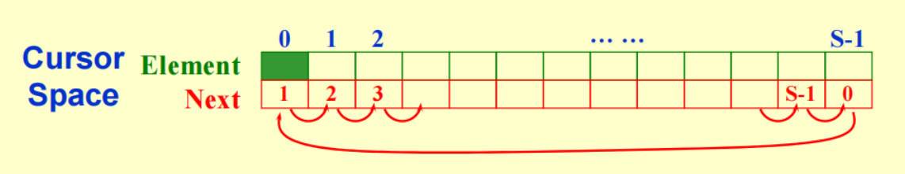

# 线性数据结构

线性数据结构中的元素按先后次序排列。除首尾元素外，每个元素都有唯一的直接前驱和直接后继。线性表、栈、队列和串都具有这样的逻辑关系，但对元素和操作的限制各不相同。

## 抽象数据类型

**抽象数据类型 (Abstract Data Type, ADT)** 描述一组数据及其上的操作，关注的是“可以执行哪些操作、操作应满足什么条件”，而将具体的存储方式和实现过程留给实现层。换句话说，我们只关心它能做什么 (Specification)，而不关心它怎么做 (Implementation)。

因此，讨论一种数据结构时，需要区分 **逻辑结构、存储结构和操作的实现**。例如，“插入元素”是逻辑操作，而“移动数组元素”或“修改链表指针”是实现该操作的具体方式。

## 线性表

**线性表 (List)** 是具有相同数据类型的 $n$ 个数据元素的有限序列，记作 $(a_1, a_2, \dots, a_n)$。其中 $n$ 为表长；当 $n=0$ 时，称为空表。

线性表的基本操作包括初始化、求表长、判空、按位访问、按值查找，以及插入、删除和修改元素。常见的存储方式有 **顺序存储** 和 **链式存储**。

### 顺序表

顺序表使用一段连续的存储空间，按逻辑次序存放元素，通常用数组实现。

-   **按位访问**：可以由首地址和元素下标直接计算存储位置，时间复杂度为 $O(1)$。
-   **按值查找**：对于无序表，一般需要顺序扫描，最坏时间复杂度为 $O(n)$。
-   **插入和删除**：为保持元素的连续存放，通常需要移动后续元素，最坏时间复杂度为 $O(n)$。
-   **容量管理**：静态数组需要预先确定最大容量；动态数组可以扩容，但扩容时可能需要分配新空间并复制原有元素。

### 链表

链表通过指针连接各个节点，节点在内存中可以分散存放。单链表的每个节点包含 **数据域** 和指向后继节点的 **指针域**。

按位访问或按值查找时，需要从表头沿指针逐个访问，最坏时间复杂度为 $O(n)$。插入和删除则主要通过修改指针完成。

!!! Note "插入、删除的复杂度"
    在单链表中，**已知插入位置的前驱节点**，或 **已知被删节点及其前驱节点** 时，修改链接的时间复杂度为 $O(1)$。若还需要从表头寻找这些节点，则整个操作的最坏时间复杂度仍为 $O(n)$。

??? Example "修改链接的顺序"
    假设 `node` 是有效节点，`newNode` 已分配空间，在 `node` 后插入新节点：

    ```c
    newNode->next = node->next;
    node->next = newNode;
    ```

    先保存原来的后继，再让前驱指向新节点。如果交换这两步，原来的后续链表会失去入口。

    假设 `prevNode` 是待删节点 `node` 的前驱，且节点由 `malloc` 分配，删除时执行：

    ```c
    prevNode->next = node->next;
    free(node);
    ```

    先将待删节点从链表中摘除，再释放其空间。

为了统一处理首元节点处的插入和删除，常在其前面设置一个 **头节点 (Dummy Head)**。头节点不存放有效的数据元素；头指针指向头节点，而头节点的后继才是第一个有效元素。

链表还可以扩展为：

-   **双向链表**：每个节点同时保存前驱和后继指针，便于向两个方向访问，也便于在已知节点处执行删除。
-   **循环链表**：单链表的尾节点指向头节点；无头节点时，则指向首元节点。遍历结束条件由遇到 `NULL` 改为回到起点。
-   **双向循环链表**：同时具有前驱、后继指针和循环结构。带头节点的空表中，头节点的两个指针都指向自身。

### 游标实现的链表

**游标 (Cursor)** 实现使用数组模拟节点空间，以 **数组下标代替指针**。数组中的每个记录保存数据，以及后继节点所在的下标，因此也称为静态链表。



在同一个数组中，可以分别维护数据链表和 **空闲链表 (Freelist)**。数据链表连接有效元素，空闲链表连接尚未使用的数组单元。

-   **分配节点**：从空闲链表中摘下一个单元，用它存放新元素，相当于模拟 `malloc`。
-   **释放节点**：将不再使用的单元重新链接到空闲链表中，相当于模拟 `free`。

这种方式适合没有指针机制或需要统一管理节点空间的场景。它保留了链式存储通过链接确定逻辑次序的特点，但可用节点总数受数组容量限制。

??? Example "多重链表：学生与课程"
    假设有 40000 名学生和 2500 门课程，需要分别查询“某名学生选了哪些课”和“某门课有哪些学生”。用二维数组记录选课关系，需要为所有学生与课程的组合预留位置，而实际关系通常很稀疏。

    可以为每条选课记录建立一个节点，让它同时属于一条学生链表和一条课程链表。节点分别保存沿两个方向访问的链接，于是可以从学生或课程任一入口遍历相关记录。这与稀疏矩阵的十字链表表示具有相同的思路。

## 栈

**栈 (Stack)** 是只允许在一端插入和删除的线性表。允许操作的一端称为 **栈顶**，另一端称为 **栈底**。其访问次序是 **后进先出 (Last In, First Out, LIFO)**。

主要操作包括：

-   `push`：入栈，将元素放到栈顶。
-   `pop`：出栈，删除并通常返回栈顶元素。
-   `top`：读取栈顶元素，不改变栈。
-   此外还有初始化、判空、清空和销毁等操作。

栈可以用数组或链表实现。在容量足够的顺序栈中，或以链表表头为栈顶的链栈中，入栈和出栈的时间复杂度均为 $O(1)$。

!!! Warning "栈的边界条件"
    空栈上执行出栈或读取栈顶违反了操作的前提条件，称为 **下溢**。固定容量的顺序栈已满时继续入栈，则会发生 **上溢**；实现时应先检查相应条件。

### 栈的应用

#### 括号匹配

从左向右扫描表达式。遇到左括号时入栈；遇到右括号时，检查栈顶是否为对应的左括号，匹配则出栈，否则匹配失败。扫描结束后，栈应为空。

#### 后缀表达式求值

后缀表达式将运算符放在操作数之后，例如 `a b + c *` 表示 $(a+b)\times c$。从左向右扫描：

1. 遇到操作数，将其入栈。
2. 遇到二元运算符，先弹出 **右操作数**，再弹出 **左操作数**，计算后将结果入栈。
3. 合法表达式扫描结束后，栈中剩下的唯一元素就是结果。

对于减法和除法，两个操作数的弹出顺序尤其重要。

#### 中缀表达式转后缀表达式

使用一个运算符栈保存尚未输出的运算符。操作数保持原有先后次序，运算符按照优先级和结合性安排输出：

1. 遇到操作数，直接输出。
2. 遇到左括号，入栈。
3. 遇到右括号，依次弹出并输出运算符，直到遇到左括号；将这对括号丢弃。
4. 遇到运算符，先弹出并输出栈顶优先级更高的运算符。若当前运算符是 **左结合** 的，还要弹出优先级相同的运算符；随后将当前运算符入栈。弹出过程在左括号处停止。
5. 扫描结束后，依次弹出并输出栈中剩余的运算符。

常见的 `+`、`-`、`*`、`/` 均按左结合处理。括号只控制运算次序，不出现在最终的后缀表达式中。

#### 函数调用与递归

函数调用通常通过 **调用栈** 保存返回地址、参数和局部状态。后调用的函数先返回，与栈的后进先出次序一致。递归也依赖这一机制，其辅助空间与同时存在的调用层数有关；满足条件时，编译器可以将尾递归优化为循环。

## 队列

**队列 (Queue)** 是只允许在一端插入、另一端删除的线性表。插入端称为 **队尾**，删除端称为 **队首**，其访问次序是 **先进先出 (First In, First Out, FIFO)**。

主要操作包括 `enqueue`（入队）、`dequeue`（出队）、`front`（读取队首），以及初始化、判空和销毁等。

### 链式队列

链式队列同时保存队首和队尾指针。在队尾插入、队首删除时，均只需修改常数个链接，时间复杂度为 $O(1)$。删除最后一个有效节点后，需要同步更新队尾指针，使其与空队列的表示保持一致。

### 循环队列

如果直接用数组存储队列，随着入队和出队，队首、队尾会逐渐向数组末端移动，前面已经释放的位置却无法继续使用。**循环队列** 通过取模运算把数组的首尾连接起来：

$$
\text{下一个位置} = (\text{当前位置} + 1) \bmod \text{Capacity}
$$

以下沿用 Weiss 教材的表示方式：`Front` 指向 **队首元素**，`Rear` 指向 **队尾元素**，另用 `Size` 记录元素个数。

```c
struct QueueRecord {
    int Capacity;        /* 数组容量，要求大于 0 */
    int Front;           /* 队首元素的位置 */
    int Rear;            /* 队尾元素的位置 */
    int Size;            /* 当前元素个数 */
    ElementType *Array;  /* 指向已分配的元素数组 */
};
```

其中 `ElementType` 表示队列元素类型。采用从 0 开始的数组下标时，各操作为：

1. **初始化**：`Front = 0`，`Rear = Capacity - 1`，`Size = 0`。
2. **入队**：确认队列未满，令 `Rear = (Rear + 1) % Capacity`，在该位置写入元素，再令 `Size++`。
3. **出队**：确认队列非空，取出 `Array[Front]`，令 `Front = (Front + 1) % Capacity`，再令 `Size--`。
4. **判空、判满**：分别检查 `Size == 0` 和 `Size == Capacity`。

因此，循环队列的入队和出队均为 $O(1)$，且可以使用全部 `Capacity` 个数组单元。

!!! Note "另一种常见约定：队尾指向下一个空位"
    也可以令 `front` 指向队首元素，`rear` 指向 **下一次入队的位置**，并牺牲一个数组单元区分空与满。此时：

    -   初始化：`front = rear = 0`。
    -   队空：`front == rear`。
    -   队满：`(rear + 1) % Capacity == front`。
    -   元素个数：`(rear - front + Capacity) % Capacity`。

    这种表示最多存放 `Capacity - 1` 个元素。使用公式前，应先明确 `rear` 的含义和判满方式。

## 串与模式匹配

**串 (String)** 是由零个或多个字符组成的有限序列。串长为 0 时称为空串；由一个或多个空格构成的串仍然具有非零长度。串中的一段连续字符构成 **子串**，待查找的串称为 **模式串**，被搜索的串称为 **主串**。

**模式匹配** 要确定模式串在主串中出现的位置。下面讨论的匹配算法中，我们关注首次出现的位置。

在本章，我们约定设主串为 $S$、长度为 $n$，模式串为 $T$、长度为 $m$。字符从 **1** 开始编号，即 $S[1\dots n]$、$T[1\dots m]$。匹配成功则返回起始位置，失败则返回 **0**；空模式串约定在位置 **1** 匹配成功。

### 朴素模式匹配

朴素算法依次尝试主串中的每一个可能起点，从模式串的第一个字符开始逐个比较。若遇到不相等的字符，就将起点后移一位并重新比较；若模式串全部匹配，则返回当前起点。

用 $i$、$j$ 分别表示主串和模式串当前比较的位置，失配前的起点为 $i-j+1$，因此失配后可令：

$$
i \leftarrow i-j+2,\qquad j \leftarrow 1
$$

当 $1\le m\le n$ 时，最多尝试 $n-m+1$ 个起点，每次最多比较 $m$ 个字符，最坏时间复杂度为 $O((n-m+1)m)$，通常简写为 $O(nm)$；辅助空间复杂度为 $O(1)$。若 $m>n$，可以直接判定匹配失败。

### KMP 算法

#### 基本思想

**KMP 算法 (Knuth–Morris–Pratt)** 利用模式串自身的重复结构，在失配后保留已经获得的匹配信息。其关键是：**主串指针 $i$ 不回退，只调整模式串指针 $j$**。

!!! info "如果你感兴趣..."
    -   [KMP 原始论文](https://doi.org/10.1137/0206024)；
    -   [NIST 算法与数据结构词典](https://xlinux.nist.gov/dads/HTML/knuthMorrisPratt.html) 从有限状态机的角度概括了该算法。

假设 $S[i]$ 与 $T[j]$ 发生失配，那么此时 $T[1\dots j-1]$ 已与主串中的对应部分匹配。如果这段已匹配子串（失配字符之前的部分）的某个后缀恰好也是模式串的前缀，就可以让这个前缀与已匹配后缀对齐，继续比较当前的 $S[i]$。

为了最大化收益，我们选择其中 **最长** 的相等前后缀，以保留最多的已匹配字符，并尝试最靠前的剩余候选起点。这个信息仅由模式串决定，可以预先计算。

```text
S: a b a b a b a c
T: a b a b a c          在第 6 个字符处失配
T:     a b a b a c      右移 2 位，起点为 3
```

我们接下来来看看它的具体实现。

#### `next` 数组

!!! note "前后缀的定义"
    我们称 **前缀 (prefix)** 是从串首开始的子串；**后缀 (suffix)** 是到串尾结束的子串。

    !!! warning "特别提醒"
        后缀 **不是从串尾开始倒着往前** 形成的。如果不太习惯，读者朋友们可以想一下英文单词中是如何定义前后词根词缀的。

    进一步地，我们定义 **真前缀** 是所有前缀中长度小于原串的那些，**真后缀** 是所有后缀中长度小于原串的那些。例如，`ababa` 的最长相等真前后缀是 `aba`，长度为 3。

我们定义一个 `next` 数组来实现匹配。其中 `next[j]` 为：**在模式串第 $j$ 个字符处失配后，应将 $j$ 调整到的位置**。对 $j\ge 2$，令 $\ell$ 为 $T[1\dots j-1]$ 的最长相等真前后缀长度，则：

$$
\operatorname{next}[j] =
\begin{cases}
0, & j=1,\\
\ell+1, & 2\le j\le m.
\end{cases}
$$

-   `next[1] = 0`：第一个字符就失配，说明主串当前字符无法作为匹配起点。这里 0 是一种“控制标记”，说明下一轮匹配要令 `i++`、`j++`，从下一个主串字符重新开始。
-   一般情况下，失配后算法执行 `j = next[j]`，主串指针 `i` 保持不变。若再次失配，就继续沿 `next` 回退。

#### 求 `next` 数组

手动计算 `next` 的方法是比较直观的。假设我们有模式串 `ababac`，逐个位置考察 **失配字符之前** 的部分：

```text
j                  1  2  3  4  5  6
T[j]               a  b  a  b  a  c
next[j]            0  1  1  2  3  4
```

例如，在 $j=6$ 处失配时，已匹配部分为 `ababa`，其最长相等真前后缀为 `aba`，长度为 3，所以 `next[6] = 4`。接下来用 $T[4]$ 与当前主串字符比较，模式串相当于右移了 $6-4=2$ 位。

也可以利用前序已经计算出的结果求 `next`。对 $i\ge 2$，设我们已知 `next[i] = j`，即 $T[1\dots i-1]$ 的最长相等真前后缀长为 $j-1$。现在我们要求 `next[i + 1]`：

1. 若 $T[i]=T[j]$，已有的相等前后缀可以各延长一个字符，得到 `next[i + 1] = j + 1`。
2. 若两者不等，就令 `j = next[j]`，尝试更短的相等前后缀。
3. 若退到 `j == 0`，说明无法延长任何候选前缀，此时令 `next[i + 1] = 1`。

假设 $m\ge 1$，且 `next` 分配到的空间足够（$\ge m+1$）：

```c
void GetNext(const char T[], int m, int next[]) {
    int i = 1, j = 0;
    next[1] = 0;
    while (i < m) {
        if (j == 0 || T[i] == T[j]) { // j == 0 放在逻辑或的左侧，利用短路求值跳过对 T[0] 的比较
            ++i;
            ++j;
            next[i] = j;
        } else {
            j = next[j];
        }
    }
}
```

求表过程中 $i$ 单调增加，$j$ 的回退总量受其增加总量限制，因此预处理时间为 $O(m)$。

#### 使用 `next` 进行匹配

以下函数接收已经构造好的 `next` 数组；$n,m$ 为非负长度，且有效字符按本节约定从下标 1 开始存放：

```c
int IndexKMP(const char S[], int n, const char T[], int m,
             const int next[]) {
    if (m == 0) return 1;
    if (m > n) return 0;

    int i = 1, j = 1;
    while (i <= n && j <= m) {
        if (j == 0 || S[i] == T[j]) {
            ++i;
            ++j;
        } else {
            j = next[j];
        }
    }
    return j > m ? i - m : 0;
}
```

当 $m>0$ 时，先调用 `GetNext`，再将结果传给 `IndexKMP`。同一个模式串的表可以重复用于不同主串。空模式串直接调用匹配函数即可，无需构造表。

!!! Example "匹配过程：在 abababac 中查找 ababac"
    1. 从 $i=j=1$ 开始，前 5 个字符均相等。
    2. 到 $i=6$、$j=6$ 时，主串字符 `b` 与模式串字符 `c` 失配。
    3. 保持 $i=6$，令 $j=\operatorname{next}[6]=4$。已有后缀 `aba` 与模式串前缀对齐，无需重新比较。
    4. 从 $S[6]$ 与 $T[4]$ 开始，剩余的 `bac` 全部匹配。此时 $i=9$、$j=7$，返回 $i-m=3$。

    ```text
    S: a b a b a b a c
    T: a b a b a c          在第 6 个字符处失配
    T:     a b a b a c      右移 2 位，起点为 3
    ```

#### `nextval` 数组

普通 `next` 还可能安排一些可以提前排除的比较。若在 $T[j]$ 处失配，令 $k=\operatorname{next}[j]$，且 $T[k]=T[j]$，那么已经知道 $S[i]\ne T[j]$，也就知道 $S[i]\ne T[k]$。这次比较可以直接跳过。

因此，可以将失配表进一步优化为 `nextval`：

$$
\operatorname{nextval}[1]=0
$$

对 $j\ge 2$，令 $k=\operatorname{next}[j]$，则

$$
\operatorname{nextval}[j]=
\begin{cases}
k, & T[j]\ne T[k],\\
\operatorname{nextval}[k], & T[j]=T[k].
\end{cases}
$$

由于 $k<j$，可以从左向右计算。下面接收普通 `next` 表，输出另一个独立数组 `nextval`，两个数组均应有至少 $m+1$ 个单元：

```c
void GetNextval(const char T[], int m, const int next[], int nextval[]) {
    if (m == 0) return;
    nextval[1] = 0;
    for (int j = 2; j <= m; ++j) {
        int k = next[j];
        nextval[j] = (T[j] == T[k]) ? nextval[k] : k;
    }
}
```

仍以 `ababac` 为例：

```text
j                  1  2  3  4  5  6
T[j]               a  b  a  b  a  c
next[j]            0  1  1  2  3  4
nextval[j]         0  1  0  1  0  4
```

例如 `next[5] = 3`，但 $T[5]=T[3]=T[1]=\texttt{a}$。若在第 5 个字符处失配，再依次与第 3、第 1 个字符比较都必然失败，因此 `nextval[5] = 0`。

将 `nextval` 作为 `IndexKMP` 的最后一个参数，即可使用优化后的匹配过程。`nextval` 减少了部分重复比较，总时间复杂度仍为 $O(n+m)$。

#### 复杂度分析

-   **预处理**：构造 `next` 需要 $O(m)$；在此基础上构造 `nextval` 同样需要 $O(m)$。
-   **匹配阶段**：$i$ 最多前进 $n$ 次，每次最多让 $j$ 增加 1；失配时 $j$ 严格减小，且不会小于 0。因此所有回退操作的总次数为 $O(n)$，匹配时间为 $O(n)$。
-   **总体**：预处理加匹配的总时间复杂度为 $O(n+m)$，失配表占用 $O(m)$ 的辅助空间；已有失配表时，匹配过程自身只需 $O(1)$ 的额外空间。

!!! Tip "next 与前缀函数的对应关系"
    另一种常见写法使用从 0 开始的模式串下标，并定义 **前缀函数** $\pi[r]$：它表示子串 $T[0\dots r]$ 的最长相等真前后缀长度。

    对同一个模式串，本节的 1 起始 `next` 与 0 起始前缀函数满足：

    $$
    \operatorname{next}[1]=0,\qquad
    \operatorname{next}[j]=\pi[j-2]+1\quad (2\le j\le m).
    $$

    例如 `ababac` 的前缀函数为 `0, 0, 1, 2, 3, 0`，而本节的 `next` 为 `0, 1, 1, 2, 3, 4`。区别在于：前缀函数记录 **截至当前字符的长度**，本节的 `next` 记录 **当前字符失配后的比较位置**。阅读不同实现时，应先对齐下标、表项含义和失配时的更新语句。
