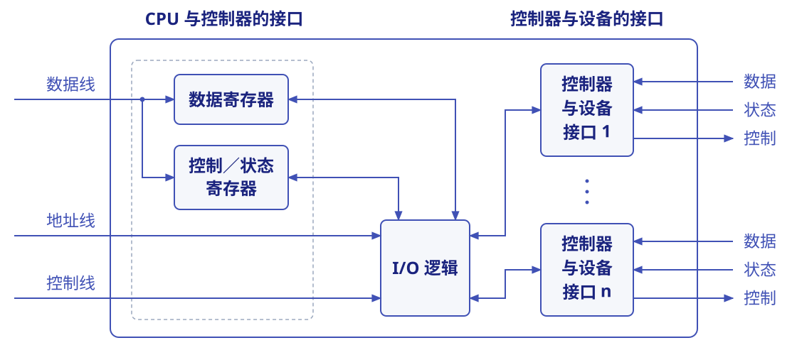
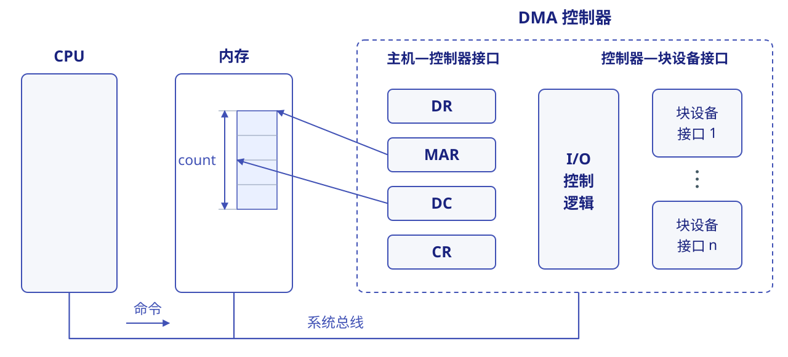
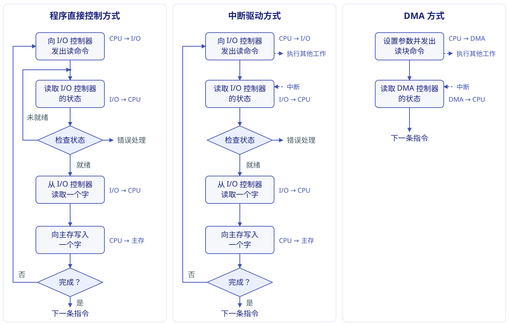
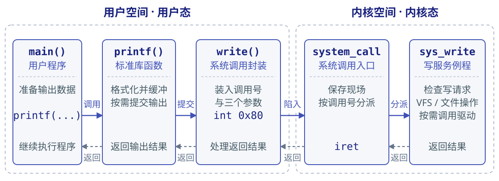

# 输入/输出

I/O 是计算机与外部世界交换信息的通道。键盘、显示器、磁盘、打印机和网卡的工作方式各不相同，速度也往往与 CPU 相差很大。操作系统需要把这些差异封装起来，让应用程序能够通过统一接口使用设备，同时协调数据传输、设备共享与错误处理。

## I/O 管理概述

### I/O 设备

一个 I/O 设备通常包括 **设备本身** 和 **设备控制器**：前者完成实际的输入或输出，后者连接主机与设备，接收命令（并转换为设备可以识别的电信号）、报告状态并组织数据交换。例如，磁盘的盘片与磁头负责记录和读取信息，控制器负责解释读写请求并协调操作。

#### 设备的分类

I/O 设备有很多种类，可以从很多不同的角度进行分类。我们简单提几种分类思路：

-   按 **信息交换单位** 分：
    -   块设备：按数据块交换，通常可寻址和随机访问，如磁盘；
    -   字符设备：按字符或字节交换，通常按流顺序访问，如键盘、终端、打印机。
-   按 **传输速率** 分：可分为低速、中速、高速设备，分别对应的例子有键鼠、激光打印机、磁盘等，划分描述的是相对速度。
-   按 **使用特性** 分：
    -   人机交互设备；在用户与计算机之间传递信息，如键盘、显示器；
    -   存储设备：保存程序与数据，如磁盘、磁带、光盘；
    -   网络通信设备：在计算机之间传递信息，如网卡、调制解调器。
-   按 **共享属性** 分：
    -   独占设备：分配后由一个进程使用，结束后再交给其他进程，如打印机；
    -   共享设备：可供多个进程在逻辑上并发使用，由系统协调物理访问，如磁盘；
    -   虚拟设备：通过 [SPOOLing](#spooling-技术假脱机技术) 等技术，把独占设备表现为多个逻辑设备，也就是实现独占设备的逻辑共享。

#### I/O 接口

I/O 接口也被称为（前面提过的）设备控制器。控制器主要包括三部分：

1.  **与 CPU 的接口**。通过地址线选择端口，通过数据线交换数据、命令和状态，通过控制线确定读写等操作。
2.  **与设备的接口**。传递设备一侧的数据、控制和状态信号，一个控制器可以连接一个或多个设备。
3.  **I/O 逻辑**。识别地址、解释命令，并按设备状态组织操作。

<figure markdown>
{:width="90%"}
<figurecaption>设备控制器的组成</figurecaption>
</figure>

控制器的主要功能包括接收和识别命令、数据交换、标识和报告状态、地址识别、数据缓冲和差错控制。设备驱动程序向它写入参数和命令，读取状态或结果。

!!! info "有关硬件信号与寄存器的进一步说明，请见[计算机组成中的 I/O 接口](../CO/co_IO.md#io接口)。"

I/O 接口同样可以从不同角度分类：

-   按设备侧的数据传送方式，分为 **串行接口** 与 **并行接口**，必要时完成串并格式转换。
-   按主机控制传送的方式，分为程序查询接口、中断接口和 DMA 接口等。
-   按功能能否通过编程改变，分为可编程与不可编程接口。
-   按所连接的设备类型，分为字符设备、块设备和网络设备接口。

#### I/O 端口

I/O 端口指的是设备控制器中可以被 CPU 访问的寄存器。

| 端口类型 | 主要用途 | 常见访问方向 |
| :---: | :---: | :---: |
| 数据寄存器 | 暂存输入或输出数据 | CPU 读取输入，写入输出 |
| 状态寄存器 | 保存忙闲、就绪、完成和错误等状态 | CPU 读取 |
| 控制寄存器 | 设置工作方式、提交启动命令 | CPU 写入 |

CPU 访问端口时，需要识别其地址，每个端口应该对应一个唯一的端口地址。主要有两种编址方式。

-   **独立编址**（I/O 映射）。I/O 端口与主存属于不同地址空间，逻辑上完全分离。CPU 使用专用 I/O 指令访问，如 `IN`、`OUT`。
    -   I/O 操作易于辨认（使用专用指令）；由于 I/O 端口数量也远少于内存，需要的地址线少，译码电路简单，寻址速度快。
    -   I/O 指令功能有限；CPU需同时提供存储器读/写和 I/O 读/写两组控制信号。
-   **统一编址**（内存映射）。端口占用存储器地址空间中的部分地址，使用普通加载、存储指令。
    -   编程更加灵活（使用统一访存指令）；地址保护机制可统一实现而无需额外硬件支持。
    -   主存容量是一定的，把一部分分给 I/O 端口就会降低可用内存容量；需要根据完整地址识别设备地址范围，译码电路相对复杂。

### I/O 控制方式

I/O 控制负责组织设备与主机之间的数据传送。控制方式的发展方向，是<u>减少 CPU 在等待、搬运和组织 I/O 时的干预，让 CPU 有更多时间执行其他任务</u>。

常见的控制方式包括程序直接控制、中断驱动、DMA 和通道控制。比较时可以关注：**谁检查设备状态，谁搬运数据，CPU 多久介入一次**。下面以输入操作为例，对照前三种方式的操作流程。

#### 程序直接控制方式

也称程序轮询方式。CPU 发出读命令后，从 I/O 设备读取一个字（节）,然后不断地循环测试设备状态（这被称为轮询），直到确定该字（节）已在设备控制器的数据寄存器中。于是 CPU 将数据寄存器中的数据取出，送入内存的指定单元，这样便完成了一个字（节）的 I/O 操作。输出时方向相反。

这种方式控制简单，但状态检查和数据搬运都由 CPU 执行。持续忙等待占用 CPU，使设备准备数据的时间 CPU 难以用于其他有用计算，降低了 CPU 的利用率。

程序查询也可以采用间隔查询。[程序查询方式](../CO/co_IO.md#程序查询方式)这一节进一步讲到了这两种方法。

#### 中断驱动方式

CPU 发出 I/O 命令后，可以执行其他工作；设备准备好数据或需要服务时，通过中断通知 CPU。随后，由中断处理程序检查状态，并完成相应的数据搬运或后续处理。

从设备控制器的角度看，它从 CPU 发出指令后开始“活跃”；从 CPU 的角度看，CPU 发出指令后对应的进程就开始阻塞，CPU 得以执行其他计算，从而显著提升了 CPU 的利用率。

但是，数据交换仍经过 CPU 寄存器；中断服务也需要执行指令和保护现场，而 CPU 是以字（节）为单位进行干预的，因此高速、大批量传输时采用中断驱动会带来很高的开销。

!!! tip "讲到中断的其他地方"
    中断的基本分类：[中断机制](./os_intro.md#int)；
    I/O 完成中断如何处理请求进程：[中断处理程序](#中断处理程序)。

#### DMA 方式

DMA（Direct Memory Access，直接存储器访问）由控制器在设备与主存之间 **直接搬运数据** 而不需要经过 CPU。

DMA 控制器的基本寄存器包括：

| 寄存器 | 作用 |
| :---: | :---: |
| 命令/状态寄存器 CR | 保存传输命令与状态 |
| 内存地址寄存器 MAR | 保存当前主存传输位置，初值为起始地址 |
| 数据寄存器 DR | 暂存传输的数据单元 |
| 数据计数器 DC | 记录本次需要传输的字（节）数量 |

<figure markdown>

<figurecaption>DMA 控制器的结构</figurecaption>
</figure>

DMA 的基本特点是：

-   以数据块组织传输。块内仍可以逐字搬运。
-   数据不经过 CPU 通用寄存器。
-   CPU 仅在开始和结束时介入。CPU 设置好相应寄存器后即启动传输，I/O 控制权交给 DMA 控制器；传输完成后，DMA 控制器向 CPU 发送中断信号告知完成，CPU 直接处理结果。

显然，DMA 仍需使用总线和主存，可能与 CPU 发生访存竞争。突发传送、周期挪用等方式，见[DMA 的传送方式](../CO/co_IO.md#dma的传送方式)。

<figure markdown>

<figurecaption>I/O 控制方式的操作流程</figurecaption>
</figure>

#### 通道控制方式\*

**I/O 通道** 是面向 I/O 的专用处理机，能够执行存放在主存中的通道程序。CPU 指明设备和通道程序位置后，由通道按程序组织操作，结束时报告结果。

与一次设置一个数据块的 DMA 模型相比，通道可以执行一系列专用指令，自主组织多个阶段、多个设备的操作。

| 控制方式 | 数据搬运与操作组织 | CPU 的主要介入方式 |
| :---: | :---: | :---: |
| 程序直接控制 | CPU 查询并搬运 | 逐字或逐字节查询、传送 |
| 中断驱动 | CPU 在中断服务中搬运 | 按设备服务事件介入，教材模型中通常逐字或逐字节 |
| DMA | 控制器直接在设备与主存间传送 | 设置数据块，处理完成通知 |
| 通道 | 通道执行程序组织 I/O | 启动通道程序，处理最终结果 |

### I/O 软件层次结构

I/O 软件把设备特定的操作与各类设备共用的功能分开，常见结构由上到下是：

$$
\text{用户层软件}\longrightarrow\text{设备独立性软件}
\longrightarrow\text{设备驱动程序}\longrightarrow\text{中断处理程序}
$$

设备硬件位于这些软件层之下。这种分层架构中，每层利用下层提供的服务、向上提供统一的接口（又是这句话！）。

#### 用户层软件

包括与应用程序链接的 I/O 库函数，负责格式化、用户缓冲和提供便利接口，例如 `printf()`、`scanf()`。需要内核服务时，再通过[系统调用](./os_intro.md#syscall)进入内核。

!!! tip "调用库函数本身不一定立刻发生系统调用。例如，格式化结果可能先写入库管理的缓冲区，之后再统一提交。"

#### 设备独立性软件

**设备独立性**，也称设备无关性，是指应用程序不必绑定某一台具体物理设备。所以系统引入了逻辑设备和物理设备的概念：程序使用逻辑设备名请求某类设备，系统负责将逻辑设备名映射为实际的物理设备并定位驱动程序，因而可以支持重定向和设备替换。

为实现设备独立性，需在设备驱动程序之上设置一层设备独立性软件，这一层提供公共 I/O 服务和统一接口。

#### 设备驱动程序

驱动程序是与设备特性直接相关的软件，每类设备都需要配置一个专用的驱动程序。这一层主要负责把上层的抽象 I/O 请求转换为设备控制器能执行的命令，从而启动设备进行相应操作，并将设备控制器返回的状态信息或数据传递回上层。

从上面的概述我们可以总结驱动程序的工作流程：

1.  将抽象请求转换为具体操作（例如将逻辑地址转换为物理参数）；
2.  校验请求的合法性；
3.  检查设备状态；
4.  传递相应参数；
5.  启动设备。处理后续事项。

#### 中断处理程序

I/O 中断到达时，CPU 可能正在运行另一个进程。在[中断的处理](./os_intro.md#中断的处理)这一章节我们已经大概了解了总体的流程。为了确保这一套流程可靠，操作系统需要对中断处理程序本身进行管理：

-   注册中断。驱动初始化时需要向内核注册中断号和处理函数的入口地址，以建立硬件中断信号和服务代码之间的映射，确保内核可以准确调用；
-   处理中断。例如对来自 I/O 设备的中断处理程序，典型流程应该如下：
    1.  确认中断来源。确认中断是否来自本设备，读取设备状态，判断是正常完成、需要继续传输，还是发生错误。
    2.  清除中断标志。这是为了防止重复触发中断。
    3.  执行必要的设备操作。例如，程序中断 I/O 可能需要搬运数据而产生读/写。
-   注销中断。当驱动程序被卸载或设备停用时，需要注销其中断处理程序以释放资源。独占中断线时，注销后直接禁用该线即可；共享中断线时，应该注意这一设备的处理程序注销不能影响其他设备的处理例程。

特别需要注意的是，由于中断处理程序运行在中断的上下文中，中断处理应尽快、非阻塞地完成，不能执行可能引发睡眠等待的操作。

#### I/O 操作举例 

应用程序使用统一的 `write` 接口发出写请求，设备之间的差异交给内核和驱动处理。下面以某进程 P 调用 `printf()` 输出数据为例，串起各层的工作；本例选择标准库需要提交输出、且写请求需要等待设备完成的路径。

先看函数调用与 CPU 状态的变化。图中采用 Linux 在 IA-32 上的传统 `int 0x80` 路径，内核入口与写服务例程沿用 `system_call`、`sys_write` 的名称。

<figure markdown>

<figurecaption>Linux 中 write 调用的执行流程（IA-32 传统路径）</figurecaption>
</figure>

1.  **用户层软件：格式化并提交数据。** `main()` 调用 `printf()`，由标准库完成格式化和用户缓冲管理；需要提交输出时，再调用 `write(fd, buf, count)` 封装，传入文件描述符、用户缓冲区地址和字节数。这些库函数仍在用户态运行。
2.  **系统调用入口：陷入内核并分派。** 按 [IA-32 调用约定](https://man7.org/linux/man-pages/man2/syscall.2.html)，封装把系统调用号放入 `eax`，把三个参数依次放入 `ebx`、`ecx`、`edx`，然后执行 `int 0x80`。CPU 由用户态进入内核态，硬件与入口代码配合保存现场；`system_call` 根据调用号查询系统调用表，转到 `sys_write`。
3.  **设备独立性软件：处理公共工作。** 写服务例程根据文件描述符找到已打开的文件对象，经 VFS（虚拟文件系统）检查写入权限、用户缓冲区及请求范围，再转入对应的文件操作；需要访问设备时，继续交给相应驱动。这一层为上层提供统一接口，具体调用关系可对照 [`sys_write` 与 `vfs_write` 的实现](https://github.com/torvalds/linux/blob/v2.6.12/fs/read_write.c)。
4.  **设备驱动程序：启动设备并安排等待。** 驱动把抽象写请求转换为设备命令，设置控制器寄存器和传输参数，启动设备。本例中 P 需要等待完成，于是进入阻塞态；调度程序可以把 CPU 交给其他就绪进程 Q。
5.  **中断处理程序：记录完成并唤醒进程。** 设备完成后，控制器向 CPU 发出中断请求。CPU 响应中断，保存当前执行现场，转入内核中的中断处理程序；处理程序检查设备状态、清除中断标志、记录结果，并唤醒 P，使其从 **阻塞态变为就绪态**。若此时运行的是 Q，被中断和保存现场的就是 Q。
6.  **恢复请求进程：完成调用并返回用户态。** P 再次获得 CPU 后，从原先等待的位置继续执行内核代码，完成写请求的后续处理。结果经系统调用返回路径传回，恢复现场并执行 `iret`，CPU 回到用户态，从 `int 0x80` 后的指令继续执行；随后 `write()` 封装返回标准库，`printf()` 再返回 `main()`。入口分派与返回过程可对照 [`system_call` 的实现](https://github.com/torvalds/linux/blob/v2.6.12/arch/i386/kernel/entry.S)。

把两个事件分开记：**陷入指令由请求进程主动执行，用来进入内核请求服务；I/O 中断由设备异步发出，用来通知 CPU 处理设备事件。** 请求进程的状态变化则是“运行 → 阻塞 → 就绪 → 运行”，其中从就绪到运行需要经过调度。

缓冲数据如何流入用户变量，请参见后面的[键盘输入示例](#keyboard-input)。

### 应用程序 I/O 接口

上一节我们从内部分工了解了完成 I/O 功能所需要的一系列任务。而总体来看，它们是一套为了统一管理各类 I/O 设备而设计的软件架构与编程规范，被称为应用程序 I/O 接口。这再次体现了操作系统的封装性，应用程序无需关心硬件的具体实现，新设备也能以模块化的方式方便地加入系统。

#### I/O 接口的分类

| 接口 | 对上层提供的主要操作 | 封装的设备差异 |
| :---: | :---: | :---: |
| 字符设备接口 | 字符读取、写入，如抽象的 `get`、`put`，以及打开、关闭和设备控制 `in-control` | 字符流、缓冲和具体工作模式 |
| 块设备接口 | 块读取、写入和定位，如 `read`、`write`、`seek` | 将块号组织为线性地址，隐藏实际物理布局 |
| 网络设备接口 | 通过套接字（Socket）建立通信端点，发送与接收数据 | 网络协议、通信端点与底层网卡操作 |

字符设备的特殊功能可以通过 `ioctl` 一类设备控制接口设置。统一接口不表示所有设备都支持完全相同的控制操作，也不表示 `ioctl` 取代了普通读写。

#### 阻塞 I/O 和非阻塞 I/O

**阻塞 I/O** 在请求暂时无法完成时，使调用进程等待。条件满足后进程进入就绪态，再次获得 CPU 后继续执行并取得结果。如果请求立即可满足，则未必发生阻塞。

**非阻塞 I/O** 在当前条件下尽可能完成操作，并及时返回。没有可用数据或空间时，可以返回暂时不可完成的状态；也可能只完成部分传输，程序需要依据实际结果继续处理。

| 模式 | 暂时不能完成时 | 程序需要关注的事 |
| :---: | :---: | :---: |
| 阻塞 | 等待条件满足 | 控制流程直接，但该调用进程不能继续做其他工作 |
| 非阻塞 | 返回当前结果或暂时不可完成状态 | 处理重试和部分传输，避免无意义地反复查询 |

## 设备独立性软件 

设备独立性软件位于[设备驱动程序](#设备驱动程序)之上，是内核 I/O 子系统的最高层。它把各类设备共有的操作集中起来，向上提供统一的 I/O 服务，把设备特有的操作交给对应驱动。具体系统会根据性能、代码复用和设备特性，调整这一层与驱动程序之间的功能分工。

它主要承担以下工作：

1.  **统一驱动接口与设备映射**。要求驱动遵循统一的接口规范，根据逻辑设备名找到物理设备及驱动入口，使上层可以用一致的方式访问设备。
2.  **缓冲管理**。协调 CPU 与外设的速度差异、数据粒度和传输节奏，组织单缓冲、双缓冲、循环缓冲及缓冲池。
3.  **差错控制**。暂时性错误优先由驱动重试处理，超过重试次数或时间限制后报告失败；设备独立性软件处理驱动无法解决的错误。对于磁盘划痕等持久性错误，可记录[坏块](#坏块)，使后续访问绕过故障区域。
4.  **独占设备的分配与回收**。维护设备状态和等待队列：空闲时分配，忙时让请求进程等待，释放时安排后续请求或置为空闲。
5.  **提供统一的逻辑数据块**。通过分块、组合和缓冲，把设备各异的物理交换单位转换为上层使用的统一逻辑单位。
6.  **设备保护**。检查访问权限，使设备访问经过内核受控路径，防止未授权使用。

程序使用逻辑设备名，系统负责选择和绑定实际设备。这样既能屏蔽硬件细节、简化编程和提高可移植性，也能通过改变映射实现 I/O 重定向，提高分配的灵活性。

### 高速缓存与缓冲区

#### 磁盘高速缓存

**磁盘高速缓存（Disk Cache）** 利用主存保存磁盘数据的副本。它依据[局部性](./memory.md#locality)，让重复读取尽可能由内存满足，从而减少实际磁盘访问。其存储位置在主存中，与 CPU 和主存之间的硬件 Cache 属于不同层次。

磁盘高速缓存有两种组织形式：

-   **固定缓存区**：在主存中划出固定大小的专用空间。
-   **动态缓冲池**：利用系统空闲内存，由请求分页系统与磁盘 I/O 子系统共享可用页框，按需调整容量。

读取时先查缓存：命中则直接使用副本，未命中则安排磁盘读取。缓存也可以暂存修改、合并写入；修改后的数据需要按写回策略与磁盘内容同步，具体见[提高磁盘 I/O 速度的方法](#提高磁盘-io-速度的方法)。

#### 缓冲区

**缓冲区（Buffer）** 是暂存传输中数据的区域。引入缓冲区主要有四个目的：

1.  缓和 CPU 与 I/O 设备之间的速度差异。
2.  减少对 CPU 的中断频率，放宽对中断响应时间的要求。
3.  匹配双方的数据粒度，例如在字符流与数据块之间进行组织和转换。
4.  提高 CPU 与 I/O 设备的并行程度，减少相互等待。

缓冲可由硬件缓冲器实现，也可在主存中分配。硬件缓冲器成本较高，通常用于关键部位；我们下面讨论的是主存中的缓冲区的实现。

##### 单缓冲

进程请求输入时，操作系统为其分配一个缓冲区，大小通常为一个数据块。以块设备输入为例，把处理过程拆成三个阶段：

$$
\text{设备}\xrightarrow{T}\text{缓冲区}
\xrightarrow{M}\text{用户工作区}\xrightarrow{C}\text{处理完成}
$$

-   $T$：设备把一块数据输入缓冲区的时间。
-   $M$：把该块数据从缓冲区移到用户工作区的时间。
-   $C$：CPU 在工作区处理该块数据的时间。

这里采用**整块输入后再移出、只有一个用户工作区**的模型。设备填充缓冲区与系统从同一缓冲区移出数据互斥；工作区中的当前块处理完毕后，才能接收下一块。

当前块移出后，缓冲区空闲，设备可以输入下一块；与此同时，CPU 处理工作区中的当前块。因此，**$T$ 与 $C$ 可以重叠，$M$ 要单独计入**：

-   $T\ge C$ 时，CPU 先完成处理，再等下一块输入完成，周期为 $T+M$。
-   $T<C$ 时，下一块先装满缓冲区，再等 CPU 处理完当前块，周期为 $C+M$。

稳态下每块数据的处理周期为：

$$
\tau_{\mathrm{single}}=\max(T,C)+M
$$

##### 双缓冲

**双缓冲**也称缓冲对换，使用两个缓冲区交替接收数据。设备装满缓冲区 1 后，转向缓冲区 2；系统则把缓冲区 1 的数据移到工作区并处理。数据移出后，该缓冲区即可供设备再次使用。

在同样的工作区模型下，**设备输入的 $T$ 可以与另一块数据的移送和处理 $M+C$ 重叠**：

-   $T\ge M+C$ 时，输入较慢，设备可以连续输入，处理方等待下一块就绪，周期为 $T$。
-   $T<M+C$ 时，移送与处理较慢，设备可能等待缓冲区释放，周期为 $M+C$。

因此，双缓冲的稳态周期为：

$$
\tau_{\mathrm{double}}=\max(T,M+C)
$$

双机通信也可以通过双缓冲分开收发：每台机器设置一个发送缓冲区和一个接收缓冲区，A 的发送缓冲区对应 B 的接收缓冲区，反向亦然，从而支持双方同时收发。若每台机器仅有一个缓冲区，且它一次只能承担一种收发角色，则双方需要交替收发。

!!! example "从稳态周期计算有限批次时间"

    若缓冲区和工作区初始均为空，连续输入并处理完 $n$ 块数据，第一块需要依次经过 $T+M+C$，其余各块按稳态周期完成：

    $$
    t_{\mathrm{single}}=T+M+C+(n-1)\bigl[\max(T,C)+M\bigr]
    $$

    $$
    t_{\mathrm{double}}=T+M+C+(n-1)\max(T,M+C)
    $$

    例如，$T=10$ ms、$M=2$ ms、$C=6$ ms 时，单缓冲稳态周期为 12 ms，双缓冲为 10 ms；从空状态处理完三块，分别需要 $18+2\times12=42$ ms 和 $18+2\times10=38$ ms。

    初始已有数据、阶段间允许的重叠方式改变，或只统计输入完成时间时，应按题目给出的起止状态重新画时间线。

##### 循环缓冲

当输入与处理速率存在较大波动时，可以增加缓冲区数量。**循环缓冲**把多个大小相等的缓冲区链接成循环队列：每个缓冲区指向下一个，最后一个指回第一个。

系统维护两个指针，沿链接方向循环推进：

-   `in` 指向下一个待写入的空缓冲区，由输入进程推进。
-   `out` 指向下一个待读取的满缓冲区，由计算进程推进。

两类进程可以并行运行，但需要处理两种同步情形：

1.  **系统受计算限制**：输入快于处理，`in` 追上 `out`，缓冲区全部装满。输入进程阻塞，等待计算进程取走数据、释放空缓冲区后将其唤醒。
2.  **系统受 I/O 限制**：处理快于输入，`out` 追上 `in`，缓冲区全部为空。计算进程阻塞，等待输入进程填入数据后将其唤醒。

实际管理时，需要结合计数或状态标志区分指针相等时的满、空状态，同步关系可按[生产者与消费者](./sync.md#生产者-消费者问题)理解。增加缓冲区能吸收一段时间的速度波动，长期吞吐率仍由较慢的一方决定。

##### 缓冲池

**缓冲池**由一组缓冲区、管理数据结构和操作函数组成，供多个进程共享，由系统统一分配和回收。按缓冲区的使用状态，组织为三个队列：

-   **空缓冲队列**：保存可供分配的空缓冲区。
-   **输入队列**：保存装满输入数据、等待计算进程取用的缓冲区。
-   **输出队列**：保存装满输出数据、等待输出进程取用的缓冲区。

使用时从相应队列的**队首**摘取一个缓冲区，操作完成后挂到下一队列的**队尾**。四种操作及其角色如下：

| 操作与角色 | 执行者 | 获取来源 | 完成后去向 |
| :---: | :---: | :---: | :---: |
| 收容输入 `hin` | 输入进程 | 空缓冲队列 | 写入设备输入，装满后加入输入队列 |
| 提取输入 `sin` | 计算进程 | 输入队列 | 取走输入数据后，归还空缓冲队列 |
| 收容输出 `hout` | 计算进程 | 空缓冲队列 | 写入计算结果，装满后加入输出队列 |
| 提取输出 `sout` | 输出进程 | 输出队列 | 将数据交给输出设备后，归还空缓冲队列 |

`hin`、`sin`、`hout`、`sout` 表示缓冲区在一次操作中承担的角色。同一块内存可随分配和回收承担不同角色；操作队列及访问缓冲内容时，需要协调互斥与同步。

#### 高速缓存与缓冲区的对比

两者都利用较快的存储空间缓和速度差异，区别主要在于**保留数据的目的**。

| 比较项 | 高速缓存 | 缓冲区 |
| :---: | :---: | :---: |
| 存放内容 | 慢速设备数据的副本，可保留到被替换 | 正在传输的数据，取走后通常释放空间 |
| 主要目的 | 提高重复访问效率，减少对慢速介质的访问 | 提高传输效率，协调速度、粒度和处理节奏 |
| 典型操作 | 查找命中、保留副本、替换或写回 | 填入、移出、释放或交给下一处理阶段 |
| 性能关注点 | 命中率与慢速介质访问次数 | 传输并行程度、等待和搬运成本 |

同一片内存可以兼有两种用途：例如，磁盘块读入后先用于中转，随后继续保留以供重复访问。

### 设备分配与回收

#### 设备分配概述

设备分配根据进程的 I/O 请求，安排所需设备及其访问通路。目标是在充分利用设备的同时，避免不当的资源分配引发死锁。

一次分配需要回答三个问题：**有哪些设备可用、请求应交给谁、占用和等待如何管理**。系统用控制表记录资源，再根据分配策略选择设备及通路。

#### 设备分配的数据结构

教材采用“通道—控制器—设备”的组织模型：系统可有多个通道，一个通道连接多个控制器，一个控制器连接多个物理设备。以下四类内核数据结构记录资源的状态、从属关系和等待队列。

**设备控制表（DCT）**：每台物理设备一张，主要包含六项内容：

1.  **设备类型**：如打印机、扫描仪或键盘。
2.  **设备标识符**：即物理设备名，在系统内唯一。
3.  **设备状态**：记录忙闲等状态。
4.  **控制器表指针**：指向所属控制器的 COCT。
5.  **重复执行次数或时间**：规定 I/O 的重试限制，超过限制后报告失败。
6.  **设备队列的队首指针**：指向等待该设备的进程队列，队列由相应进程的 PCB 构成。

其余三张表把设备组织成可查找的资源网络：

-   **控制器控制表（COCT）**：每个控制器一张，记录控制器标识符、忙闲状态、所连接通道的 CHCT 指针，以及控制器等待队列的队首和队尾指针。
-   **通道控制表（CHCT）**：每个通道一张，记录通道标识符、忙闲状态、所连接控制器表的首址，以及通道等待队列的队首和队尾指针。
-   **系统设备表（SDT）**：全系统一张，作为所有物理设备的索引。每个表目对应一台设备，保存设备类型、标识符、DCT 指针和驱动程序入口。

因此，SDT 负责定位设备，DCT、COCT 和 CHCT 负责描述设备及通路的状态。它们由内核在内存中维护；控制器中的数据、状态和控制寄存器则用于硬件交互。

#### 设备分配时应考虑的因素

1.  **设备的固有属性**

    不同[设备属性](#设备的分类)对应不同的分配策略：

    -   **独占设备**：分配给某进程后，由该进程独占，直到主动释放或终止。
    -   **共享设备**：允许多个进程使用，通过调度协调访问顺序，如磁盘。
    -   **虚拟设备**：通过 [SPOOLing](#spooling-技术假脱机技术) 等技术，为进程安排独立的逻辑使用空间，接受多个进程并发提交的请求。

2.  **设备分配算法**

    -   **先来先服务（FCFS）**：按请求到达顺序排队，优先分配给队首进程。
    -   **最高优先级优先**：高优先级进程优先，优先级相同时按 FCFS 排队。

    这里安排的是设备使用资格；[磁盘调度](#磁盘调度算法)则进一步安排具体读写请求的服务顺序。

3.  **设备分配的安全性**

    按请求进程能否继续申请资源，区分两种方式：

    -   **安全分配方式**：进程发出 I/O 请求后立即阻塞，完成本次操作后才继续运行，等待期间停止申请其他资源。按一次使用一台设备、完成后再申请的模型，设备请求串行推进，避免形成循环等待；代价是该进程的计算与 I/O 并行程度较低。该进程等待时，CPU 仍可运行其他就绪进程。
    -   **不安全分配方式**：进程发出 I/O 请求后可以继续运行，并申请其他设备；所请求设备已被占用时才阻塞。一个进程可同时使用多个设备，推进较快，但可能形成[循环等待](./sync.md#死锁发生的条件)，需要配合死锁预防、避免或检测与解除措施。

**4. 设备独立性**

使用逻辑设备名，把“需要某类设备”与“选中哪台设备”分开，系统便可在同类设备中选择可用者。具体的选择过程和映射方式如下。

#### 设备分配的步骤

以具有通道的独占设备模型为例，请求指定物理设备名时，依次分配**设备、控制器和通道**：

$$
\mathrm{SDT}\longrightarrow\mathrm{DCT}\longrightarrow\mathrm{COCT}\longrightarrow\mathrm{CHCT}
$$

1.  **分配设备**。根据物理设备名查 SDT，找到 DCT 并检查设备状态。若忙，将请求进程的 PCB 加入设备等待队列；若空闲，将设备分配给该进程。
2.  **分配控制器**。沿 DCT 的指针找到 COCT。若控制器忙，将 PCB 加入控制器等待队列；若空闲，分配控制器。
3.  **分配通道**。沿 COCT 的指针找到 CHCT。若通道忙，将 PCB 加入通道等待队列；若空闲，分配通道。

三者均分配成功后，才能启动设备进行传输。回收时释放相应资源并更新状态：有等待者时，按分配策略选择并唤醒后续进程；没有等待者时，置为空闲。采用 FCFS 时，接续服务的就是队首进程。

若改用**逻辑设备名**，系统会从 SDT 中查找同类设备的 DCT，选中空闲设备后继续分配控制器和通道；所有同类设备都忙时，进程才进入该类设备的公共等待队列。相比指定一台物理设备，这种方式扩大了可选择的资源范围。

#### 逻辑设备名到物理设备名的映射

**逻辑设备表（Logical Unit Table，LUT）** 建立程序所用名称与实际设备之间的对应关系，表项包含**逻辑设备名、物理设备名和驱动程序入口地址**。

进程首次使用逻辑设备名请求设备时，系统选择空闲的物理设备并建立映射。后续请求通过该表项找到实际设备和驱动入口。LUT 有两种设置方式：

| 设置方式 | 逻辑名称的作用范围 | 适用场景 |
| :---: | :---: | :---: |
| 全系统共用一张 LUT | 所有用户共享名称空间，逻辑设备名需互不冲突 | 单用户系统 |
| 每个用户分别设置 LUT | 各用户有独立名称空间，可使用相同逻辑设备名 | 多用户系统 |

按用户设置 LUT 时，也可以保存指向全局 SDT 表项的指针，再通过 SDT 找到设备及驱动信息。**LUT 管理名称映射，SDT 管理全系统物理设备的索引**；多个用户竞争同一物理设备时，仍由设备分配机制协调。

### SPOOLing 技术（假脱机技术）

**SPOOLing** 用磁盘作暂存空间，以专门的输入、输出进程模拟早期脱机 I/O 中外围控制机的功能。早期[脱机 I/O](./os_intro.md#操作系统的任务执行设计)由外围机在主机之外组织数据传送；SPOOLing 则借助多道程序技术，在主机控制下完成这些工作，因此称为**假脱机**。

它把进程对低速设备的直接等待，转换为对磁盘井文件的存取，再由后台进程组织实际 I/O，使计算与设备操作并行。

#### SPOOLing 系统的组成

系统由四部分构成：

1.  **输入井与输出井**：磁盘上的暂存区域，分别保存输入数据和待输出结果。各进程的数据以**井文件**形式保存，并按顺序组织成输入队列或输出队列。
2.  **输入缓冲区与输出缓冲区**：主存中的中转区域，分别暂存送往输入井的数据，以及从输出井取出、即将交给设备的数据。
3.  **输入进程与输出进程**：模拟外围控制机。输入进程把输入设备的数据经缓冲区送入输入井，供用户作业读取；输出进程组织输出井数据的暂存和向设备的传送。
4.  **井管理程序**：控制用户作业与磁盘井之间的信息交换。

数据流向为：

-   输入：**输入设备 → 输入缓冲区 → 输入井 → 用户处理**。
-   输出：**用户结果 → 输出井 → 输出缓冲区 → 输出设备**。

其中，**井在磁盘上，缓冲区在主存中**。

#### 共享打印机的工作过程

打印机是典型的独占设备。SPOOLing 通过下面的过程，让多个用户进程共享它：

1.  **接收请求**。为该进程在输出井中分配存储空间，保存待打印数据；申请一张用户请求打印表，记录打印要求，并挂到假脱机打印队列。
2.  **返回用户进程**。数据提交完成后，进程继续执行后续代码；物理打印由后台打印进程负责。
3.  **后台输出**。打印机空闲时，后台进程取出队首请求，根据打印表找到井文件，经输出缓冲区把数据交给打印机。
4.  **完成与接续**。当前任务结束后释放相应暂存空间，继续处理下一项；队列为空时，后台进程等待，直到新请求将其唤醒。

每个进程获得独立的暂存空间和请求记录，使用效果如同各有一台打印机；物理打印机由后台进程统一管理，按队列顺序逐项输出。

#### SPOOLing 的特点

-   **提高 I/O 效率**：用户进程主要与较快的磁盘交换数据，把提交请求与设备实际输出分开，减少用户进程等待低速设备的时间。
-   **实现独占设备的逻辑共享**：多个进程可以并发提交请求，由后台集中安排物理设备的服务。
-   **实现虚拟设备功能**：一台物理设备对应多个逻辑使用对象，每个进程拥有自己的暂存空间和使用视图。

这是一种**以空间换时间**的技术：利用磁盘空间和后台管理，换取更灵活的设备共享及更高的计算与 I/O 并行程度。请求提交的速度主要取决于暂存操作，纸面输出的速度仍取决于打印机。

### 设备驱动程序接口

设备独立性软件通过统一接口调用驱动，驱动再与设备控制器交互。接口的作用是让上层按统一规则提交请求，让不同设备的专用驱动接入同一套 I/O 框架。

#### 驱动程序的功能

结合前面的[驱动程序工作流程](#设备驱动程序)，一次请求主要经过以下处理：

1.  **转换命令与地址**。接收上层命令和参数，把抽象读写、逻辑块号等转换为设备命令和地址参数。在传统磁盘几何模型中，可能需要转换为柱面（磁道）、盘面和扇区号；采用线性块地址接口时，几何细节可由控制器封装。
2.  **检查请求与状态**。检查操作、范围和访问方式是否合法，例如只写设备仅接受写入；查询设备是否就绪，确定工作方式。
3.  **传递参数并启动设备**。设置方向、缓冲区地址、传输长度等参数。设备可用时发出 I/O 命令；设备忙时将请求进程的 PCB 加入等待队列。
4.  **配合中断和完成处理**。提供并配合相应的中断处理程序，响应设备事件，维护设备状态，向上层反馈数据、完成情况或错误，必要时重试或报告失败。

#### 驱动程序的特点与接口要求

驱动与具体硬件直接相关，具有以下特点：

-   **双向衔接**：向下把抽象请求转换为设备操作，向上把设备状态和完成情况反馈给请求方。
-   **依赖 I/O 控制方式**：中断驱动、DMA 等方式会影响参数设置、传输组织及完成处理。
-   **具有设备专用性**：不同类型的设备需要相应驱动，以封装其硬件特性。
-   **可与固件配合**：设备初始化等部分底层功能可以由设备固件或系统 ROM 提供。
-   **支持可重入执行**：多个进程可能并发调用同一驱动，需要分别保存请求上下文，并对共享状态做好同步。

为统一各类驱动的接入方式，操作系统要求：**遵循统一或相近的调用规范、通过设备管理机制完成逻辑名映射及驱动入口定位、对设备访问实施权限控制**。这样，新增设备主要通过适配驱动接入，公共 I/O 处理可以继续复用。

### I/O 操作举例 

以 `scanf("%d", &d)` 为例，观察键盘字符怎样经过两级缓冲，最终转换为整数。请求跨越各软件层的通用过程见[前面的写操作示例](#io-layer-example)。

#### 用户缓冲区与内核缓冲区

-   **用户缓冲区**位于用户空间，本例由 C 标准库管理，保存供 `scanf()` 读取和解析的字符。
-   **内核缓冲区**位于内核空间，由操作系统维护，用于暂存设备输入，并为系统调用提供数据。

两者位于受保护的不同地址空间。本例的数据传递由内核先接收设备输入，再按 `read` 请求把数据复制到指定的用户缓冲区。

#### 从库函数到系统调用

`scanf()` 先在用户态检查用户缓冲区。若已有足够字符，直接解析；需要补充输入时，通过 `read(fd, buf, count)` 请求内核服务：

-   `fd`：文件描述符，本例标识标准输入。
-   `buf`：接收数据的用户缓冲区地址。
-   `count`：本次请求读取的最大字节数。

封装函数准备参数后执行陷阱指令，使 CPU 进入内核态，由系统调用服务例程检查参数并处理请求。

#### 等待输入、处理中断与返回

以下采用**输入尚未就绪、需要等待键盘输入**的中断驱动模型：

1.  **发起读取**。内核检查输入状态、设置相应 I/O 参数；条件尚未满足，进程 P 进入阻塞态，CPU 调度其他进程运行。
2.  **接收按键**。用户输入字符，字符到达键盘 I/O 接口的数据端口，接口向 CPU 发出中断请求。
3.  **处理中断**。CPU 响应中断，执行键盘中断处理程序，读取端口并把字符送入内核缓冲区，更新输入状态。
4.  **唤醒进程**。满足读取条件后，P 从阻塞态变为就绪态，进入就绪队列等待调度。读取条件由输入接口决定，例如行缓冲输入通常要等到一行结束。
5.  **完成读取**。P 再次获得 CPU 后，继续执行系统调用服务例程，把数据从内核缓冲区复制到用户缓冲区，并返回实际读取的字节数，恢复用户态执行。
6.  **解析并赋值**。`scanf()` 继续读取用户缓冲区中的字符，按 `%d` 进行整数转换，将结果存入变量 `d`。

$$
\text{键盘}\longrightarrow\text{键盘 I/O 接口}
\longrightarrow\text{内核缓冲区}
\longrightarrow\text{用户缓冲区}\xrightarrow{\text{解析}}d
$$

沿着数据流看，三段工作分别是：**驱动及其配合的中断处理访问设备端口，设备无关的系统调用处理把数据交给用户空间，用户层库函数完成格式转换。**

## 磁盘和固态硬盘

### 磁盘

机械磁盘用磁性盘面记录数据，盘片旋转，磁头沿径向移动。基本结构包括：

-   **盘片与盘面**。一个盘片可以有用于记录的表面，每个记录面对应磁头。
-   **磁道**。盘面上的同心圆记录区域。
-   **扇区**。磁道划分出的固定大小区域，是介质寻址与传输的基本单位。
-   **柱面**。各记录面上半径相同的磁道集合。

在活动头盘组模型中，磁头由同一磁头臂带动，处于同一个柱面。访问时先定位柱面，再选择盘面，等待目标扇区转到磁头下方，随后传输数据。

若每道扇区数相同，容量为：

$$
\text{容量}=\text{柱面数}\times\text{记录面数}
\times\text{每道扇区数}\times\text{每扇区数据字节数}
$$

假设逻辑扇区按“同柱面内依次遍历盘面，各盘面内依次遍历扇区”编号，且各字段从 0 开始，设每道 $S$ 个扇区、$H$ 个记录面，逻辑扇区号为 $q$，则：

$$
c=\left\lfloor\frac{q}{HS}\right\rfloor,\qquad
h=\left\lfloor\frac{q}{S}\right\rfloor\bmod H,\qquad
s=q\bmod S
$$

编址顺序或起始编号改变时，需要相应调整。区域记录（ZBR）还允许外层环带每道包含更多扇区，不能对这种布局无条件套用“每道容量相同”的公式。

固定头磁盘为各磁道配置位置固定的磁头；活动头磁盘则通过磁头臂移动定位。按盘片能否取换，还可分为固定盘与可换盘。这是两组不同的分类。

### 磁盘的管理

#### 磁盘初始化

**物理格式化（低级格式化）** 建立扇区等物理组织，使控制器能够识别和读写。扇区通常包含头部、数据区域和尾部，其中保存标识、校验等控制信息；用户数据容量只计算数据区域。

磁盘通常在制造阶段已完成相应的物理格式化，并建立初始坏块和逻辑块映射信息。

#### 分区

**分区** 把磁盘划分为若干逻辑区域；**逻辑格式化（高级格式化）** 则在相应区域上建立文件系统，初始化目录和空闲空间管理等结构。

文件系统可以把若干扇区组织成块或簇作为分配单位，减小管理粒度过细的开销。非空文件最后一个分配单位可能没有填满，造成空间浪费；具体分配不能只按文件内容字节数判断。

分区表记录区域的位置和大小，传统 MBR 与 GPT 布局的区别见[操作系统引导](./os_intro.md#操作系统引导)。

#### 引导块

在传统引导模型中，固件保留小型引导代码，再把磁盘上的引导块载入执行，后者继续定位和加载操作系统。磁盘上的引导代码便于随系统更新，这样就不必把所有引导功能固定在 ROM 中。

MBR、分区引导扇区以及现代固件的完整流程，统一见[操作系统引导](./os_intro.md#操作系统引导)。本节只需区分 **用于启动的代码和信息** 与 **普通文件数据**。

#### 坏块

坏块处理的核心是避免继续使用不可靠的物理区域，常见方法有：

-   **软件标记**。文件系统记录坏块，分配空间时绕过。
-   **控制器重映射**。控制器维护坏块信息，用预留备用扇区替代损坏位置，向上层保持原逻辑块地址。

控制器重映射可以对操作系统透明，软件标记则由上层管理。是否能够恢复损坏前的数据，是另一问题，不能仅凭存在替代扇区就认为原数据一定完好。

### 磁盘调度算法

#### 磁盘的存取时间

一次机械磁盘访问的基本时间由寻道、旋转等待和数据传输构成：

$$
T_a=T_s+T_r+T_t
$$

-   **寻道时间 $T_s$**。移动磁头臂到目标柱面。在简化模型中，跨越 $n$ 条磁道、每条移动时间为 $m$、启动时间为 $s_0$ 时，$T_s=mn+s_0$。
-   **旋转延迟 $T_r$**。等待目标扇区到达磁头。若每秒转 $r$ 圈，随机位置下平均等待半圈，$\overline T_r=1/(2r)$。
-   **传输时间 $T_t$**。若每道数据量为 $N$ B，传输 $b$ B，则在连续传输模型中 $T_t=b/(rN)$。

转速按 rpm 给出时，要先除以 60。例如，5400 rpm 等于 90 转/秒，平均旋转延迟约为 5.56 ms。若给出目标扇区的具体角度，则应计算实际等待，不能直接取半圈。

寻道常是主要开销，磁盘调度重点减少磁头移动。若计算请求的完整响应时间，还需要按题目加入排队、控制器处理等时间。

#### 磁盘调度算法的比较

| 算法 | 服务规则 | 主要特点 |
| :---: | :---: | :---: |
| FCFS | 按到达顺序服务 | 简单、公平，但可能频繁长距离移动 |
| SSTF | 每次选择距当前位置最近的请求 | 通常减少移动，但不保证总距离最小，动态请求下可能使远端请求饥饿 |
| SCAN | 沿当前方向服务，到物理端点后反向 | 类似电梯，可较好地照顾不同区域，但刚扫描过的位置可能等待较久 |
| C-SCAN | 只沿一个方向服务，到端点后返回另一端，回程不服务 | 提供循环式服务，等待分布较均匀，但返回有移动成本 |
| LOOK | 当前方向没有更远请求时就反向 | 避免为到物理端点而多走一段 |
| C-LOOK | 服务到本方向最远请求，再返回另一侧最远待处理请求，回程不服务 | 不要求到物理端点，仍需计入循环返回的移动 |

!!! example "一个具体的计算例子"

    本例中约定 **计入循环返回距离**，并在最后一个请求完成时停止统计。设磁道范围为 0～200，初始位置为 100，请求顺序为 $55,58,39,18,90,160,150,38,184$，扫描方向先向磁道号增大的一侧。

    

    | 算法 | 从 100 开始的移动路径 | 总移动磁道数 | 平均寻道长度 |
    | :---: | :---: | :---: | :---: |
    | FCFS | 100 → 55 → 58 → 39 → 18 → 90 → 160 → 150 → 38 → 184 | 498 | 55.33 |
    | SSTF | 100 → 90 → 58 → 55 → 39 → 38 → 18 → 150 → 160 → 184 | 248 | 27.56 |
    | SCAN | 100 → 150 → 160 → 184 → 200 → 90 → 58 → 55 → 39 → 38 → 18 | 282 | 31.33 |
    | C-SCAN | 100 → 150 → 160 → 184 → 200 → 0 → 18 → 38 → 39 → 55 → 58 → 90 | 390 | 43.33 |
    | LOOK | 100 → 150 → 160 → 184 → 90 → 58 → 55 → 39 → 38 → 18 | 250 | 27.78 |
    | C-LOOK | 100 → 150 → 160 → 184 → 18 → 38 → 39 → 55 → 58 → 90 | 322 | 35.78 |

    

总移动量是路径上相邻位置之差的绝对值之和，平均寻道长度的分母是 **9 个实际请求**，不计用于转向的端点。平均长度也不是平均时间；转换为时间还需按给定寻道模型处理。

**NStepSCAN 与 FSCAN**。

动态请求还可能导致 **磁臂黏着**：不断出现某一区域的新请求，使磁头长期停留。可以把当前处理集合与新到请求分开：

-   **NStepSCAN**。按到达顺序把请求分为最多 $N$ 项的子队列，依次用 SCAN 处理；扫描当前子队列时，新请求进入其他队列。$N=1$ 时，服务顺序退化为 FCFS。
-   **FSCAN**。使用两个队列：一个冻结为本轮服务队列，另一个收集新请求；本轮结束后交换角色。

冻结当前集合，使新请求不会无限延长这一轮扫描，改善热点请求对其他请求的影响。

#### 减少延迟时间的方法

读取一个扇区后，可能还要处理数据或切换磁头。如果下一逻辑扇区已经转过磁头，就需要额外等待。因此可以优化扇区的物理安排：

-   **交替编号**。同一磁道上，给逻辑相邻扇区留出物理间隔，使处理完成后下一扇区恰好接近磁头。
-   **错位命名**。不同盘面的相应扇区采用错位布局，为处理数据和切换磁头留出时间，减少跨盘面时错过扇区的等待。

这些方法优化的是布局与等待。间隔大小必须适应给定处理时间，不能认为逻辑编号越连续，物理访问就一定越快。

#### 提高磁盘 I/O 速度的方法

可以从减少实际访问次数、改善请求顺序和降低定位开销入手：

-   利用[磁盘高速缓存](#磁盘高速缓存)，让可复用的内容由主存满足。
-   按[调度规则](#磁盘调度算法的比较)调整服务顺序，减少寻道。
-   **提前读**。根据顺序访问趋势，读入当前块时预取后续块，减少将来的独立请求；预测错误则会产生多余传输。
-   **延迟写**。先修改内存缓冲中的数据，再在合适时机集中写回，合并多次更新。系统调用返回与数据已经写入磁盘不必是同一时刻。
-   **优化物理分布**。尽量让相关块位于同一或相邻磁道、同一柱面，并使用适当分配单位，减少定位次数。
-   **虚拟盘（RAM 盘）**。用内存提供一个供程序访问的磁盘式存储空间，适合临时数据。它本身是可见存储对象，磁盘缓存则是系统透明维护的副本。
-   **磁盘阵列 RAID**。利用多盘组织实现适当的并行访问，具体级别与冗余见[磁盘阵列](../CO/storage.md#磁盘阵列-raid)。

### 固态硬盘

#### 固态硬盘的特性

**固态硬盘（Solid State Drive，SSD）** 以闪存保存数据，通过 **闪存翻译层（Flash Translation Layer，FTL）** 把主机的逻辑块请求映射到实际闪存位置。

闪存按“块包含多个页”组织；此处的闪存页，与[虚拟内存中的页](./memory.md#基本分页存储管理)是不同概念。

| 操作 | 基本单位 | 主要限制 |
| :---: | :---: | :---: |
| 读取 | 页 | 从目标位置取得数据 |
| 写入（编程） | 页 | 写入可用的已擦除位置，不能任意反复原地覆盖 |
| 擦除 | 块 | 整块恢复为可写状态，块内各页一起受影响 |

更新有效数据时，控制器需要安排可写位置，并在擦除旧块前保存其中仍有效的内容。这会带来数据迁移和擦除开销，随机写入通常比读取复杂；不能仅凭“无机械部件”就认为读写成本完全相同。

SSD 没有磁头寻道与盘片旋转等待，随机访问延迟较低，也具有抗震、低噪声等特点。其限制之一是擦写寿命有限，所以需要管理不同块的使用程度。

#### 磨损均衡

**磨损均衡（Wear Leveling）** 调整物理位置的使用，避免反复改写少数块，使它们过早达到擦写限度。

-   **动态磨损均衡**。分配写入位置时，优先选择擦写次数较少的空闲块，分散新写入。
-   **静态磨损均衡**。还主动迁移已经保存、长期不变的数据，让这些数据占用的块也参与整体使用调整，避免均衡仅发生在当前空闲区域。

在理想的均匀磨损模型中，介质累计可写入量可近似为“容量 $\times$ 每块允许的擦写次数”。
