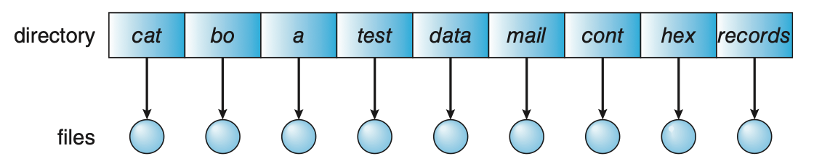
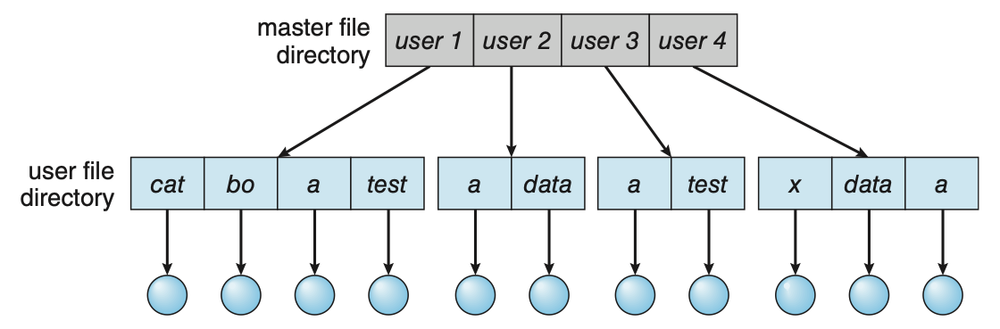
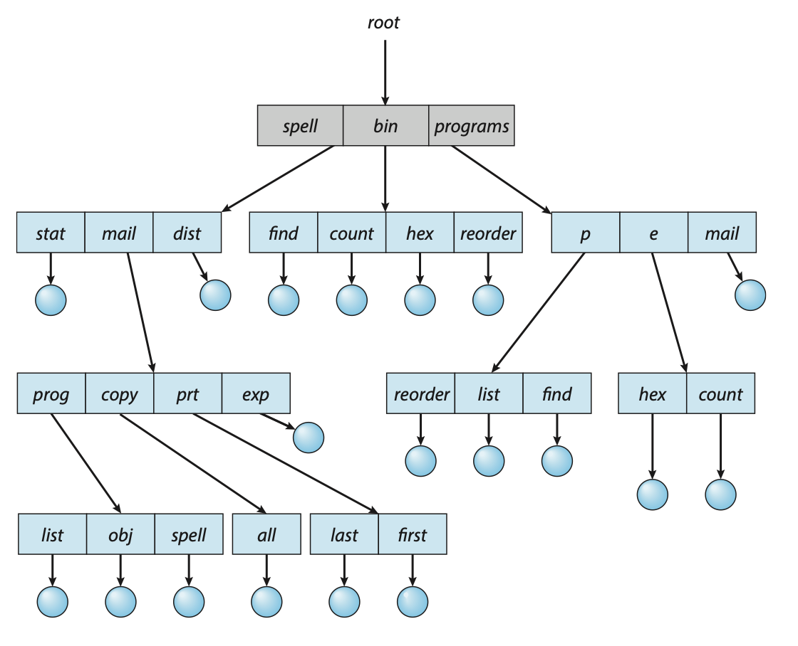
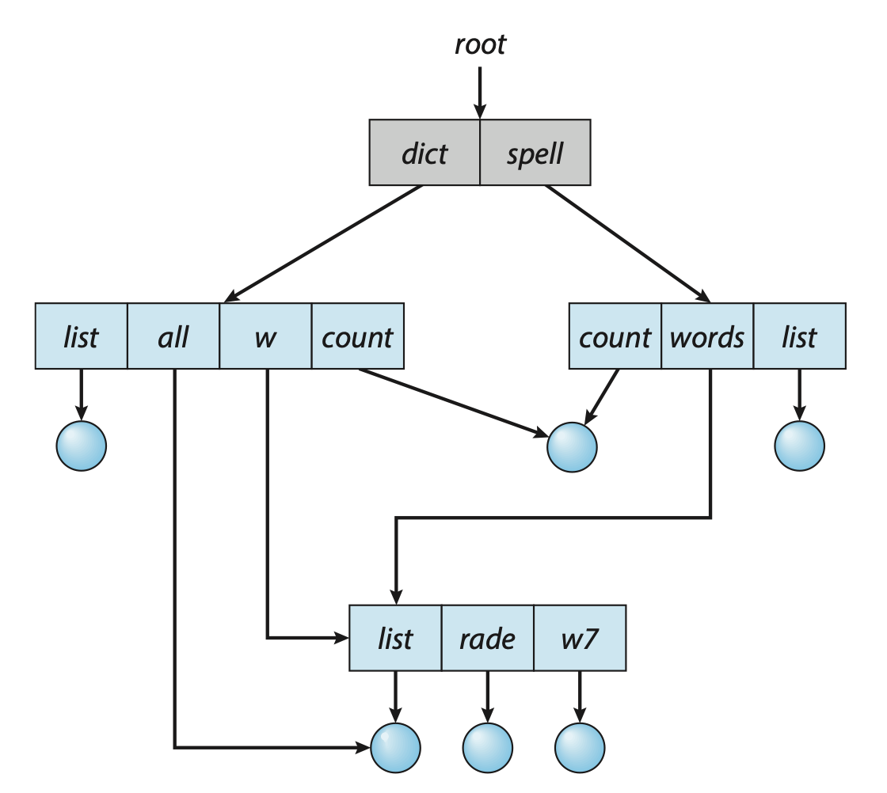
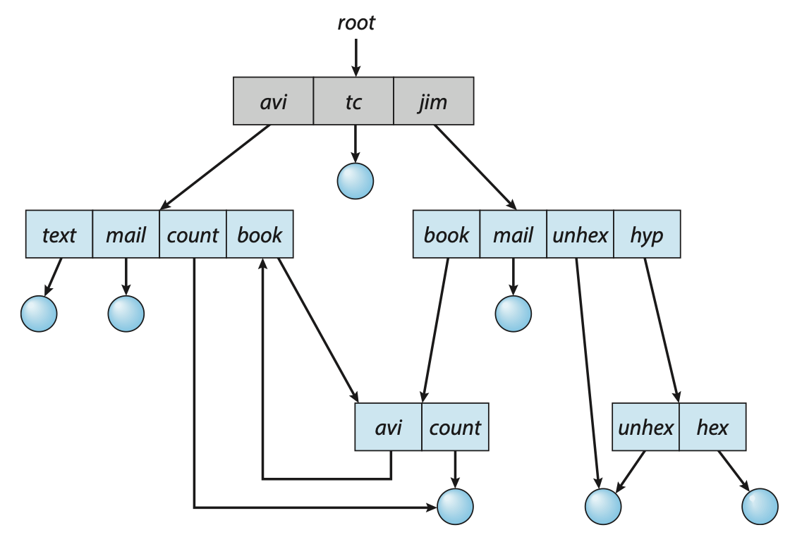

# 文件管理

## 文件

**文件**（File）是存储在计算机持久性存储设备（如硬盘、固态盘等）上的 **信息集合**，其内容可以是文本文档、图像、程序代码或其他形式的数据。在操作系统中，系统运行时以进程为基本单位进行资源的调度与分配；而用户在进行输入/输出操作时，则 **通常将文件作为逻辑操作的基本对象**。

为了支持用户对文件的创建、读取、修改、删除及安全保护等需求，操作系统提供了专门的文件系统，用以统一管理文件资源。文件系统通过对二级存储相关资源的抽象，屏蔽了文件的内部属性、存储介质的物理特性及其在设备上的具体位置等底层细节，使用户无须关心这些细节，便能方便、高效地使用文件。用户借助文件系统创建文件，并将其用于应用程序的输入与输出，从而有效管理数据资源。

??? info "自底向上看文件"

    1.  数据项。是文件系统中最低级的数据组织形式，可分为以下两种类型：
        1.  基本数据项。用于描述一个对象某一方面属性的一个值，是数据中的最小逻辑单位。
        2.  组合数据项。由多个基本数据项组成。
    2.  记录。是一组相关数据项的集合，用于描述一个对象在某一方面的完整属性。
    3.  文件。是指由创建者所定义的、具有文件名的一组相关元素的集合，可分为有结构文件和无结构文件两类。
        1.  有结构文件由若干格式相似的记录组成，如一个班级的学生记录；
        2.  无结构文件被视为一个连续的字节流，如二进制文件或普通文本文件。

### 文件属性

首先，文件必然包含实际的数据，即存储空间中所保存的信息；其次，由于操作系统需要管理大量数据，必须对这些数据进行分类和组织，因此每个文件都关联有用于分类和索引的信息；最后，不同用户对数据的访问权限存在差异，系统还需为文件设置相应的访问控制信息。

尽管不同的文件系统实现上有所差异，但通常都包含以下基本属性：

<center markdown="1">

| 属性 | 内容 |
| :---: | :---: |
| 名称 | 供用户使用的名字，在同一目录中必须唯一；不同目录可以重名。 |
| 标识符 | 系统内部标识文件的编号，例如 inode 号；其唯一性通常限定在一个文件系统内。 |
| 类型 | 用于标识文件的种类，供系统决定如何处理或打开该文件。 |
| 创建者 | 创建该文件的用户标识（ID）。 |
| 所有者 | 当前拥有该文件的用户标识（ID），通常有权修改文件属性或访问权限。 |
| 位置 | 指向文件在外存设备上物理存储位置的指针。 |
| 大小 | 文件的逻辑长度，通常以字节计；它与实际分配的磁盘空间大小可能不同。 |
| 保护 | 定义对文件的访问控制策略，包括读/写、执行等权限，用于保障文件安全。 |
| 创建时间、最后一次修改时间及最后一次访问时间 | 常用于审计、备份或缓存管理。 |

</center>

这些信息也被称为文件的元数据（meta data）。

### 文件类型

<center markdown="1">

| 分类依据 | 主要类型 |
| :---: | :---: |
| 性质和用途 | 系统文件、用户文件、库文件 |
| 数据形式 | 源文件、目标文件、可执行文件 |
| 存取控制属性 | 只读、读写、可执行；这些权限可组合 |
| 组织形式与处理方式 | 普通文件、目录文件、特殊文件（如设备文件） |

</center>

扩展名主要是命名约定和应用程序选择处理方式的依据，改名不会自动改变内容格式。操作系统不必理解普通文件的全部内容语义，记录、图像等内部格式可以由应用程序解释。

在 UNIX 系统中会在文件头中使用一串 **魔数**（magic number）来标识文件格式，例如 JPEG 的起始标记为 `FF D8`。脚本文件常用 `#!/bin/sh` 这样的首行形式指定解释器（这个就表示用 `/bin/sh` 执行）。

## 文件的访问方式

<center markdown="1">

| 访问方式 | 基本操作与特点 | 适用情形 |
| :---: | :---: | :---: |
| 顺序访问 | 从当前位置读写下一个字节或记录，指针随操作推进，可复位或跳过若干记录 | 文本扫描、批处理、磁带 |
| 直接/随机/相对访问 | 按文件内的相对块号或字节偏移访问，不必依次读出前面的数据 | 磁盘文件、数据库、随机播放 |
| 索引访问 | 先查索引得到记录或块的位置，再直接访问 | 按关键字查找、变长记录 |
| 索引顺序访问 | 先定位记录组，再组内顺序访问 | 兼顾顺序处理和检索 |

</center>

访问方式是接口能力，逻辑结构是数据组织，物理分配决定其实现代价。随机访问也不表示所有请求耗时严格相同，缓存、索引层数和寻道距离都会影响时间。

## 文件的逻辑结构 {#logical-structure}

### 无结构文件

**无结构文件**又称流式文件，向系统呈现连续的字节序列，没有由文件系统规定的记录边界。这里的“连续”描述逻辑地址，不保证磁盘块物理连续。UNIX 普通文件采用这种视图，应用程序仍可在其中组织复杂的数据。

### 有结构文件

**有结构文件**又称记录式文件，由若干记录组成；记录中的某个数据项可以作为查找用的关键字。通常，记录分为两种：

<center markdown="1">

| 记录形式 | 定位方法 | 特点 |
| :---: | :---: | :---: |
| 定长记录 | 若记录从 0 编号，长度为 $L$，第 $i$ 条的起始偏移为 $iL$ | 容易按记录号直接定位 |
| 变长记录 | 若无索引，第 $i$ 条的偏移为 $\sum_{k=0}^{i-1}L_k$ | 通常需扫描前面的长度信息；可建立索引加速 |

</center>

按照记录的组织形式，有结构文件可以分为以下三类。它们各自的组织形式也决定了其访问方式。

#### 顺序文件

记录在逻辑上按线性顺序依次排列，可采用定长或变长记录。按记录是否依关键字排序，可分为：

- **串结构**：按记录进入文件的先后顺序排列，按关键字查找通常需要顺序扫描。
- **顺序结构**：按关键字有序排列。对于定长且按键字有序的顺序文件，可通过偏移量直接定位记录，并支持折半查找等高效算法；物理实现还必须支持高效的直接访问，才能发挥这一优势。

顺序文件适合批量处理大量记录，访问局部性好，它在批量处理场景下表现最优，也是磁带等顺序存储设备的自然组织形式。

相应地，在频繁进行单条记录的查找、修改、插入或删除操作时，由于顺序文件缺乏直接定位能力且需移动大量数据，它的表现并不佳。

#### 索引文件

在顺序文件中，我们讨论过，对于变长记录，我们需要过一遍顺序扫描，效率很低。为了提高后续访问时的访问效率，无论记录本身是定长还是变长，我们都可以为每条记录建立一个定长的索引项，保存<u>关键字或记录号</u>、<u>记录（起始）位置</u>及<u>必要的长度信息</u>。查找时先检索索引表，再访问目标记录；即使记录本身变长，也能通过定长索引项快速定位。

索引可以按关键字排序，也可以针对不同检索字段建立多张索引。

显然，采用索引文件的代价是需要索引表的额外空间，以及插入、删除、修改记录时维护索引的开销。

#### 索引顺序文件

结合上面两种组织方式，我们就得到了索引顺序文件：将顺序文件分组，每组建立一个索引项。索引记录该组的代表关键字和起始位置；组间按关键字范围有序，组内可以无序排列顺序查找。当然，若组内无序，代表关键字必须能正确界定组的范围（例如该组都有某个字）。

检索分两步：先查索引确定所在组，再在组内查找。相比每条记录一个索引项，分组索引节省空间；记录很多时可继续建立多级索引。

设文件中有 $N$ 条记录，均分为 $m$ 组，那么每组大约含 $\dfrac Nm$ 条记录；假设索引表和组内都采用顺序查找，近似平均查找次数为

$$
T(m)\approx\frac m2+\frac{N}{2m}.
$$

当 $m\approx\sqrt N$ 时最小，约为 $\sqrt N$。由此，我们发现索引顺序文件可以显著提升索引效率；当记录数量很大时，还可以引入两级索引或多级索引；组内记录有序时，可以采用折半查找等方式。

#### 直接文件（散列文件）

!!! info "[哈希查找](../DS/search.md#哈希表散列表)"

对记录关键字计算哈希值，从而确定记录的物理地址。如果发生冲突，则使用冲突处理机制定位记录。

显然，直接文件的平均查找快，适合按关键字精确查询；散列冲突、扩容和范围查询则需要另行处理。

## 文件系统结构 {#filesystem-structure}

文件系统的设计需要同时解决两个问题：向上提供文件、目录和相关操作的接口，向下通过算法和数据结构，把这些逻辑对象映射到外存。将功能分层，可以把命名、权限、空间组织与设备控制分别处理。

自顶向下，一种常见的划分如下。

<center markdown="1">

| 层次 | 主要职责 |
| :---: | :---: |
| 应用程序 | 通过系统调用提出创建、打开、读写等请求 |
| 逻辑文件系统 | 管理文件名、目录、FCB、权限等元数据，完成按名存取与文件保护 |
| 文件组织模块 | 将文件逻辑块号转换为物理块号，并通过空闲空间管理器分配、回收盘块 |
| 基本文件系统 | 向设备驱动发出通用的物理块读写请求，管理内存缓冲区和缓存 |
| I/O 控制 | 包含设备驱动程序与中断处理程序，将通用请求转换为设备命令，处理传输与完成通知 |
| 设备 | 执行实际的数据存取 |

</center>

例如，用户给出一个文件路径后，逻辑文件系统先取得文件的描述信息；文件组织模块据此定位数据块；基本文件系统和 I/O 控制再共同完成块的传输。这里的层次描述职责分工，具体实现可以进一步合并或细分。

## 目录与文件 {#directory}

**文件目录** 是一种数据结构用于组织文件，建立文件名与文件描述信息之间的联系，是实现 **按名存取** 的关键。用户给出文件名或路径，系统便能定位文件，而不必让用户记住盘块地址。

目录管理还需要提高检索速度、支持文件共享与访问控制，并允许不同用户或不同目录中的文件重名。目录本身通常也以文件形式存放，其内容是所包含文件和子目录的目录项。

### 文件控制块

**文件控制块**（File Control Block，FCB）是操作系统描述和管理文件的数据结构，以实现按名存取。

每个文件对应一个 FCB，**所有 FCB 的集合构成文件目录**（也称目录文件）。创建文件时，系统就为其建立 FCB，集中保存前面介绍的文件属性，主要包括三类：

- **基本信息**：文件名、物理位置、逻辑结构和物理结构等。
- **存取控制信息**：文件主及其他用户的访问权限。
- **使用信息**：创建时间、最后修改时间等。

??? warning "有关 FCB..."
    [@Isshiki 修佬的博客](https://note.isshikih.top/cour_note/D3QD_OperatingSystem/Unit6/)中提到了 FCB 维护的到底是什么文件的信息的问题。由于我主要参考的是王道，因此在笔记里写的是王道的表述：每个文件都会被分配一个 FCB。

    但是在[维基百科](https://en.wikipedia.org/wiki/File_Control_Block)中，FCB 被定义为维护一个打开文件的状态的结构，而且 FCB 位于使用该文件的程序内存中。[微软学习文档](https://learn.microsoft.com/en-us/windows-hardware/drivers/ifs/the-fcb-structure)中也有“The FCB structure corresponds to every open file and directory.”这样支持 FCB 是打开文件的控制块的表述。

    与此同时，[Operating System Concepts (10th Edition)](https://codex.cs.yale.edu/avi/os-book/OS10/slide-dir/)（就是我们课上参考的教材）的官方课件（由编者自己写的课件）有如下表述：

    > File control block (FCB) – storage structure consisting of information about a file 
    > OS maintains FCB **per file**
    > System-wide open-file table contains **a copy** of the FCB of each file

    即认为 FCB 是磁盘上的每文件描述结构，打开时是将其副本放进[打开文件表](#open-file-table)的。

    ??? success "一种解释"
        > 下面的这些解释是我根据大模型生成的内容再加工得来的。如有错漏之处，恳请指正！

        这种范围上的差异，来源主要是由于这些不同的来源中 FCB 这个术语的适用范围。维基百科主要介绍的是 CP/M、DOS 操作系统的具体 FCB 接口，在这种情况下，应用程序提供一块内存，操作系统通过它完成文件操作，并维护访问状态；而王道和《操作系统概念》则将 FCB 视为描述文件信息的数据结构的通称。

        现代系统通常分别管理文件元数据、文件在内存中的表示，以及每次打开的状态；Linux 的磁盘 inode、内存 inode 和 `struct file` 分别对应前面说的三种职责。前面的各种来源提到的 FCB 所对应的职责都有所不同。

### 索引节点

然而，当文件数量庞大时，传统 FCB 目录会占用大量磁盘空间。查找文件时，系统需要逐块读入目录项、比较文件名，找到目标后才需要读取其余属性。若每次都读入完整 FCB，就会在检索阶段传输大量暂时用不到的信息。

因此，可以把 **文件名与描述信息分离**：将文件描述信息独立组织为 **索引节点**（index node-inode，也称 i 节点），目录项只保留 **文件名和索引节点号**。

$$
\text{文件名}\xrightarrow{\text{查目录}}\text{inode 号}\xrightarrow{\text{读 inode}}\text{文件属性与数据块地址}
$$

这样，同一个盘块可以容纳更多目录项，减少查找目录时的磁盘 I/O。例如，盘块为 1 KiB 时，64 B 的 FCB 每块只能放 16 项；分离后若目录项为 16 B，每块就能放 64 项。

为了能够兼顾持久存储和高效访问，索引节点被设计成两种形态：

??? note "磁盘索引节点"
    持久保存。每个文件有唯一的磁盘索引节点，内容包括：

    -   **文件主标识符**（标识所属的用户或用户组）
    -   **文件类型**
    -   **文件存取权限**
    -   **文件长度**（通常以字节为单位）
    -   **文件物理地址**（直接或间接记录的块地址）
    -   **文件硬链接计数**（统计本文件系统中有多少目录项指向该文件）
    -   **文件存取时间**（文件访问、修改和 inode 修改的时间）

??? note "内存索引节点"
    在文件被打开时，系统将对应的磁盘索引节点载入内存，并在此基础上增加一些运行时信息：

    -   **inode 号**
    -   **状态**（指示 i 节点是否被锁定/已修改）
    -   **访问计数**（有访问 +1，访问结束 -1；用于判断运行时是否仍有进程使用该对象，或者说能否释放）
    -   **逻辑设备号**（标识文件所属系统的逻辑设备号；在多文件系统环境下尤为关键）
    -   **连接指针**（分别指向空闲链表和散列队列；便于内核的调度和回收）

多个目录项可以指向同一个 inode，这也是后面[硬链接共享](#hard-link)的基础。

### 目录结构

#### 单级目录

整个文件系统只有一张目录表，所有文件都处于同一级。创建文件前，需要扫描目录，确认不存在同名文件；访问时按文件名查找对应目录项。

<figure markdown>
{:width="80%"}
</figure>

这种结构实现简单，但缺陷也很明显：全系统不能重名，文件增多后查找较慢，也不便分类和共享；它主要适合早期简单的单用户环境。

#### 两级目录

目录分为 **主文件目录**（Master File Directory, MFD）和 **用户文件目录**（User File Directory, UFD）：MFD 记录用户名及其 UFD 的位置，UFD 保存该用户的文件目录项。

<figure markdown>
{:width="80%"}
</figure>

查找时，系统先定位到用户，再从其 UFD 继续查找。

不同用户的文件可以重名，检索范围也随之缩小，便于用户之间的隔离和保护。不过，每个用户的 UFD 仍然是扁平结构，无法继续按项目或文件类别分组。

#### 树形目录

如果我们将目录本身也视为一种特殊的文件，允许目录中继续包含子目录，就得到以根目录为起点的 **树形目录**。

在纯树形结构中，每个非根节点只有一个父节点，文件由从根出发的路径唯一确定。路径名有两种形式：

- **绝对路径**：从根目录开始，如 `/home/student/os/file.md`。
- **相对路径**：从进程的当前工作目录开始。若当前工程目录为 `/home/student`，则 `os/file.md` 指向上述文件。

许多操作系统使用 `.` 表示当前目录，`..` 表示父目录。进程可以改变当前工作目录，从而缩短路径输入，并减少反复从根解析相同上层目录的工作。

<figure markdown>
{:width="80%"}
</figure>

树形目录便于分类、管理和保护：它能按层次组织文件，在不同分支中使用相同文件名，并对不同目录独立地设置访问权限。

> 使用过任何操作系统的命令行的读者朋友应该都会对树形目录已经有了一个了解。

当然，这不是说树形目录完全没有代价。遇到较深的路径时需要逐级查找，这可能增加磁盘 I/O；纯树的结构本身也不能直接表示一个文件属于多个目录的共享关系。但总体来说，凭借其良好的组织性、扩展性以及对多用户环境的支持，这些代价可谓瑕不掩瑜；当前的绝大多数现代操作系统也都采用树形目录结构。

#### 无环图目录

在树形目录中增加指向已有文件或子目录的共享边，并保持整个结构无环，就得到 **无环图目录**。一个节点可以出现在多个目录下，用户共享同一实体而无须各自保存数据副本。

<figure markdown>
{:width="80%"}
</figure>

但共享节点删除操作的复杂性也不容忽视：不能直接物理删除整个共享节点而破坏其他用户仍在使用的实体。所以我们需要一些机制来解决这个问题，这就涉及到计数的问题。

具体的引用计数与链接机制，我们放在后面的[文件共享](#file-sharing)中展开。

#### 一般图目录

无环图目录通过保证不存在环来保证文件系统的简洁性，避免遍历目录时候出现死循环或者删除文件时出现的循环依赖等问题。如果允许共享边形成环，目录便成为一般图。

<figure markdown>
{:width="80%"}
</figure>

此时我们就需要额外注意一些事情来避免可能出现的问题。例如，图遍历时需要记录访问状态或限制跟随链接的次数，以免无限循环；仅靠引用计数也可能无法回收已经不可达、却相互引用的节点，需要结合可达性检查等回收机制。

!!! tip "想要复习[图论](../DS/graph.md)？"

### 目录的操作

目录操作主要改变命名关系和组织层次。

<center markdown="1">

| 操作 | 主要工作 |
| :---: | :--- |
| 搜索 | 在目录中查找与给定名称匹配的目录项；多级路径需要逐级解析 |
| 创建文件项 | 检查同目录重名情况，无重名则建立新目录项并初始化其属性 |
| 删除文件项 | 移除目录项；结合共享和使用状态判断是否同时回收文件实体 |
| 创建目录 | 建立子目录，使文件能够继续分组和嵌套 |
| 删除目录 | 空目录可直接删除；非空目录需先用户清空，或自动递归删除其中内容 |
| 移动 | 将文件或子目录的命名关系迁移到另一父目录，随后更新路径名 |
| 显示目录 | 列出文件和子目录的名称，以及需要显示的相关属性 |
| 改变目录 | 修改进程的当前工作目录，作为后续相对路径的起点 |

</center>

### 目录实现

访问文件时，操作系统根据路径名定位相应的目录项，而目录项中包含用于查找文件磁盘块所需的关键信息。目录实现的核心目标是高效支持查找操作，因此主要有两种基本方法。

#### 线性列表

将文件名及其定位信息（数据块指针）组织成线性表，查找时逐项比较。创建前先确认无重名，再新增目录项；删除时即根据文件名查找并释放其占用的空间。为了重用被删除的目录项对应的块可标记表项为空闲、挂入空闲链，或用末项填补空位。

优点是实现简单；缺点是目录越大，顺序扫描越慢。当然，有几个老生常谈的优化措施：若目录项按文件名有序，可采用折半查找，但插入和删除同样需要维护有序性；也可使用平衡树、B+ 树等索引组织。

#### 哈希表

对文件名计算哈希值，定位到哈希表中的某个元素，该元素通常存放一个目录项指针，再核对文件名。平均查找速度较快，但必须处理不同文件名的哈希冲突，还要考虑表容量和扩容。

无论采用哪种方法，将活跃目录缓存到内存，都能减少重复查目录造成的磁盘读取。

### 文件的物理分配 {#allocation}

文件物理结构关注 **文件数据如何在磁盘上分布与组织**。它与[文件的逻辑结构](#logical-structure)不同，逻辑上相邻的记录，在物理实现上可以有不同的方式；物理实现会影响逻辑访问的效率。

文件分配方式直接决定文件的物理结构，常用策略有三种：连续分配、链接分配和索引分配。

#### 盘块与簇

文件系统按固定大小的块组织外存空间，并以块为粒度进行底层数据交换。若以若干连续盘块构成一个分配单元，则称为 **簇**（cluster）。簇增大后，需要管理的分配单元和指针变少，但文件尾部未用满的空间可能增大，形成内部碎片。

设块大小为 $B$ 字节，文件内字节偏移为 $x$，逻辑块号和偏移均从 0 开始，则

$$
q=\left\lfloor\frac{x}{B}\right\rfloor,\qquad r=x\bmod B.
$$

其中，$q$ 是文件内逻辑块号，$r$ 是块内偏移。接下来还需根据分配方式，将 $q$ 转换为物理块号。

#### 连续分配

一个文件占据一段连续的盘块，目录项或 FCB 记录 **起始块号和占用的块数**。若起始块为 $s$，长度为 $n$ 块，则占据 $s$ 到 $s+n-1$，逻辑块 $q$ 对应物理块 $s+q$。

连续分配支持顺序访问和直接访问，连续读写时寻道较少。但它的主要问题是：

- 需要足够大的连续空闲区，容易产生 **外部碎片**。
- 需要预先知道文件大小，且难以支持文件动态增长：后方空间被占用时，增长可能需要迁移整个文件，否则强行扩展可能覆盖物理上相邻的其他文件。
- 为维持数据的连续排列，中间插入、删除记录可能导致大量数据移动。

整理可以搬移文件、合并零散空闲区，但复制数据的代价较大。另一种改进是 **区段**（extent）：文件由若干段连续空间组成，每段记录起始位置和长度，增长时再分配新区段，不要求整个文件始终连续。

#### 链接分配

文件的盘块可以分散存放，通过指针确定先后次序。它不要求连续空闲空间，便于按需增长，也便于在已找到的位置插入或删除整块。根据指针存储的位置，可分为隐式链接和显式链接。

-   **隐式链接** 目录项记录首块的盘块号和尾块号，将下一块的地址保存在当前数据块内。

    这种方式的局限性在于
    
    -   访问后面的块时，需要从已知位置沿链逐块读取，因此隐式链接仅支持顺序访问；
    -   每块都要占用一定空间去存指针；
    -   若指针损坏，后续链可能无法到达。
    
    将多个连续盘块组成一个簇后再链接，可以减少指针数量和链长（就可以缓解上述问题），但会增加尾簇内部碎片的可能。

<a id="fat"></a>

-   **显式链接** 把物理块块指针集中放入 **文件分配表**（File Allocation Table，FAT）。整个文件系统中仅设一张 FAT（FAT 是全局的），每个表项与一个磁盘块对应。所以，目录项只需保存文件的首块号，再沿 FAT 获得后续块号。

    例如，`FAT[2]=8`、`FAT[8]=5`、`FAT[5]=EOF`，表示文件依次占用 `2 → 8 → 5` 三块。FAT 持久保存在磁盘上，在系统启动时即被载入内存。因此在访问某个逻辑块时，可以在内存中查链，定位后直接读目标块而无须读取沿途的数据块。

    表项还可以用特殊值标记空闲、坏块等状态，因此系统可直接利用 FAT 管理磁盘的空闲空间等。

    综上，显式链接除了支持顺序访问，还支持直接访问。使用 FAT 时，检索操作均在内存中完成，不仅显著提升了查找速度，也大幅减少磁盘 I/O 次数。当然，不可避免的是，全卷 FAT 的内存开销随分配单元数量增加。

#### 索引分配

为每个文件建立独立的 **索引块**，按逻辑块次序存放数据块的物理块号，FCB 或 inode 保存索引块地址。与 FAT 按全卷物理块组织表项不同，文件索引表的第 $q$ 项直接对应该文件的逻辑块 $q$。

索引分配支持直接访问，数据块可离散分配，不产生要求连续空间所导致的外部碎片；代价是索引本身占用空间，小文件也可能需要一个未用满的索引块。

设索引块与数据块均为 $B$ 字节，块地址占 $p$ 字节，则一个索引块能存放

$$
K=\left\lfloor\frac{B}{p}\right\rfloor
$$

个地址项。

1. **单级索引**：一个索引块直接指向最多 $K$ 个数据块，文件数据容量上限为 $K\times B$。
2. **链接索引**：把多个索引块串成链，扩展索引容量。索引块需要为链指针预留空间，访问后面的索引块仍要沿链查找。
3. **多级索引**：上层索引块保存下层索引块地址，最后一级再指向数据块。若有 $m$ 级且各级均能容纳 $K$ 项，则最多覆盖 $K^m$ 个数据块，数据容量为 $K^mB$。

例如，$B=4$ KiB、$p=4$ B 时，$K=1024$；单级索引覆盖 4 MiB，二级索引覆盖 4 GiB。多级索引能容纳大文件，但未命中缓存时，访问数据需要逐级读取索引。

二级索引中，逻辑块号 $q$ 对应的主索引项为 $\lfloor q/K\rfloor$，下层索引项为 $q\bmod K$；字节在数据块内的偏移仍为 $r$。这与多级页表按字段逐级定位的思想相似。

#### 混合索引

在 inode 中同时设置直接地址和多级间接地址，可以兼顾不同大小的文件：小文件通过直接地址访问，超出部分再依次使用一次、二次和三次间址。

若有 $d$ 个直接地址项，各有一个一次、二次和三次间接地址项，则

$$
L_{\max}=(d+K+K^2+K^3)B.
$$

下面以 **10 个直接地址项 + 3 个间接地址项**、$B=4$ KiB、$p=4$ B 为例。

<center markdown="1">

| 地址部分 | inode 中保存的地址指向 | 此部分新增的数据容量 | 使用至此的累计容量 |
| :---: | :---: | :---: | :---: |
| 10 个直接地址 | 数据块 | 40 KiB | 40 KiB |
| 一次间址 | 存放数据块地址的索引块 | 4 MiB | 4 MiB + 40 KiB |
| 二次间址 | 指向一次间址块的主索引块 | 4 GiB | 4 GiB + 4 MiB + 40 KiB |
| 三次间址 | 再增加一层索引的主索引块 | 4 TiB | 4 TiB + 4 GiB + 4 MiB + 40 KiB |

</center>

表中计算的是 **文件数据容量**，不包含索引块占用的空间。不同方案的地址项数量可以不同，例如也有 12 个直接地址加 3 个间接地址的组织；计算时应使用给定的结构参数。

定位时先判断逻辑块属于哪一段，再减去此前各段覆盖的块数。例如，一次间址段使用 $q-d$ 作为索引；二次间址段先取 $t=q-d-K$，再用 $\lfloor t/K\rfloor$ 和 $t\bmod K$ 逐级定位。

!!! tip "访问次数要先说明缓存和计数范围"

    假设 FCB／inode 已在内存、相关索引未缓存，只统计取得目标数据所需的读盘，且记录与数据块一一对应：连续分配访问第 $n$ 块需 1 次；隐式链接从首块查到第 $n$ 块需 $n$ 次；$m$ 级索引需读取 $m$ 个索引块和 1 个数据块，共 $m+1$ 次。混合索引的直接地址部分只需读数据块。FAT 已在内存时，查链本身不增加磁盘读取。

    若目录、inode 或索引已经缓存，或题目要求统计写回，还需按实际条件调整，不能只套用级数。

这里讨论已分配块的组织；未分配块的登记、分配和回收，放在后面的[文件存储空间管理](#free-space)中讨论。

### 文件的操作 {#file-operations}

操作系统通过系统调用提供文件操作。这里先说明创建、删除和数据访问，再讨论如何用打开文件表保存访问状态。

#### 创建与删除

**创建文件**通常经过以下步骤：

1. 检查文件名是否合法、同目录是否重名，以及用户对目标目录是否有相应权限。
2. 分配 FCB 或 inode，初始化文件类型、所有者、权限、长度、时间戳和块指针等信息。
3. 按需要预留或分配数据块，登记其地址。
4. 在父目录中建立“文件名 → 文件描述信息”的目录项。
5. 更新空闲 inode、空闲块、目录大小和时间等元数据；若接口同时执行打开，还需建立打开状态并返回描述符。

创建与打开是两个动作，可以由同一接口组合完成。创建空文件也不一定立即分配数据块，数据空间可以在写入时按需取得。

**删除文件**先按路径找到目录项，检查目录操作权限，再移除该名字并更新引用状态。若仍有其他[硬链接](#hard-link)，就保留共享实体；满足回收条件时，系统才根据 inode 释放数据块、索引块和 inode，并更新空闲空间等信息。

#### 数据访问与其他操作

<center markdown="1">

| 操作 | 核心工作 |
| :---: | :---: |
| 读取 `read` | 从当前读写位置取得数据，送到用户缓冲区，并按实际读取量推进位置 |
| 写入 `write` | 将用户缓冲区中的数据写到当前位置，推进位置；必要时分配新块，更新块地址、文件长度和时间 |
| 定位 `seek`／`lseek` | 改变下一次读写的文件内偏移，定位本身通常不传输文件内容 |
| 截断 `truncate` | 缩短或调整文件长度；截到 0 时清空内容，但保留文件身份及仍适用的属性 |
| 加锁 `lock` | 协调多个访问者对文件或记录区间的并发操作 |

</center>

锁解决并发协调问题，访问权限则决定用户能否执行相应操作。

!!! example "一个共享读锁和独占写锁的具体例子"
    [Linux fcntl_locking(2)](https://man7.org/linux/man-pages/man2/fcntl_locking.2.html)。

#### 打开文件表 {#open-file-table}

若每次读写都按文件名重新查找目录、读取元数据，重复开销会很大。**打开**把后续访问所需的信息保留在内核中，并返回一个描述符或句柄，使后续操作可以直接找到访问状态。

**文件描述符**（file descriptor，fd）是进程打开文件表的索引，通常为非负整数；Windows 使用文件句柄（file handle）这一概念。它与文件名、inode 号和物理地址属于不同层次，不同进程中的相同 fd 数值也不一定表示同一个文件。

一种常用的两级打开文件表模型如下。

<center markdown="1">

| 层次 | 保存的主要信息 |
| :---: | :---: |
| 进程打开文件表 | 本进程的读写位置、访问方式、权限及指向系统表项的引用 |
| 系统打开文件表 | 共享的文件位置、大小、访问时间等信息，以及打开计数；可关联活动 FCB／inode |

</center>

在这一模型中，多个进程打开同一文件，可以复用系统级文件信息，同时维护各自的访问状态。打开计数用于判断系统表项是否仍被使用；在每个进程只打开一次的简化情形下，可以把它看作打开该文件的进程数。

打开一个已有文件的过程为：

1. 根据路径逐级查找目录，取得目标文件的 inode 号。
2. 查找已有的活动文件信息；必要时将磁盘 inode 载入内存。
3. 检查请求的打开方式是否符合文件访问权限。
4. 建立或引用系统表项，维护打开计数，再分配进程表项，初始化本次访问状态。
5. 将进程表项的索引 fd 返回给调用者。

**打开并不要求把整个文件读入内存**。文件内容通常在实际读取、预读或映射访问时按需载入。

随后，`read(fd, buf, n)` 等操作通过 fd 取得访问状态，根据文件偏移和分配结构定位数据，利用缓存或设备 I/O 完成传输，再更新偏移。`read`、`write`、`lseek`、`close` 使用 fd；删除、重命名等路径操作仍可使用文件名。

**关闭**时撤销相应进程表项，递减系统表项的打开计数；不再被引用的运行时结构可以释放，修改过的元数据按需更新。正常关闭不会删除文件名，也不会因为关闭而回收仍存在的文件数据。

??? info "Linux 中的打开文件描述"

    Linux 的具体关系是 `进程 fd 表 → 打开文件描述（file 对象）→ inode`。文件偏移和状态标志保存在打开文件描述中。分别调用两次 `open` 通常产生两个独立的打开文件描述；`dup` 或 `fork` 继承的描述符则可以共享同一打开文件描述和偏移。因此，不能把“同一文件始终只有一个系统表项”或“不同进程的偏移必然独立”当成所有系统的实现规律。参见 [Linux open(2)](https://man7.org/linux/man-pages/man2/open.2.html)。

### 文件共享 {#file-sharing}

文件共享使多个用户访问同一份物理数据，避免副本浪费和内容不一致。共享不仅要让不同名字找到相同数据，还要让文件增长、属性变化等更新对各访问者一致可见；因此，不能只是把当时的数据块地址复制到多份目录项中。

#### 硬链接 {#hard-link}

**硬链接**通过多个目录项指向同一个 inode。文件块地址和属性只保存在这个公共 inode 中，增加链接不会复制数据，也不会自动改变文件所有者。

inode 中的硬链接计数记录指向它的目录项数量。新建文件通常为 1；增加硬链接时加 1；删除一个名字时减 1。只要仍有名字指向该文件，就应保留其 inode 和数据。

例如，`A` 的硬链接计数起初为 1，建立另一个硬链接 `B` 后变为 2。删除 `A` 只把计数减到 1，`B` 仍能访问原来的文件。硬链接之间没有必须长期保留的“原文件名”，各名字都指向同一实体。

#### 软链接

**软链接**，也称符号链接，是一个独立的链接文件，内容保存目标文件的路径。访问链接时，系统读取并解析目标路径，再定位实际文件。

它有自己的 inode，不增加目标文件的硬链接计数。若目标路径消失，链接便成为 **悬空链接**；删除链接本身不会删除目标。沿用上例，若 `C` 保存路径 `A`，删除 `A` 后即使 `B` 仍保有原文件，`C` 也无法再通过路径 `A` 找到它。

软链接需要额外存储路径和链接文件的元数据，访问还可能增加路径解析与读盘开销。

??? note "链接的实际使用范围"

    UNIX 中的硬链接通常限制在同一文件系统内，且不允许普通用户随意建立目录硬链接；符号链接可以指向目录，也可以通过路径跨文件系统。相对目标路径以链接所在目录为起点解释，符号链接还可能形成解析循环。参见 [Linux symlink(7)](https://man7.org/linux/man-pages/man7/symlink.7.html)。

    在网络共享中，路径还需要通过已建立的远程文件访问机制解释；本地符号链接本身不会执行网络传输。

!!! note "删除名字与释放实体可以发生在不同时刻"

    硬链接计数降到 0 后，如果文件仍被打开，支持延迟回收的系统会保留其数据，直到有关打开引用释放。因而，硬链接计数描述名字关联，打开计数描述运行时使用，判断回收条件时需要同时考虑二者。

### 文件保护 {#sharing-protection}

文件保护控制 **谁能对文件执行什么操作**，避免未授权访问或意外修改。常见受控操作有读、写、执行、追加、删除和列目录。其中，追加只允许在末尾增加数据，与任意位置的写入不同。

复制、打印、编辑等高层操作最终由底层读写等操作完成。例如，读取源文件是复制的基础；单凭源文件读权限，不能保证内容不会被复制或打印。

#### 访问控制列表

**访问控制列表**（Access-Control List，ACL）附属于文件或目录，记录用户或用户组及其允许的访问类型。它能表达灵活的授权策略，但列表长度不定，用户很多时管理开销较大。

一种精简办法是把用户分为 **拥有者、组、其他用户**，再为每类设置独立权限位。例如：

<center markdown="1">

| 用户类别 | 读 | 写 | 删除 | 执行 |
| :---: | :---: | :---: | :---: | :---: |
| 拥有者 | 1 | 1 | 1 | 1 |
| 组 | 1 | 0 | 0 | 0 |
| 其他用户 | 0 | 0 | 0 | 0 |

</center>

每种权限用一位表示，三类用户、四种权限共需 $3\times4=12$ 位。检查时先判断是否为拥有者，再判断是否属于相应组，否则使用其他用户权限。

UNIX 常见的基本权限是三组 `rwx`，分别表示拥有者、组和其他用户的读、写、执行权限，共 9 位。例如，`-rw-r-----` 表示普通文件，拥有者可读写，组可读，其他用户无权限；`d` 开头表示目录。

??? info "目录权限的含义"

    对目录而言，`r` 允许读取目录项列表，`x` 允许搜索和穿过目录，`w` 允许修改目录项。创建和删除名字通常需要父目录的写与搜索权限，不能仅根据目标文件自身的写权限判断；具体还可能受 sticky bit 等规则限制。参见 [Linux inode(7)](https://man7.org/linux/man-pages/man7/inode.7.html)。

#### 口令与加密

<center markdown="1">

| 机制 | 思路 | 主要代价与局限 |
| :---: | :---: | :---: |
| 口令保护 | 用户提供正确口令后，系统允许访问文件 | 实现简单，但共享口令的分发、保存和撤销不便，简单存储方式安全性有限 |
| 加密保护 | 文件内容以密文保存，持有正确密钥才能解密 | 有加解密计算与密钥管理成本 |

</center>

口令与加密主要解决访问凭据和内容保密问题，仍需结合访问控制，才能区分读、写、执行等操作。多级目录还需要对目录及其子树提供保护；备份与故障恢复则在后面的[一致性与恢复](#performance-recovery)中讨论。

## 文件系统 {#filesystem-layout}

### 文件系统布局

文件系统不仅有文件管理软件，还包括被管理的文件，以及目录、inode、空闲空间结构等管理数据。本节从持久化存储和运行时管理两个角度观察其布局。

#### 磁盘中的结构

一个磁盘通常可以划分为多个分区，各分区建立相应的文件系统。以下是传统分区方案下的一种示意布局，各文件系统的实际排列可以不同。

```text
磁盘：主引导区（含分区表等） | 分区 1 | 分区 2 | ……

分区内部的一种布局：
引导块 | 超级块 | 空闲空间管理信息 | inode 区 | 根目录 | 其他文件与目录
```

<center markdown="1">

| 结构 | 保存的信息与作用 |
| :---: | :---: |
| 主引导记录 MBR | 在传统 BIOS/MBR 启动方案中位于磁盘起始扇区，包含主引导代码和分区表等信息 |
| 引导块／引导控制块 | 保存卷的启动信息或引导程序，用于继续加载操作系统；Windows 中也称分区引导扇区 |
| 超级块／卷控制信息 | 保存整个文件系统的参数，如总块数、块大小、空闲块与空闲 inode 数量及相关管理位置 |
| 空闲空间结构 | 记录哪些分配单元尚未使用，支持后续分配和回收 |
| inode 等每文件描述结构 | 保存单个文件的属性和块定位信息 |
| 根目录及其他目录 | 建立文件命名和组织关系 |
| 文件数据区 | 保存普通文件内容及目录内容等数据 |

</center>

在上述启动模型中，BIOS 读取并执行主引导代码，由其定位活动分区并移交给分区引导程序，继续加载操作系统。引导块保存的是启动所需的信息，不能理解为整个操作系统都放在其中；这一流程也只描述特定启动方案。

超级块在挂载时被读取，用于建立内存中的文件系统管理信息。它描述整个文件系统，inode 描述单个文件，目录项提供文件名关联，三者职责不同。

#### 内存中的结构

<center markdown="1">

| 结构 | 作用 |
| :---: | :---: |
| 挂载表 | 记录已挂载文件系统的设备、挂载点、类型及选项 |
| 内存中的卷信息 | 保存超级块等全局信息的运行时表示，支持空间管理与状态维护 |
| 目录缓存 | 保存近期访问的目录信息，加速路径解析 |
| 活动 inode／FCB | 保留文件属性及运行时引用状态 |
| 系统级与进程级打开文件表 | 关联共享文件信息和进程的访问状态，具体过程见[打开文件表](#open-file-table) |
| 数据缓冲区与缓存 | 暂存盘块内容，协调传输并复用已读入的数据 |

</center>

运行期间，内存中的状态会不断变化；需要持久保存的更新还应写回磁盘。运行时表项和缓存不必全部对应某个原样存放的磁盘结构。

### 文件存储空间管理 {#free-space}

空间管理维护外存中 **尚未分配的区域**，按需向文件提供盘块，并在释放时收回。它与前面的[文件分配方式](#allocation)配合：前者回答哪些块可用，后者回答取得这些块后如何组织成文件。

#### 空闲表法

为每个连续空闲区建立一个表项，记录起始盘块号和盘块数，通常按起始块号递增排列。

分配时，按首次适应、最佳适应等策略选择足够大的空闲区；若只取其中一部分，就更新剩余区的起点和长度。回收时，检查释放区与前后空闲区是否物理相邻，必要时合并。

它便于寻找连续空间，分配和回收思路类似[动态分区管理](./memory.md#动态分区分配)。若采用计数方式组织空闲区，同样可以用“起始块号 + 连续块数”压缩逐块记录。

#### 空闲链表法

按链节点的粒度，可分为两种形式。

<center markdown="1">

| 形式 | 节点内容 | 分配与回收 | 特点 |
| :---: | :---: | :---: | :---: |
| 空闲盘块链 | 单个空闲盘块及下一空闲块指针 | 从链中摘下盘块；回收时重新接入链 | 单块操作简单，但链长较长，批量分配和寻找连续块不方便 |
| 空闲盘区链 | 连续空闲区的起点、长度和下一盘区指针 | 选择满足需求的盘区，必要时分割；回收时检查相邻区并合并 | 链较短，适合连续区管理，但分割、合并更复杂 |

</center>

这里链接的是 **空闲块或空闲区**，与隐式链接分配中串接一个文件的数据块不同。

#### 位示图法

**位示图**（bitmap，也称位图）为每个盘块或簇设置一个比特位，用来表示分配状态。本节约定 **0 表示空闲，1 表示已分配**；若题目约定相反，置位与清零操作也随之交换。

- 分配：扫描空闲位，换算出对应块号，再将这些位置为 1。
- 回收：由块号确定对应位，再置为 0。

相邻位可以表示相邻盘块，因此较容易寻找连续空闲空间。若管理 $N$ 个分配单元，位图需 $N$ 位，即 $\lceil N/8\rceil$ 字节；结构紧凑，但其大小仍随分配单元总数增加。例如，1 GiB 空间按 4 KiB 块管理，有 $2^{18}$ 块，位图需 32 KiB。

若每行有 $w$ 位，块号 $b$、行号 $i$、列号 $j$ **均从 0 开始**，则

$$
b=iw+j,\qquad
i=\left\lfloor\frac{b}{w}\right\rfloor,\qquad
j=b\bmod w.
$$

若三者 **均从 1 开始**，则

$$
b=(i-1)w+j,\qquad
i=\left\lfloor\frac{b-1}{w}\right\rfloor+1,\qquad
j=(b-1)\bmod w+1.
$$

计算前应先确认三种编号的起点；若起点混用，可以先转换为从 0 开始的位偏移，再换回题目要求的编号。

#### 成组链接法

将空闲块号分组，每组保存一批空闲块号及数量，并利用连接块保存下一组信息。内存中只保留当前一组，构成 **空闲盘块号栈**；跨组时才读取下一组，避免逐块沿长链读取。

```text
内存中的当前组：[连接块 G，若干空闲块号]
                         │
                         └→ 块 G 保存：[连接块 H，下一组空闲块号]
                                               │
                                               └→ …… → 结束标志
```

**分配**时，从栈中取出块号；当取到连接块时，先将它保存的下一组块号和数量读入内存，再把这个块分配给文件。否则，一旦覆盖连接块，就会丢失后续空闲组的信息。

**回收**时，若栈未满，直接压入块号；若栈已满，则把当前栈的块号和计数写入新回收的块，让它成为连接块，再在内存栈中保留该块号，后续回收继续压栈。

组内块号不要求连续；分组容量、栈的分配次序和结束标记由具体方案规定。空闲管理信息需要持久保存，挂载时读入有关信息，并在运行中维护内存与磁盘状态的一致性。

### 虚拟文件系统 {#vfs-mount}

**虚拟文件系统**（Virtual File System，VFS）在应用程序与具体文件系统之间提供统一抽象。应用程序使用相同的 `open`、`read`、`write` 等接口，VFS 根据文件所属的实现，将请求分发给 ext、FAT、NTFS 或网络文件系统等。

VFS 本身是内核中的抽象层，没有需要单独格式化的磁盘布局。它的主要作用是屏蔽实现差异，使不同文件系统共存；文件的实际存储布局和设备访问仍由具体实现处理。

#### 四类主要对象

对象包含通用数据和操作函数，具体文件系统提供相应实现。常见模型包含以下四类对象。

<center markdown="1">

| 对象 | 表示的内容 | 关键信息 |
| :---: | :---: | :---: |
| 超级块对象 | 一个已挂载的文件系统实例 | 全局参数、状态，以及分配 inode、同步等操作 |
| V 节点对象（vnode） | 一个具体的文件或目录实体 | 通用文件属性、对底层私有元数据的引用及相关操作 |
| 目录项对象（dentry） | 路径中的名字及目录关系 | 名称、父目录关系、对应文件节点，用于路径缓存 |
| 文件对象（file） | 一次打开形成的访问上下文 | 当前读写位置、访问模式、引用计数及对应节点 |

</center>

V 节点统一封装文件描述信息，与磁盘上的具体 inode 不属于同一层次。目录项对象在路径解析中建立，也不一定原样对应磁盘上的某个目录项；多个名字可以关联同一文件节点。文件对象随打开访问建立，相关引用释放后可以销毁。

??? info "Linux 的对象命名"

    Linux 通常用 **VFS inode** 表示这里的通用文件节点。它与 superblock、dentry、file 对象协作；其中 file 保存一次打开的访问状态，inode 表示文件实体。这些内存对象通过具体文件系统提供的操作函数完成请求。参见 [Linux VFS 文档](https://docs.kernel.org/filesystems/vfs.html)。

#### 请求的分发

以 `write(fd, buf, n)` 为例：系统根据 fd 找到文件对象及对应文件节点，通过其操作接口调用具体文件系统的写方法；具体实现更新缓存和必要的元数据，再由下层 I/O 将数据写向设备。

同一个接口可以对应不同实现，这与面向对象中的多态类似。新文件系统只有实现相应接口后，才能接入这一统一模型。

### 文件系统挂载 {#mount}

**挂载**（mount）把一个文件系统接入当前可见的文件命名空间。接入位置称为 **挂载点**；用户通过该位置访问被挂载文件系统中的文件。

挂载需要确定设备或文件系统来源、类型、挂载位置和有关选项，读取并验证必要的元数据，建立内存管理对象，再将其根目录与挂载位置关联，并登记挂载信息。

- **UNIX** 以 `/` 为统一根，启动时挂载根文件系统，其他文件系统可在启动阶段或运行期间接入目录树。
- **Windows** 常用 `C:`、`D:` 等驱动器号访问不同卷，也支持目录形式的装入点。

例如，将设备上的 ext2 文件系统挂载到已有目录 `/mnt/data`：

```sh
mount -t ext2 /dev/example /mnt/data
umount /mnt/data
```

格式化建立文件系统的磁盘结构，挂载建立访问入口，打开则建立某个文件的访问上下文，三者处理的对象和时机不同。

## 典型文件系统 {#filesystem-examples}

### FAT 与长文件名

FAT12、FAT16、FAT32 使用前面的[文件分配表](#fat)组织簇链。经典 FAT 目录项为 32 B，保存短文件名、属性、首簇号、文件大小和时间等信息；长文件名由若干附加目录项配合短文件名项保存。

??? info "长文件名目录项的编码"

    每个长文件名项也是 32 B，可保存 13 个 16 位字符单元，属性为 `0x0F`。各片段在短文件名项之前按序号倒序排列，末片段带 `0x40` 标志。按从 0 开始的字节偏移，12 为类型，13 为短文件名校验和，26–27 为置零字段。末片段有余位时，先用 `0x0000` 终止，再以 `0xFFFF` 填充。普通短项的 `0x20` 是归档属性位，不能把它看成所有短文件名项固定的属性值。参见 [Microsoft FAT 规范，第 7 节](https://www.scs.stanford.edu/~zyedidia/docs/_other/fat.pdf)。

    exFAT 使用分配位图管理簇的占用状态，FAT 项仍为 32 位，而文件长度等字段可以为 64 位，不能概括为“64 位 FAT”。参见 [Microsoft exFAT 规范](https://learn.microsoft.com/en-us/windows/win32/fileio/exfat-specification)。

### NTFS 与主文件表

NTFS 的 **主文件表**（Master File Table，MFT）由文件记录组成，文件和目录的描述信息都保存在其中，每个文件或目录至少对应一条记录。记录包含固定格式的头部，以及文件名、数据等属性。MFT 的前 16 条记录为特殊元数据文件保留。

??? note "MFT 记录与文件内容"

    常见教学示例使用 1 KiB 的 MFT 记录；具体记录长度可以通过卷信息中的 `BytesPerFileRecordSegment` 字段查询。单条记录放不下的属性可使用扩展记录。MFT 管理的是大量文件记录，其职责不能直接等同于 UNIX 中仅保存全局参数的超级块。参见 [Microsoft MFT 说明](https://learn.microsoft.com/en-us/windows/win32/devnotes/master-file-table)及 [NTFS 卷信息结构](https://learn.microsoft.com/en-us/windows/win32/api/winioctl/ns-winioctl-ntfs_volume_data_buffer)。

## 文件系统的性能与恢复 {#performance-recovery}

### 页缓存

**页缓存**（page cache）以内存页为单位缓存文件内容，使文件访问能够与虚拟内存管理配合。它的收益来自复用内存中的文件数据、减少实际设备 I/O，不能仅归因于“虚拟内存接口更快”。[内存映射文件](./memory.md#内存映射文件)介绍了把文件区域映射到进程地址空间的访问方式。

??? info "页缓存与写回"

    Linux 的普通文件读写和文件映射通常通过页缓存完成。修改后的脏页需要写回存储设备；延迟写回可以合并更新，但写调用成功与数据已经持久保存是不同事件。需要持久性保证时应使用相应同步机制。参见 [Linux Page Cache](https://docs.kernel.org/mm/page_cache.html)和 [fsync(2)](https://man7.org/linux/man-pages/man2/fsync.2.html)。

### 一致性检查与备份

文件更新可能同时改变目录、inode、块分配信息等结构。如果在部分更新完成后发生故障，磁盘上的结构可能不再一致，例如块已标为占用，却没有文件引用它。

一致性检查核对文件描述、目录引用和空闲状态，发现并尝试修复异常；备份则保存可供恢复的数据副本。二者解决的问题不同：修复结构关系不一定能恢复丢失的用户内容，恢复数据还需要可用的备份。

### 日志与崩溃恢复

将相关修改组织为事务并保存恢复信息，可以在崩溃后识别完整更新、恢复一致状态。这里需要区分两类名称相近的机制。

??? info "日志式与日志结构文件系统"

    **日志式文件系统**（journaling file system）先将恢复所需的信息写入日志，完整提交后再按协议落实到常规位置；崩溃后可重放已提交事务。日志可以只覆盖元数据，因此不能由“有日志”推出用户数据始终为最新版本。参见 [Linux ext4 Journal](https://www.kernel.org/doc/html/latest/filesystems/ext4/journal.html)。

    **日志结构文件系统**（log-structured file system，LFS）把数据和元数据的新版本主要顺序追加写入，以映射定位最新版本，并通过段清理回收旧版本空间。这是一种整体存储布局策略，区别于在常规布局旁增加事务日志。参见 [OSTEP：Log-structured File Systems](https://pages.cs.wisc.edu/~remzi/OSTEP/file-lfs.pdf)。
