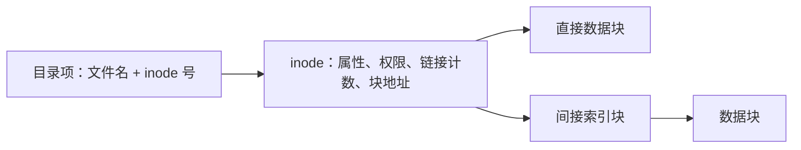
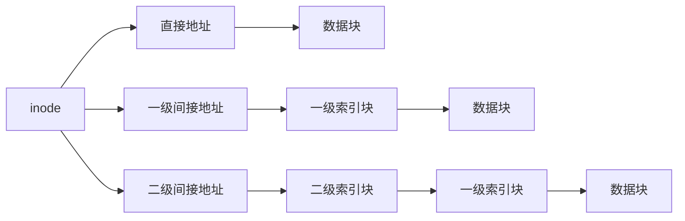
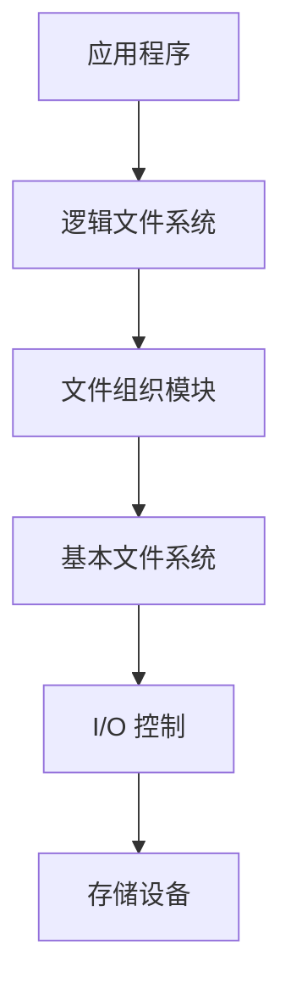
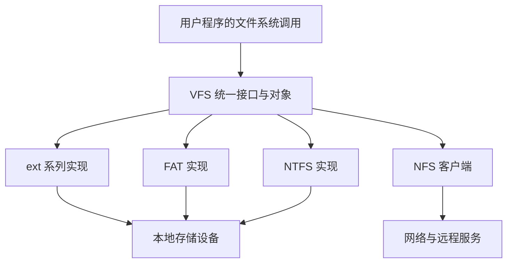

# 文件管理

## 文件

**文件**（File）是存储在计算机持久性存储设备（如硬盘、固态盘等）上的 **信息集合**，其内容可以是文本文档、图像、程序代码或其他形式的数据。在操作系统中，系统运行时以进程为基本单位进行资源的调度与分配；而用户在进行输入/输出操作时，则 **通常将文件作为逻辑操作的基本对象**。

为了支持用户对文件的创建、读取、修改、删除及安全保护等需求，操作系统提供了专门的文件系统，用以统一管理文件资源。文件系统通过对二级存储相关资源的抽象，屏蔽了文件的内部属性、存储介质的物理特性及其在设备上的具体位置等底层细节，使用户无须关心这些细节，便能方便、高效地使用文件。用户借助文件系统创建文件，并将其用于应用程序的输入与输出，从而有效管理数据资源。

??? info "自底向上看文件"

    1.  数据项。是文件系统中最低级的数据组织形式，可分为以下两种类型：
        1.  基本数据项。用于描述一个对象某一方面属性的一个值，是数据中的最小逻辑单位。
        2.  组合数据项。由多个基本数据项组成。
    2.  记录。是一组相关数据项的集合，用于描述一个对象在某一方面的完整属性。
    3.  文件。是指由创建者所定义的、具有文件名的一组相关元素的集合，可分为有结构文件和无结构文件两类。
        1.  有结构文件由若干格式相似的记录组成，如一个班级的学生记录；
        2.  无结构文件被视为一个连续的字节流，如二进制文件或普通文本文件。

### 文件属性

首先，文件必然包含实际的数据，即存储空间中所保存的信息；其次，由于操作系统需要管理大量数据，必须对这些数据进行分类和组织，因此每个文件都关联有用于分类和索引的信息；最后，不同用户对数据的访问权限存在差异，系统还需为文件设置相应的访问控制信息。

尽管不同的文件系统实现上有所差异，但通常都包含以下基本属性：

| 属性 | 内容 |
| --- | --- |
| 名称 | 供用户使用的名字，在同一目录中必须唯一；不同目录可以重名。 |
| 标识符 | 系统内部标识文件的编号，例如 inode 号；其唯一性通常限定在一个文件系统内。 |
| 类型 | 用于标识文件的种类，供系统决定如何处理或打开该文件。 |
| 创建者 | 创建该文件的用户标识（ID）。 |
| 所有者 | 当前拥有该文件的用户标识（ID），通常有权修改文件属性或访问权限。 |
| 位置 | 指向文件在外存设备上物理存储位置的指针。 |
| 大小 | 文件的逻辑长度，通常以字节计；它与实际分配的磁盘空间大小可能不同。 |
| 保护 | 定义对文件的访问控制策略，包括读/写、执行等权限，用于保障文件安全。 |
| 创建时间、最后一次修改时间及最后一次访问时间 | 常用于审计、备份或缓存管理。 |

这些信息也被称为文件的元数据（meta data）。

### 文件分类与类型识别

| 分类依据 | 主要类型 |
| --- | --- |
| 性质和用途 | 系统文件、用户文件、库文件 |
| 数据形式 | 源文件、目标文件、可执行文件 |
| 存取控制属性 | 只读、读写、可执行；这些权限可组合 |
| 组织形式与处理方式 | 普通文件、目录文件、特殊文件（如设备文件） |

扩展名主要是命名约定和应用程序选择处理方式的依据，改名不会自动改变内容格式。文件头中的 **魔数**（magic number）也可帮助识别格式，例如 JPEG 的起始标记为 `FF D8`。脚本常用 `#!/bin/sh` 这样的首行指定解释器。操作系统不必理解普通文件的全部内容语义，记录、图像等内部格式可以由应用程序解释。

## 文件的逻辑结构与访问方式 {#logical-structure}

### 无结构文件与有结构文件

**无结构文件**又称流式文件，向系统呈现连续的字节序列，没有由文件系统规定的记录边界。这里的“连续”描述逻辑地址，不保证磁盘块物理连续。UNIX 普通文件采用这种视图，应用程序仍可在其中组织复杂的数据。

**有结构文件**又称记录式文件，由若干记录组成；记录中的某个数据项可以作为查找用的关键字。

| 记录形式 | 定位方法 | 特点 |
| --- | --- | --- |
| 定长记录 | 若记录从 0 编号，长度为 $L$，第 $i$ 条的起始偏移为 $iL$ | 容易按记录号直接定位 |
| 变长记录 | 若无索引，第 $i$ 条的偏移为 $\sum_{k=0}^{i-1}L_k$ | 通常需扫描前面的长度信息；可建立索引加速 |

!!! warning "按偏移访问与按内容查找不同"

    字节流文件可以通过 `seek` 定位到已知字节偏移。教材所说无结构文件需要顺序查找，主要指缺少记录边界和索引时，按关键字查找内容；不能据此推出“流式文件不支持随机访问”。

### 顺序文件

记录在逻辑上依次排列。按是否依关键字排序，可分为：

- **串结构**：按记录进入文件的先后顺序排列，按关键字查找通常需要顺序扫描。
- **顺序结构**：按关键字有序排列。定长记录可以先算偏移，再采用折半查找；物理实现还必须支持高效的直接访问，才能发挥这一优势。

顺序文件适合批量处理大量记录，访问局部性好，也是磁带等顺序存储设备的自然组织形式。若通过连续排列维持记录顺序，插入、删除往往要移动许多记录；频繁的单记录检索和更新通常更适合索引组织。

### 索引文件

为每条记录建立一个定长的索引项，保存关键字或记录号、记录位置及必要的长度信息。查找时先检索索引表，再访问目标记录；即使记录本身变长，也能通过定长索引项快速定位。

索引可以按关键字排序，也可以针对不同检索字段建立多张索引。代价是额外空间，以及插入、删除、修改记录时维护索引的开销。**索引项保存定位信息，不需要复制完整记录。**

### 索引顺序文件

将顺序文件分组，每组建立一个索引项。索引记录该组的代表关键字和起始位置；组间按关键字范围有序，组内可以顺序查找。若组内无序，代表关键字必须能正确界定组的范围，不能任取一个键就用于判断归属。

检索分两步：先查索引确定所在组，再在组内查找。相比每条记录一个索引项，分组索引节省空间；记录很多时可继续建立多级索引。

设有 $N$ 条记录，均分为 $m$ 组；假设索引表和组内都采用顺序查找，教材使用的近似平均查找次数为

$$
T(m)\approx\frac m2+\frac{N}{2m}.
$$

当 $m\approx\sqrt N$ 时最小，约为 $\sqrt N$。例如 $N=10000$，分成 100 组、每组 100 条时，约查找 $50+50=100$ 次。若使用精确的等概率成功查找长度，应分别计入 $(m+1)/2$ 和 $(N/m+1)/2$；若索引改用折半查找，上述最优分组公式也随之改变。

### 直接文件（散列文件）

对记录关键字计算散列值，得到桶或记录的存储位置，再用冲突处理机制定位记录。平均查找快，适合按关键字精确查询；散列冲突、扩容和范围查询需要另行处理。“直接文件”是逻辑组织方式，不等于“连续分配”。

### 文件访问方式

| 访问方式 | 基本操作与特点 | 适用情形 |
| --- | --- | --- |
| 顺序访问 | 从当前位置读写下一个字节或记录，指针随操作推进，可复位或跳过若干记录 | 文本扫描、批处理、磁带 |
| 直接／随机／相对访问 | 按文件内的相对块号或字节偏移访问，不必依次读出前面的数据 | 磁盘文件、数据库、随机播放 |
| 索引访问 | 先查索引得到记录或块的位置，再直接访问 | 按关键字查找、变长记录 |
| 索引顺序访问 | 先定位记录组，再组内顺序访问 | 兼顾顺序处理和检索 |

访问方式是接口能力，逻辑结构是数据组织，物理分配决定其实现代价。随机访问也不表示所有请求耗时严格相同，缓存、索引层数和寻道距离都会影响时间。

## 目录、文件控制块与索引节点 {#directory}

### 目录的职责

目录建立 **文件名到文件元数据的映射**，是“按名存取”的关键。目录管理还应提高检索速度、允许不同目录重名，并支持共享和保护。目录本身通常也是持久保存的特殊文件，其内容是子文件、子目录的目录项。

### 文件控制块（FCB）

FCB 是操作系统描述和管理一个文件的数据结构，在创建文件时建立。其内容可归为：

| 类别 | 典型信息 |
| --- | --- |
| 基本信息 | 文件名、类型、位置、大小、逻辑结构和物理结构 |
| 存取控制信息 | 所有者、组、各类用户的访问权限 |
| 使用信息 | 创建、修改、访问时间及有关状态 |

在传统模型中，目录项就是 FCB，目录文件是 FCB 的集合。**FCB 不以文件处于打开状态为存在条件**；打开文件表记录的是运行时的打开状态，可包含或引用 FCB 的内存副本。不同系统的具体结构名称并不完全相同。

### 将文件名与描述信息分离：inode

搜索目录时主要比较文件名，扫描完整 FCB 会同时读入大量暂时无用的属性。将描述信息集中到 **索引节点**（index node，inode），目录项缩小为“文件名 + inode 号”，一个盘块就能容纳更多目录项，减少检索的磁盘 I/O。



同一文件系统内，多个目录项可以指向同一个 inode，这也为硬链接共享提供了基础。inode 通常不保存文件名；跨文件系统标识文件时，需要结合文件系统／设备标识与 inode 号。

| 形态 | 保存的信息 |
| --- | --- |
| 磁盘 inode | 所有者与组、文件类型和权限、文件长度、数据块的直接或间接地址、硬链接计数、访问／修改及 inode 状态变化时间 |
| 内存 inode | 磁盘信息的内存表示，加上 inode 号、设备号、锁定／修改状态、运行时引用计数、空闲链或哈希队列指针等 |

磁盘 inode 的硬链接计数统计目录引用；内存引用计数用于判断运行时对象是否仍被使用。二者不能混为一谈。inode 地址项的个数由具体实现决定，王道示例为 13 项，其他教材也可能使用 15 项。

??? example "目录项分解如何减少访盘"

    假设盘块为 1 KiB，目录包含 3200 项，目录项不跨块且全部等概率被查找。

    - 完整 FCB 为 64 B：每块 16 项，共 200 块；教材近似平均扫描 100 块。
    - 简化目录项为 16 B：每块 64 项，共 50 块；近似扫描 25 块。若目标 inode 未缓存，还需读 inode 所在块一次，共约 26 次。

    精确计算且每块装满时，分别为 $(200+1)/2=100.5$ 和 $(50+1)/2+1=26.5$。末块未装满时，各块被命中的概率不同，应使用 $E=\sum_k k n_k/N$，其中 $n_k$ 为第 $k$ 块的目录项数；然后再加读取 inode 的次数。**查目录、读 inode 和读文件数据是三种不同的 I/O。**

### 目录结构

| 结构 | 组织方式 | 优点 | 局限 |
| --- | --- | --- | --- |
| 单级目录 | 全系统一张目录表 | 简单，能按名存取 | 全局不能重名，扫描慢，不便分类与共享 |
| 两级目录 | 主文件目录 MFD 指向各用户文件目录 UFD | 用户间可重名，缩小查找范围，便于隔离 | 每个 UFD 仍是扁平结构，用户内分类与跨用户共享不便 |
| 树形目录 | 根目录下递归包含子目录与文件 | 层次清晰，支持分类、重名和分层保护 | 纯树中每个节点只有一个父节点，不能直接表达共享；深路径有逐级查找开销 |
| 无环图目录 | 在树上增加共享边，但保持无环 | 同一文件或子目录可出现在多个位置 | 需维护共享计数、处理删除并防止环 |
| 一般图／通用图目录 | 允许形成环 | 共享关系更自由 | 遍历须防重复和无限循环；仅靠引用计数可能回收不了不可达的环 |

前三种和无环图目录对应王道的目录结构；一般图是 Unit 6 的补充主题。处理图中的环可使用访问标记、限制跟随链接次数、建链时检查，以及从根出发的可达性检查／垃圾回收。目录共享是抽象设计能力；实际 UNIX 通常限制用户创建目录硬链接，符号链接仍可能形成循环。

### 路径名与当前工作目录

- **绝对路径**从根开始，例如 `/home/student/os/file.md`。
- **相对路径**从进程的当前工作目录开始，例如当前目录为 `/home/student` 时，`os/file.md` 指向同一文件。
- `.` 表示当前目录，`..` 表示父目录；进程可通过 `chdir` 改变工作目录，Shell 的 `cd` 使用这类机制。

当前工作目录既缩短路径输入，也可减少重复解析上层目录的工作；它不改变磁盘本身的数据传输速度。纯树中节点有唯一绝对路径，引入硬链接后，同一文件实体可能有多个路径。

路径解析按分量逐级查找；中途遇到不存在的分量、非目录分量或权限不足，就不能继续。目录内容、目录 inode 和数据块是否已在缓存中，决定实际访盘次数，不能简单认为“一个斜杠就是一次 I/O”。

### 目录操作与实现

目录支持搜索、创建／删除文件项、创建／删除子目录、重命名／移动、显示内容和改变工作目录。创建前要检查同目录重名；文件名与子目录名共享该目录的命名空间。删除空目录较简单，非空目录通常要求先清空，或由上层工具递归删除。移动同一文件系统内的文件一般更新目录关系即可，跨文件系统移动通常还需要复制数据。

| 实现方法 | 查找与维护 | 注意点 |
| --- | --- | --- |
| 线性列表 | 顺序比较文件名；删除项可标空闲、挂空闲链或用末项填补 | 实现简单，规模增大时查找慢 |
| 有序列表／树形索引 | 有序数组可折半查找，平衡树或 B+ 树支持动态检索 | 插入、删除需要维护顺序或树结构 |
| 哈希表 | 文件名经哈希后定位目录项，再核对名称 | 平均查找快；必须处理冲突、负载与扩容，不能只比较哈希值 |

将活跃目录项缓存到内存可避免重复读盘。目录检索开销与目录项数量、大小、位置及路径有关，与目标文件内容的大小没有直接对应关系。

## 文件操作与打开文件表 {#file-operations}

### 基本操作

| 操作 | 核心工作 |
| --- | --- |
| 创建 `create` | 检查名称与目录权限，分配并初始化 FCB／inode，建立目录项，更新空闲空间等元数据 |
| 打开 `open` | 按路径找到文件，检查打开方式，建立运行时访问上下文，返回描述符或句柄 |
| 读取 `read` | 从当前偏移读取数据到用户缓冲区，按实际读取量推进偏移 |
| 写入 `write` | 从用户缓冲区取数据，必要时分配新块，更新内容、偏移、长度和时间等信息 |
| 定位 `seek`／`lseek` | 改变下一次访问的偏移，一般不传输文件数据 |
| 截断 `truncate` | 将长度改为指定值；截到 0 时清空内容但保留文件身份，长度、时间等属性会更新 |
| 关闭 `close` | 解除本次打开引用，必要时更新元数据和释放运行时结构 |
| 删除 `delete`／`unlink` | 移除目录中的名字，减少硬链接计数；满足回收条件时释放 inode、数据块和索引块 |
| 加锁 `lock` | 对文件或记录区间实施并发访问协调 |

创建空文件并不必然立即分配数据块，很多系统写入时才按需分配；但仍需建立元数据和目录项。创建与打开是不同动作，有些接口可一次完成两者。删除一个文件也不意味着删除其父目录。

### 为什么需要先打开

若每次读写都从路径解析开始，重复查询目录和加载元数据会很昂贵。打开操作把后续访问所需的信息保留在内核中，并返回 **文件描述符**（file descriptor，fd）。fd 通常是进程描述符表的一个非负整数索引（Windows 中称文件句柄，file handle），不是磁盘地址，也不是全系统统一的文件编号；不同进程里的同一数值可以表示不同文件。

**打开主要准备元数据和访问状态，不要求把整个文件内容读入内存。** 内容在读取、映射缺页或预读等过程中按需进入缓存。

### 王道的两级打开文件表模型

| 层次 | 主要用途 |
| --- | --- |
| 进程打开文件表 | 保存本进程的访问模式、读写位置等私有访问状态，并指向系统表项；fd 用来查此表 |
| 系统打开文件表 | 保存或引用共享的文件属性、磁盘位置、大小等信息，并记录打开计数 |
| 活动 inode／FCB | 提供文件本身的属性及块映射，供系统表项引用 |

按教材简化模型，多个进程打开同一文件，可以共享系统级信息，同时保有各自访问状态。打开、关闭计数的是仍在使用的打开引用；若题目限定每进程只打开一次，才可直接等同于进程数量。

打开普通已有文件的过程为：

1. 根据绝对或相对路径查找目录，取得目标 inode 号；缓存未命中时读取所需目录块和 inode。
2. 结合用户身份、文件权限与请求的打开方式检查合法性。
3. 建立或引用系统级文件信息，维护打开计数；在进程表中分配表项，初始化访问状态。
4. 返回进程表项的索引 fd，供 `read(fd, buf, n)`、`write`、`lseek`、`close` 等使用。

关闭时解除进程表项，递减相应引用计数；最后一个引用消失后，运行时表项才可回收。**正常关闭不删除目录项，也不释放文件的数据块。** 文件元数据可能需要回写；`close` 也不等同于保证所有数据已持久化到设备。

!!! info "与 Linux 实际结构对照"

    Linux 更准确的关系是 `进程 fd 表 → 打开文件描述（file 对象）→ inode`。文件偏移和状态标志在 file 对象中：分别调用两次 `open` 通常创建两个 file 对象、偏移互不影响；`dup` 或 `fork` 继承的描述符可引用同一个 file 对象并共享偏移。它们又可以共享同一个 inode。因而“同一文件只对应一个系统打开表项”“所有进程偏移都独立”仅适用于特定教材模型，不能当作普遍实现规律。参见 [Linux open(2)](https://man7.org/linux/man-pages/man2/open.2.html)。

### 一次读取怎样到达磁盘

查 fd 并验证可读性 → 根据文件偏移确定逻辑块 → 利用 inode／分配信息找到物理块 → 查询缓存 → 必要时提交设备 I/O → 将数据交给用户并推进偏移。

`read` 的参数包含 fd、缓冲区地址和请求字节数。系统调用使 CPU 进入内核态；若数据需要设备 I/O，同步读取的线程可能阻塞，I/O 完成后再被唤醒。普通读取的缓存未命中不必然产生用户进程的缺页异常，应与 `mmap` 后访问未驻留页区分。已打开后的读写不再重复按文件名查目录，但删除、重命名等路径操作仍可使用文件名。

## 文件共享与保护 {#sharing-protection}

### 硬链接与软链接

共享的目标是让多个名字或多个使用者访问同一份数据，避免复制导致空间浪费和内容分歧。

| 比较项 | 硬链接（hard link） | 软链接／符号链接（symbolic link） |
| --- | --- | --- |
| 本质 | 新目录项指向已有 inode | 单独的链接文件，内容记录目标路径 |
| inode | 与原名字共用 inode | 链接自身有独立 inode |
| 目标的硬链接计数 | 创建时加 1，删除该名字时减 1 | 不因建立或删除软链接而改变 |
| 删除原名字 | 其他硬链接仍可访问同一实体 | 若目标路径不再存在，链接悬空，访问失败 |
| 跨文件系统 | 通常不允许 | 可以指向其他已挂载文件系统中的路径 |
| 指向目录 | 实际 UNIX 一般限制用户创建目录硬链接，以避免环等问题 | 通常允许，但可能形成路径解析循环 |
| 开销 | 解析名字后直接定位共享 inode | 还要读取／解释目标路径并再次解析，缓存可减轻开销 |

硬链接共享的是 inode 和数据，并非复制各份文件属性；任一名字下的写入都会作用于同一实体，文件所有者也不会因增加链接自动改变。符号链接访问时重新解释目标路径，目标删除后在相同路径建立新文件，链接可能转而指向新实体。相对目标路径相对于链接所在目录解释。此外，每个目录中还固定存在 `.` 与 `..`，分别指向当前目录和父目录；它们常被视为“不允许目录硬链接”这一限制的例外。参见 [Linux symlink(7)](https://man7.org/linux/man-pages/man7/symlink.7.html)。

例如，`A` 创建后硬链接计数为 1；建立其硬链接 `B` 后计数为 2；建立指向 `A` 的软链接 `C` 不改变这个 2，`C` 自身通常计数为 1。删除 `A` 后，共享实体的计数变为 1，`B` 仍可访问，`C` 则因路径 `A` 消失而悬空。

!!! warning "链接计数为 0 不一定立刻释放数据"

    磁盘硬链接计数、打开文件引用计数和内存 inode 引用计数属于不同层次。在 UNIX 中，即使最后一个名字被 `unlink`，已经打开的描述符仍可继续使用文件；要等有关打开引用等都释放后才能回收数据。删除软链接只删除链接自身，系统不必自动清除悬空软链接。参见 [Linux unlink(2)](https://man7.org/linux/man-pages/man2/unlink.2.html)。

教材还用“远程机器标识 + 路径”解释网络共享的命名思想。实际本地符号链接并不会自行执行网络协议；访问远端内容还需要网络文件系统等机制。

### 共享后的并发访问

允许多个进程打开文件，不代表系统自动替应用程序把一组读改写操作变成互斥事务。常见控制方式包括共享读锁、独占写锁、整文件锁或记录锁；还要区分由程序自觉遵守的建议锁与系统强制执行的锁。权限回答“可不可以访问”，锁回答“并发访问怎样协调”，调度优先级回答“先让谁运行”。

### 文件保护的目标与受控操作

保护机制限制未授权访问；备份、冗余与恢复则针对误删、故障或损坏，二者相互补充。受控访问类型包括 **读、写、执行、追加、删除和列目录**，也可扩展到重命名等操作。复制和打印会读取源文件；源文件的读权限并不能保证其内容不会被复制，目标写入或输出设备还可能有各自限制。

| 方法 | 基本思想 | 特点 |
| --- | --- | --- |
| 口令保护 | 访问文件时核对共享口令 | 实现简单，但口令分发、保管和撤销不便；教材中的简单存储方式安全性有限 |
| 加密保护 | 用密钥加密内容，持有正确密钥才能解密 | 提供内容保密性，有计算和密钥管理成本；实际格式还可能需要 nonce、认证标签等元数据 |
| 访问控制 | 按用户身份和操作类型决定是否授权 | 能细分读、写、执行等权限，是受控共享的主要机制 |

### ACL、权限位与目录保护

**访问控制列表**（ACL）附属于文件或目录，记录用户／用户组及其权限。它表达灵活，但列表可能很长且长度不定。精简方法将用户分为拥有者、所属组和其他用户，为各类保存一组权限位。

若有 $u$ 类用户、$v$ 种可独立组合的权限，需要 $uv$ 位，而非 $\lceil\log_2u\rceil+\lceil\log_2v\rceil$ 位。例如王道的 3 类用户、4 种权限需 12 位；4 类用户、5 种权限需 20 位。

UNIX 的基本模式位为三组 `rwx`，共 9 位。例如 `-rw-r-----` 的首字符 `-` 表示普通文件，其后表示拥有者可读写、组可读、其他用户无权限，数值为 `640`（读 4、写 2、执行 1）。`d` 表示目录，`l` 表示符号链接。基本模式位按拥有者、组、其他的适用类别选择权限，不是把三组全部相加；扩展 ACL 可表达更细的规则。

对目录而言，`r` 表示列出目录项，`x` 表示搜索／穿过目录，`w` 表示修改目录项。创建和删除名字通常需要父目录的写与搜索权限；能否删除文件不能仅由文件自身的写权限判断，还可能受 sticky bit 等规则限制。多级目录的路径遍历也要逐级满足搜索权限。参见 [Linux inode(7)](https://man7.org/linux/man-pages/man7/inode.7.html)。

## 文件的物理结构与分配方式 {#allocation}

### 块、簇与地址换算

文件物理结构描述 **已经分配给一个文件的块怎样组织**；空闲空间管理描述 **尚未分配的块怎样登记、分配和回收**。两者有关联，但不是同一个问题。

磁盘扇区是设备层的单位，文件系统以块或簇分配空间；簇可包含多个相邻扇区或盘块。内存页与文件系统块可能取相同大小，但并非必须相等。程序可以请求读取几个字节，底层仍按设备和缓存的粒度传输。

本节默认块大小为 $B$ 字节，文件偏移 $x$、逻辑块号均 **从 0 开始**。则

$$
q=\left\lfloor\frac{x}{B}\right\rfloor,\qquad r=x\bmod B.
$$

$q$ 是文件内逻辑块号，$r$ 是块内偏移；物理块号由分配方式决定。题目说“第 $k$ 个字节”且从 1 计数时，应先取 $x=k-1$。除非题目另有说明，以下用 KiB、MiB、GiB、TiB 明确表示 $2^{10}$、$2^{20}$、$2^{30}$、$2^{40}$ 字节。

若分配单位为 $C$ 字节，普通非稀疏文件长 $L$，仅数据部分至少占

$$
n=\left\lceil\frac LC\right\rceil\text{ 个簇},\qquad S=nC.
$$

最后一簇未使用的 $S-L$ 是内部碎片。例如 1026 B 的文件、1 KiB 的簇，需要 2 簇，即 2048 B。簇增大可减少管理项和指针数量、改善连续传输，但通常增加小文件的内部碎片。

### 连续分配

为一个文件分配一段连续物理块，FCB 记录 **起始块号 $s$ 和块数 $n$**。其逻辑块 $q$ 对应物理块 $s+q$，因此支持顺序访问和直接访问；连续读取时寻道开销小。

主要问题是：需要找到足够长的连续空间，容易产生外部碎片；预估文件大小困难，预留过多浪费空间、预留不足则增长可能要迁移；为保持顺序，文件中间插入或删除数据可能引起大量移动。

**紧凑／整理**可搬移文件并合并空闲区，但复制数据的代价很高。**区段**（extent）是折中：每个区段保存一段连续块的“起始位置 + 长度”，文件可由多个区段组成，增长时增加区段。区段之间不必连续，组织区段的结构也可以是列表或树，不必固定为链表。

### 链接分配

#### 隐式链接

目录项保存首块号，常同时保存尾块号；每个数据块中保存下一块的指针，末块用结束标记。数据块可以离散分布，不产生要求连续空闲区所导致的外部碎片，增长与整块插入较方便。

其代价是：要找后面的块，必须从已知块开始沿链读取；每块指针占空间；指针损坏可能使后续链不可达。教材中未加限定的“链接分配”通常指这种方式，因而通常记为 **只适合顺序访问**。

若块大小 $B$，指针占 $p$ 字节，则有效数据容量为 $D=B-p$，应按

$$
q=\left\lfloor\frac{x}{D}\right\rfloor,\qquad r=x\bmod D
$$

定位链中的逻辑块及数据区偏移。若指针在块首，实际块内偏移为 $p+r$；若指针在块尾，则为 $r$。增大链节点粒度为簇，可以减少指针开销，但也会增加尾簇内部碎片。

#### 显式链接与 FAT

将下一块指针集中存入 **文件分配表**（File Allocation Table，FAT）。在教材模型中，FAT 的每个表项与卷中的一个物理分配单元对应；以当前块号为数组下标，表项的值表示下一块号或特殊状态。目录项保存文件首块号。

例如 `FAT[2]=8`、`FAT[8]=5`、`FAT[5]=EOF`，则从首块 2 得到链 `2 → 8 → 5`。表项还可标记空闲、坏块等，所以 FAT 同时能够参与空闲空间管理。教材使用的 `-1`、`-2` 只是示意，实际格式规定专门编码。

FAT 持久保存在磁盘上；教材计算通常假设它已经整体调入内存。这时查链无需读取沿途数据块，定位后只需读目标数据块；但 **仍需在内存中沿 FAT 链走到目标，通常不是按逻辑块号一次下标访问**。这就是教材称显式链接支持直接访问时应理解的条件。大卷的 FAT 会占用较多内存，实际系统也可按需缓存。

设分配单元数为 $N$，每项 $p$ 字节，一份 FAT 约占 $Np$ 字节；若按位紧凑存储，先求块号至少需要 $\lceil\log_2N\rceil$ 位，再计算总位数并向上取整。字节对齐、保留值及 FAT 副本的空间要按题目另计。

??? example "FAT 容量与表长"

    教学模型中，簇号为 2 B、簇大小 4 KiB，忽略保留簇号和特殊编码，则最多表示 $2^{16}$ 个簇：一份 FAT 长 $2^{16}\times2=128$ KiB，链能覆盖的数据空间上限为 $2^{16}\times4$ KiB $=256$ MiB。

    实际单文件上限还可能受目录项中的文件长度字段约束，不能把真实 FAT 文件系统的所有容量限制都归结为簇号位数。

### 索引分配

将 **每个文件自己的数据块号** 按逻辑顺序放入索引块，FCB／inode 保存索引块的位置。逻辑块 $q$ 对应索引的第 $q$ 项，数据块可以离散分配。

这既支持直接访问，又便于增长，没有外部碎片；代价是索引占用空间，读取未缓存索引也需要 I/O。小文件若必须占用完整索引块，利用率会很低。与 FAT 的主要区别是：FAT 是按全卷物理块组织的链信息，而文件索引按单个文件的逻辑块组织位置映射。

#### 单级、链接索引与多级索引

设每个块地址占 $p$ 字节，一个纯索引块能容纳

$$
K=\left\lfloor\frac Bp\right\rfloor
$$

个地址项。注意 $K$ 是项数，不能直接拿块的字节数当地址项数。

| 形式 | 组织方法 | 可寻址的数据量／代价 |
| --- | --- | --- |
| 单级索引 | 一个索引块直接列出数据块号 | 最大 $KB$ 字节 |
| 链接索引 | 多个索引块用指针串联 | 可扩展，但找后面的索引块仍要沿链；连接指针占用索引空间 |
| $m$ 级索引 | 上级索引指向下级索引，最末级指向数据 | 一个顶级索引块最多覆盖 $K^mB$ 字节；未缓存时读目标数据需 $m+1$ 次 I/O |

若链接索引的每块预留 $p$ 字节保存下一索引块指针，则每块最多有 $K'=\lfloor(B-p)/p\rfloor$ 个数据地址；逻辑块 $q$ 属于第 $\lfloor q/K'\rfloor$ 个索引块，在其中的项号为 $q\bmod K'$。不能忘记逐块定位该索引块的开销。

例如 $B=4$ KiB、$p=4$ B，$K=1024$，单级索引覆盖 4 MiB，二级覆盖 4 GiB。若 $B=1$ KiB、$p=4$ B，则二级覆盖 $256^2\times1$ KiB $=64$ MiB；这是 **单文件索引结构的寻址上限**，不是整个文件系统容量。

#### 混合索引

在 inode 中同时设置直接地址、一级间接地址、二级间接地址和三级间接地址。小文件直接定位；较大文件按需分配间接索引块，兼顾速度、容量和空间成本。



设直接项有 $d$ 个，一级、二级、三级间接项分别有 $a_1,a_2,a_3$ 个，索引结构最多描述

$$
N_{\max}=d+a_1K+a_2K^2+a_3K^3,\qquad L_{\max}=N_{\max}B.
$$

王道示例为 **10 个直接项 + 各 1 个一、二、三级间接项**，共 13 项；Unit 6 举的是 **12 + 1 + 1 + 1**，共 15 项。两种都用于说明混合索引，做题以题目给出的数量为准。

对王道的 $B=4$ KiB、$p=4$ B 示例，各部分贡献为：

| 地址部分 | 覆盖的数据块数 | 单独贡献的容量 |
| --- | --- | --- |
| 10 个直接项 | $10$ | 40 KiB |
| 一级间接项 | $1024$ | 4 MiB |
| 二级间接项 | $1024^2$ | 4 GiB |
| 三级间接项 | $1024^3$ | 4 TiB |

总上限为 $4$ TiB $+4$ GiB $+4$ MiB $+40$ KiB。判断一个偏移落在哪一级时要使用 **累积边界**，不能只与单个间接区的容量比较。

#### 从偏移定位索引项

以各级间接入口各一个为例，先算 $q=\lfloor x/B\rfloor$ 和 $r=x\bmod B$：

1. 若 $q<d$，使用直接项 $q$。
2. 否则减去 $d$，得到 $q_1$；若 $q_1<K$，使用一级索引的第 $q_1$ 项。
3. 否则再减去 $K$，得到 $q_2$；若 $q_2<K^2$，二级路径的两个下标为 $\lfloor q_2/K\rfloor$、$q_2\bmod K$。
4. 否则再减去 $K^2$，得到 $q_3$；三级路径依次为 $\lfloor q_3/K^2\rfloor$、$\lfloor(q_3\bmod K^2)/K\rfloor$、$q_3\bmod K$。

最终在目标数据块中使用偏移 $r$。直接项与间接项的分界是半开区间，文件长度恰好等于某一容量时，最后一个字节仍在前一区间。

### 三种分配方式与访盘次数

下表假设 FCB／inode 已在内存、目标数据未缓存，所需间接索引未缓存；$n$ 从 1 计数，指文件第 $n$ 个数据块。

| 分配方式 | 定位并读目标块的磁盘 I/O | 增长与访问特点 | 主要成本 |
| --- | --- | --- | --- |
| 连续分配 | 1 次 | 可直接计算，顺序访问快，增长不便 | 外部碎片、预分配和移动成本 |
| 隐式链接 | 从首块开始需 $n$ 次 | 易增长，整块插入方便 | 指针空间、沿链读盘、可靠性 |
| FAT 显式链接 | FAT 全在内存时，目标数据 1 次 | 内存中沿链，可避免读沿途数据块 | FAT 内存与磁盘空间 |
| 单级索引 | 2 次 | 可直接按逻辑块号定位 | 1 个索引块和索引读取 |
| $m$ 级索引 | $m+1$ 次 | 容量大、可随机访问 | 多级索引空间与读取 |
| 混合索引 | 直接区 1 次；一、二、三级间接区分别 2、3、4 次 | 小文件快，大文件可扩展 | 随实际使用的间接层数变化 |

若索引已缓存，相应读索引次数应扣除；若 inode 未缓存，则还要加读取 inode 的开销。连续、链接和索引分配都可能有末块内部碎片，“没有外部碎片”不能简写为“没有碎片”。

### 索引空间、容量和文件数量计算

**文件长度**只计用户数据；**实际占用**还包括末块余量、索引块和有关元数据。求最大文件长度时不要把索引块当作数据块相加；求占用空间时也不能漏掉它们。

例如混合索引具有 $d$ 个直接项、一个一级入口和一个二级入口，文件占 $n>d+K$ 个数据块，则使用的间接索引块数为

$$
I=1+1+\left\lceil\frac{n-d-K}{K}\right\rceil.
$$

三个部分依次是一级入口下的索引块、二级根索引块、二级区域所需的叶索引块。只分配实际用到的索引块；尚未进入的间接区域不必分配。

??? example "2 GiB 文件的索引开销"

    使用王道 13 项模型，$B=4$ KiB、$p=4$ B，文件长 2 GiB，则数据块数 $n=524288$，直接区与一级区容纳 $10+1024$ 块，剩余 $523254$ 块进入二级区域。

    二级区域需 $\lceil523254/1024\rceil=511$ 个叶索引块，加上二级根块和一级入口的索引块，共 **513 个索引块**，占 $513\times4$ KiB $=2$ MiB $+4$ KiB。数据块和索引块合计为 $2$ GiB $+2$ MiB $+4$ KiB。

    若题目要求计入 inode，再加其给定大小。$13\times4=52$ B 只是 13 个地址项的大小；只有题目明确把 inode 简化为这些地址项时，才能把 52 B 当整个 inode 的大小。

**单文件最大长度**还受块号位宽、长度字段、文件系统规则和可用空间约束。$p$ 字节无符号块号理论上最多表示 $2^{8p}$ 个编号，实际还可能有保留编号，索引块本身也占空间。求“系统能支持的最大空间”时，应把**索引结构的寻址能力**与**块号位宽的地址范围**分别算出，取较小者。

**文件数量**受 inode／FCB 数量和可分配空间限制。设 inode 区为 $S_i$ 字节、每个 inode 为 $s_i$ 字节，至多有 $\lfloor S_i/s_i\rfloor$ 个槽位；若每个文件需要 $n$ 个数据及索引块、可用块数为 $N$，简化上限为

$$
F_{\max}\le\min\left(\left\lfloor\frac{S_i}{s_i}\right\rfloor,\left\lfloor\frac Nn\right\rfloor\right).
$$

目录和保留元数据也消耗 inode 与空间，实际应按题设扣除。增加索引层级主要增大单文件容量，增加 inode 数量主要增大可保存的文件实体数；硬链接增多并不按名字数量消耗新 inode。

### 常见操作的 I/O 计算

??? example "在文件中插入一条记录"

    王道综合题：已有 200 条记录，每块一条，将内存中的新记录插为第 30 条；忽略目录、空闲表和 FCB 回写，只计有关数据块，原数据块未缓存。

    - **连续分配**，前后都有足够空闲：前移前 29 块比后移后 171 块更少。每块读一次、写一次，再写新记录，共 $2\times29+1=59$ 次；起始块号前移一块，文件长度增加。
    - **隐式链接**：先读前 29 块找到前驱，再写新块、改前驱指针并写回，共 $29+1+1=31$ 次；无需移动后续数据。
    - **索引分配**：可调整索引项顺序，无需搬移后续数据块；仍须写入新记录。索引读取、回写是否计入，取决于题目是否说明索引已在内存及计数范围。

    若隐式链每块 1 KiB、链接指针 4 B，忽略保留编码和元数据占用，链能表达的用户数据理论上限为 $2^{32}(1024-4)$ B $=4080$ GiB。

??? example "记录成组与分解"

    多条逻辑记录可合并到一个物理块中传输，读入后再分解成记录；题目若规定记录不能跨块，必须先向下取整求每块记录数。设块长 $B$、块内指针占 $p$、记录定长 $L$，则每块可放 $g=\lfloor(B-p)/L\rfloor$ 条，第 $k$ 条记录（从 1 编号）位于第 $\lceil k/g\rceil$ 个块。

    例如块 512 B、记录 100 B、链接指针放在余下空间，每块可放 5 条。第 22 条在第 5 块；隐式链从首块开始修改该记录，需要读 5 块、写回目标块 1 次，共 6 次。

??? example "路径、inode、索引和数据分别计数"

    若父目录内容已缓存，仅知道文件的 inode 号，目标 inode 与数据均未缓存，且目标由 inode 直接地址定位，则还需读取 **inode 所在块 + 数据块**，共 2 次。

    若 inode 已缓存、块大小 1 KiB、直接项 10 个、地址项 4 B，则偏移 1234 B 位于直接区，只需读数据 1 次；偏移 307400 B 超过 $(10+256)\times1024$，进入二级间接区，在索引未缓存时需要读 2 个索引块和 1 个数据块，共 3 次。

    对完整路径题，应逐步列出“尚未缓存的目录块 → 必要的 inode → 间接索引块 → 数据块”。沿不同硬链接访问同一实体时，可复用已缓存的 inode；修改后的回写则另计。

## 文件系统的层次与布局 {#filesystem-layout}

### 文件系统的组成与分层

文件系统不仅包括文件管理软件，也包括被管理的文件和支持管理的数据结构。它向用户提供命名、查找、读写、共享与保护，向下完成逻辑到物理的映射、空间分配和设备数据交换。



| 层次 | 主要职责 |
| --- | --- |
| 逻辑文件系统 | 管理文件名、目录、FCB／inode、权限等元数据，实现按名存取和保护 |
| 文件组织模块 | 将文件逻辑块映射到物理块；调用空闲空间管理器分配、回收块 |
| 基本文件系统 | 发出通用的物理块读写请求，管理缓冲区和缓存，并与下层 I/O 调度协作 |
| I/O 控制 | 设备驱动及中断处理，将通用操作转换成控制器命令，处理传输和完成通知 |
| 设备 | 执行实际存储访问 |

这是职责划分模型，具体操作系统可能合并或细分这些层次。用户接口与磁盘实现应分开理解；逻辑文件系统管理描述信息，而文件数据的实际传输由更低层协作完成。

王道教材还给出另一套更贴近请求处理流程的层次结构（自顶向下），并用“删除文件中一条记录”说明各层如何依次工作：

| 层次 | 在处理“删除一条记录”时的工作 |
| --- | --- |
| 用户接口 | 用户经操作系统提供的接口发出请求，给出文件路径、记录号等参数 |
| 文件目录系统 | 按路径逐级查找目录，找到目标文件的目录项／FCB |
| 存取控制验证模块 | 检查用户对该文件是否具有相应操作的权限 |
| 逻辑文件系统与文件信息缓冲区 | 把用户给出的记录号换算为逻辑地址（记录在文件内的逻辑位置） |
| 物理文件系统 | 把逻辑地址（逻辑块号）转换为实际的物理地址 |
| 设备管理程序模块 | 向磁盘设备发出读／写请求，完成数据传输 |
| 辅助分配模块 | 管理空闲盘块：删除记录后回收盘块，文件增长时分配新块 |

两套划分视角不同、并不矛盾：Unit 6 与教材的分层回答“文件系统实现被拆成哪些子层”，王道的层次回答“一次请求依次由哪些功能模块处理”。复习时重点是记住其中的分工——**“记录号 → 逻辑地址”由逻辑文件系统与文件信息缓冲区完成，“逻辑地址 → 物理地址”由物理文件系统完成，设备 I/O 由设备管理程序模块下发，空闲盘块的分配与回收归辅助分配模块。**

### 磁盘、分区与卷

一个磁盘可划分多个分区，分别采用不同文件系统；一个逻辑卷也可能跨越多个物理设备，因此“磁盘、分区、卷、文件系统”不能总视为一一对应。文件系统容量不一定等于整块磁盘容量，部分空间还用于元数据。

分区在投入使用前需要初始化：**物理格式化**（低级格式化）划分扇区、检测并替换坏扇区；**逻辑格式化**则在分区内建立根目录、超级块和空闲空间管理等结构。完成格式化后，卷才能被挂载并创建文件。

王道展示的传统布局可概括为：

```text
磁盘：主引导扇区（引导代码、分区表等） | 分区 1 | 分区 2 | ...
分区中的一种示意布局：
引导区 | 超级块 | 空闲空间管理信息 | inode 区 | 根目录 | 其他目录和文件数据
```

### 外存中的主要数据结构

| 结构 | 范围和用途 |
| --- | --- |
| 主引导记录／主引导扇区（MBR） | 传统 BIOS/MBR 分区方案下位于磁盘起始扇区，包含引导代码、分区表和结束标记 |
| 引导控制块／引导块（boot control block） | 与卷有关，保存启动所需的信息或代码；引导代码负责继续加载系统，不是把整个操作系统装在一个块里。UFS 中称引导块，NTFS 中称分区引导扇区 |
| 卷控制块（volume control block）／超级块 | 描述文件系统全局参数，如块大小、总块数、空闲块和 inode 数量及管理信息的位置；UFS 中即超级块 |
| 空闲空间结构 | 位图、空闲链、成组链接信息等，记录可分配空间 |
| 目录结构 | 文件名到 FCB／inode 等元数据的映射，根目录是文件命名树的入口 |
| 每文件元数据 | FCB、inode 或 NTFS 文件记录，保存文件属性及定位信息 |
| 文件与目录的数据块 | 保存普通文件内容及目录内容 |

在传统启动模型中，BIOS 读取并执行主引导代码，再定位活动分区，引导块中的程序继续加载系统。教材的布局示意不意味着所有文件系统都使用同样的固定排列，也不应把 BIOS/MBR 流程泛化到所有启动方案。

超级块描述的是整个文件系统，inode 描述的是单个文件，目录项提供的是名字关联。NTFS 的 MFT 同时承载大量文件及元数据记录，其职责不能简单等同于一个 UNIX 超级块。

### 内存中的主要数据结构

| 结构 | 作用 |
| --- | --- |
| 挂载表 | 记录已挂载卷、文件系统类型、设备、挂载点及选项 |
| 内存超级块／卷信息 | 支持运行时分配、统计和同步 |
| 目录项缓存 | 加速路径分量的查找 |
| 活动 inode／FCB 缓存 | 缓存文件属性、块映射并维护运行时引用和状态 |
| 系统级打开文件结构 | 关联活跃文件与打开实例，具体字段按教材模型或实际实现区分 |
| 进程级描述符表 | fd 到内核文件对象／系统表项的关联 |
| 数据缓存和缓冲区 | 缓存已读数据、暂存待写数据，协调 CPU 与设备速度 |

文件系统挂载时建立必要的全局状态；inode、目录项和数据通常按需载入，并非挂载时将所有文件全部读入内存。运行时修改要通过适当同步保持内存与磁盘状态一致。

## 文件存储空间管理 {#free-space}

### 空闲表法与计数法

将每个连续空闲区记为“**起始块号 + 块数**”，常按起始地址排列。分配时可使用首次适应、最佳适应等策略，必要时把空闲区切分；回收时检查前后相邻空闲区，可能与前区合并、与后区合并、两边都合并，或独立建立一项。

它适合寻找连续空间，连续空闲区较多时表示紧凑；碎片很多时表项增多。Unit 6 所述 **计数法**（counting）同样利用“许多相邻块一同分配或释放”的特点，以区段起点和长度代替逐块登记。空闲表负责表示空闲区域，本身不能代替文件的物理块映射。

### 空闲链表法

| 类型 | 节点内容 | 分配和回收 | 特点 |
| --- | --- | --- | --- |
| 空闲盘块链 | 一个空闲块及下一空闲块指针 | 从链首摘块，释放块接回链中 | 单块操作简单；批量分配要沿链读取，不易寻找连续空间 |
| 空闲盘区链 | 一段连续空闲区的长度和下一盘区指针 | 查找适合盘区，分配时切分、回收时合并 | 节点少，适合批量分配；操作比单块链复杂 |

这两种链管理的是 **空闲块／区**，不要与将同一文件的 **已分配数据块** 链接起来混淆。

### 位示图（位图）

每个分配单元对应一个 bit，表示空闲或占用。以下沿用王道“0 空闲、1 已分配”的约定；其他资料可能反过来，做题要先看题设。

分配时找一个或一组 0，换算对应块号，再置为 1；回收时由块号找到对应位并清零。位图紧凑、可缓存，便于扫描相邻的空闲块；管理很大的卷时也可能分块或分组维护。其大小取决于 **总分配单元数**，与当前有多少空闲块无关。

#### 位图大小

卷容量为 $V$ 字节，分配单元为 $C$ 字节，设可管理单元数为 $N$，则

$$
N=\left\lfloor\frac VC\right\rfloor,\qquad
S_{\mathrm{bitmap}}=\left\lceil\frac N8\right\rceil\text{ B}.
$$

若存位图也按 $B$ 字节的块分配，其占用块数为

$$
M_{\mathrm{bitmap}}=\left\lceil\frac{N}{8B}\right\rceil.
$$

例如 10 GiB 分区、4 KiB 的簇，共有 $2621440$ 个簇，位图占 320 KiB，即 80 个簇。1 GiB、4 KiB 的分配单位则需 32 KiB 位图。位图思想也可用于内存页框，16 GiB 内存、4 KiB 页需要 512 KiB 位图。

#### 行列与块号的换算

设每行 $w$ 位。**块号、行号、列号都从 0 开始**时：

$$
b=iw+j,\qquad i=\left\lfloor\frac bw\right\rfloor,\qquad j=b\bmod w.
$$

**三者都从 1 开始**时，王道公式为：

$$
b=(i-1)w+j,\qquad
i=\left\lfloor\frac{b-1}{w}\right\rfloor+1,\qquad
j=(b-1)\bmod w+1.
$$

例如每行 32 位，块号 100 对应第 4 行、第 4 列；第 18 行、第 16 列对应块号 560。若题目混用编号起点，应先转换到从 0 开始的位偏移，再换回题目编号。

#### 位图所在磁盘块与块内字节

设位图从物理块 $s$ 开始连续存放，每块 $B$ 字节，用位偏移 $b$ 表示待修改位，则

$$
\begin{aligned}
\text{位图所在物理块}&=s+\left\lfloor\frac{b}{8B}\right\rfloor,\\
\text{块内字节偏移}&=\left\lfloor\frac{b\bmod(8B)}8\right\rfloor,\\
\text{该字节内位偏移}&=b\bmod8.
\end{aligned}
$$

例如位图起始块为 32、块长 1024 B、释放的块号为 409612，均从 0 编号：$409612=50\times8192+12$，故修改物理块 **82** 的字节偏移 **1**、该字节内位偏移 **4**。实际位掩码还取决于位图对字节内各位的编号约定。

#### 与磁盘几何地址的换算

题目若规定一个块对应一个扇区，每柱面有 $H$ 个磁头／磁道、每磁道 $S$ 个扇区，且编号均从 0 开始，则

$$
\begin{aligned}
b&=cHS+hS+s,\\
c&=\left\lfloor\frac b{HS}\right\rfloor,\quad
h=\left\lfloor\frac{b\bmod(HS)}S\right\rfloor,\quad
s=b\bmod S.
\end{aligned}
$$

将位图中的位置先换成线性块号 $b$，再换成柱面、磁头、扇区即可。不要把这一简化题型的编号约定直接套到所有实际设备接口上。

### 成组链接法

将空闲块号分组保存：内存保留一组块号和计数，构成 **空闲盘块号栈**；其中一个块兼作连接块，内容保存下一组的块号及数量。它将分组批量处理与链接结合，避免每分配一个空闲块都读取下一个链节点。

```text
内存栈：[连接块 G，若干可分配块号]
                 |
                 v
块 G 内容：[下一连接块 H，下一组块号]
                 |
                 v
块 H 内容：[再下一组信息] → ... → 结束标记
```

**分配：**栈中有普通块号时直接弹出；当要分配连接块时，必须先把该块内保存的下一组信息读入内存，再把连接块交给文件使用。读到结束标记则表明没有下一组。

**回收：**栈未满时直接压入回收块号；若栈已满，则把当前栈的计数和块号写入这次回收的块，使其成为连接块，再让内存栈只保留这个块号。后续空闲块可继续压栈。

例如王道图中先分配 201–299 号块；轮到连接块 300 时，先读出其保存的下一组信息，再分配 300。组内块号不必物理连续，具体从栈哪一端分配由实现规定；应掌握“**覆盖连接块前先取走下一组信息**”这一不变条件。组数、栈容量和结束标记须以题设为准。

教材将成组链接与早期 UNIX 的超级块管理联系起来；这不是所有现代 UNIX 文件系统必须使用的唯一方法。

### 空闲管理方法对照

| 方法 | 表示粒度 | 连续空间查找 | 管理开销与特点 |
| --- | --- | --- | --- |
| 空闲表／计数 | 连续空闲区 | 方便 | 依赖空闲区数量，需分割、合并 |
| 空闲盘块链 | 单块 | 通常较困难 | 链长与空闲块数有关，单块操作简单 |
| 空闲盘区链 | 连续空闲区 | 较方便 | 链较短，需维护区段长度与合并 |
| 位图 | 每块或每簇 1 bit | 便于扫描连续位 | 空间由总块数决定，与空闲量无关 |
| 成组链接 | 一组空闲块号 | 取决于分组和块号组织，不保证连续 | 只常驻一组，跨组时读写连接块 |
| FAT 的空闲标记 | 每簇一个 FAT 项 | 可以扫描表项 | 同时描述文件链和空闲状态，整表较大 |

普通文件 inode 保存已分配块的映射，不是全卷空闲块管理表。空闲结构本身也要持久保存；分配状态与文件块指针更新不同步，可能造成块泄漏或重复分配。

## 虚拟文件系统与挂载 {#vfs-mount}

### VFS 的作用

**虚拟文件系统**（Virtual File System，VFS）是内核中的统一抽象层。应用程序使用相同的 `open`、`read`、`write` 等接口，VFS 再根据对象所属的具体文件系统，将请求分发给不同实现，支持本地文件系统和网络文件系统共存。



VFS 的主要目标是接口统一和屏蔽实现差异，而非保证某种访问速度。它不是一种磁盘格式，也不是“在虚拟内存里创建的磁盘文件系统”；运行时对象占用内核内存，但没有需要在每个卷上另行格式化的“VFS 分区”。

### 四类主要对象

| 对象 | 描述什么 | 关键内容 |
| --- | --- | --- |
| 超级块对象（superblock） | 一个文件系统实例 | 全局参数、状态与相应操作 |
| 文件节点对象（vnode／VFS inode） | 一个文件或目录实体 | 通用元数据及对底层私有元数据的引用 |
| 目录项对象（dentry） | 路径中的名字及父子关系 | 文件名、父目录关联、对应文件节点，支持路径缓存 |
| 文件对象（file） | 一次打开形成的访问上下文 | 当前偏移、访问模式、引用计数及相关节点／操作 |

王道使用 vnode 解释对不同文件系统节点的统一封装；Linux 通常把对应抽象称为 VFS inode。两者都要与磁盘上具体格式的 inode 区分。dentry 是内存路径对象，也不等于把某个磁盘目录项原封不动复制到内存；多个 dentry 可对应同一个文件节点。参见 [Linux VFS 文档](https://docs.kernel.org/filesystems/vfs.html)。

四类对象配合各自的操作函数，形成类似多态的调用机制。新文件系统实现相应接口后，才能接入。以写入为例：

`write(fd, buf, n)` → 查进程 fd 表 → 找到 file 对象及有关文件节点 → 经操作接口调用具体文件系统的写方法 → 更新缓存与必要的元数据 → 由底层 I/O 完成设备写入。

这里的函数分工是概念流程；实际内核的函数名和调用细节可能不同。

### 文件系统挂载

**挂载**（mount）将一个文件系统接入当前可见的命名空间，使程序可通过指定路径访问其中的文件。接入位置称为 **挂载点**。它和格式化不同：格式化建立磁盘结构，挂载使已有结构进入系统的访问路径。

挂载通常需要指定设备或文件系统来源、挂载点、类型或自动识别方式，以及访问选项。系统读取并验证必要的文件系统元数据，创建内存管理对象，记录到挂载信息中，并把挂载点与被挂载文件系统的根关联起来。

- UNIX 以 `/` 为统一根，在启动时建立根文件系统，其他文件系统可在启动配置或手动操作中挂到目录树下。
- Windows 可用 `C:`、`D:` 等驱动器号访问不同卷，也支持目录挂载点。
- 挂载点下原来的内容通常被新挂载的内容遮蔽，卸载后恢复可见；挂载本身不要求把原内容删除或搬走。
- 一个文件系统可以出现在多个挂载位置。教材按“一个挂载点对应一个当前可见文件系统”建模；实际系统还可能存在叠加挂载、绑定挂载及不同挂载命名空间，不能把简化模型理解为所有内核的绝对限制。

```sh
# 示例：将设备上的 ext2 文件系统接入 /mnt/data
mount -t ext2 /dev/example /mnt/data
# 使用完毕后卸载
umount /mnt/data
```

卸载需处理未完成写回和有关运行时引用；仍有打开文件、进程工作目录等引用时，常规卸载可能因忙而失败。挂载管理的是整个文件系统与命名空间的关系，打开管理的是具体文件的一次访问，两者粒度不同。

## 典型文件系统 {#filesystem-examples}

这一部分对应 Unit 6 的实例主题，具体格式细节用于联系前面的通用机制。

### FAT 系列与长文件名

FAT12、FAT16、FAT32 都以 FAT 记录簇链；目录项提供首簇、长度等信息。经典 FAT 目录项为 32 B，长文件名通过额外目录项拼接，与保存短文件名、首簇和时间等信息的目录项配合。

??? info "FAT 长文件名目录项"

    每个长文件名项容纳 13 个 16 位字符单元，属性为 `0x0F`。多个项紧挨短文件名项之前，按片段序号倒序保存；序号从 1 开始，最后片段的序号带 `0x40` 标志，因此在磁盘上最先出现。

    按从 0 开始的字节偏移：12 为类型（0），13 为短文件名校验和，26–27 为置零字段。最后片段若有余位，先放 `0x0000` 终止，再用 `0xFFFF` 填充；恰好用满时无须额外终止填充。短项属性 `0x20` 表示归档位，不能说所有短文件名项的属性都固定为 `0x20`。字段以 [Microsoft FAT 规范第 7 节](https://www.scs.stanford.edu/~zyedidia/docs/_other/fat.pdf) 为准。

exFAT 是 FAT 家族的另一种格式，使用分配位图等结构，不能仅称为“把 FAT 表项扩为 64 位的 FAT”。它的 FAT 项仍为 32 位，文件长度字段可以为 64 位；位图和簇链的职责也要区分。参见 [Microsoft exFAT 规范](https://learn.microsoft.com/en-us/windows/win32/fileio/exfat-specification)。

### ext 系列

ext2 的经典 inode 使用直接与多级间接块地址；ext3 引入日志机制；ext4 可使用 extent 树描述连续数据区段，减少大文件的逐块地址记录开销。目录仍通过名字关联 inode，不必把传统 15 地址项模型当作所有 ext4 文件的实际布局。参见 [Linux ext 文件系统说明](https://man7.org/linux/man-pages/man5/ext4.5.html) 与 [ext4 数据结构](https://www.kernel.org/doc/html/v6.12/filesystems/ext4/dynamic.html)。

### NTFS 与 MFT

NTFS 的 **主文件表**（Master File Table，MFT）由文件记录组成，每个文件和目录至少关联一条记录，需要时可使用扩展记录。常见教学模型采用 1 KiB 记录；实际不能脱离卷格式把它当成所有版本的唯一大小。

记录以固定格式的头部开始，后面是文件名、数据等属性；前 16 条记录为特殊元数据文件保留，如 MFT 自身、根目录和空闲簇位图。小属性或数据可驻留在记录内，较大数据通过属性中的位置描述引用外部存储。参见 [Microsoft MFT 说明](https://learn.microsoft.com/en-us/windows/win32/devnotes/master-file-table) 和 [NTFS 空间分配说明](https://learn.microsoft.com/en-us/troubleshoot/windows-server/backup-and-storage/disk-space-problems-on-ntfs-volumes)。

### 其他实例与分类边界

文件系统实例还包括 UFS、HFS+、APFS、ReFS、ZFS、HPFS、ReiserFS、YAFFS、ISO 9660、LTFS，以及课程资料列举的 S51K／S52K 等。需要特别区分：**NFS** 是网络文件系统；**proc、sysfs** 主要提供内核或系统对象的文件视图；**VFS** 是协调不同实现的抽象层，不能与某一种持久化磁盘格式直接并列理解。

## 文件系统的性能、一致性与恢复 {#performance-recovery}

### 缓存、缓冲与页缓存

常用优化包括缩小目录项、缓存目录和 inode、缓存文件数据、预读相邻数据、合并写入、改善数据布局与磁盘调度。它们分别减少定位所需信息量、实际 I/O 次数或设备访问时间。

**缓存**强调复用已有数据，**缓冲**强调暂存数据并协调传输速度；同一块内存可以同时承担二者作用。**页缓存**（page cache）把文件内容纳入内存页管理，使常规读写及文件映射能复用缓存。其收益主要来自避免反复访问存储设备及重复缓存，不能简单归因于“虚拟内存接口一定更快”。参见 [Linux Page Cache](https://docs.kernel.org/mm/page_cache.html)。

脏页表示内存中的内容已修改、尚待写回。延迟写可以合并多次更新，但应用收到写入成功与数据已经持久保存是不同事件。需要持久性保证时，应使用适当的同步接口并考虑设备行为；异步 I/O 则让计算与 I/O 重叠，并不自动减少同一任务所需的磁盘读写次数。

### 一致性检查、备份与恢复

创建、删除、扩展文件通常同时修改目录、inode、块分配状态等多个结构。若中途掉电，可能出现“块已分配但没有文件引用”“两个文件错误地拥有同一块”“链接计数与目录不符”等不一致。

一致性检查工具可比较目录引用、inode、块指针与空闲结构并尝试修复，但不能凭空恢复已丢失的用户内容。备份保存可供恢复的副本，应覆盖所需数据和元数据；全量备份、增量备份及恢复验证解决的是故障后的恢复能力。访问权限、文件锁、日志和备份各有目标，不能相互替代。

### 日志式文件系统与日志结构文件系统

**日志式文件系统**（journaling FS）将一组相关更新视为事务，先把恢复所需的信息写到日志并提交，再把更新落实到常规位置。崩溃后，系统可依据完整的提交记录重放事务；未完成事务按日志协议处理，避免把一半完成的元数据更新当成完整结果。日志可能只覆盖元数据，也可能覆盖数据；仅有元数据日志不保证所有用户数据都是最新版本。参见 [Linux ext4 Journal](https://www.kernel.org/doc/html/latest/filesystems/ext4/journal.html)。

**日志结构文件系统**（log-structured FS，LFS）则把数据与元数据的新版本主要顺序追加写入日志式存储布局，用映射定位最新版本，并通过段清理回收旧版本占用的空间。它是一种整体的数据布局策略，不能等同于“普通文件系统多写一份事务日志”。参见 [OSTEP：Log-structured File Systems](https://pages.cs.wisc.edu/~remzi/OSTEP/file-lfs.pdf)。

Unit 6 将二者放在相近语境中介绍，复习时应保留上述区别：日志解决崩溃时如何恢复一致更新，LFS 还规定数据主要如何布局及旧空间如何回收。

## 复习对照与易混点 {#review}

### 从一次文件访问串起各个模块

给定路径时，先通过挂载关系确定所经过的文件系统，逐级查目录并取得 inode；打开时检查权限，建立描述符与文件对象的关系。读写时按文件偏移和分配结构定位数据，优先利用缓存，必要时经过下层 I/O 访问设备。增长时分配空闲块，删除名字时维护硬链接计数，最后释放引用时决定对象能否回收；有关元数据与数据再按同步和恢复协议持久化。

### 高频易混点

| 容易混淆的概念 | 区分依据 |
| --- | --- |
| 顺序文件与连续分配 | 前者是记录逻辑组织，后者是物理块布局 |
| 记录索引、inode、块索引 | 分别用于记录定位、描述文件、定位文件数据块 |
| 文件名、inode 号与 fd | 分别属于目录命名、文件实体标识、进程的打开访问引用 |
| FCB 与打开文件表 | FCB 随文件存在，打开文件表随运行时打开引用存在 |
| 逻辑文件系统与物理文件系统 | 前者负责记录与逻辑地址的换算及元数据，后者负责逻辑地址到物理地址的映射 |
| 硬链接计数与打开计数 | 前者对应名字关联，后者对应打开访问，生命周期不同 |
| 关闭与删除 | 关闭解除打开引用；删除首先移除名字，满足条件才回收数据 |
| 文件大小与占用空间 | 逻辑字节长度与实际分配块、索引和元数据的空间不同 |
| 单文件上限、卷容量与文件数 | 分别核对索引／长度字段、卷及块地址范围、inode 和空间数量 |
| FAT 与文件索引块 | FAT 按卷的物理分配单元记录链；索引块按单文件逻辑块记录地址 |
| 文件链接与空闲链 | 前者组织已分配数据块，后者组织尚未分配块 |
| 格式化、挂载与打开 | 分别建立文件系统结构、接入命名空间、建立文件访问上下文 |
| ACL、加锁、日志和备份 | 分别针对授权、并发协调、崩溃一致性和数据恢复 |

计算题先明确 **编号从 0 还是 1 开始、块／簇与记录大小、指针宽度、缓存状态、读写是否都计数、是否包含元数据回写**。题设采用理想模型时按模型作答；解释实际实现时，应保留条件。

### 王道第 4 章覆盖对照

下表页码为书内印刷页码；PDF 页序比书页大 11。各节小结及习题解析中的可复用结论已并入对应主题，题目不逐题抄录。

| 王道章节 | 书页 | 本笔记对应主题 |
| --- | --- | --- |
| 4.1.1 文件的基本概念 | 251–253 | 文件定义、数据项与记录、属性、分类 |
| 4.1.2 文件系统结构 | 253 | [文件系统的层次与布局](#filesystem-layout)，含教材五层与王道七层两套划分 |
| 4.1.3 文件的逻辑结构 | 253–255 | [逻辑结构与访问方式](#logical-structure)，含散列文件及索引顺序查找计算 |
| 4.1.4–4.1.6 小结、习题与解析 | 255–257 | 逻辑／物理结构辨析、顺序检索平均次数 |
| 4.2.1–4.2.2 目录概念、FCB 与 inode | 257–258 | [目录、FCB 与 inode](#directory)，含目录项分解与访盘 |
| 4.2.3–4.2.5 目录结构、操作、实现 | 258–261 | 路径和工作目录，单级、两级、树形、无环图，线性与哈希实现；带星号部分保留 |
| 4.2.6 文件的物理结构 | 261–265 | [文件分配](#allocation)，含 FAT、簇、单级／多级／混合索引 |
| 4.2.7 文件的操作 | 266–268 | [操作与打开文件表](#file-operations)，创建、删除、读写、打开和关闭 |
| 4.2.8–4.2.9 共享与保护 | 268–271 | [共享与保护](#sharing-protection)，软硬链接、ACL、口令与加密 |
| 4.2.10–4.2.12 小结、习题与解析 | 271–293 | 目录检索、记录成组、FAT 大小、索引容量与开销、插入记录、路径 I/O、链接计数、权限位数和文件数限制 |
| 4.3.1 文件系统布局 | 294–295 | [层次与布局](#filesystem-layout)，磁盘与内存结构 |
| 4.3.2 文件存储空间管理 | 295–297 | [空闲空间管理](#free-space)，空闲表、两种空闲链、位图、成组链接 |
| 4.3.3–4.3.4 VFS 与挂载 | 298–300 | [VFS 与挂载](#vfs-mount)，四类对象和调用过程 |
| 4.3.5–4.3.7 小结、习题与解析 | 300–304 | 文件系统功能、位图大小及定位、磁盘几何地址、VFS 性质 |
| 4.4 本章疑难点 | 304 | 三种分配方式及访盘对照、完整打开流程 |

### Unit 6 补充主题对照

| Unit 6 主题 | 本笔记位置 |
| --- | --- |
| 文件属性、操作、保护、类型、结构 | 文件基础、[文件操作](#file-operations)、[共享与保护](#sharing-protection) |
| 访问方式、各类目录及一般图 | [逻辑结构](#logical-structure)、[目录](#directory) |
| 挂载、分层、磁盘和内存结构 | [层次与布局](#filesystem-layout)、[VFS 与挂载](#vfs-mount) |
| 块组织、extent、链接索引、容量及插入例题 | [文件分配](#allocation) |
| 位图、空闲链、分组、计数 | [空闲空间管理](#free-space) |
| FAT 长文件名、ext、NTFS/MFT 等实例 | [典型文件系统](#filesystem-examples) |
| 页缓存、恢复、日志 | [性能、一致性与恢复](#performance-recovery)，区分 journaling 与 LFS |
