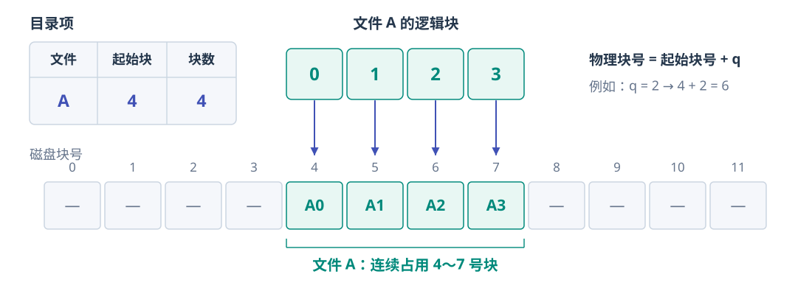
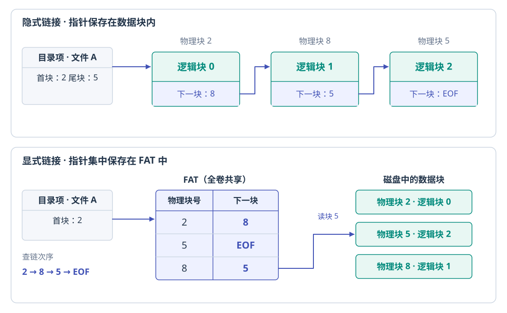
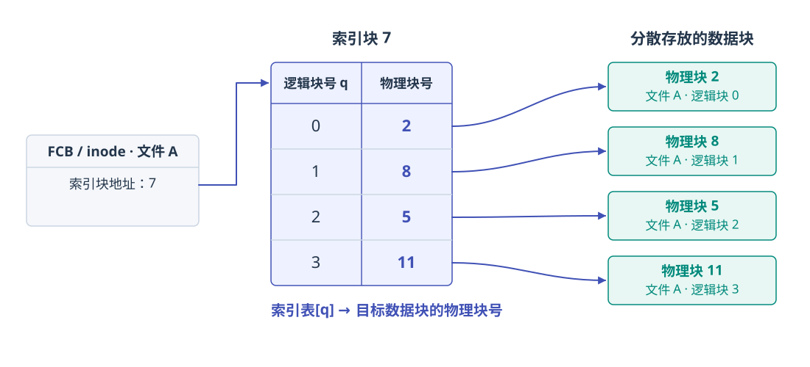
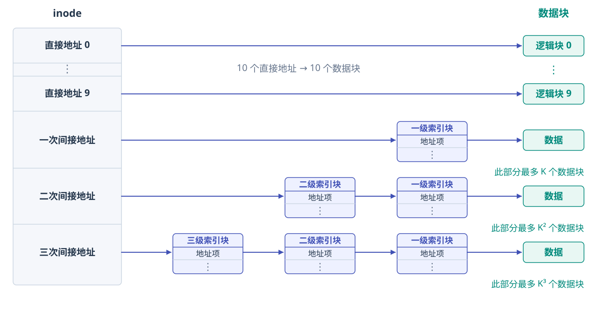
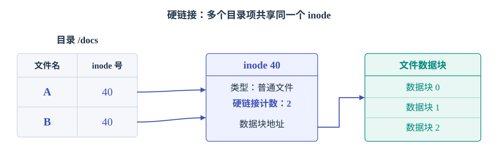
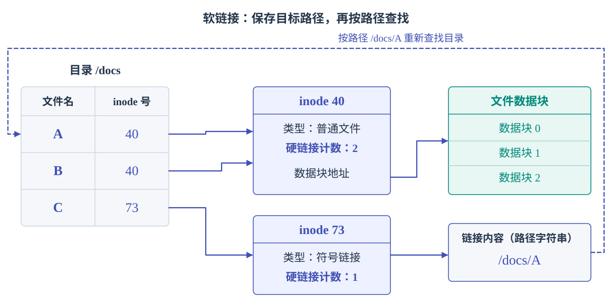
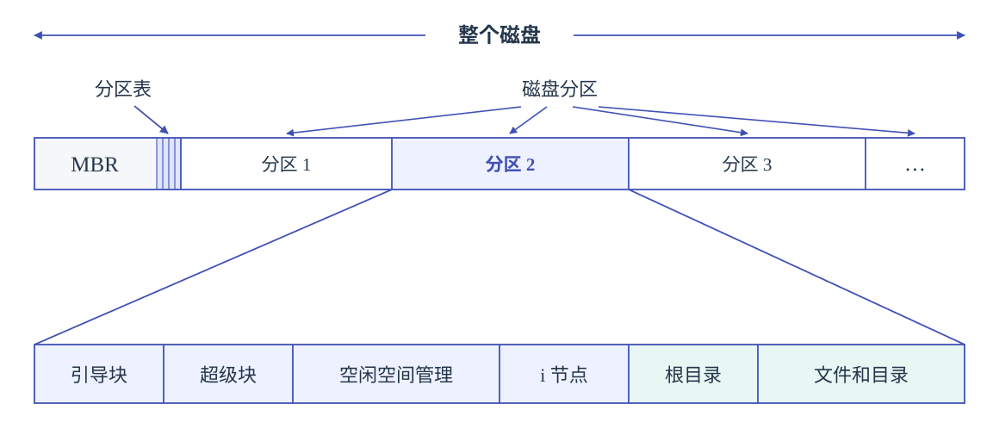
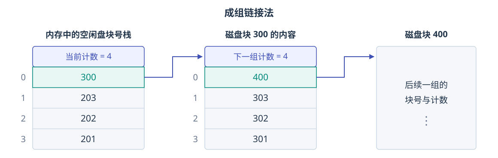

# 文件管理

## 文件

**文件**（File）是存储在计算机持久性存储设备（如硬盘、固态盘等）上的 **信息集合**，其内容可以是文本文档、图像、程序代码或其他形式的数据。在操作系统中，系统运行时以进程为基本单位进行资源的调度与分配；而用户在进行输入/输出操作时，则 **通常将文件作为逻辑操作的基本对象**。

为了支持用户对文件的创建、读取、修改、删除及安全保护等需求，操作系统提供了专门的文件系统，用以统一管理文件资源。文件系统通过对二级存储相关资源的抽象，屏蔽了文件的内部属性、存储介质的物理特性及其在设备上的具体位置等底层细节，使用户无须关心这些细节，便能方便、高效地使用文件。用户借助文件系统创建文件，并将其用于应用程序的输入与输出，从而有效管理数据资源。

??? info "自底向上看文件"
    1.  数据项。是文件系统中最低级的数据组织形式，可分为以下两种类型：
        1.  基本数据项。用于描述一个对象某一方面属性的一个值，是数据中的最小逻辑单位。
        2.  组合数据项。由多个基本数据项组成。
    2.  记录。是一组相关数据项的集合，用于描述一个对象在某一方面的完整属性。
    3.  文件。是指由创建者所定义的、具有文件名的一组相关元素的集合，可分为有结构文件和无结构文件两类。
        1.  有结构文件由若干格式相似的记录组成，如一个班级的学生记录；
        2.  无结构文件被视为一个连续的字节流，如二进制文件或普通文本文件。

### 文件属性

首先，文件必然包含实际的数据，即存储空间中所保存的信息；其次，由于操作系统需要管理大量数据，必须对这些数据进行分类和组织，因此每个文件都关联有用于分类和索引的信息；最后，不同用户对数据的访问权限存在差异，系统还需为文件设置相应的访问控制信息。

尽管不同的文件系统实现上有所差异，但通常都包含以下基本属性：

<center markdown="1">

| 属性 | 内容 |
| :---: | :---: |
| 名称 | 供用户使用的名字，在同一目录中必须唯一；不同目录可以重名。 |
| 标识符 | 系统内部标识文件的编号，例如 inode 号；其唯一性通常限定在一个文件系统内。 |
| 类型 | 用于标识文件的种类，供系统决定如何处理或打开该文件。 |
| 创建者 | 创建该文件的用户标识（ID）。 |
| 所有者 | 当前拥有该文件的用户标识（ID），通常有权修改文件属性或访问权限。 |
| 位置 | 指向文件在外存设备上物理存储位置的指针。 |
| 大小 | 文件的逻辑长度，通常以字节计；它与实际分配的磁盘空间大小可能不同。 |
| 保护 | 定义对文件的访问控制策略，包括读/写、执行等权限，用于保障文件安全。 |
| 创建时间、最后一次修改时间及最后一次访问时间 | 常用于审计、备份或缓存管理。 |

</center>

这些信息也被称为文件的元数据（meta data）。

### 文件类型

<center markdown="1">

| 分类依据 | 主要类型 |
| :---: | :---: |
| 性质和用途 | 系统文件、用户文件、库文件 |
| 数据形式 | 源文件、目标文件、可执行文件 |
| 存取控制属性 | 只读、读写、可执行；这些权限可组合 |
| 组织形式与处理方式 | 普通文件、目录文件、特殊文件（如设备文件） |

</center>

扩展名主要是命名约定和应用程序选择处理方式的依据，改名不会自动改变内容格式。操作系统不必理解普通文件的全部内容语义，记录、图像等内部格式可以由应用程序解释。

在 UNIX 系统中会在文件头中使用一串 **魔数**（magic number）来标识文件格式，例如 JPEG 的起始标记为 `FF D8`。脚本文件常用 `#!/bin/sh` 这样的首行形式指定解释器（这个就表示用 `/bin/sh` 执行）。

## 文件的访问方式

<center markdown="1">

| 访问方式 | 基本操作与特点 | 适用情形 |
| :---: | :---: | :---: |
| 顺序访问 | 从当前位置读写下一个字节或记录，指针随操作推进，可复位或跳过若干记录 | 文本扫描、批处理、磁带 |
| 直接/随机/相对访问 | 按文件内的相对块号或字节偏移访问，不必依次读出前面的数据 | 磁盘文件、数据库、随机播放 |
| 索引访问 | 先查索引得到记录或块的位置，再直接访问 | 按关键字查找、变长记录 |
| 索引顺序访问 | 先定位记录组，再组内顺序访问 | 兼顾顺序处理和检索 |

</center>

访问方式是接口能力，逻辑结构是数据组织，物理分配决定其实现代价。随机访问也不表示所有请求耗时严格相同，缓存、索引层数和寻道距离都会影响时间。

## 文件的逻辑结构 {#logical-structure}

### 无结构文件

**无结构文件**又称流式文件，向系统呈现连续的字节序列，没有由文件系统规定的记录边界。这里的“连续”描述逻辑地址，不保证磁盘块物理连续。UNIX 普通文件采用这种视图，应用程序仍可在其中组织复杂的数据。

### 有结构文件

**有结构文件**又称记录式文件，由若干记录组成；记录中的某个数据项可以作为查找用的关键字。通常，记录分为两种：

<center markdown="1">

| 记录形式 | 定位方法 | 特点 |
| :---: | :---: | :---: |
| 定长记录 | 若记录从 0 编号，长度为 $L$，第 $i$ 条的起始偏移为 $iL$ | 容易按记录号直接定位 |
| 变长记录 | 若无索引，第 $i$ 条的偏移为 $\sum_{k=0}^{i-1}L_k$ | 通常需扫描前面的长度信息；可建立索引加速 |

</center>

按照记录的组织形式，有结构文件可以分为以下三类。它们各自的组织形式也决定了其访问方式。

#### 顺序文件

记录在逻辑上按线性顺序依次排列，可采用定长或变长记录。按记录是否依关键字排序，可分为：

- **串结构**：按记录进入文件的先后顺序排列，按关键字查找通常需要顺序扫描。
- **顺序结构**：按关键字有序排列。对于定长且按键字有序的顺序文件，可通过偏移量直接定位记录，并支持折半查找等高效算法；物理实现还必须支持高效的直接访问，才能发挥这一优势。

顺序文件适合批量处理大量记录，访问局部性好，它在批量处理场景下表现最优，也是磁带等顺序存储设备的自然组织形式。

相应地，在频繁进行单条记录的查找、修改、插入或删除操作时，由于顺序文件缺乏直接定位能力且需移动大量数据，它的表现并不佳。

#### 索引文件

在顺序文件中，我们讨论过，对于变长记录，我们需要过一遍顺序扫描，效率很低。为了提高后续访问时的访问效率，无论记录本身是定长还是变长，我们都可以为每条记录建立一个定长的索引项，保存<u>关键字或记录号</u>、<u>记录（起始）位置</u>及<u>必要的长度信息</u>。查找时先检索索引表，再访问目标记录；即使记录本身变长，也能通过定长索引项快速定位。

索引可以按关键字排序，也可以针对不同检索字段建立多张索引。

显然，采用索引文件的代价是需要索引表的额外空间，以及插入、删除、修改记录时维护索引的开销。

#### 索引顺序文件

结合上面两种组织方式，我们就得到了索引顺序文件：将顺序文件分组，每组建立一个索引项。索引记录该组的代表关键字和起始位置；组间按关键字范围有序，组内可以无序排列顺序查找。当然，若组内无序，代表关键字必须能正确界定组的范围（例如该组都有某个字）。

检索分两步：先查索引确定所在组，再在组内查找。相比每条记录一个索引项，分组索引节省空间；记录很多时可继续建立多级索引。

设文件中有 $N$ 条记录，均分为 $m$ 组，那么每组大约含 $\dfrac Nm$ 条记录；假设索引表和组内都采用顺序查找，近似平均查找次数为

$$
T(m)\approx\frac m2+\frac{N}{2m}.
$$

当 $m\approx\sqrt N$ 时最小，约为 $\sqrt N$。由此，我们发现索引顺序文件可以显著提升索引效率；当记录数量很大时，还可以引入两级索引或多级索引；组内记录有序时，可以采用折半查找等方式。

#### 直接文件（散列文件）

!!! info "[哈希查找](../DS/search.md#哈希表散列表)"

对记录关键字计算哈希值，从而确定记录的物理地址。如果发生冲突，则使用冲突处理机制定位记录。

显然，直接文件的平均查找快，适合按关键字精确查询；散列冲突、扩容和范围查询则需要另行处理。

## 文件系统结构 {#filesystem-structure}

文件系统的设计需要同时解决两个问题：向上提供文件、目录和相关操作的接口，向下通过算法和数据结构，把这些逻辑对象映射到外存。将功能分层，可以把命名、权限、空间组织与设备控制分别处理。

自顶向下，一种常见的划分如下。

<center markdown="1">

| 层次 | 主要职责 |
| :---: | :---: |
| 应用程序 | 通过系统调用提出创建、打开、读写等请求 |
| 逻辑文件系统 | 管理文件名、目录、FCB、权限等元数据，完成按名存取与文件保护 |
| 文件组织模块 | 将文件逻辑块号转换为物理块号，并通过空闲空间管理器分配、回收盘块 |
| 基本文件系统 | 向设备驱动发出通用的物理块读写请求，管理内存缓冲区和缓存 |
| I/O 控制 | 包含设备驱动程序与中断处理程序，将通用请求转换为设备命令，处理传输与完成通知 |
| 设备 | 执行实际的数据存取 |

</center>

例如，用户给出一个文件路径后，逻辑文件系统先取得文件的描述信息；文件组织模块据此定位数据块；基本文件系统和 I/O 控制再共同完成块的传输。这里的层次描述职责分工，具体实现可以进一步合并或细分。

## 目录与文件 {#directory}

**文件目录** 是一种数据结构用于组织文件，建立文件名与文件描述信息之间的联系，是实现 **按名存取** 的关键。用户给出文件名或路径，系统便能定位文件，而不必让用户记住盘块地址。

目录管理还需要提高检索速度、支持文件共享与访问控制，并允许不同用户或不同目录中的文件重名。目录本身通常也以文件形式存放，其内容是所包含文件和子目录的目录项。

### 文件控制块

**文件控制块**（File Control Block，FCB）是操作系统描述和管理文件的数据结构，以实现按名存取。

每个文件对应一个 FCB，**所有 FCB 的集合构成文件目录**（也称目录文件）。创建文件时，系统就为其建立 FCB，集中保存前面介绍的文件属性，主要包括三类：

- **基本信息**：文件名、物理位置、逻辑结构和物理结构等。
- **存取控制信息**：文件主及其他用户的访问权限。
- **使用信息**：创建时间、最后修改时间等。

??? warning "有关 FCB..."
    [@Isshiki 修佬的博客](https://note.isshikih.top/cour_note/D3QD_OperatingSystem/Unit6/)中提到了 FCB 维护的到底是什么文件的信息的问题。由于我主要参考的是王道，因此在笔记里写的是王道的表述：每个文件都会被分配一个 FCB。

    但是在[维基百科](https://en.wikipedia.org/wiki/File_Control_Block)中，FCB 被定义为维护一个打开文件的状态的结构，而且 FCB 位于使用该文件的程序内存中。[微软学习文档](https://learn.microsoft.com/en-us/windows-hardware/drivers/ifs/the-fcb-structure)中也有“The FCB structure corresponds to every open file and directory.”这样支持 FCB 是打开文件的控制块的表述。

    与此同时，[Operating System Concepts (10th Edition)](https://codex.cs.yale.edu/avi/os-book/OS10/slide-dir/)（就是我们课上参考的教材）的官方课件（由编者自己写的课件）有如下表述：

    > File control block (FCB) – storage structure consisting of information about a file 
    > OS maintains FCB **per file**
    > System-wide open-file table contains **a copy** of the FCB of each file

    即认为 FCB 是磁盘上的每文件描述结构，打开时是将其副本放进[打开文件表](#open-file)的。

    ??? success "一种解释"
        > 下面的这些解释是我根据大模型生成的内容再加工得来的。如有错漏之处，恳请指正！

        这种范围上的差异，来源主要是由于这些不同的来源中 FCB 这个术语的适用范围。维基百科主要介绍的是 CP/M、DOS 操作系统的具体 FCB 接口，在这种情况下，应用程序提供一块内存，操作系统通过它完成文件操作，并维护访问状态；而王道和《操作系统概念》则将 FCB 视为描述文件信息的数据结构的通称。

        现代系统通常分别管理文件元数据、文件在内存中的表示，以及每次打开的状态；Linux 的磁盘 inode、内存 inode 和 `struct file` 分别对应前面说的三种职责。前面的各种来源提到的 FCB 所对应的职责都有所不同。

### 索引节点

然而，当文件数量庞大时，传统 FCB 目录会占用大量磁盘空间。查找文件时，系统需要逐块读入目录项、比较文件名，找到目标后才需要读取其余属性。若每次都读入完整 FCB，就会在检索阶段传输大量暂时用不到的信息。

因此，可以把 **文件名与描述信息分离**：将文件描述信息独立组织为 **索引节点**（index node-inode，也称 i 节点），目录项只保留 **文件名和索引节点号**。

$$
\text{文件名}\xrightarrow{\text{查目录}}\text{inode 号}\xrightarrow{\text{读 inode}}\text{文件属性与数据块地址}
$$

这样，同一个盘块可以容纳更多目录项，减少查找目录时的磁盘 I/O。例如，盘块为 1 KiB 时，64 B 的 FCB 每块只能放 16 项；分离后若目录项为 16 B，每块就能放 64 项。

为了能够兼顾持久存储和高效访问，索引节点被设计成两种形态：

??? note "磁盘索引节点"
    持久保存。每个文件有唯一的磁盘索引节点，内容包括：

    -   **文件主标识符**（标识所属的用户或用户组）
    -   **文件类型**
    -   **文件存取权限**
    -   **文件长度**（通常以字节为单位）
    -   **文件物理地址**（直接或间接记录的块地址）
    -   **文件硬链接计数**（统计本文件系统中有多少目录项指向该文件）
    -   **文件存取时间**（文件访问、修改和 inode 修改的时间）

??? note "内存索引节点"
    在文件被打开时，系统将对应的磁盘索引节点载入内存，并在此基础上增加一些运行时信息：

    -   **inode 号**
    -   **状态**（指示 i 节点是否被锁定/已修改）
    -   **访问计数**（有访问 +1，访问结束 -1；用于判断运行时是否仍有进程使用该对象，或者说能否释放）
    -   **逻辑设备号**（标识文件所属系统的逻辑设备号；在多文件系统环境下尤为关键）
    -   **连接指针**（分别指向空闲链表和散列队列；便于内核的调度和回收）

多个目录项可以指向同一个 inode，这也是后面[硬链接共享](#hard-link)的基础。

### 目录结构

#### 单级目录

整个文件系统只有一张目录表，所有文件都处于同一级。创建文件前，需要扫描目录，确认不存在同名文件；访问时按文件名查找对应目录项。

<figure markdown>
{:width="80%"}
</figure>

这种结构实现简单，但缺陷也很明显：全系统不能重名，文件增多后查找较慢，也不便分类和共享；它主要适合早期简单的单用户环境。

#### 两级目录

目录分为 **主文件目录**（Master File Directory, MFD）和 **用户文件目录**（User File Directory, UFD）：MFD 记录用户名及其 UFD 的位置，UFD 保存该用户的文件目录项。

<figure markdown>
{:width="80%"}
</figure>

查找时，系统先定位到用户，再从其 UFD 继续查找。

不同用户的文件可以重名，检索范围也随之缩小，便于用户之间的隔离和保护。不过，每个用户的 UFD 仍然是扁平结构，无法继续按项目或文件类别分组。

#### 树形目录

如果我们将目录本身也视为一种特殊的文件，允许目录中继续包含子目录，就得到以根目录为起点的 **树形目录**。

在纯树形结构中，每个非根节点只有一个父节点，文件由从根出发的路径唯一确定。路径名有两种形式：

- **绝对路径**：从根目录开始，如 `/home/student/os/file.md`。
- **相对路径**：从进程的当前工作目录开始。若当前工程目录为 `/home/student`，则 `os/file.md` 指向上述文件。

许多操作系统使用 `.` 表示当前目录，`..` 表示父目录。进程可以改变当前工作目录，从而缩短路径输入，并减少反复从根解析相同上层目录的工作。

<figure markdown>
{:width="80%"}
</figure>

树形目录便于分类、管理和保护：它能按层次组织文件，在不同分支中使用相同文件名，并对不同目录独立地设置访问权限。

> 使用过任何操作系统的命令行的读者朋友应该都会对树形目录已经有了一个了解。

当然，这不是说树形目录完全没有代价。遇到较深的路径时需要逐级查找，这可能增加磁盘 I/O；纯树的结构本身也不能直接表示一个文件属于多个目录的共享关系。但总体来说，凭借其良好的组织性、扩展性以及对多用户环境的支持，这些代价可谓瑕不掩瑜；当前的绝大多数现代操作系统也都采用树形目录结构。

#### 无环图目录

在树形目录中增加指向已有文件或子目录的共享边，并保持整个结构无环，就得到 **无环图目录**。一个节点可以出现在多个目录下，用户共享同一实体而无须各自保存数据副本。

<figure markdown>
{:width="80%"}
</figure>

但共享节点删除操作的复杂性也不容忽视：不能直接物理删除整个共享节点而破坏其他用户仍在使用的实体。所以我们需要一些机制来解决这个问题，这就涉及到计数的问题。

具体的引用计数与链接机制，我们放在后面的[文件共享](#file-sharing)中展开。

#### 一般图目录

无环图目录通过保证不存在环来保证文件系统的简洁性，避免遍历目录时候出现死循环或者删除文件时出现的循环依赖等问题。如果允许共享边形成环，目录便成为一般图。

<figure markdown>
{:width="80%"}
</figure>

此时我们就需要额外注意一些事情来避免可能出现的问题。例如，图遍历时需要记录访问状态或限制跟随链接的次数，以免无限循环；仅靠引用计数也可能无法回收已经不可达、却相互引用的节点，需要结合可达性检查等回收机制。

!!! tip "想要复习[图论](../DS/graph.md)？"

### 目录的操作

目录操作主要改变命名关系和组织层次。

<center markdown="1">

| 操作 | 主要工作 |
| :---: | :---: |
| 搜索 | 在目录中查找与给定名称匹配的目录项；多级路径需要逐级解析 |
| 创建文件项 | 检查同目录重名情况，无重名则建立新目录项并初始化其属性 |
| 删除文件项 | 移除目录项；结合共享和使用状态判断是否同时回收文件实体 |
| 创建目录 | 建立子目录，使文件能够继续分组和嵌套 |
| 删除目录 | 空目录可直接删除；非空目录需先用户清空，或自动递归删除其中内容 |
| 移动 | 将文件或子目录的命名关系迁移到另一父目录，随后更新路径名 |
| 显示目录 | 列出文件和子目录的名称，以及需要显示的相关属性 |
| 改变目录 | 修改进程的当前工作目录，作为后续相对路径的起点 |

</center>

### 目录实现

访问文件时，操作系统根据路径名定位相应的目录项，而目录项中包含用于查找文件磁盘块所需的关键信息。目录实现的核心目标是高效支持查找操作，因此主要有两种基本方法。

#### 线性列表

将文件名及其定位信息（数据块指针）组织成线性表，查找时逐项比较。创建前先确认无重名，再新增目录项；删除时即根据文件名查找并释放其占用的空间。为了重用被删除的目录项对应的块可标记表项为空闲、挂入空闲链，或用末项填补空位。

优点是实现简单；缺点是目录越大，顺序扫描越慢。当然，有几个老生常谈的优化措施：若目录项按文件名有序，可采用折半查找，但插入和删除同样需要维护有序性；也可使用平衡树、B+ 树等索引组织。

#### 哈希表

对文件名计算哈希值，定位到哈希表中的某个元素，该元素通常存放一个目录项指针，再核对文件名。平均查找速度较快，但必须处理不同文件名的哈希冲突，还要考虑表容量和扩容。

无论采用哪种方法，将活跃目录缓存到内存，都能减少重复查目录造成的磁盘读取。

### 文件的物理分配 {#allocation}

文件物理结构关注 **文件数据如何在磁盘上分布与组织**。它与[文件的逻辑结构](#logical-structure)不同，逻辑上相邻的记录，在物理实现上可以有不同的方式；物理实现会影响逻辑访问的效率。

文件分配方式直接决定文件的物理结构，常用策略有三种：连续分配、链接分配和索引分配。

#### 盘块与簇

文件系统按固定大小的块组织外存空间，并以块为粒度进行底层数据交换。若以若干连续盘块构成一个分配单元，则称为 **簇**（cluster）。簇增大后，需要管理的分配单元和指针变少，但文件尾部未用满的空间可能增大，形成内部碎片。

设块大小为 $B$ 字节，文件内字节偏移为 $x$，逻辑块号和偏移均从 0 开始，则

$$
q=\left\lfloor\frac{x}{B}\right\rfloor,\qquad r=x\bmod B.
$$

其中，$q$ 是文件内逻辑块号，$r$ 是块内偏移。接下来还需根据分配方式，将 $q$ 转换为物理块号。

#### 连续分配

一个文件占据一段连续的盘块，目录项记录 **起始块号和占用的块数**。若起始块为 $s$，长度为 $n$ 块，则占据 $s$ 到 $s+n-1$，逻辑块 $q$ 对应物理块 $s+q$。

<figure markdown>

</figure>

连续分配支持顺序访问和直接访问，连续读写时寻道较少。但它的主要问题是：

- 需要足够大的连续空闲区，容易产生 **外部碎片**。
- 需要预先知道文件大小，且难以支持文件动态增长：后方空间被占用时，增长可能需要迁移整个文件，否则强行扩展可能覆盖物理上相邻的其他文件。
- 为维持数据的连续排列，中间插入、删除记录可能导致大量数据移动。

整理可以搬移文件、合并零散空闲区，但复制数据的代价较大。另一种改进是 **区段**（extent）：文件由若干段连续空间组成，每段记录起始位置和长度，增长时再分配新区段，不要求整个文件始终连续。

#### 链接分配

文件的盘块可以分散存放，通过指针确定先后次序。它不要求连续空闲空间，便于按需增长，也便于在已找到的位置插入或删除整块。根据指针存储的位置，可分为隐式链接和显式链接。

<figure markdown>

</figure>

-   **隐式链接** 目录项记录首块的盘块号和尾块号，将下一块的地址保存在当前数据块内。

    这种方式的局限性在于
    
    -   访问后面的块时，需要从已知位置沿链逐块读取，因此隐式链接仅支持顺序访问；
    -   每块都要占用一定空间去存指针；
    -   若指针损坏，后续链可能无法到达。
    
    将多个连续盘块组成一个簇后再链接，可以减少指针数量和链长（就可以缓解上述问题），但会增加尾簇内部碎片的可能。

<a id="fat"></a>

-   **显式链接** 把物理块块指针集中放入 **文件分配表**（File Allocation Table，FAT）。整个文件系统中仅设一张 FAT（FAT 是全局的），每个表项与一个磁盘块对应，存放指向下一个盘块的指针。所以，目录项只需保存文件的首块号，再沿 FAT 获得后续块号。

    例如，`FAT[2]=8`、`FAT[8]=5`、`FAT[5]=EOF`，表示文件依次占用 `2 → 8 → 5` 三块。FAT 持久保存在磁盘上，在系统启动时即被载入内存。因此在访问某个逻辑块时，可以在内存中查链，定位后直接读目标块而无须读取沿途的数据块。

    表项还可以用特殊值标记空闲、坏块等状态，因此系统可直接利用 FAT 管理磁盘的空闲空间等。

    综上，显式链接除了支持顺序访问，还支持直接访问。使用 FAT 时，检索操作均在内存中完成，不仅显著提升了查找速度，也大幅减少磁盘 I/O 次数。当然，不可避免的是，全卷 FAT 的内存开销随分配单元数量增加。

#### 索引分配

为每个文件建立独立的 **索引块**，索引块中按逻辑块次序存放数据块的物理块号。与 FAT 按全卷物理块组织表项不同，文件索引表的第 $q$ 项直接对应该文件的逻辑块 $q$。从这个意义上讲，索引表的功能类似于内存管理中的页表――建立逻辑页面到物理页之间的映射关系。

<figure markdown>

</figure>

索引分配支持直接访问，数据块可离散分配，不产生要求连续空间所导致的外部碎片；代价是索引本身占用空间，小文件也可能需要一个未用满的索引块。

1. **单级索引**：一个索引块直接指向最多 $K$ 个数据块，文件数据容量上限为 $K\times B$。
2. **链接索引**：把多个索引块串成链，扩展索引容量。索引块需要为链指针预留空间，访问后面的索引块仍要沿链查找。
3. **多级索引**：上层索引块保存下层索引块地址，最后一级再指向数据块。例如二级索引中，逻辑块号 $q$ 对应的主索引项为 $\lfloor q/K\rfloor$，下层索引项为 $q\bmod K$；字节在数据块内的偏移仍为 $r$。这与多级页表逐级定位的思想相似。

例如，$B=4$ KiB、$p=4$ B 时，$K=1024$；单级索引覆盖 4 MiB，二级索引覆盖 4 GiB。多级索引能容纳大文件，但未命中缓存时，访问数据需要逐级读取索引。

#### 混合索引

在 inode 中同时设置直接地址和（多级）间接地址，可以兼顾不同大小的文件：小文件通过直接地址访问，中型文件可以使用单级索引（单级间接地址），大型和超大型可以使用多级索引分配（多级间接地址）等等。

<figure markdown>

</figure>

!!! example "混合索引的容量计算"
    若有 $d$ 个直接地址项，各有一个一次、二次和三次间接地址项，则

    $$
    L_{\max}=(d+K+K^2+K^3)B.
    $$

    下面以 **10 个直接地址项 + 3 个间接地址项**、$B=4$ KiB、$p=4$ B 为例，我们计算文件数据容量。

    <center markdown="1">

    | 地址部分 | inode 中保存的地址指向 | 此部分新增的数据容量 | 使用至此的累计容量 |
    | :---: | :---: | :---: | :---: |
    | 10 个直接地址 | 数据块 | 40 KiB | 40 KiB |
    | 一次间址 | 存放数据块地址的索引块 | 4 MiB | 4 MiB + 40 KiB |
    | 二次间址 | 指向一次间址块的主索引块 | 4 GiB | 4 GiB + 4 MiB + 40 KiB |
    | 三次间址 | 再增加一层索引的主索引块 | 4 TiB | 4 TiB + 4 GiB + 4 MiB + 40 KiB |

    </center>

上面讨论的都是已分配块的组织；未分配块的登记、分配和回收，放在后面的[文件存储空间管理](#free-space)中讨论。

### 文件的操作 {#file-operations}

操作系统通过系统调用提供文件操作。

#### 创建文件

创建文件通常经过以下步骤：

1.  检查文件名是否合法、同目录是否重名，以及用户对目标目录是否有相应写权限。
2.  为文件分配一个空闲的 FCB 或 inode，初始化文件元数据（文件类型、所有者、权限、长度、时间戳和块指针等信息）。
3.  按需要（文件预估的大小）分配数据块，在 inode 中登记其地址。
4.  在父目录中建立格式为 `<文件名, 索引节点号>` 的目录项（我们前面介绍过设置 inode 的初衷）。
5.  更新空闲 inode、空闲块、目录大小和时间等元数据；若接口同时执行打开，还需建立打开状态并返回描述符。

#### 删除文件

删除文件通常经过以下步骤：

1.  先按路径主机查找到目录项，获取其 inode 或 FCB，并检查用户对目录的操作权限。
2.  检查使用状态与[硬链接计数](#hard-link)：
    1.  若文件正被打开，则系统可能延迟物理删除，待所有引用关闭后再回收资源；
    2.  若仍有其他硬链接，就保留共享实体：删除当前目录项、计数 -1 但不回收 inode 和物理块；
    3.  仅当满足计数为 1 的回收条件时，系统才进行下面的删除流程：
3.  移出目录中的目录项，在逻辑上删除。
4.  释放 inode；在链接计数归零时 inode 被标记为空闲并归还至空闲管理结构。
5.  释放磁盘块；根据 inode 中的指针，将所有数据块和索引块归还至空闲块管理结构。
6.  释放内存临时资源。这部分内容可见[内存中的结构](#内存中的结构)一节。
7.  更新文件系统元数据。

#### 数据访问

**读文件** 依靠目录项和读指针。首先根据目录项获取 inode 号，进而定位磁盘块位置；随后根据读指针的位置从指定的块中读取数据，并更新读指针；
**写文件** 依靠目录项和写指针。目录项的作用和读操作相同；根据写指针的位置向指定的块中写入数据并更新写指针。若写入超出当前分配的空间，系统会动态分配新磁盘块并一并更新 inode（或 FCB）中的块指针。

当然，提到数据访问则必然有保证互斥性的操作（如加锁），但我们就不在这里展开了。

!!! example "一个共享读锁和独占写锁的具体例子"
    [Linux fcntl_locking(2)](https://man7.org/linux/man-pages/man2/fcntl_locking.2.html)。

#### 打开文件 {#open-file}

若每次读写都按文件名重新查找目录、读取元数据，重复开销会很大。为了避免重复查找，系统维护了一个叫 **打开文件表** 的数据结构以记录当前活跃文件的信息。

为了兼顾效率和灵活性，实现现代操作系统采用两级打开文件表结构：

-   进程打开文件表：每个进程独有，记录进程的私有访问状态，如当前读/写指针、访问权限和文件打开模式。该表项中的每一项均指向系统打开文件表的对应项。
-   系统打开文件表：全局共享，存储和进程无关的文件属性，如文件位置、文件大小、访问时间等。每一个表项都包含一个 **打开计数器**，记录有多少进程打开了该文件。

当一个进程成功打开文件时，系统首先确保其在系统打开文件表中存在对应项（若不存在则创建），随后在该进程的打开文件表中新增一项，指向该系统表项。此后，其他进程若打开同
一文件，仅需要在其各自的进程表中添加新项并指向同一系统表项。

UNIX 系统中使用 **文件描述符**（file descriptor，fd）称呼进程打开文件表的索引，通常为非负整数；Windows 系统则使用 **文件句柄**（file handle）这一概念来指代同样的东西。

大多数操作系统要求用户（某进程）首次访问某个文件时必须先通过 **系统调用 `open`** 将其打开：系统根据文件路径定位到其目录项后，将关键信息载入内存，在进程打开文件表中创建一个表目，并将该表目的索引号（也就是文件描述符/文件句柄）返回给用户。此后，用户再次操作该文件时，只需要拿着 fd 给系统，就可以直接从内存中获取所需要的信息，从而显著降低了目录检索的开销。

所以我们可以总结出打开一个已有文件的过程为：

1.  根据路径逐级查找目录，取得目标文件的 inode 号。
2.  在系统打开文件表中查找已有的活动文件信息。
    -   若找到对应项，则维护打开计数（+1）；
    -   若未找到，则从磁盘读取该 inode 至内核缓冲区，创建表项，并维护打开计数（初始化为 1）。
3.  检查请求的打开方式是否符合文件访问权限。
4.  在发起请求的进程所属的进程打开文件表分配新的进程表项，初始化本次访问状态。
5.  将进程表项的索引 fd 返回给调用者。

随后，`read(fd, buf, n)` 等操作通过 fd 取得访问状态，根据文件偏移和分配结构定位数据，利用缓存或设备 I/O 完成传输，再更新偏移。`read`、`write`、`lseek`（定位，即改变偏移）、`close` 等都使用 fd。

!!! warning "注意区分 inode 和文件内容。打开不要求把整个文件读入内存。"

#### 关闭文件

对应地，用户调用 `close` **关闭文件** 撤销相应进程表项，递减系统表项的打开计数。一旦计数减至 0，表示该文件已经无任何进程引用，于是系统可以安全地删除其在系统表中的项并释放所占用的相关资源。

???+ info "Linux 中的打开文件描述"

    Linux 的具体关系是 `进程 fd 表 → 打开文件描述（file 对象）→ inode`。文件偏移和状态标志保存在打开文件描述中。分别调用两次 `open` 通常产生两个独立的打开文件描述；`dup` 或 `fork` 继承的描述符则可以共享同一打开文件描述和偏移。参见 [Linux open(2)](https://man7.org/linux/man-pages/man2/open.2.html)。

### 文件共享 {#file-sharing}

文件共享使多个用户访问同一份物理数据，不仅节省了存储空间，还让文件增长、属性变化等更新对各访问者一致可见。

!!! danger "无环图目录作为共享方案...？"
    无环图目录结构看起来确实可用于实现文件共享：建立链接时，需要将被共享文件的盘块号复制到相应目录项中。然而，若某用户向文件追加数据并分配新盘块，这些新增盘块仅出现在其操作所对应的目录中，而对其他用户不可见，这破坏了一致性，因此无法实现真正的共享。

#### 硬链接 {#hard-link}

**硬链接** 是一种基于索引节点的共享机制。在这种方式下，多个目录项指向同一个 inode。文件块地址和属性不再存放在目录项，而只保存在这个公共 inode 中。增加链接不会复制数据，也不会自动改变文件所有者。谁创建了文件，谁就是文件的拥有者。

inode 中的硬链接计数（链接计数）记录指向它的目录项数量。新建文件通常为 1；增加硬链接时加 1；删除一个名字时减 1。只要仍有名字指向该文件，就应保留其 inode 和数据。

例如，`A` 的硬链接计数起初为 1，建立另一个硬链接 `B` 后变为 2。删除 `A` 只把计数减到 1，`B` 仍能访问原来的文件。硬链接之间没有必须长期保留的“原文件名”，各名字都指向同一实体。

<figure markdown="1">
{:width="96%"}
</figure>

#### 软链接

**软链接**，也称符号链接，实质上是一个独立的链接文件，内容保存目标文件的路径。访问链接时，系统读取并解析目标路径，再定位实际文件。

它有自己的 inode，不增加目标文件的硬链接计数。若目标路径不再对应有效文件（例如拥有者删除），符号链接便成为 **悬空链接**；删除链接本身不会删除目标。沿用上例，若 `C` 保存路径 `A`，删除 `A` 后即使 `B` 仍保有原文件，`C` 也无法再通过路径 `A` 找到它。

!!! warning "悬空链接和悬空指针"
    这里的悬空链接说的是符号链接本身（链接文件保存的路径名称）找不到目标；而 **悬空指针** 说的是仍直接引用已经释放的对象或存储位置，继续使用可能访问无效内容，例如指向 inode 的指针。

    所以，采用软链接时，即使拥有者删除了共享文件，也不会导致其他用户的指针悬空。当其他用户尝试通过符号链访问已被删除的共享文件时，系统将返回访问失败，此时可安全地删除该符号链接，而不会引发任何问题。

软链接需要额外存储路径和链接文件的元数据，访问还可能增加路径解析与读盘开销。

<figure markdown="1">
{:width="96%"}
</figure>

??? info "链接的实际使用范围"

    UNIX 中的硬链接通常限制在同一文件系统内，且不允许普通用户随意建立目录硬链接；符号链接可以指向目录，也可以通过路径跨文件系统。相对目标路径以链接所在目录为起点解释，符号链接还可能形成解析循环。参见 [Linux symlink(7)](https://man7.org/linux/man-pages/man7/symlink.7.html)。

    在网络共享中，路径还需要通过已建立的远程文件访问机制解释；本地符号链接本身不会执行网络传输。

!!! tip "删除名字与释放实体可以发生在不同时刻"

    硬链接计数降到 0 后，如果文件仍被打开，支持延迟回收的系统会保留其数据，直到相关的打开引用被释放。因而，硬链接计数描述名字关联，打开计数描述运行时使用，判断回收条件时需要同时考虑二者。

### 文件保护 {#sharing-protection}

文件保护控制 **谁能对文件执行什么操作**，避免未授权访问或意外修改。常见受控操作有 **读、写、执行、追加、删除和列目录**。其中，追加操作是在文件末尾增加数据而不覆盖原有内容，与写操作这种任意位置的写入（修改）不同。

此外，系统还可以控制复制、打印、编辑等高层操作，但这些操作通常由应用程序通过系统调用实现，最终由底层读写等操作完成，真正的保护机制也仅在底层提供。例如，读取源文件是复制的基础，复制文件本质上是通过一系列读操作完成的。

#### 访问控制列表

实现访问控制最常用的方法是基于用户身份进行权限管理。其中，最普遍的机制是为每个文件和目录附加一个 **访问控制列表**（Access-Control List，ACL），记录用户或用户组及其允许的访问类型。它能表达灵活的授权策略，但列表长度不定，用户很多时管理开销较大。

一种精简办法是把用户分为 **拥有者、组、其他用户**，再为每类设置独立权限位，这也是现代系统的常用办法。例如，一个文件的 ACL 可以是这样的：

<center markdown="1">

| 用户类别 | 读 | 写 | 删除 | 执行 |
| :---: | :---: | :---: | :---: | :---: |
| 拥有者 | 1 | 1 | 1 | 1 |
| 组 | 1 | 0 | 0 | 0 |
| 其他用户 | 0 | 0 | 0 | 0 |

</center>

每种权限用一个二进制位表示，所以仅需一个 $3\times4$ 的矩阵。检查用户权限时，系统按优先级顺序匹配：先判断是否为拥有者，再判断是否属于相应组，否则使用其他用户权限。

UNIX 常见的基本权限是三组 `rwx`，分别表示拥有者、组和其他用户的读、写、执行权限，共 9 位。例如，`-rw-r-----` 表示普通文件，拥有者可读写，组可读，其他用户无权限；`d` 开头表示目录。

对目录而言，`r` 允许读取目录项列表，`x` 允许搜索和穿过目录，`w` 允许修改目录项。创建和删除名字通常需要父目录的写与搜索权限；具体还可能受 sticky bit 等规则限制。参见 [Linux inode(7)](https://man7.org/linux/man-pages/man7/inode.7.html)。

#### 口令与加密

<center markdown="1">

| 机制 | 思路 | 主要代价与局限 |
| :---: | :---: | :---: |
| 口令保护 | 用户提供正确口令后，系统允许访问文件 | 实现简单，但共享口令的分发、保存和撤销不便，简单存储方式安全性有限 |
| 加密保护 | 文件内容以密文保存，持有正确密钥才能解密 | 有加解密计算与密钥管理成本 |

</center>

口令与加密主要解决访问凭据和内容保密问题而并不区分具体访问操作类型，所以仍需结合访问控制，才能区分读、写、执行等操作。

此外，多级目录还需要对目录及其子树提供保护。

## 文件系统 {#filesystem-layout}

一个完整的文件系统不仅包括被管理的文件，还有实现文件管理所需要的数据结构、与文件管理相关软件等。

### 文件系统布局

本节从持久化存储和运行时管理两个角度观察其布局。

#### 磁盘中的结构

一个磁盘通常可以划分为多个分区，各分区建立相应的文件系统。以下是传统分区方案下的一种示意布局。

<figure markdown="1">
{:width="96%"}
</figure>

<center markdown="1">

| 组成部分 | 保存的信息与作用 |
| :---: | :---: |
| 主引导记录 MBR | 在传统 BIOS/MBR 启动方案中位于磁盘起始（0 号）扇区，包含主引导代码，其后紧跟分区表 |
| 引导块/引导控制块 | 位于分区的第一个扇区；保存所在分区的启动信息或引导程序，用于继续加载操作系统；Windows 中将该区域称为分区引导扇区 |
| 超级块/卷控制信息 | 保存整个文件系统的参数，如总块数、块大小、空闲块与空闲 inode 数量及相关管理位置 |
| 空闲空间结构 | 记录哪些分配单元尚未使用，支持后续分配和回收 |
| inode 等每文件描述结构 | 保存单个文件的属性和块定位信息 |
| 根目录及其他目录 | 建立文件命名和组织关系 |
| 文件数据区 | 保存普通文件内容及目录内容等数据 |

</center>

在上述启动模型中，分区表用于记录各分区的起始与结束地址，并标记其中一个为活动分区。计算机上电后，BIOS 读取并执行主引导代码，由其识别活动分区，随后读取改分区的引导块，并将控制权移交给该分区引导块中的引导程序，继续加载分区中的操作系统。

超级块在系统启动或首次挂载对应文件系统时被读取，用于建立内存中的文件系统管理信息：超级块中的典型内容包括分区的总块数、块大小、空闲块数量及其指针、空闲 inode 数量及指针等。

#### 内存中的结构

除了维护磁盘中的结构以长期保存文件，系统还需要在内存中维护运行时的管理信息。这些信息在文件系统挂载时加载，在运行期间动态更新，并在卸载时释放。

<center markdown="1">

| 结构 | 管理的对象与作用 |
| :---: | :---: |
| 挂载表（mount table） | 记录已挂载文件系统的设备标识、挂载点、类型和选项，支持在不同文件系统之间定位访问目标 |
| 内存中的超级块等卷信息 | 保存文件系统全局参数的运行时表示，供空间分配、统计和状态维护使用 |
| 目录缓存 | 保留近期访问的目录信息，减少路径解析时重复读取目录的开销 |
| 活动 inode | 保留已载入的文件描述信息；具体字段可参见前面的[内存索引节点](#索引节点)一节 |
| 系统级[打开文件表](#open-file) | 维护当前打开文件的共享信息，供各进程的打开文件表引用 |
| 进程级打开文件表 | 将本进程使用的文件描述符与相应的内核访问状态关联 |
| 数据缓冲区与缓存 | 暂存读入或待写出的盘块内容，协调数据传输，并复用已经取得的数据 |

</center>

内存中的信息也有不同的去向：文件内容和需要保留的元数据更新应写回外存；进程的访问状态等临时信息则在相关引用结束后释放。

### 文件存储空间管理 {#free-space}

前面的[物理分配方式](#allocation)讨论已经交给文件使用的盘块如何组织；**文件存储空间管理** 则专门负责登记哪些盘块尚未使用，并完成空闲空间的分配与回收。

分配时，系统要找到满足请求的空闲块或连续空闲区，更新其占用状态；回收时，则将释放的空间重新登记为可用。以下几种方法的区别，主要在于 **用什么结构表示空闲空间，以及一次管理一个块还是一个连续区**。

#### 空闲表法

为空闲磁盘区域建立一张 **空闲表**，每个连续空闲区对应一个表项，记录起始盘块号和空闲盘块数，通常按起始盘块号递增排列。这种方法便于配合 **连续分配** 使用，思路源于[内存的动态分区管理](./memory.md#动态分区分配)。

**分配盘块**时：

1.  按首次适应、最佳适应等策略，选择大小满足请求的空闲区。
2.  若恰好用完整个空闲区，删除对应表项；若只使用其中一部分，则修改剩余区的起始块号和长度。

**回收盘块**时，要根据释放区与已有空闲区的物理相邻关系处理：

-   与前后区域都不相邻，新增一个空闲区表项。
-   只与前区或后区相邻，合并为一个更大的空闲区。
-   与前后区域都相邻，将三者合并，减少空闲表项数量。

这里的“相邻”指盘块地址连续。例如，起始块为 $s$、长度为 $n$ 的区域，其紧邻后继从 $s+n$ 开始。

空闲表法能够直接提供连续块，利于顺序 I/O；但随着空闲区增多，需要检索和维护的表项也会增多。

#### 空闲链表法

将空闲空间组织成链表，按节点粒度可分为 **空闲盘块链** 与 **空闲盘区链**。这种链接的组织方式和前面的[隐式链接](#链接分配)分配是类似的。

-   **空闲盘块链** 以单个空闲盘块为节点，在块中保存下一空闲块的指针。

    分配时从链首摘下所需数量的盘块；回收时将释放块接回链尾。单块分配和回收简单，但请求多个盘块时需要沿链取得多个节点，可能产生多次磁盘访问；链较长时，寻找连续空间也不方便。

-   **空闲盘区链** 以一组连续空闲盘块为节点，记录盘区长度和下一空闲盘区的指针。

    分配时选择足够大的盘区，必要时分割；回收时检查与其他盘区是否相邻，必要时合并。它用较少节点表示成段空间，适合连续区的批量分配，但需要维护盘区的分割、合并及链接关系。

!!! info "与计数法的关系"
    **计数法** 强调以“起始块号 + 连续块数”描述连续空闲区。空闲表法与空闲盘区链都采用这种表示，前者将记录组织成表，后者将记录组织成链。

#### 成组链接法

空闲表可能需要维护大量空闲区，空闲盘块链又可能因逐块链接而过长；因此它们都不适用于大型文件系统。UNIX 采用 **成组链接法** 来缓解这个问题。

成组链接法将所有空闲块分成若干组，除最后一组外，每组的第一个块（即该组块号列表中 **位置 0** 对应的盘块）用作索引块，用于记录下一组中所有空闲盘块的块号及其数量。这些索引块会被依次连接起来形成一条链。文件系统挂载时，第一组的空闲盘块信息（保存在链头管理结构，传统 UNIX 中保存在超级块中）会被预先加载到内存中的一个专用栈结构（称为 **空闲盘块号栈**）中。

**分配盘块**的过程为：

1.  当前栈中还有普通块号时，弹出一个块号，减少计数，将对应盘块分配出去。
2.  当轮到连接块时，**先读取其中保存的下一组信息**，更新内存栈。
3.  下一组已接续到内存后，原连接块就完成了连接任务，可以作为普通盘块交给文件使用。遇到结束标志则表示没有后续组。

<figure markdown="1">
{:width="96%"}
</figure>

图中每组块号按倒序排列，位置 0 的 300 号块用作索引块。位置 0 是栈底，分配时从位置 3 向位置 0 弹出块号，因此先分配 201、202、203；轮到 300 时，先把 300 中的下一组信息装入内存，再分配 300。

**回收盘块**时：

1.  栈未满，直接将释放块号压入栈，计数加 1。
2.  栈已满，将当前栈的全部块号和计数写入这次回收的块，使它成为新的连接块；随后在内存栈中只保留该块号，将计数置为 1。
3.  后续回收的块号继续压栈，直到再次装满。

这样一来，跨组时才需要成批读取或保存块号，避免逐块读链带来的开销。分组是块号的组织方式，并不必然要求组内各盘块物理连续。

空闲管理信息本身也需要持久保存。文件系统挂载时，系统读取超级块等相关结构，建立可供分配使用的内存状态；运行中还要维护这些状态与磁盘副本的一致性。

#### 位示图法

**位示图**（bitmap，也称位图）为每个分配单元设置一个比特位，表示其占用状态。分配单元可以是盘块，也可以是簇；一般情况下， **0 表示空闲，1 表示已分配**。

将各位按固定顺序排列后，每个位的位置都能换算成对应的盘块号。因此，分配和回收不需要在链中插入或删除节点，只需修改相应的位。

**分配盘块**时：

1.  扫描位图，寻找一个空闲位，或满足连续分配要求的一组相邻空闲位。
2.  根据这些位的位置计算盘块号，将盘块交给文件使用。
3.  将对应位从 0 改为 1。

**回收盘块**时，则先由块号求出位图位置，再将对应位改为 0。若采用相反的 0、1 含义，置位和清零的方向也要交换。

??? example "位图需要多大空间"

    若管理 $N$ 个分配单元，位图需要 $N$ 位，即

    $$
    S_{\text{bitmap}}=\left\lceil\frac{N}{8}\right\rceil\ \mathrm{B}.
    $$

    例如，1 GiB 空间以 4 KiB 盘块为单位管理，共有 $2^{30}/4\times2^{10}=2^{18}$ 块，因此位图需要 $2^{18}$ 位，也就是 32 KiB。

位图结构紧凑，可以将常用部分留在内存中；相邻位对应相邻盘块，也便于查找连续空间。它的大小取决于 **分配单元总数**：每个单元始终需要一个状态位，磁盘增大或分配粒度减小时，管理空间也随之增加。

??? example "位图位置与盘块号的换算"
    设每行有 $w$ 位，盘块号为 $b$，行号、列号分别为 $i,j$。假设 **盘块号、行号和列号均从 1 开始** ：

    $$
    \begin{aligned}
    b&=(i-1)w+j,\\
    i&=\left\lfloor\frac{b-1}{w}\right\rfloor+1,\\
    j&=(b-1)\bmod w+1.
    \end{aligned}
    $$

    其中，$b-1$ 是从位图开头算起的位偏移。

    若三者都从 0 开始，则相应表达式变化：

    $$
    b=iw+j,\qquad
    i=\left\lfloor\frac{b}{w}\right\rfloor,\qquad
    j=b\bmod w.
    $$

    ---

    无论如何变化，重点都是先算“偏移量”。

### 虚拟文件系统 {#vfs}

现代操作系统通常需要支持多种文件系统，如 ext4、NTFS、FAT 等。不同文件系统的目录组织、元数据格式和块定位方式可能完全不同。若应用程序直接适配每种格式，就需要分别编写文件操作代码，这样会降低系统的可维护性。为此，操作系统引入了**虚拟文件系统**（Virtual File System，VFS），在应用程序与具体实现之间提供一层统一接口。

有了 VFS，无论文件存储在何种设备上、采用何种格式，应用程序只需要使用标准系统调用如 `open`、`read`、`write` 等操作；VFS 负责将这些通用请求转发给相应的文件系统进行处理。

#### 四类主要对象

VFS 采用面向对象的设计思想，抽象出一个通用的文件系统模型，并将其中的公共特性封装为四种对象。每个对象既有描述状态的数据，也有一组操作函数指针；具体文件系统提供这些函数的实现。

-   **超级块对象**（superblock）表示一个已挂载的文件系统实例，它对应磁盘上的超级块，保存块大小、总块数、空闲块数量和文件系统类型等全局信息。挂载磁盘文件系统时，系统读取其全局描述信息，创建相应内存对象，并设置分配 inode、同步元数据等操作函数。

-   **V 节点对象**（vnode）是 VFS 中最重要的抽象对象，用于在内存中表示一个具体的文件或目录。每个 vnode 对象关联底层某个具体文件系统的索引节点，协同完成文件操作。它向上为系统调用提供统一的文件属性（如权限、大小、时间戳等），向下通过指针指向该文件系统私有的元数据结构。实际上，vnode 提供了统一的接口，inode 提供实际的存储信息。vnode 对象仅在文件首次被访问时动态创建于内存，引用计数归零后自动释放；其内部包含一组标准操作函数指针（如 read、write 等）。

-   **目录项对象**（dentry）在路径解析时动态建立，表示路径中的一个组成部分，它实质上是 VFS 解析路径时的缓存。例如，`/home/user/file` 中的 `home`、`user`、`file` 都是这样的对象。每个目录项保存文件名、指向父目录项和子目录项的指针，以及指向对应 vnode 的指针；多个目录项组合形成逻辑上的目录树。缓存这些对象可以加快后续访问；多个目录项也可以关联同一个文件节点，以表达前面介绍的文件共享关系。

-   **文件对象**（file）表示一个进程所打开的文件。它保存一次打开的读写位置、访问模式和引用计数，并用指针关联相应 vode 与目录项。当一次打开建立访问上下文时，系统创建相应对象；相关引用释放后，该对象被销毁。它与文件实体的区别，正是前面[打开文件](#open-file)中区分 inode 和打开状态的原因。

!!! info "Linux 中的对象命名"

    Linux 通常用 **VFS inode** 表示这里的通用文件节点，与 superblock、dentry、file 共同组成文件系统的内存对象模型。file 对象还保存文件操作接口，读写时通过这些接口调用具体实现。参见 [Linux VFS 文档](https://docs.kernel.org/filesystems/vfs.html)。

#### 文件操作的分发

以 `write(fd, buf, n)` 为例，可以沿着对象之间的联系理解一次请求：

1.  进程发出系统调用，内核根据 fd 找到对应的文件对象。
2.  通过文件对象取得访问模式、当前位置，以及关联的文件节点等信息。
3.  经操作函数接口，调用该对象所属文件系统的具体写方法。
4.  具体文件系统处理块定位、空间增长及有关元数据，把数据交给缓存和下层 I/O，最终由设备完成存储。

这里的分发与面向对象中的多态类似：上层调用统一接口，实际执行的是具体文件系统提供的方法。新的文件系统实现相应接口后，才能接入这一模型。

### 文件系统挂载 {#mount}

**挂载**（mount，也称安装）把一个文件系统接入当前可见的文件命名空间，使进程能够通过指定入口访问其中的文件。文件系统在被进程访问前必须先挂载。将某个设备（指逻辑上的设备，磁盘的不同分区可以被视为不同的逻辑设备）上的文件系统挂载到目录树中的一个目录后，即可通过该目录访问该设备上的文件。

UNIX 系统以 `/` 为单一的根，启动时挂载根文件系统；其他文件系统可在初始化阶段自动挂载，也可在运行期间挂载到目录树中的某个目录；用于挂载的目录称为 **挂载点**（mount point）。在 UNIX 中挂载可以理解为：<u>到达挂载点后，继续从被挂载文件系统的根目录解析路径</u>。例如，将某个文件系统挂载到 `/mnt/data` 后，访问 `/mnt/data/report.txt` 就会在该文件系统的根目录中寻找 `report.txt`。

Windows 系统则常用 `C:`、`D:` 等驱动器号标识分区（卷），每个分区拥有独立的目录树结构并关联一个已挂载的文件系统，路径如 `D:\data\report.txt`；访问时，操
作系统<u>根据驱动器号定位对应的文件系统，再在其目录结构中查找目标文件</u>。较新版本的 Windows 也支持将文件系统挂载到目录树下的任意目录（被称为装入点），行为和 UNIX 类似。

一个文件系统可以出现在多个挂载位置。对某个挂载点进行路径访问时，解析进入该位置当前可见的文件系统。

!!! note "挂载与卸载命令示意"

    ```sh
    # 将设备上的 ext2 文件系统接入已有目录
    mount -t ext2 /dev/example /mnt/data

    # 使用完毕后解除挂载
    umount /mnt/data
    ```

#### 挂载的过程

1.  确定文件系统来源、类型、挂载位置和访问选项。
2.  读取并检查所需的文件系统元数据，确认能够使用该格式。
3.  建立超级块等内存管理对象，将被挂载文件系统的根与访问入口关联。
4.  登记挂载信息，使后续路径查找能够进入这个文件系统。

!!! info "挂载内容的覆盖和卸载"

    在 Linux 中，挂载点下原有的内容会被新挂载的内容遮蔽，卸载后重新可见；挂载不会因此删除原有文件。仍有打开文件或进程工作目录等引用时，常规卸载可能因文件系统忙而失败。参见 [mount(8)](https://man7.org/linux/man-pages/man8/mount.8.html)与 [umount(8)](https://man7.org/linux/man-pages/man8/umount.8.html)。

    Linux 还支持在同一位置叠加挂载等机制，路径访问进入该位置当前可见的挂载层。

## 典型文件系统 {#filesystem-examples}

### FAT 与长文件名

FAT12、FAT16、FAT32 使用前面的[文件分配表](#fat)组织簇链。本节重点看目录如何记录文件名及其属性。

经典 FAT 目录项为 **32 B**，其中保存短文件名、属性、首簇号、文件长度和时间等信息。长文件名由 **一条短文件名项与若干附加的长文件名项** 共同表示。

每个长文件名项同样占 32 B，可以容纳 13 个 16 位字符单元。多个片段连续存放在对应短文件名项之前，按片段序号倒序排列；访问时再根据序号还原完整名称，并通过校验和确认它们与短文件名项的关联。

??? info "长文件名目录项的字段"

    下表偏移从 0 开始，字段内容参考 [Microsoft FAT 规范第 7 节](https://www.scs.stanford.edu/~zyedidia/docs/_other/fat.pdf)。

    <center markdown="1">

    | 字节偏移 | 字段或内容 |
    | :---: | :---: |
    | 0 | 片段序号；末片段的序号带 `0x40` 标志，因此该片段在磁盘上最先出现 |
    | 1–10 | 第 1–5 个字符单元 |
    | 11 | 属性，长文件名项固定为 `0x0F` |
    | 12 | 类型，置 0 |
    | 13 | 对应短文件名的校验和 |
    | 14–25 | 第 6–11 个字符单元 |
    | 26–27 | 置零字段 |
    | 28–31 | 第 12–13 个字符单元 |

    </center>

    末片段还有余位时，用 `0x0000` 结束名称，再用 `0xFFFF` 填充；若名称恰好占满所有字符位置，则省略终止符和填充。短文件名项中的 `0x20` 表示归档属性位，其完整属性值由各标志位共同组成。

??? note "exFAT 的位数"

    exFAT 使用分配位图表示簇的占用状态，FAT 记录需要链接的簇之间的关系。文件长度使用 64 位字段，FAT 表项使用 32 位字段，两种位宽描述的是不同信息。参见 [Microsoft exFAT 规范](https://learn.microsoft.com/en-us/windows/win32/fileio/exfat-specification)。

### NTFS 与主文件表

NTFS 在每个卷中维护 **主文件表**（Master File Table，MFT），以文件记录的形式保存文件和目录的描述信息。每个文件或目录至少对应一条 MFT 记录。

记录前部是固定格式的头部，其后保存文件名、数据等属性。MFT 的前 16 条记录为特殊元数据文件保留，而非普通用户文件任意使用的位置。

??? info "MFT 记录的大小与扩展"

    记录长度可由卷信息中的 `BytesPerFileRecordSegment` 字段取得。如果属性不能放进一条记录，NTFS 可以分配额外记录，并通过属性列表建立联系。参见 [Microsoft MFT 说明](https://learn.microsoft.com/en-us/windows/win32/devnotes/master-file-table)与 [NTFS 卷信息结构](https://learn.microsoft.com/en-us/windows/win32/api/winioctl/ns-winioctl-ntfs_volume_data_buffer)。

MFT 保存大量文件的记录，超级块则描述文件系统的全局参数。

### ext

!!! info "[Extended file system | Wikipedia](https://en.wikipedia.org/wiki/Extended_file_system)"

## 文件系统的性能与恢复 {#performance-recovery}

### 页缓存

**页缓存**（page cache）以内存页为单位保留文件内容，使文件访问与虚拟内存管理配合。访问已经缓存的数据时，可以由内存满足请求，从而减少实际的设备 I/O。

与[内存映射文件](./memory.md#内存映射文件)不同的是，映射文件为进程提供地址空间中的访问方式，页缓存则管理驻留在内存中的文件数据。

??? info "普通读写、映射与写回"

    Linux 的普通文件读写和文件映射通常都使用页缓存，因此可以复用同一份缓存内容；某些访问方式也可以绕过它。参见 [Linux Page Cache](https://docs.kernel.org/mm/page_cache.html)。

    修改后的缓存页称为脏页，需要在之后写回存储设备。`write` 返回与持久写入是不同阶段；应用需要持久化保证时，应使用适当的同步接口。例如，`fsync` 同步文件的数据及相关元数据，目录项的持久化还可能需要同步所在目录。参见 [fsync(2)](https://man7.org/linux/man-pages/man2/fsync.2.html)。

### 一致性检查与备份

创建、扩展和删除文件，可能同时更新目录、inode 与空闲块状态。若中途发生掉电或崩溃，部分修改已经保存、另一部分尚未完成，就可能留下不一致的磁盘结构，例如某个块已标记为占用，却没有文件引用它。

**一致性检查** 核对这些结构之间的关系，发现并尝试修复异常；**备份与恢复** 则依靠事先保存的副本，恢复所需的数据。恢复丢失的用户内容需要可用副本，因此应定期备份，并检查备份的一致性和完整性。

### 日志与崩溃恢复

把一组相关更新视为事务，并记录恢复所需的信息，可以帮助系统在崩溃后区分完整更新与未完成更新，恢复一致状态。

??? info "日志式文件系统"

    日志式文件系统（journaling file system）在把相关更新写到常规位置之前，先将恢复所需的信息保存到日志，并写入完整的提交记录。崩溃后，可以重放已经提交的事务；缺少有效提交记录的事务则按日志协议处理。

    日志可能只覆盖元数据，也可能同时覆盖文件数据。只记录元数据时，日志恢复的目标是元数据更新的一致性；用户数据的持久性还取决于数据写入与同步策略。参见 [Linux ext4 Journal](https://www.kernel.org/doc/html/latest/filesystems/ext4/journal.html)。

??? info "日志结构文件系统"

    日志结构文件系统（log-structured file system，LFS）把数据和元数据的新版本主要顺序追加写入，再通过映射定位最新内容，并用段清理回收旧版本占用的空间。

    它规定了文件系统的整体存储布局，与在常规布局之外增加事务日志是不同的设计。参见 [OSTEP：Log-structured File Systems](https://pages.cs.wisc.edu/~remzi/OSTEP/file-lfs.pdf)。
