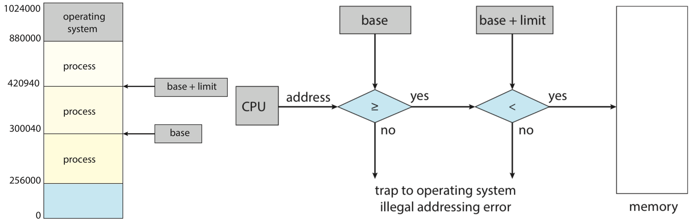
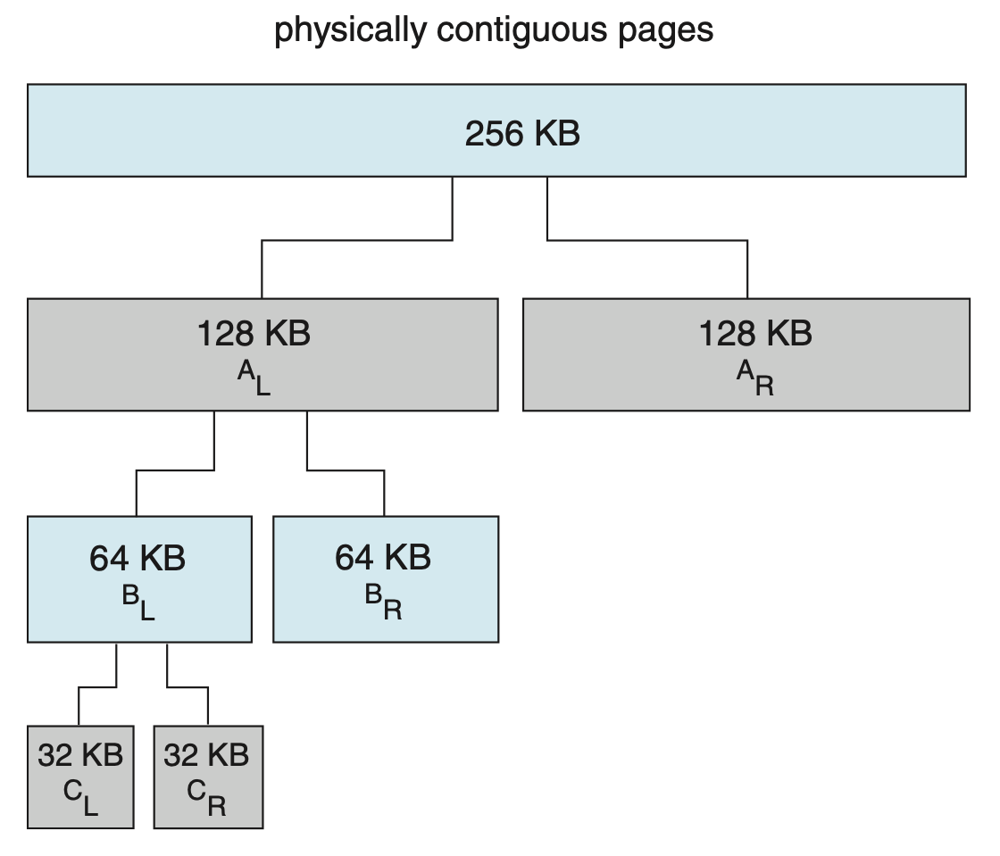
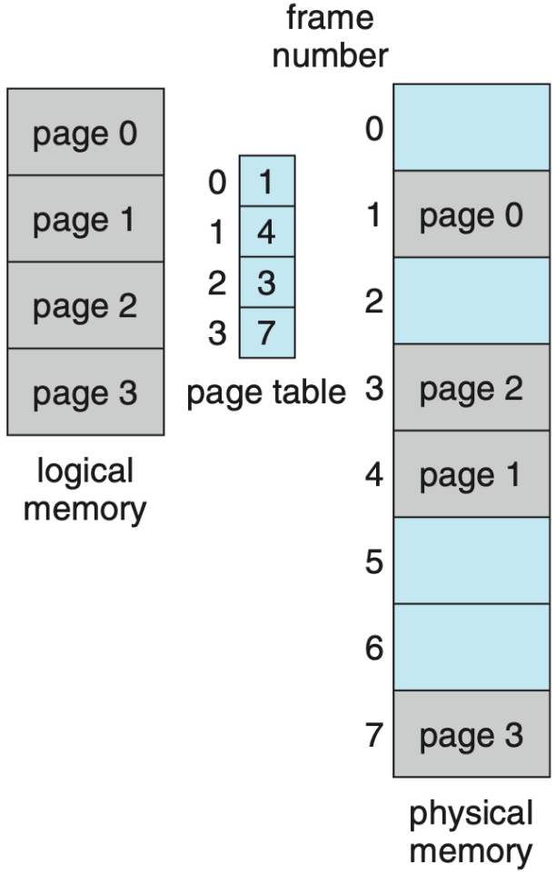
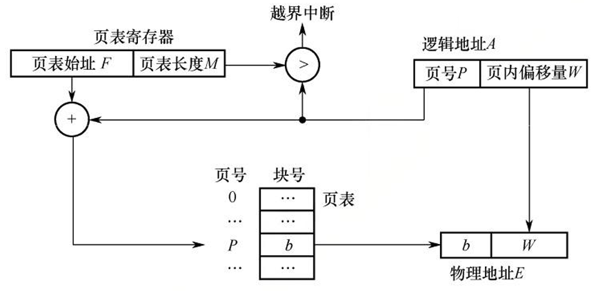
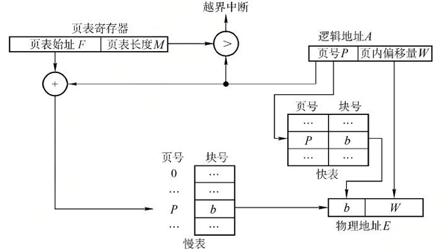
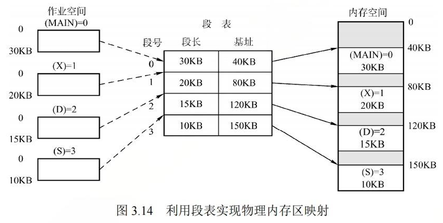
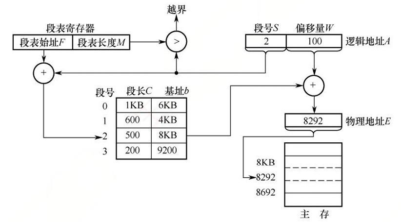

# 内存管理

!!! abstract "概览——内存管理的基本原理和要求"
    在多道程序环境中，多个进程共同使用有限的物理内存。我们既希望尽可能多地容纳进程，又需要让它们拥有各自独立、可以安全访问的地址空间。于是，内存管理要回答两个相互关联的问题：**空间如何分配，地址如何解释**。

    操作系统需要跟踪内存的使用情况，为进程分配和回收空间，完成[地址转换](#程序的装入方式)，并提供[内存共享](#内存共享)、[存储保护](#内存保护)和[内存空间的扩充](#虚拟内存的基本概念)。这些功能共同构成了 **内存管理（Memory Management）**。

!!! warning "阅读前惠存"
    这一章节和计算机组成课程里的对应部分有很高的重合度。为了节省空间，在以下的笔记中可能出现较多的互相链接的情况。若有更好的组织方式，欢迎读者朋友发布评论或 PR！

## 内存基础设计与技术

### 逻辑地址与物理地址

**逻辑地址（Logical Address）**，也称虚拟地址，是程序使用的地址。目标模块通常从 0 开始编址，链接时再将各模块的相对地址组织为统一的逻辑地址空间。不同进程拥有独立的地址空间，因此相同的逻辑地址可以表示不同的内容。

**物理地址（Physical Address）** 是实际访问主存时使用的地址。逻辑地址到物理地址的转换称为 **地址重定位**；在采用运行时地址转换的系统中，这一工作由 **内存管理单元（Memory Management Unit，MMU）** 根据操作系统维护的映射信息完成。

用户程序只需使用自己的逻辑地址，具体对应哪个物理位置由内存管理机制决定。逻辑地址与物理地址的位数也不必相同，其容量限制见[虚拟容量与实际存储能力](#虚拟存储器)。

进程地址空间中代码、数据、堆、栈等区域的组织，见[进程的内存映像](./process.md#进程的内存映像)。后面所说的分页和分段，是对这些地址建立物理映射的方法。

### 程序的链接与装入

一个源程序通常需要经过三个步骤，才能成为在内存中的、可以执行的程序：

1.  **编译**。编译程序将源代码翻译为目标模块。
2.  **链接**。链接程序组合目标模块和所需的库，调整地址并解析模块之间的引用，形成装入模块。
3.  **装入（加载）**。装入程序将装入模块放入内存，准备运行所需的环境。

$$
\text{源程序}\xrightarrow{\text{编译}}\text{目标模块}
\xrightarrow{\text{链接}}\text{装入模块}
\xrightarrow{\text{装入}}\text{内存中的程序}
$$

更具体地来说，以 C 语言源代码文件为例，编译器首先将若干 `.c` 源文件编译为若干 `.o` 文件（这里合并了预处理、编译、汇编步骤）；这些 `.o` 文件被称为可重定位目标文件，其存在形式为机器码（目标模块）；随后链接器将若干 `.o` 文件连带所需要的一些库文件（如 `.a` 文件）链接为一个可执行目标文件（装入模块）。

链接主要处理 **模块之间的关系**，装入主要处理 **程序与内存位置的关系**。二者可以在不同阶段完成，并不一定严格分成三个互不交叠的过程。

#### 程序的链接方式

根据链接发生的时机，可以分为三种方式。

| 方式 | 完成时机 | 主要特点 |
| :---: | :---: | :---: |
| 静态链接 | 运行之前 | 将目标模块和所需库代码组合进一个完整的装入模块，修改模块后通常需要重新链接 |
| 装入时动态链接 | 装入内存时 | 各模块独立保存，边装入边链接，便于更新和共享模块 |
| 运行时动态链接 | 执行中需要调用模块时 | 推迟加载和链接尚未使用的模块，减少初始装入开销和内存占用 |

静态链接中有两项关键工作：

-   **地址调整**。目标模块各自从 0 编址，组合后需要加上所在位置的偏移。例如，模块 A 长度为 $L$，模块 B 紧接其后，则 B 中原来的地址 $x$ 应调整为 $L+x$。
-   **外部符号解析**。将模块间的函数、变量等符号引用解析为可以使用的地址。例如，A 调用 B 中的函数，需要确定该函数在组合后模块中的位置。

能被动态链接的库就被称为动态链接库（DLL）。动态链接库可以供多个进程使用，但“多个程序使用同一个库文件”与“多个进程实际共享同一组物理页面”仍需通过[内存共享](#内存共享)机制联系起来。

??? tip "动态装载与动态链接"
    在多道程序环境下，为了更加灵活地使用内存资源，我们引入动态装载（按需动态装载）机制。如果一个例程还没有被调用，那么它会以可重定位装载格式存储在磁盘上；当它被调用时，就动态地被装载到内存中。
    
    动态装载是需要某个例程时才加载它；动态链接在此基础上还需要处理模块间的符号引用。前者可以由程序自行实现，后者需要操作系统支持。

#### 程序的装入方式

装入方式的区别主要在于：**什么时候确定程序中的地址所对应的物理位置**，或者说何时发生地址转换。

| 方式 | 地址转换时机 | 装入后能否移动 | 实现要点 |
| :---: | :---: | :---: | :---: |
| 绝对装入 | 编译或汇编时确定绝对地址 | 不能直接移动 | 已知装入位置，按绝对地址放入内存，仅适用于简单的单道程序环境 |
| 可重定位装入 | 装入时，即静态重定位 | 不能直接移动 | 根据实际装入位置一次性修改需要重定位的地址 |
| 动态运行时装入 | 执行中实际访问地址时，即动态重定位 | 可以 | 程序保留逻辑地址，由硬件依据当前映射完成转换 |

静态重定位要求在装入前准备好所需空间（根据内存当前的空闲情况为其分配一块连续的内存区域），若内存不足，则无法装入。一旦装入，进程在整个运行期间既不能移动位置，也不能动态申请额外内存。

动态重定位则可以通过修改映射信息来适应位置变化（装入程序将装入模块载入内存而不立即转换地址）。这种方式使用一个重定位寄存器来完成功能。在最简单的连续分配模型中，重定位寄存器保存起始物理地址 $B$，访问逻辑地址 $A$ 时得到：

$$
E=B+A
$$

$E$ 就是逻辑地址 $A$ 在物理内存中对应的实际地址。每次程序移动后，更新 $B$（重定位寄存器）即可。

??? question "为什么直接加上逻辑地址就可以？"
    我们前面提到过，程序使用的是逻辑地址。在多道程序环境下，编译程序无法预知目标模块在内存中的具体位置，因而经编译和链接生成的装入模块通常从地址 0 开始编址。

!!! info "若要支持离散存放，则需要后面的[页表](#分页存储的几个基本概念)或[段表](#段表)等映射机构。单个基地址寄存器不足以描述任意离散布局。"

### 内存保护

存储保护要阻止进程访问未经授权的区域，包括操作系统区域和其他进程的私有区域。在连续分配模型中，常见的硬件方法有两种。

1.  **上、下限寄存器**。记录进程可以访问的物理地址范围，访问时检查地址是否落在范围内。

2.  **重定位寄存器与界地址寄存器**。前者（`base`）保存起始物理地址，后者（`limit`）保存逻辑地址空间长度。需要访问内存时，先检查访问的地址是否在两个寄存器所框定的范围 $[\text{base}, \text{base + limit})$ 内；否则产生越界异常而中断程序执行。

    <figure markdown="1">
    
    </figure>

这些寄存器只能由内核通过[特权指令](./os_intro.md#priv)设置，用户程序不能自行扩大权限。分页和分段系统还可以在表项中设置读、写、执行等权限，按相应的管理单位实施保护。

### 内存共享

进程的地址空间相互独立，但如果所有物理存储内容每个进程都各有一份，对于多用户系统来说，这是一笔很大的开销。所以，操作系统提供了内存共享机制，可以把同一块物理内存映射到多个进程的地址空间。但显然的是，并非所有进程的内存空间都适合共享。

共享程序代码时，适合共享的是执行过程中不被修改的代码，即 **可重入代码（纯代码）**。各进程共享一份代码，同时保留各自的私有数据区，以免运行状态相互干扰。

假如共有 $n$ 个进程使用同一程序，代码区大小为 $C$，每个进程的私有数据区大小为 $D$。不共享时需要 $n(C+D)$ 的空间，共享代码后只需要 $C+nD$。这里节省的是物理空间，各进程仍需建立各自的地址映射。

可写的数据也可以由多个进程共享，用于[共享存储通信](./process.md#共享存储)，但并发访问需要注意同步与互斥。共享文件的另一种方式见[内存映射文件](#内存映射文件)。

### 连续分配管理方式

连续分配为一道程序提供一块连续的物理内存。根据分区的划分方式，主要有以下三种。

#### 单一连续分配

内存分为操作系统使用的 **系统区** 和用户程序使用的 **用户区**，用户区同时只容纳一道程序。

这种方式实现简单，没有外部碎片，但用户程序未使用的空间难以交给其他程序，从而会形成内部碎片。这种方式内存利用率低，只适合简单的单用户、单任务环境。除此之外，虽然无需处理多个用户进程之间的隔离，系统区仍需要防止被用户程序破坏。

#### 固定分区分配

预先把用户区划分成若干大小固定的分区，每个分区至多容纳一道作业。分区<u>可以等大，也可以设置不同大小</u>，以适应不同规模的作业。

系统维护一个 **分区使用表**，记录各分区的始址、大小和状态。分配时选择足够大且空闲的分区，并标记为已占用；回收时恢复为空闲状态。

固定分区是最简单的一种多道程序存储管理方式，但存在几个很显著的问题：

-   并发作业数受到分区数量限制；
-   即使各分区的空闲容量总和足够，一个大于任何单独分区的作业也无法装入；
-   分给作业的分区可能比实际需求大，但多出的空间也无法交给其他作业（内部碎片）；
-   无法支持多个进程共享同一内存区域。

#### 动态分区分配

动态分区，也称可变分区，在装入进程时按照需求划出连续区域，分区的数量和大小随分配、释放而变化。

系统维护空闲分区链或表，记录各空闲区的始址和大小。分配时选择一个足够大的空闲区，划出所需空间，剩余部分继续保留；若剩余部分小到不足以单独管理，则可以一并分配。

回收时，要检查与待回收区在物理地址上相邻的空闲区：

-   只与前面的空闲区相邻，则扩展前面空闲区的长度。
-   只与后面的空闲区相邻，则向前扩展后面的这个空闲区，修改始址和长度。
-   与前后空闲区都相邻：三者合并，只保留一个表项。
-   前后都不相邻：为回收区建立新的空闲表项。

!!! info "紧凑技术"
    长期分配和回收后，动态分区容易形成外部碎片。**紧凑（Compaction）** 技术可以缓解这一问题。
    
    操作系统周期性地搬移进程，把分散的空闲区集中起来合并为一个连续区域。但读者朋友们可能会意识到这需要系统支持[动态重定位](#程序的装入方式)，且搬移本身有不小的开销。紧凑技术的原理类似于 Windows 的磁盘碎片整理，但后者作用于外存文件系统，紧凑作用于主存。

!!! note "内部碎片与外部碎片"
    **内部碎片** 是已经分配给进程、却没有被利用的空间；**外部碎片** 是已分配区域之间分散的空闲空间，可能总量足够，却无法组成所需的连续区域。

    读者可以发现内外是相对于进程的区分。固定分区不产生外部碎片，主要浪费在于内部碎片；动态分区主要产生外部碎片。

接下来介绍在动态分区分配中使用的两类分配算法。

-   **基于顺序搜索的分配算法**

    

    | 算法 | 空闲分区的组织与搜索方式 | 主要影响 |
    | :---: | :---: | :---: |
    | 首次适应（First Fit，FF） | 按地址递增，从头选择第一个足够大的分区 | 倾向保留高地址大空闲区，但低地址容易积累小碎片 |
    | 邻近适应（Next Fit，NF） | 按地址排列，从上次搜索结束处继续循环查找 | 减少重复扫描低地址区域，但可能切割原本保留的大空闲区 |
    | 最佳适应（Best Fit，BF） | 按容量递增，选择满足要求的最小分区 | 保留大分区，但容易留下难以利用的极小剩余块 |
    | 最坏适应（Worst Fit，WF） | 按容量递减，选择最大的分区 | 剩余块往往较大，但容易消耗大分区，妨碍后续大作业装入 |

    

    !!! warning "“最佳”描述的是本次分配所选空间的大小，并不保证整个系统的表现最好。"
    
    综合来看，FF 方法在查找成本与保留大空闲区之间取得了较好的折中。

-   **基于索引搜索的分配算法**

    空闲区很多时，逐项搜索的成本较高。可以按大小建立多条空闲链，再通过索引快速定位。

    -   **快速适应（Quick Fit）**。按常用请求大小建立类别，从合适类别的链首取出空闲块。分配速度快，但回收时识别和合并相邻块较复杂；类别块不一定正好等于请求大小。
    -   **伙伴系统（Buddy System）**。分区的大小规格为 $2^k$，并依大小分别组织成链（链上存放这个大小的空闲块）。请求大小为 $n$ 时，先选择不小于 $n$ 的最小规格的分区链上查找可用的空闲块；若没有这种块，就从更大的块逐次二分直至得到所需的块，期间产生的其余部分加入对应的分区链。
    
        这一算法名字中的“伙伴”来自于每个大小为 $2^k$ 的分区都有一个唯一的、与其大小相同、地址相邻的伙伴分区。

        回收时，若某分区的对应伙伴也空闲，就合并它们，随后并继续向上检查尝试合并。

    -   **哈希算法**。以空闲块大小为关键字，通过哈希表定位对应空闲链，减少查找开销。

    !!! tip "有关伙伴系统..."
        

        

        -   伙伴必须是 **同一个较大块二分得到的两半**。例如，按 8 KiB 边界管理的大块中，`[0,4)` 和 `[4,8)` KiB 是一对 4 KiB 伙伴；`[4,8)` 和 `[8,12)` KiB 虽然等大且相邻，却不是伙伴。
        -   伙伴系统方便分裂与合并，但向上取整到 $2^k$ 仍会产生内部碎片。例如，申请 21 KiB 时还是需要分配 32 KiB。
        

        

        <figure markdown>
        
        <figcaption>伙伴系统示意</figcaption>
        </figure>
        

        

??? info "内核中的小对象分配"
    [Slab](https://www.kernel.org/doc/gorman/html/understand/understand011.html) 按内核对象类型建立缓存，在帧中分配适合对象大小的空间；缓存不足时再向伙伴系统申请，减少反复分配和初始化的开销。

??? question "进程所需要的内存一定要是连续的吗？"
    我们前面介绍了连续分配管理的方式。固定分区会产生内部碎片，动态分区会产生外部碎片，这两种方式对内存的利用率都较低。为了克服外部碎片的问题，提高内存的利用率，人们就想如何能把进程所在的内存“掰成”块。但是太碎也不行，因为这样的话，可以预见的是内存映射关系会过于琐碎。于是我们诞生了下面的方案。

### 基本分页存储管理

分页把进程的逻辑地址空间划分为等大的 **页（Page）**，把物理内存划分为和页同样大小的 **帧（Frame）**，也称页框、物理块。一个进程的不同页可以装入不相邻的帧，因而不再需要一整块连续的物理空间。

这样，系统可以以帧为单位为进程分配内存，以页为单位组织进程的地址空间，因而不会产生外部碎片。

#### 分页存储的几个基本概念

页面与页面大小

页号和帧号通常从 0 开始。

因为二进制数和二的整数次幂天然的相合性，页面大小通常取 $2$ 的整数次幂以方便地址转换。

我们刚才提到，分页管理可以避免外部碎片，但由于页的大小是固定的，分配时不免产生页内碎片（内部碎片）。小页面的内部碎片较少，但页面数量和页表开销较大；大页面减少页表项数量，却可能浪费更多页内空间。在进程长度的余数近似均匀分布的模型中，平均页内碎片约为半页。调页性能的进一步影响见[虚拟存储器性能影响因素](#虚拟存储器性能影响因素)。

地址结构

设页面大小为 $L=2^d$，逻辑地址为 $A$，则：

$$
P=\left\lfloor\frac{A}{L}\right\rfloor,\qquad W=A\bmod L
$$

其中 $P$ 是页号，$W$ 是页内偏移。若逻辑地址共 $v$ 位，则高 $v-d$ 位是页号，低 $d$ 位是偏移。因此，分页虽然将地址拆成两个字段，程序仍只需要给出一个线性地址，地址空间是 **一维的**。

显然，由于帧和页是一一对应的，所以单个页内的连续内存页对应帧上的连续内存；而在两页之间，某页页末地址的下一位地址正好是下一页的第一位（二进制的进位）。

!!! note "从这里我们可以看到，分页设计既有进程在逻辑上连续的优势，又有在分配物理内存时的灵活性（可以分为不连续的几帧）的优势。"

例如，32 位逻辑地址、页面大小 4 KiB 时，页内偏移占 12 位，页号占 20 位，逻辑地址空间共有 $2^{20}$ 个页面。

页表

每个进程维护自己的 **页表（Page Table）**，记录页号到物理帧号的映射。通过建立页号到帧号的映射，系统为进程的每个页面分配物理内存；或者说，帧与页的对应关系，就是通过页表来实现的。

在线性页表中，表项按页号顺序存放，因此页号可以由表项位置隐含，不必另占一个字段。

页表本身也占空间。若按字节编址、逻辑地址为 $v$ 位、页面大小为 $2^d$ B、页表项大小为 $e$ B，易知完整单级页表的大小为：

$$
S_{\mathrm{PT}}=2^{v-d}e\ \mathrm{B}
$$

<figure markdown>

<figcaption>逻辑地址到物理地址的映射</figcaption>
</figure>

页表保存在物理内存中，访问页表直接使用物理地址访问。当前进程的页表始址与长度由页表寄存器（PTR）提供；也可以分别由页表基址寄存器（PTBR）和页表长度寄存器（PTLR）保存。进程未运行时，这些信息保存在 PCB 中，[切换进程](./schedule.md#cont_switch)时由内核更新。

!!! info "有关页表保存在物理内存中的原因，可以参考 [@Isshiki 修佬在这个问题上的引导和启发](https://note.isshikih.top/cour_note/D3QD_OperatingSystem/Unit3-Part1/#%E5%B8%A7--%E9%A1%B5)。"

页表项的大小需要考虑 **物理地址**。沿用前面的符号约定，若物理地址为 $p$ 位，则帧号需要 $p-d$ 位；再加上保护与状态字段，并考虑按字节取整和对齐。不能用逻辑页号的位数直接代替物理帧号的位数。

#### 基本地址变换机构

设页（帧）大小为 $L$，页表始址为 $F$，页表项大小为 $e$，页表长度为 $M$，一次地址转换如下：

1.  CPU 给出逻辑地址，从逻辑地址 $A$ 得到页号 $P$ 和偏移 $W$。
2.  检查 $P<M$；否则产生页号越界异常。注意这里 $M$ 是表项数量，并非最大合法页号。
3.  访问地址 $F+Pe$（物理地址），读取对应页表项中的帧号 $b$。
4.  形成物理地址 $E=bL+W$，访问目标内容。

若页面大小为 $2^d$，地址转换也可以理解为用物理帧号替换逻辑页号，保留低 $d$ 位偏移。**页内偏移在地址转换前后不变**。

<figure markdown="1">
{:width="70%"}
<figurecaption>基本的分页系统地址变换</figurecaption>
</figure>

例如，页面大小为 1 KiB，逻辑地址为 2500，页表记录第 2 页位于第 8 个帧，则 $P=2$、$W=452$，物理地址为 $8\times1024+452=8644$。

!!! example "在页表位于主存、没有地址转换缓存、忽略数据 Cache 的模型中，一次目标访问需要两次主存访问：一次查页表，一次访问指令或数据。"

#### 具有快表的地址变换机构

我们刚刚了解到，若页表全部存放在内存中，则每次访问内存至少需要两次主存访问；这很浪费系统性能。

你或许会想到像计算机存储的多级架构那样再设置一个“中间人”。**快表（Translation Lookaside Buffer，TLB）**  正是这样的、用于缓存近期活跃地址映射的高速存储器；主存中的页表相应称为慢表。

!!! info "TLB 的作用基于[局部性原理](#locality)。"

TLB 的单个表项由页号和帧号组成，仍然反映进程内页号到物理帧号的映射。它常采用全相联或组相联组织，标记如何从页号中切分见[快表（TLB）](../CO/storage.md#快表tlb)。

带 TLB 的一次地址转换中，CPU 给出逻辑地址后，硬件自动提取页号，并将其与快表中所有页号 **并行比较**；
    -   TLB 命中（表中有匹配页）：直接取得帧号，形成物理地址，再访问目标内容。
    -   TLB 未命中：查慢表取得映射，再访问目标内容，并把映射补入 TLB；TLB 已满时，需要替换旧表项。

<figure markdown="1">
{:width="70%"}
<figurecaption>含有 TLB 的地址变换</figurecaption>
</figure>

设 TLB 查询时间为 $t_T$，一次主存访问时间为 $t_M$，命中率为 $\alpha$。在 **单级页表、先查 TLB 再查慢表、不计缺页和数据 Cache** 的模型中：

$$
\begin{aligned}
T_{\mathrm{EAT}}
&=\alpha(t_T+t_M)+(1-\alpha)(t_T+2t_M)\\
&=t_T+(2-\alpha)t_M
\end{aligned}
$$

??? tip "切换地址空间时的 TLB"
    不同进程可能有相同页号，而 TLB 并不像页表一样每一个进程都拥有一个。因而切换地址空间时需要清除旧映射（flush 操作）。或者，我们可以用地址空间标识符（ASID）区分表项；查询时同时匹配 ASID 和页号。

#### 页的共享

我们前面说过，物理内存可以映射到多个进程的地址空间。这也就是说，多个页可以对应同一个帧，那这样的页就被称为共享页。前面提到的共享库就是通过共享页来实现的。

再比如，我们在[进程间通信](./process.md#进程通信)中提到过通过共享内存来实现进程间通信，在某些操作系统中，共享内存就是通过共享页来实现的。

#### 页表设计改进

设想一个系统具有 32 位逻辑地址、4 KiB 页面、4 B 页表项。如果采用单级页表，此时完整单级页表占 $2^{20}\times4\ \mathrm{B}=4\ \mathrm{MiB}$，需要 1024 个帧。

!!! question "此时，页表已经可以算是非常庞大了，如果我们又要求整张表连续存放，那管理起来并不方便。有没有一个方法控制页表在内存中所占的大小？"

???+ note "分层页表"
    一个自然的解决思路是：**把页表也分页，再用外层页表记录各页表页的位置**。外层页表也称页目录，内层页表（二级页表）负责映射实际的程序页面。

    回到前面的假定条件，此时一个帧能容纳 $4096/4=1024=2^{10}$ 个页表项，因此 20 位页号拆成两个 10 位字段：

    

    | 页目录号 $P_1$ | 内层页号 $P_2$ | 页内偏移 $W$ |
    | :---: | :---: | :---: |
    | 10 位 | 10 位 | 12 位 |

    

    转换时，先用 $P_1$ 查页目录，得到内层页表的位置；再用 $P_2$ 查内层页表，得到目标帧号；最后保留 $W$，形成物理地址。此时页表基址寄存器指向的是 **页目录**。

    两级页表的好处有两个：

    -   内层页表可以分别存放，不再需要容纳整张页表的大块连续空间。（但是每一块内层页表仍然是连续的，因为需要支持随机访问）
    -   未使用的地址范围不必建立对应内层页表；结合虚拟内存时，也可以按需驻留页表页，减少物理内存占用。

    它的代价是增加了查表次数。没有 TLB、且所需页表页都在主存时，二级页表的一次目标访问需要三次主存访问。一般地，$k$ 级页表需要 $k+1$ 次；TLB 命中时则可以直接使用最终映射。

    !!! warning "多级页表并非总比单级页表占用的内存少"
        节省空间依赖于地址空间的稀疏使用。考虑一种较为极端的情况，若所有内层页表都建立，则此时映射表项总量没有减少，还反而增加了上层索引。

    对于更大的逻辑地址空间，需要继续增加层级。例如，若逻辑地址为 64 位、页面大小为 4 KiB，则页号占 52 位。若每页仍可存放 1024 个页表项，则需约 6 级页表才能覆盖整个地址空间。在实际的 64 位系统中，常常将虚拟地址限制为 48 位，这样采用三级或四级页表就可以实现高效管理，取得了应用需求和硬件复杂度的平衡。

    总结来看，建立多级页表的根本目的是 **按需建立**（按需分配页表页），实现了 **离散存放**，避免为未使用的地址空间预留大量无效的页表项。

???+ note "哈希页表"
    !!! tip "[哈希](../DS/search.md#哈希表散列表)"
    
    我们要把页表拆开、离散化，还有一种思路——**哈希页表**。在这种方法中按虚拟页号查哈希桶，每个桶中的每一项（链表项）存放页号、帧号和链表 next 指针。这种方法适合稀疏地址空间（如果地址空间较满，每个哈希桶的槽数就会比较大）。
    
???+ note "反向页表"
    之前的两种方法都是通过维护虚拟地址的有序（虚拟地址是连续的）来组织页表。反向页表则完全把思路反过来，它按物理帧连续组织全局表，记录所属进程和虚拟页号。
    
    这样做的的确确节省了内存空间，因为整个操作系统只需要维护一张反向页表。但同时，查询与对共享页的支持也变得更加复杂：在地址转换中，我们通常做从虚拟地址到物理地址的查询，所以在这样的实现下，我们只能遍历整个表来找映射关系；对于共享映射来说，索引应该是独一无二的（一个页对应一个物理帧），现在我们反过来从物理帧出发，会产生一对多的情况。

    综合来看，反向页表在性能上并不是一个好方法。

### 基本分段存储管理（*）

分页主要从系统管理的角度划分空间，其地址转换由硬件自动完成，对用户完全透明；分段则按照程序的逻辑结构组织地址空间。

#### 分段

分段系统将用户进程的逻辑地址空间划分为若干大小不等的段。例如，一个进程可包含主程序段、子程序段、栈段和数据段等。各段长度不必相同，段内从 0 开始编址。一个段在物理内存中占连续区域，不同段之间则不要求连续。

在分段系统中，逻辑地址由 **段号 $S$ 与段内偏移 $W$** 共同确定。由于地址空间被组织为两个具有明确语义的段，进程的逻辑地址空间被认为是 **二维的**。

在页式系统中，逻辑地址中的页号与页内偏移量对用户透明；而在分段系统中，段号和段内偏移量 **必须由用户显式提供**——这一工作在高级语言中由编译程序自动完成。

若段号占 $s$ 位、偏移占 $w$ 位，则最多可以表示 $2^s$ 个段，每段的偏移范围最多覆盖 $2^w$ 个编址单位。

#### 段表

每个进程有一张 **段表**，每个段表项记录该段的 **基址（起始地址）和段长**，还可以包括存取权限等信息。表项按段号排列，因此段号作为索引可以隐含而无需额外空间存储。

段表寄存器保存段表始址和段表长度。若段表始址为 $F$，表项大小为 $e_S$，则第 $S$ 项的地址为 $F+Se_S$。需要区分：段表长度是段的数量，表项中的段长是某一段包含的编址单位数。

<figure>

</figure>

#### 地址变换机构

设段表长度为 $M$，第 $S$ 段的基址为 $b$，段长为 $C$，转换过程为：

1.  分离段号 $S$ 和段内偏移 $W$。
2.  检查 $S<M$，否则产生段号越界异常。
3.  查段表，取得 $b$ 和 $C$，检查 $0\le W<C$，否则产生段内越界异常。
4.  检查相应存取权限，通过后按 $E=b+W$ 访问内存。

与分页的帧号拼接不同，**段基址与偏移需要相加**。段长不固定，段基址也不要求按某个统一段大小对齐。

<figure>
{:width="70%"}
<figureacaption>基本的分段系统地址变换</figurecaption>
</figure>

例如，第 2 段基址为 8 KiB，段长为 500 B，偏移为 100 B，则物理地址为 $8192+100=8292$；偏移为 500 B 时已越界。没有快表且忽略数据 Cache 时，需要一次访问段表、一次访问目标内容。

!!! tip "分页和分段的对比"
    

    | 比较项 | 分页 | 分段 |
    | :---: | :---: | :---: |
    | 划分依据 | 按固定大小管理空间，主要提高内存利用率和系统性能 | 按程序逻辑（用户需求）组织，便于编程、信息共享和保护、动态增长和动态链接等高级功能 |
    | 单元大小 | 页大小由系统规定，固定 | 段长由逻辑内容决定，可变 |
    | 用户看到的地址 | 一维线性地址，页号与偏移由系统拆分 | 二维地址，包含段号与段内偏移 |
    | 物理布局 | 页内连续，页间可以离散 | 段内连续，段间可以离散 |
    | 映射表的关键信息 | 帧号 | 段基址与段长 |
    | 碎片 | 有内部碎片，无外部碎片 | 通常无内部碎片，但有外部碎片 |
    | 共享与保护的粒度 | 页，逻辑模块可能跨多页 | 段，可以直接对应一个逻辑模块 |

    

#### 段的共享与保护

和分页系统中页的共享类似，共享时，各进程的段表项指向同一个物理段；同一共享段在不同进程中可以使用不同段号。

但与分页系统不同的是，若共享模块跨越 $N$ 页，分页需要在每个进程中建立相应的 $N$ 个页映射；采用分段时，每个进程只需用一个段表项描述这一模块（读者朋友们可以简单思考一下——物理帧是固定的，但段不是）。因此，按逻辑模块共享通常更直接。

系统还可以维护 **共享段表**，记录段长、内存位置、存在状态、外存位置和共享计数等。进程停止使用共享段时减少计数，只有最后一个使用者释放后，才能回收其空间。

和分页系统类似，段的保护包括段号与段内偏移的越界检查，以及通过权限字段（权限位）限制读、写、执行。

### 段页式存储管理

分页存储管理能有效提高内存利用率，而分段存储管理能反映程序的逻辑结构，并有利于段的共享与保护。人们自然地想到将二者各自的优势有机结合，于是便形成了段页式存储管理方式。

在段页式系统中，进程的地址空间先按逻辑结构分段（逻辑段，每个段的段号唯一），再对每个段分页，物理内存仍按帧分配。它保留了分段在共享、保护方面的便利，也避免了为整个段寻找连续物理空间。

每个进程有一张段表，每个段有自己的页表。段表项记录该段的页表始址和页表长度，页表项记录相应页面的物理帧号。

进程的逻辑地址结构包括 **段号 $S$、段内页号 $P$ 和页内偏移 $W$**。对用户而言，地址空间中仍是“段号与段内地址”的二维地址；系统再把段内地址拆成页号与偏移，分页细节对用户透明。

设段表始址为 $F$，段表项大小为 $e_S$，页表项大小为 $e_P$，页面大小为 $L$：

1.  检查段号是否小于段表长度；访问 $F+Se_S$，取得该段的页表始址 $D$ 和页表长度。
2.  检查段内页号是否越界；访问 $D+Pe_P$，取得帧号 $b$。
3.  结合保护信息检查访问是否合法，形成物理地址 $E=bL+W$，访问目标内容。

不使用快表且忽略数据 Cache 时，需要 **三次主存访问**：段表、页表、目标内容。快表可以用“段号、页号”共同作为查找关键字，缓存最终帧映射。

!!! tip "两级页表与段页式不是同一种结构"
    两级页表把一个线性页号拆成两级索引；段页式先按程序语义分段，各段再分页。两者虽然都可能查两张表，但上层表项的含义不同。

段页式不要求一个段的所有帧连续，也不要求不同段的页表连续；但是它仍有页内碎片，并增加了表结构和查找开销。

---

???+ example "地址翻译的示例"
    本节采用 **先完成地址转换，再访问物理寻址数据 Cache** 的模型。Cache 的映射规则见[计算机组成中的 Cache](../CO/storage.md#cache-和主存的映射方式)，这里重点观察它与 TLB、页表如何配合。

    假设按字节编址，虚拟地址为 14 位，物理地址为 12 位，页面大小为 64 B；TLB 共 16 项、四路组相联；数据 Cache 直接映射、共 16 行，每行 4 B。

    接下来我们分析对虚拟地址 `0x03d4`，`0x00f1` 和 `0x0229` 的访问过程。

    页面大小 $64=2^6$，所以页内偏移占 6 位，虚拟页号占 8 位，物理帧号占 6 位。TLB 共 $16/4=4$ 组，从虚拟页号中拆出 2 位组索引和 6 位标记。Cache 从物理地址中拆出 2 位块内偏移、4 位行索引和 6 位标记。

    

    | 用途 | 高位字段 | 中间字段 | 低位字段 |
    | :---: | :---: | :---: | :---: |
    | 虚拟地址转换 | 虚拟页号：8 位 | — | 页内偏移：6 位 |
    | TLB 查询 | TLB 标记：6 位 | TLB 组索引：2 位 | 页内偏移：6 位，不参与映射匹配 |
    | 物理地址 | 物理帧号：6 位 | — | 页内偏移：6 位 |
    | Cache 查询 | Cache 标记：6 位 | 行索引：4 位 | 块内偏移：2 位 |

    

    只取这次访问有关的初始状态：TLB 第 3 组有有效项“标记 `0x03` → 帧 `0x0D`”，没有标记 `0x00`；第 0 组没有标记 `0x02`。页表中第 `0x03` 页已驻留于帧 `0x02`，第 `0x08` 页未驻留。Cache 第 5 行有效且标记为 `0x0D`，偏移 0 处数据为 `0x36`；第 `0xC` 行无效。

    先做地址转换：

    

    | 虚拟地址 | 虚拟页号 | 页内偏移 | TLB 标记 / 组 | 转换结果 |
    | :---: | :---: | :---: | :---: | :---: |
    | `0x03D4` | `0x0F` | `0x14` | `0x03` / 3 | TLB 命中，帧 `0x0D`，物理地址 `0x354` |
    | `0x00F1` | `0x03` | `0x31` | `0x00` / 3 | TLB 未命中，页表显示已驻留，物理地址 `0x0B1` |
    | `0x0229` | `0x08` | `0x29` | `0x02` / 0 | TLB 未命中，页表显示未驻留，发生缺页 |

    

    其中，`0x354 = 0x0D × 64 + 0x14`，`0x0B1 = 0x02 × 64 + 0x31`。得到物理地址后，再查询 Cache：

    

    | 物理地址 | Cache 标记 | 行索引 | 块内偏移 | 数据访问结果 |
    | :---: | :---: | :---: | :---: | :---: |
    | `0x354` | `0x0D` | `0x5` | 0 | 命中，读取 `0x36` |
    | `0x0B1` | `0x02` | `0xC` | 1 | 行无效，未命中，需要访问主存 |

    

    第三个地址 `0x0229` 需要先完成缺页处理，得到新的帧映射后才能继续确定物理地址和 Cache 结果。

---

## 虚拟内存管理

### 虚拟内存的基本概念

前面讨论的基本存储管理方式，虽然已经允许进程离散存放，但通常仍有两个约束：

-   **一次性**。程序运行前，需要把所需的全部程序和数据装入内存。大程序可能无法装入，大量作业也可能因内存不足而等待。
-   **驻留性**。装入的内容保持在内存中，直到运行结束；暂时不用的内容仍占用空间。

!!! question "许多在程序运行中暂未使用或暂时不用的代码和数据仍占据大量内存空间，而一些急需运行的作业却因内存不足无法装入。程序的所有内容是否真的需要同时存在于主存？"

!!! info "局部性原理"
    程序通常不会均匀地访问整个地址空间，而是在一段时间内集中访问其中的一部分，这就是 **局部性（Locality）**，分为 **时间局部性** 与 **空间局部性** 两个方面。它使“只让当前活跃内容留在主存”成为可能，也是 TLB 和 Cache 能够发挥作用的基础；两种局部性的定义与数组遍历的分析见[程序访问的局部性原理](../CO/storage.md#程序访问的局部性原理)。

#### 虚拟存储器

**虚拟存储器**（也称**虚拟内存**）通过部分装入、请求调入和置换，把内存与外存组织为用户可使用的逻辑存储空间：程序启动时只将当前需要的部分装入内存（局部性原理），访问尚未驻留的内容时再调入（[请求调页](#调入页面的时机)或请求调段），空间不足时让暂不需要的内容退出主存换出到外存（页面置换）。这样一来，系统为用户提供了一个 **逻辑上远大于物理内存的地址空间**。之所以说它“虚拟”，是因为显然它并不是一个机器里的实体。

它具有三个主要特征：

1.  **多次性**。程序与数据可以分多次装入，而非必须一次全部装入。
2.  **对换性**。运行过程中可以换出暂不用的部分，再在需要时换入。
3.  **虚拟性**。用户使用的逻辑空间可以大于实际物理内存；这是虚拟存储器的核心目标。

!!! note "虚拟容量与实际存储能力"
    虚拟地址位数决定可表示的地址空间上限。按字节编址、$v$ 位虚拟地址时，上限为 $2^v$ B；物理地址位数则约束可寻址主存的范围。

    可表示的地址空间不等于已经分配的空间，也不等于已有足够后备存储。实际能够保存和运行多少内容，还受到物理内存、可用外存和系统管理方式的限制。

#### 虚拟内存技术的实现

在离散分配的基础上，增加请求调入和置换机制，可以形成 **请求分页、请求分段或请求段页式** 管理。后面主要讨论请求分页的方式。

??? question "读者朋友们可以思考这个问题：为什么要在离散分配的基础上才能实现虚拟内存技术？"
    若采用连续分配方式，则会导致相当一部分内存空间处于暂时甚至“永久”的空闲状态，不仅造成内存资源的严重浪费，也无法从逻辑上扩充内存容量。

无论是哪种管理方式，虚拟内存技术都需要一定的硬件支持：

-   足够的内存和外存
-   记录位置及状态的页表或段表
-   运行时的地址变换机构
-   访问未驻留内容时触发异常的机制：硬件负责检测和转换，操作系统负责处理缺页、安排调入和更新映射。

!!! info "[进程调度](./schedule.md)里面也涉及了“换入”“换出”类似的概念。这里讨论的请求分页等只涉及处理进程中的部分页面。"

### 请求分页管理方式

#### 调入页面的时机

**预调页** 预测近期可能使用的页面，在真正访问之前成批调入。根据局部性原理，一次调入若干相邻页面通常比逐页调入更高效。它可以减少逐次调页的开销，但预测错误会占用空间并产生无效 I/O。预调页目前的预测成功率仅约 50%，因此该策略主要用于进程首次调入时，由程序员显式指定应优先加载的页面。

**请求调页** 在访问尚未驻留的页面、触发缺页时调入。目标页面确实已被需要，但进程需要等待缺页处理；若涉及外存读取，还要承担 I/O 开销。当前的虚拟存储器大多采用此策略。

预调页本质上是在进程运行前完成页面加载，而请求调页则是在运行期间动态调入，即它们的区别在于 **是否等到页面被实际访问后才调入**。

#### 页表机制

前面提到过，请求分页是在基本分页之上增加请求调页和页面置换，因此系统中的页表必须提供更多信息。除物理帧号和保护信息外，请求分页的页表项还包含以下字段：

| 字段 | 用途 |
| :---: | :---: |
| 页号 | / |
| 帧号 | / |
| 保护信息 | 主要是访问权限信息，规定页面可以被怎样访问 |
| 有效位 $P$ | 判断页面是否驻留主存，未驻留时不能直接使用帧号完成访问；也称存在位、装入位 |
| 访问字段 $A$ | 记录最近是否访问、访问次数或访问时间等，供置换算法使用；也称引用位、使用位 |
| 脏位 $D$（修改位 $M$） | 标记内容是否被修改，决定淘汰时是否需要保存到外存 |
| 外存地址 | 指示非驻留页面的后备位置，供调页使用 |

访问字段的具体形式取决于置换算法：CLOCK 通常只需访问位，精确 LRU 则需要更多历史信息。这里的 $P$ 是有效位符号，不是前面公式中的页号。

对于有有效后备副本的页面，未修改时可以直接释放其驻留副本；已修改时必须先保存新内容，才能安全地把帧交给其他页面。

#### 调入页面的位置

外存中的后备内容可以位于 **文件区** 或 **对换区（交换区）**。一般情况下，对换区侧重高效调页，文件区侧重保存文件。

1.  对换区足够时，可以事先把进程所需的文件内容复制进去，之后从对换区调页，但这会增加初始复制开销。
2.  对换区不足时，未修改的只读内容可以直接从文件区调入，淘汰时无需写回；需要保存的新内容则写入对换区，后续从那里取回。
3.  UNIX 方式：初次使用的内容可以从文件区调入，保存过的换出内容可从对换区恢复；共享页面已驻留时，可以复用已有副本。

无论采用哪种方式，都要找到 **目标页面的有效内容**。代码页可以有文件作为后备，堆、栈等匿名内容则不能简单依靠原始程序文件恢复。

#### 缺页中断机构

进程访问合法但未驻留的页面时，硬件触发 **缺页异常（Page Fault）**，或称缺页中断。它属于由指令执行引起的内中断（详细的分类见[中断的分类](./os_intro.md#int)）。

缺页有两个特点：一是发生在指令的访存过程中；二是一条指令可能多次缺页，例如取指令、读源操作数和写目标操作数分别访问不同页面。

??? note "缺页不一定需要外存 I/O"
    若所需内容已在共享页或保留帧中，只是当前映射尚未建立，则可以恢复映射而免去外存读取。这与需要外存 I/O 的缺页处理成本不同。

#### 调入页面的步骤

一次需要外存读取的缺页处理可以分为以下步骤：

1.  保存现场，确认访问的地址和权限合法，定位目标页的后备内容。
2.  若有可用空闲帧，直接分配；否则根据[分配策略](#内存分配策略)确定候选范围，再由[置换算法](#页面置换算法)选择淘汰页。
3.  若淘汰页已修改，先保存其内容；使旧映射失效，并维护相关 TLB 状态。
4.  将目标页调入得到的帧。等待 I/O 时，缺页进程进入阻塞态，调度其他就绪进程使用 CPU。
5.  I/O 完成后，更新目标页的帧号、存在状态和有关管理信息；使等待进程就绪。
6.  该进程再次获得 CPU 后，恢复现场，重新执行原指令。

若采用[页面缓冲](#页面缓冲算法)，保存脏页和准备空闲帧可以提前或批量进行，但不能在内容尚未安全保存时直接覆盖脏页。

#### 请求分页的地址变换

请求分页系统的地址变换过程可以描述如下：

-   地址范围和权限检查通过后，先查 TLB；
-   TLB 命中时取得帧号；未命中时查页表，根据有效位 $P$ 判断页面是否驻留；
-   若已驻留，则补充 TLB 后继续；若未驻留，则进入缺页处理，处理完成后重新执行访问。
    -   成功访问时需要更新访问状态；写入页面时还需置脏位。
    -   页面换出或映射改变后，需要同步维护页表与相关 TLB 表项，避免继续使用旧映射。

!!! tip "三种未命中的分别检查"
    -   **TLB 未命中**：没有缓存所需映射，去查页表（TLB 缓存的是地址映射）。
    -   **缺页**：所需页面没有可用的驻留映射，由操作系统处理。
    -   **数据 Cache 未命中**：已经确定访问的物理位置，但 Cache 中没有所需指令或数据，需要继续访问主存。

    三者与联合访存次数的完整对照见[TLB、页表与 Cache 的联合访问](../CO/storage.md#tlb页表与-cache-的联合访问)。

### 帧分配

#### 最小帧数与驻留集

**最小帧数** 是保证进程能够完成指令执行所需的最少帧数量，由硬件结构、指令格式、寻址方式和跨页情况决定。

在不跨页的简单模型中，单地址直接寻址指令可能需要指令页和数据页两个帧；加入间接寻址后，还可能需要存放指针的页。若一条指令及两个操作数分别跨越两个页面，最坏情况下则涉及六个不同页面。

**驻留集（Resident Set）** 是进程当前驻留在主存中的页面集合，或者说分配给该进程的物理帧集合。驻留集太小会提高缺页率；太大则占用更多帧，减少系统可容纳的进程数量。超过能够容纳主要活跃页面的规模后，继续增加帧的收益往往有限。

需要注意的是，硬件要求的最小帧数只是能正常执行的下限，并不保证具有良好的性能。

#### 内存分配策略

**固定分配与可变分配** 讨论进程获得的帧数量是否调整；**局部置换与全局置换** 讨论发生缺页时，从哪些页面中选择淘汰对象：局部置换指的是范围限定在该进程自身，全局置换则先查看空闲帧队列并取出一个物理帧，若空闲帧已耗尽则可从所有帧中选择一个换出而不论淘汰页面的归属。

局部置换和全局置换实际上是权衡局部封闭性和整体灵活性的两种选择。

| 策略 | 帧数量 | 置换范围与特点 |
| :---: | :---: | :---: |
| 固定分配、局部置换 | 运行期间保持固定 | 只替换本进程页面，初始数量难以兼顾不同阶段的需要 |
| 可变分配、全局置换 | 根据需求变化 | 可获取空闲帧，必要时从其他进程可置换的页面中选择；利用灵活，但进程会相互影响 |
| 可变分配、局部置换 | 由系统另行调整 | 缺页置换限制在本进程内部，系统根据缺页率增加或回收帧 |

固定分配要求数量保持不变，但全局置换可能改变帧归属，这二者是互斥的；所以我们一般不将固定分配与全局置换组合起来。

!!! info "当今的操作系统都主要使用全局置换方式。"

#### 帧调入算法

分配可用帧时，常见方法有：

-   **平均分配**。若 $m$ 个帧分给 $n$ 个进程，则每个进程约获得 $m/n$ 个；不足整分时需要安排剩余帧。
-   **按比例分配**。若进程大小为 $s_i$，则其份额约为 $a_i=m\dfrac{s_i}{\sum_j s_j}$。
-   **优先权分配**。为重要或紧迫的进程分配更多帧，也可以把一部分按大小分配、另一部分按优先权分配。

实际分配必须取整数，满足各进程的最小帧需求，且总量不能超过可分配帧数；不能对所有份额简单向上取整。

### 页面置换算法

在前面我们了解到，空闲帧耗尽时需要释放一个帧，也在置换策略中讨论了释放对象的范围。我们的讨论还需要具体到释放范围里的哪一帧，于是人们设计出了页面置换算法。我们希望降低缺页率，并兼顾实现与写回成本，这也是页面置换算法所要关注的目标。

#### 最佳（OPT）算法

**OPT** 是理论上最优的算法：即 ① 能带来最低的 page fault rate，② 绝对不会遭受 Belady 异常。它<u>淘汰未来最长时间不会再访问的页面</u>；特别地，未来不再访问的页面优先淘汰。它在给定访问序列和帧数量的模型中具有最低缺页次数。

但很显然，操作系统无法预先知道完整的未来访问序列，所以 OPT 主要作为理论基准，用于评价其他算法。

#### 先进先出（FIFO）算法

**FIFO** <u>淘汰最早进入内存的页面</u>。可以在内存中维护一个按装入顺序排列的队列，淘汰队首，新页进入队尾。

它实现简单，但是并不够好页面进入得早并不代表当前不需要，早些被载入的页面也可能会被频繁的使用。**命中页面时不更新其入队顺序**，这是 FIFO 与 LRU 的关键区别。

??? danger "Belady 异常"
    FIFO 可能出现 **Belady 异常**（Belady's Anomaly）：指的是帧数量增加，缺页次数反而增加。例如，对序列

    $$
    3,2,1,0,3,2,4,3,2,1,0,4
    $$

    从空内存开始，FIFO 在 3 个帧时缺页 9 次，在 4 个帧时缺页 10 次。增加帧通常有益，但不能据此认定任意算法的缺页次数都单调下降。

#### 最近最久未使用（LRU）算法

**LRU（Least Recently Used）** 淘汰距离上次访问时间最久的页面，以过去的访问历史估计近期的使用需求，利用了时间局部性，即“很久没被用过的页可能在短期内不太会被再次使用，刚刚用过的页可能在短期被频繁地用”。

LRU 算法可以记录最近访问时间，也可以维护按访问先后排列的页面序列。用计数器记录相对次序的具体做法见 [Cache 的 LRU 计数器实现](../CO/storage.md#lru-的计数器实现)；放在页面置换中，这两种做法都会带来较大的维护开销，因此下面重点讨论近似算法。

!!! note "栈算法"
    上面两种实现算法统一归结为“栈算法”~~（但是和栈好像并没有什么关系）~~。

    1.  使用一个 **计数器** 来标记一个帧有多久没使用过，对应“记录最近访问时间”的做法。
        -   当一个帧被使用的时候将计数器归零；
        -   每个帧的计数器都要被定期更新；
        -   需要考虑到计数器可能会产生溢出；
        -   找 LRU 的时候需要搜索最大值：这要么花费时间，要么增加设计复杂度（额外设计数据结构）。
    2.  使用一个 **双向链表** 来维护一个有序的帧序列，从头到尾按照最近访问时间从近到远排列。
        -   当一个帧被使用的时候：
            -   如果它在链表中，就将它移动到链表头部；
            -   如果它不在链表中，就将它插入到链表头部；
        -   找 LRU 的时候只需要直接定位到链尾，不再需要额外的搜索时间。

可以发现，每次访问，包括命中，都要更新记录或移动位置。因此，精确实现需要较多硬件或维护开销。

但 LRU 和 OPT 一样不会出现 Belady 异常。LRU 对 OPT 常有较好的拟合效果，但过去与未来并不完全一致，所以不能保证每个序列都达到 OPT 的表现。

!!! exmple "一个例子"
    以 3 个帧位置、空内存开始，对序列 $7,0,1,2,0,3,0,4,2,3,0,3,2,1,2,0,1,7,0,1$，三种算法的结果为：

    

    | 算法 | 缺页次数 | 真正发生页面置换的次数 |
    | :---: | :---: | :---: |
    | OPT | 9 | 6 |
    | FIFO | 15 | 12 |
    | LRU | 12 | 9 |

    

    开始使用空闲帧时也会缺页，因为内存中根本没有存进来的页。

#### LRU 的近似算法

经过上面的分析，我们发现 LRU 的开销是比较大的。操作系统的设计者尝试了许多算法，试图以较小的开销接近 LRU 算法的性能。

!!! note "第二次机会算法/简单 CLOCK"
    给每个页面设置一个访问位，用它近似表示近期使用情况。我们将候选帧组织成循环队列，并维护一个替换指针，指向当前检查位置。

    当某个页面被首次装入内存或被访问时，该页的访问位置为 1，这样就不用维护队列了。缺页需要置换时，从指针位置开始检查访问位：

    1.  若访问位为 0，淘汰该页，装入新页，访问位置 1，指针移到下一位置。
    2.  若访问位为 1，先清为 0，指针前移，继续检查。

    所以，更准确地说，访问位表示从上一次检查该页到这一次检查期间，该页有没有被使用过（有 = 1）。访问位为 1 的页面得到一次暂缓淘汰的机会，因此也称 **第二次机会算法**。由于指针在队列中循环移动，形如时钟指针，故称 **CLOCK 算法**。
    
    这一算法最多会遍历一次整个页面集合，即若扫描时所有访问位都是 1，清零一圈后再选出页面。从结果来看，这一算法的表现可能会退化为 FIFO 或更差。

我们发现第二次机会算法对“远近”的定义简化成了非此即彼的分类。有没有分得稍微再细一点的方法？

!!! note "改进后的第二次机会算法/改进 CLOCK/最近未使用算法"
    同时考虑访问位 $A$ 与脏位 $D$（修改位 $M$），因为淘汰脏页需要额外写回。

    

    | $(A,D)$ | 状态 | 淘汰时的考虑 |
    | :---: | :---: | :---: |
    | $(0,0)$ | 最近未访问，未修改 | 优先选择 |
    | $(0,1)$ | 最近未访问，已修改 | 次优，需要保存内容 |
    | $(1,0)$ | 最近访问，未修改 | 可能近期再用 |
    | $(1,1)$ | 最近访问，已修改 | 可能近期再用，且写回成本较高 |

    

    进行页面置换时，算法采用与简单 CLOCK 类似但略有区别的循环扫描机制，具体而言：

    1.  从当前指针开始扫描一轮，寻找第一项 $(0,0)$，这一轮不改变访问位。
    2.  若失败，再扫描一轮，寻找第一项 $(0,1)$，扫描经过未选中的页面时将访问位 $A$ 清零。
    3.  若仍失败，前面的清零已使部分页面改变类别，重新进行第 1、2 步，选出淘汰页。

    它最多需要 4 轮扫描，但它同时考虑了近期使用与脏页写回成本。事实上，由于脏位也一定程度上反映了页“被使用”的程度，虽然找的不是最久没被用过的页面，但能够尽可能地排除近期使用过的；因此，该算法也叫做 **最近未使用（NRU, Not Recently Used）算法**，是实际中比较常见的一种对 LRU 的近似。

> 不过王道中是把没有改进的第二次机会算法称为 NRU。读者朋友们注意指代。

CLOCK 算法都通过访问位描述了大致的页面最近使用时间，为 0 者较远。有没有更精确一点的“远近”表示？

!!! note "Additional-Reference-Bits/Aging"
    考虑给页面设置一个访问位，同时再维护一个 $k$ 位的位串 $h$，使用如下机制：
    
    1.  定期（可利用时钟中断）去检查访问位；
    2.  将访问位的值移入 $h$ 的最高位，并将旧记录右移；
    3.  清零访问位，然后进入下一个周期。

    可以发现 $h$ 实际上就代表着历史访问情况，而且值越大说明最后被使用的时间越近。因而，这一算法选择 $h$ 的值最小的页面去淘汰。我们这里并不关注 $h$ 的初始化情况，因为置换迟早都会发生，而记录一直在进行。

### 抖动

**抖动（Thrashing）**，也称颠簸，是进程频繁换入、换出页面，主要时间消耗在调页而非有效计算上的现象。典型的也最糟糕的表现是，刚换出的页很快又被需要，而刚刚换入的页又立即被换出。

抖动产生的根本原因是分配的帧无法容纳当前活跃页面。多道程度过高时，各进程获得的帧减少；全局置换还可能使进程相互夺取活跃页面，进一步加剧缺页。

!!! info "早期的分页系统"
    早期的设计中，操作系统会监控 CPU 利用率，如果发现 CPU 利用率不够高，就会认为 CPU 太闲了，于是就会尝试增加多道程度。
    
    !!! danger "但是！"
        CPU 利用率低也可能是因为发生了抖动，进程都在等待调页产生了大量 I/O。此时若继续装入更多进程，会形成“帧更少、缺页更多、CPU 更空闲”的循环。

所以，应根据实际内存需求，必要时挂起部分进程，降低多道程度。局部置换可以限制相互影响，但不能自动解决本进程帧不足的问题。于是人们提出了一些解决指导方案。

#### 工作集

**工作集（Working Set）** 是某一观察窗口内，进程实际访问过的不同页面集合。用 $W(t,\Delta)$ 表示时刻 $t$、窗口大小为 $\Delta$ 的工作集。

若窗口大小设置为 5，最近五次访问是 $2,3,2,5,3$，则工作集为 $\{2,3,5\}$。同一页面重复出现只计一次。

可以发现的是，窗口的选择会影响工作集在“随后一段时间内很可能频繁访问的页面集合”方面的参考价值。过小会漏掉当前局部性中的页面，过大则可能把已经不活跃的页面包括进来。

系统希望让驻留集容纳当前工作集，即 **驻留集的大小不应小于工作集的大小**。若各进程估计所需的工作集大小为 $w_i$，可用帧数为 $m$，当 $\sum_i w_i>m$ 时，系统无法同时满足所有当前需求，应考虑减少并发进程。

!!! tip "驻留集与工作集"
    [驻留集](#最小帧数与驻留集)描述 **现在放在主存中的页面**；工作集描述 **观察窗口内实际使用的页面**。前者是当前分配结果，后者用于估计需求。

#### 其他解决方式

-   我们可以想到的是，可以通过设置优先级，让一方暂时放弃调页缓解抖动；
-   也可以根据 **缺页频率（Page-Fault Frequency，PFF）** 动态调整帧数量：高于上限时增加帧，低于下限时适当回收；如果缺页过高却已无可用帧，则需要降低多道程度。

> 我们刚才说到抖动发生的根本原因是分配的帧“太少了”。所以还有一种直接的方法：增加物理内存。

### 帧回收

#### 页面缓冲算法

页面缓冲是指在置换算法之外，保留部分被淘汰页面的物理副本，等到累积到一定数量时再批量 I/O，以减少调页所用的成本。所以，系统在内存中维护如下两个专用链表：

-   **空闲页面链表**。当进程需要读入一个页面时，从该链表头部取出一帧，装入目标页面。<u>未修改页面</u>退出驻留集后，其所在帧可以加入链尾，帧里的原有内容在重新分配前暂时保留；若后续有进程访问相同页面，可以恢复映射（从链表中取下该帧进行复用），无需重新读盘。
-   **修改页面链表**。已修改的淘汰页先加入该链（加入末尾），积累了足够数量的脏页后，批量写回。只有内容已经被妥善保存，所在帧才可以用于覆盖；当然，若写回前再次需要该页面，所在也有机会直接复用保留内容。

页面缓冲算法既降低了实际 I/O 的开销，又可以使较简单的置换算法也获得较好的表现。

#### 可回收帧与后台回收

系统在可分配内存不足时会回收部分帧，但并不是所有的帧都可以被回收。<u>用户进程的代码、数据、堆栈、文件映射页和共享页所占用的帧</u>通常可以参与回收，但必须保留有效后备内容，并正确处理所有相关映射。<u>属于内核的内核栈、内核代码、内核数据等关键区域</u>的很多帧则不能按普通用户页的方式随意回收。

???+ info "Linux 内核中的帧回收"
    Linux 中设置了一个负责页面换出的守护进程 `kswapd` 以定期检查内存使用情况。它在空闲帧数量低于阈值时主动发起帧回收操作。系统不能等到空闲帧完全耗尽才开始处理，这是因为回收某些帧（如脏页）时需要写回磁盘，而 I/O 本身还可能需要临时帧缓冲空间。若此时系统已无空闲帧，则既无法分配 I/O 缓冲区，也无法完成页面释放，从而可能导致内核陷入内存分配死锁。

    回收得到的连续空闲帧，可以按[伙伴系统](#动态分区分配)组织（伙伴算法的逆操作），尝试逐级二合一合并伙伴块。

分配帧是一个“化整为零”的过程，会产生外部碎片；因此，系统必须具备将零碎帧重新合并为较大连续块的能力。

### 内存映射文件

**内存映射文件（Memory-Mapped Files）** 在文件内容与进程虚拟地址空间的某个区域之间建立映射，是一种 **系统调用机制**。映射建立后，进程可以通过内存访问读写相应内容，由操作系统负责文件数据与主存之间的传输。

进程通过该系统调用，将一个文件映射到其虚拟地址空间的某一区域，此后便可像访问内存一样读/写文件。这种功能将一个文件当作内存中的一个大字符数组来访问，而无须调用传统的文件 I/O 接口，显然更为便捷。磁盘文件的读/写由操作系统负责完成，对进程而言是透明的。

映射不要求立即把整个文件读入主存。访问某个尚未驻留的文件页时，可以按需加载；当进程退出或显式解除文件映射时，所有被修改的页面才会被写回磁盘文件。

多个进程以共享方式映射同一文件内容时，可以让各自的虚拟页指向相同的物理帧。映射位置不必相同，进程访问的是各自的虚拟地址，底层内容却可以共享。

它的主要好处是 ① 简化了文件访问；② 并便于多个进程共享同一个磁盘文件内容。

!!! note "这一节的内容可以和[共享存储](./process.md#共享存储)互相参照。"

### 虚拟存储器性能影响因素

缺页率是核心因素，但一次缺页要付出的 I/O 和处理成本也同样重要。设缺页概率为 $p_f$，不缺页时完成访问的平均时间为 $t_0$，发生缺页时完成整个访问的平均时间为 $t_f$，则：

$$
T_{\mathrm{EAT}}=(1-p_f)t_0+p_ft_f
$$

这里 $t_f$ 已包含异常处理、必要的写回与调入，以及恢复后完成访问的时间；若题目只给“额外缺页处理时间”，则应在正常访问时间之外另加，避免漏算或重复计算。

影响性能时，应分别考虑：

-   **页面大小**。较大页面可能更好地覆盖顺序访问并摊薄传输开销，但也可能调入无用内容、增加内部碎片；较小页面减少碎片，却增加页表规模。基本取舍见[页面与页面大小](#分页存储的几个基本概念)。
-   **帧数量**。增加驻留集通常能减少缺页，但收益会逐渐降低，也会影响其他进程。[FIFO 的 Belady 异常](#先进先出fifo算法)说明缺页次数并非总随帧增加而下降。
-   **置换算法**。对活跃页面的估计越合适，通常越能减少无效淘汰；同时需要考虑维护成本和脏页写回成本，见[页面置换算法](#页面置换算法)。
-   **写回与重读频率**。后台回收、批量写回和保留尚未覆盖的页面，可以减少等待外存的次数，见[页面缓冲算法](#页面缓冲算法)。
-   **程序的局部化程度**。访问顺序应尽量贴合数据布局。例如，按行存储的二维数组通常适合按行遍历；按列跨行访问可能不断跨页，但具体缺页数量还取决于页大小、驻留集和置换算法。

没有发生缺页的访问仍有地址转换成本。TLB 命中率与页表层数的影响，应结合[快表的访问时间模型](#具有快表的地址变换机构)计算。
