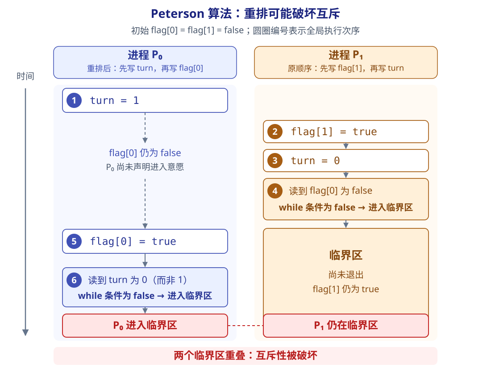
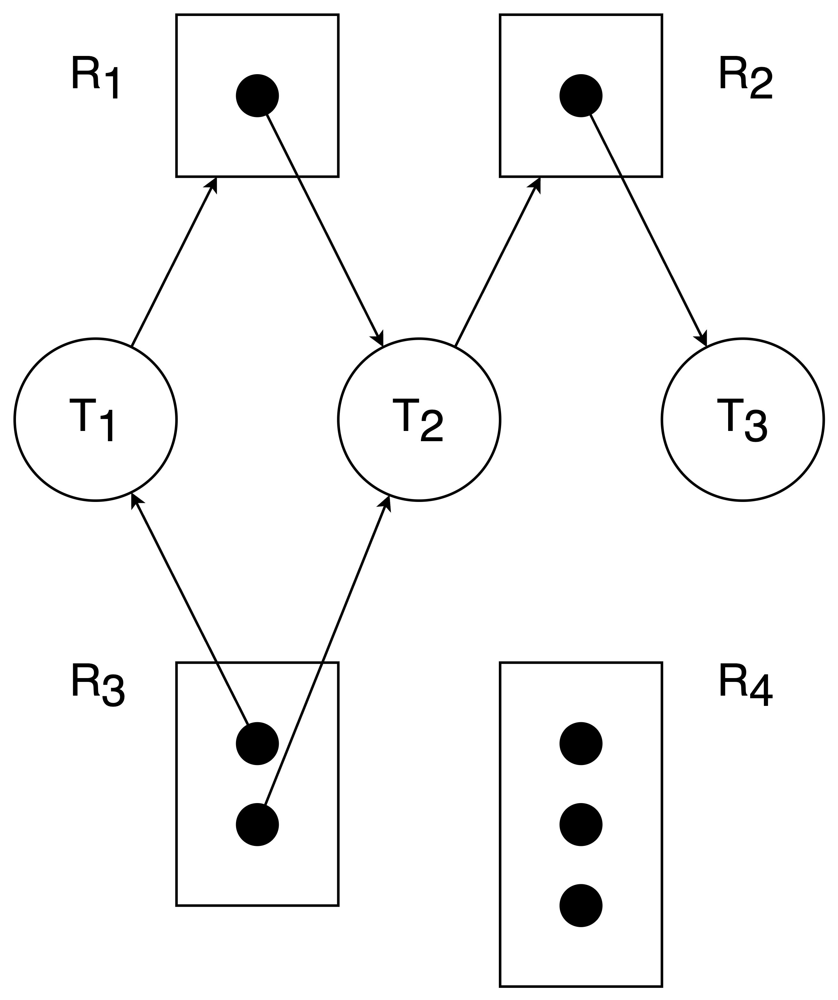
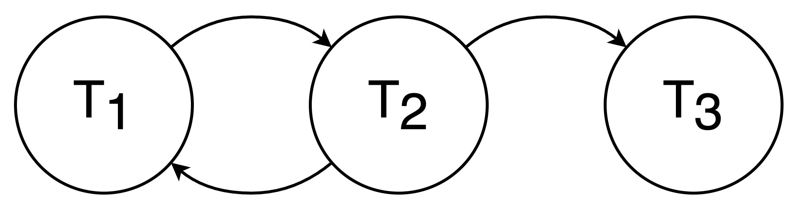

# 同步

在多道程序环境下，进程是并发执行的，不同进程之间存在多种相互制约关系。虽然我们之前提到过进程的独立性，但我们也了解到有协作进程这种东西的存在。这些进程可能需要对一些共享的资源进行修改，而我们往往希望这一系列修改按照某种顺序进行。考虑一个只含有加法和乘法而没有其他操作符的表达式，如 `1 + 2 * 3`。正常来说，我们都预期这个表达式“先乘后加”。但是，操作系统是有异步性的（各个进程以不可预知的速度向前推进），如果不加以约束，加法可能会先被计算。

所以我们需要设计一种机制，来确保进程的执行（在某种意义上）可控。这种机制就是进程同步。

## 竞态条件

!!! info "更多信息"

    [竞态条件 | Wikipedia](https://en.wikipedia.org/wiki/Race_condition)

竞态条件（race condition）是指多个进程或线程并发访问共享资源时，程序的结果取决于它们执行的相对顺序或时机。若缺少必要的同步，某些执行次序就可能使结果不符合预期。

它通常产生于 **共享资源的访问缺少协调，而相关操作又不是原子的**。例如，普通的 `count++` 可以分为“读取、加一、写回”三步：当 `count` 初值为 0 时，两个进程可能都先读到 0，再各自把 1 写回，最终得到 1，而不是预期的 2，一次更新就这样丢失了。即使只有一个 CPU，进程切换也可能让这些步骤交错执行。

## 基本概念

首先我们需要了解几个术语，这在接下来的讨论中会频繁出现。

### 临界资源

虽然多个进程可以共享系统中的各种资源，但其中许多资源 **在同一时刻仅允许一个进程访问**，这类资源被称为临界资源。常见的临界资源包括物理设备（如打印机）以及被多个进程共享的变量、数据结构等。

在每个进程中，访问临界资源的那段代码称为临界区。

!!! info "围绕临界资源的进程代码划分"
    
    实际上，为了确保临界区的资源被正确使用，一般我们把进程内的代码分为四部分：

    1.  进入区。在进入临界区之前，进程需要检查当前是否允许进入。若允许，则设置一个“正在访问临界区”的标志，以阻止其他进程同时进入临界区。
    2.  临界区。进程中实际访问临界资源的代码段，也称临界段。
    3.  退出区。在离开临界区时，应该清除“正在访问临界区”的标志，表示已释放该资源。
    4.  剩余区。指代码中除上述三部分之外的其余部分。

### 同步

同步（Synchronization）指的是，为完成某种任务而建立的两个或多个进程，由于需要协调彼此的运行次序，而在执行过程中产生 **等待或传递信息** 的制约关系。同步关系源于进程之间的相互合作。

例如 A 对 B 的管道通信。管道（缓冲区）为空时，B 因无法获得数据而被阻塞；一旦 A 向管道中送入数据，B 即被唤醒。反之，管道已满时，A 无法写入数据，A 被阻塞；一旦 B 从管道中取出数据，A 即被唤醒。

### 互斥

互斥（Mutual Exclusion）指的是，当一个进程正在临界区中使用临界资源时，其他试图访问该资源的进程必须等待；只有当占用临界资源的进程退出临界区后，其他进程才被允许进入。换句话说，“一山不容二虎”。

## 实现临界区互斥的基本方法

### 软件方法

基本的想法是在进入区设置并检查一些标志，用以表明是否有进程正在临界区中。

#### Peterson 算法

!!! info "朴素的想法..."

    接下来我们约定 $P_0$ 和 $P_1$ 是两个参与同步问题讨论的两个进程。

    1.  单标志法。这是由基本想法直接衍生的一种算法。它设置一个公用变量 `turn`，用于指示当前允许进入临界区的进程编号，例如当 `turn = 0` 时表示允许 $P_0$ 进入临界区。每当一个进程退出临界区时，就将 `turn` 置为另一个进程的编号。

        这种方法直接地确保了每次只有一个进程进入临界区。但它的缺陷也是明显的：两个进程必须交替进行。如果一个进程不再请求进入临界区，那标志也就不再更新，另一个进程也无法再次进入临界区了（事实上我觉得其实可以通过将 `turn` 设置为第三个值来解决），这造成了资源利用不充分。

    2.  双标志位先检查法。它设置一个布尔数组 `flag[2]`，以标记各进程是否希望进入临界区（`flag[i] = true` 表示 $P_i$ 希望进入临界区）。一个进程在进入临界区前，先检查对方是否想进入；如果对方想进入则自己等待，若否则将自己的 `flag[i]` 设置为 true 并进入临界区。在退出临界区时，将自己的 `flag[i]` 设置为 false。

        这样的做法就允许进程连续使用临界区而无须交替使用。但，考虑下面的情景：

        ```c
        Process P0:                     Process P1:

        while (flag[1]);    1           while (flag[0]);    2
        flag[0] = true;     3           flag[1] = true;     4
        critical section;               critical section;
        ...                             ...
        ```

        假如上面所示的 ①②③④ 按照顺序发生，双方都通过了检查，于是都进入了临界区。这显然不是我们想要的。究其原因，“检查对方标志”和“设置自己标志”两个操作不是原子化的，中间可能发生进程切换。

    3.  双标志位后检查法。如果我们先设置自己的标志、再检查对方的标志，情况会有所变化吗？

        ```c
        Process P0:                     Process P1:

        flag[0] = true;     1           flag[1] = true;     2
        while (flag[1]);    3           while (flag[0]);    4
        critical section;               critical section;
        ...                             ...
        ```

        假如上面所示的 ①②③④ 按照顺序发生，双方都无法通过检查。即使此时临界区空闲，它们中的任何一个也无法进入，这还可能会引发饥饿现象。

Peterson 算法针对上面的想法进行了综合，是针对两个进程间的同步问题的解法。算法的具体流程可以这样描述：

设置一个布尔数组 `flag[2]` 以表示自己有没有准备好进入临界区；设置一个 `turn` 变量，表示应该优先让哪个进程进入临界区。

对于两个进程 $P_0$ 和 $P_1$，如 $P_0$ 现在想进入临界区，那么将自己的 `flag[0]` 置为 true，随后将 `turn` 设为 1（或者对方的 PID 也可以，总之是主动把机会让给对方进程）。随后持续检测 `flag[1]` 与 `turn` 的值，判断是否需要等待。这样可以确保双方都请求进入临界区时只允许一个进程进入；只有一个进程的时候也不会产生饥饿问题。

```c
Process P0:                         Process P1:

flag[0] = true;                     flag[1] = true;                 // entry sec
turn = 1;                           turn = 0;                       // entry sec
while (flag[1] && turn == 1);       while (flag[0] && turn == 0);   // extry sec
// i.e. 另一进程已经完成（退出区）或尚未进入（进入区之前）
critical section;                   critical section;
flag[0] = false;                    flag[1] = false;                // exit sec
remainder section;                  remainder section;
```

!!! danger "Peterson 算法并非完美..."

    本段内容参考 [@ Isshiki 修 的操作系统笔记](https://note.isshikih.top/cour_note/D3QD_OperatingSystem/Unit2-Part1/#%E6%80%A7%E8%B4%A8%E8%AF%81%E6%98%8E)。

    Peterson 算法成立的一个重要前提是进程内的指令乖乖按照我们写出来的顺序执行，即先设置 `flag` 再设置 `turn`。然而，现代编译器和处理器可能重排内存访问；若没有相应的同步约束，另一个进程观察到的访问次序就可能与代码中的书写顺序不同。

    假设初始时 `flag[0] = flag[1] = false`，只有 $P_0$ 的两条赋值被交换，变成先执行 `turn = 1`、再执行 `flag[0] = true`，而 $P_1$ 仍按原顺序执行。就可能出现下面的交错过程（时间向下推进，编号表示全局执行次序）：

    <figure markdown="1">
    {:width="80%"}
    </figure>

    1.  ① $P_0$ 先把 `turn` 设为 1，但还没来得及把 `flag[0]` 设为 true。
    2.  ②③④ $P_1$ 设置 `flag[1] = true`、`turn = 0`，随后检查 `flag[0] && turn == 0`。因为 `flag[0]` 仍为 false，整个条件为 false，所以 $P_1$ 进入临界区。
    3.  ⑤⑥ 在 $P_1$ 尚未退出时，$P_0$ 才设置 `flag[0] = true`，随后检查 `flag[1] && turn == 1`。此时虽然 `flag[1]` 为 true，但 `turn` 已被 $P_1$ 改成 0，整个条件仍为 false，于是 $P_0$ 也进入临界区。

    这样，**两个进程同时处于临界区，互斥性被破坏**。问题在于，$P_0$ 的“让步”发生在声明进入意愿之前，$P_1$ 得以在看不到这个意愿时进入；而 $P_0$ 随后又把 `turn = 0` 当成了自己可以进入的依据。

    因此，实际实现必须保证共享变量的原子访问和正确的内存顺序，例如对 `flag` 和 `turn` 的所有访问使用[顺序一致的原子操作](https://eel.is/c++draft/atomics.order)，或结合适当的内存屏障与内存序约束访问顺序及可见性。此外，我们在开始也提到，Peterson 算法的基本形式只适用于两个进程。


### 内存屏障

!!! info "更多信息"

    [内存屏障 | Wikipedia](https://en.wikipedia.org/wiki/Memory_barrier)

内存屏障（memory barrier，也称 memory fence）是一种 **约束内存读写顺序** 的机制。为了提高效率，编译器和处理器可能重排内存访问，导致其他处理器观察到的顺序与代码的书写顺序不同。屏障在其前后的访问之间建立顺序约束，具体约束哪些读写取决于屏障的类型和平台的内存模型。

它可以作为前面 Peterson 算法的软件实现的补充：结合原子访问，在正确的位置使用适当的屏障或内存序，约束 `flag`、`turn` 的写入以及后续检查的顺序，从而避免重排破坏同步约定。实际实现需要同时考虑编译器和处理器层面的重排。

### 硬件方法

我们注意到，前面的软件方法中，每个想要进入临界区的进程都需要做两件事情：1) 检测共享标志；2) 修改共享标志。这两件事如果分开，那么就会有产生竞态条件的可能。因而我们需要将这两件事合并为一个不可分割的原子性（atomic）操作，而这需要硬件的支持。

#### 中断屏蔽

这个想法不是基于合并操作的，而是直接从另一个方向解决问题：如果进程切换可能导致竞态条件，那我直接 ban 掉进程切换（**关闭中断**）不就好了？

事实上关闭中断也是实现互斥最简单的方法之一。可以在执行临界区代码之前关闭中断，在临界区执行完毕之后再开启中断。这样，当前进程在访问临界资源期间就不会被抢占。

这种方法的缺点显而易见。① 关闭了中断就限制了 CPU 的并发执行能力，显著降低了系统效率。② 对内核而言，这种关中断是可行的，但如果把这个开关的权限开放给用户，风险就会大大增加：如果某个进程关中断后忘记开启中断，可能会导致[死锁]()甚至崩溃。③ 不适用于多处理器系统。让所有 CPU 因为一个进程而关中断既不经济也很困难。

#### 硬件指令方法 1：TestAndSet

这条指令的功能可以这样描述：

```c
<atomic> TestAndSet(bool *lock) {
    bool ret = *lock;
    *lock = true;
    return ret;
}
```

由于其是原子化的，它可以保证互斥性：进程在进入临界区前，通过执行 `TestAndSet(&lock)` 尝试获取锁：① 若返回值为 false，则说明 lock 原为 false，即无其他进程在临界区，当前进程成功获得锁，并将lock置为 true，从而阻止其他进程进入。② 若返回值为 true,则说明 lock 原为 true，即已有进程在临界区，需要进行等待。

```c
while(TestAndSet(&lock));   // - entry section
...                         // - critical seciton
lock = false;               // - exit section
...                         // - remainder section
```

相比关中断方法，由于 `lock` 是共享变量，该机制适用于多处理器系统。系统中可存在多个临界区，只需为每个临界区分配独立的 `lock` 变量。所以这里的语境不再是只限于两个进程之间的讨论。

#### 硬件指令方法 2：CompareAndSwap

这条指令的功能可以这样描述：

```c
<atomic> compare_and_swap(int *lock, int expected, int new_val) {
    int ret = *lock;

    // *lock = (*lock == expected) ? new_val : *lock;
    if (*lock == expected) {
        *lock = new_val;
    }

    return ret;
}
```

也就是说这个指令接收三个值：

1.  `lock` 待修改的数据的地址；
2.  `expected` 预期中待修改的数据的值；
3.  `new_val` 希望将待修改的数据改成何新值。

而当且仅当 `*target` 符合预期，与 `expected` 相同的时候，才会将它改为 `new_val`。其工作原理与 TS 指令本质相同：通过一次原子操作，既获取锁的当前状态，又将锁置为占用，即 `test_and_swap(lock)` 就是 `compare_and_swap(lock, false, true)`。

!!! info "王道中给出的 Swap 指令"

    王道中没有把比较旧值的功能放到这个指令里面：

    ```c
    bool key = true;
    while (key != false)
        Swap(&lock, &key);  // - entry section
    ...                     // - critical section
    lock = false;           // - exit section
    ...                     // - remainder section
    ```

    实际上是把比较的过程外化到操作外面，从功能上来讲还是一样的。

所以这种方法的优势和 TS 指令是一样的。但是它们也有问题，例如，锁的获取顺序不确定，可能导致某些进程长期无法获得访问机会，产生“饥饿”现象。

## 互斥锁

从上面的讨论，我们能看到我们已经拥有了解决竞态条件问题的手段了。但是硬件指令通常无法直接被用户程序所用，我们需要对这些手段在软件的层面上进行封装，这就是 **互斥锁**（mutex lock）。

同我们前面所看到的一样，利用互斥锁来解决竞态条件，就是在进入区声明索要（acquire）互斥锁，在退出区声明释放（release）互斥锁。索要和释放的执行必须是原子的，这也再次证明互斥锁往往采用硬件机制来实现的合理性。

```c
acquire() {
    while (!available);
    available = false;
}
release() {
    available = true;
}
```

!!! warning "忙等待"

    可能朋友们已经注意到前面我们屡次使用 `while()` 循环来保证进程等待。但是这种 `while` loop 是非常消耗 CPU 的，这种等待方式我们也称为 **忙等待**。

    许多系统为了避免忙等待，会通过暂时地切换进程，让这些处于等待的用户暂时休眠，等时机到来再唤醒它们。避免忙等待的方法我们后续会介绍。但是我们也需要认识到，切换进程也需要开销。在等待时间普遍不长的情况下，全部采用切换进程需要的上下文切换的开销可能显得较大。

我们也把这种忙等待的互斥锁成为 **自旋锁**（spinlock），因为一个线程可以在一个处理器上“旋转”，而不影响其他线程的执行。

!!! tip "锁的争抢"

    如果一个用户试图索取某个锁时，如果这个锁不可用（not available），这就意味着有用户正在使用这个锁，而当前用户需要等待这个锁重新可用，此时我们称这个锁是被争抢的（contended）；反之，如果不存在争抢，我们就称之为不被争抢的（uncontended）。

    如果现在有好多用户都在争抢一个锁，我们称之为 high contention；反之如果只有零星几个用户在争抢这个锁，我们称之为 low contention。

    如果在争抢的语境下沿用 spinlock，那么不难得到结论：high contention 会导致严重的性能问题，因为总是会有大量得不到锁的用户处于忙等待中。

## 信号量

信号量（Semaphore）机制是一种功能强大的同步机制，既能解决互斥问题，也能处理进程间的同步问题。它仅能通过两个标准原语访问：`wait()` 和 `signal()`。这两个操作也称 P 操作和 V 操作。

!!! info "你知道吗..."

    P 和 V 其实是源自于荷兰语，因为在荷兰文中，通过叫 passeren，释放叫 vrijgeven。而信号量这个概念其实是由大名鼎鼎的 **迪杰斯特拉**（Dijkstra）提出的。~~怎么又是您？~~

两个标准操作的功能可表示如下：

```c
wait(S) {
    while (S<=0);
    S -= 1;
}
signal(S) {
    S += 1;
}
```

显然这两个操作的实现也必须是原子化的。这种信号量的实现也叫 **整型信号量**。

### 信号量的应用

#### 进程同步

我们可以利用信号量来确保两个进程之间执行的先后关系（进程间通信）。例如，我们需要确保 `P0()` 中的 section A 必须在 `P1()` 的 section B 之前完成。

```c
semaphore S = 0;

P0() {
    /* Section A */
    signal(S);  // V(S);
}

P1() {
    wait(S);    // P(S);
    /* Section B */
}
```

???+ note "前驱关系"

    我们在数据结构中了解过活动图。箭头方向表示表示执行顺序的约束。在我们这一节的语境下，每一对前驱关系都对应一个同步问题：后继必须等待前驱完成后再开始。因此，可为每条前驱边设置一个同步信号量，初值均为 0。其使用规则如下：前驱段执行完毕后，执行 V 操作，通知所有直接后继；后继段开始执行前，执行 P 操作，等待所有直接前驱完成。

#### 进程互斥

我们还可以利用信号量来确保多个和进程之间互斥。和之前的思路是一样的——进入时申请，退出时释放。

```c
// i 是进程编号，S 表示信号量
process(i) {
    wait(S);    // P(S)

    /* critical section */

    signal(S);  // V(S)
}
```

S 在初始化时的赋值可以由参与讨论的进程数量决定。例如，我们讨论两个进程之间的互斥，可以初始化 S = 1。在这种语境下，如果我们采用前面提到的实现（先判断再修改值），S 的取值只可能是 1 或 0。若 S = 1，表示两个进程均未进入临界区；若 S = 0，表示有一个进程正在临界区中。

???+ tip "PV 操作的不同实现"

    我们或许能够发现，如果依靠上面的这种实现方式，我们无法区分等待队列是否有进程。因为所有进程会先判断 S 是否非正，在 S 最小也不会小于 0。于是还有一种实现是先修改再判断：

    ```c
    wait(S) {
        S -= 1;
        while (S<0);    // S < 0 时，将该进程放入等待队列并阻塞
    }

    signal(S) {
        S += 1;
        while (S<=0);   // S <= 0 时，从等待队列取出一个进程
    }
    ```

    在这种方式下，对于两个进程之间的互斥，S 若初始化为 1，则可能的取值是 1，0，-1。这种情况下，S = 0 表示有一个进程正在临界区中，没有其他进程正在等待；S = -1 表示有一个进程正在临界区，而另外的进程在等待。事实上，在这种实现下：

    -   $S > 0$ 表示仍有 $S$ 个可用的临界资源；
    -   $S = 0$ 表示没有可用资源，也没有进程在该信号量的等待队列中；
    -   $S < 0$ 表示没有可用资源，等待队列中有 $|S|$ 个进程。

### 避免忙等待的实现

前面我们说过，许多系统为了避免忙等待，会通过暂时地切换进程，让这些处于等待的用户（进程）暂时休眠，等时机到来再唤醒它们。为了实现这一点，我们需要扩展信号量的内容，引入一个链表来维护等待中的进程。

```cpp
// 结构体定义
struct semaphore {
    int value;
    struct process *L;
};

void wait(semaphore S) {
    S->value -= 1;
    if (S->value < 0) {
        S->waiting_list.push(current process);
        sleep();
    }
}

void signal(semaphore S) {
    S->value -= 1;
    if (S->value <= 0) {
        p = S->waiting_list.pop();
        wakeup(p);
    }
}
```

执行 `wait(S)` 时，进程首先将 `S.value` 减 1,表示请求一个该类资源。若减 1 后 `S.value < 0`，则表明该类资源已分配完毕，当前进程应调用 block 原语自我阻塞，主动放弃 CPU。执行 `signal(S)` 时，进程将 `S.value` 加 1，表示释放一个该类资源。若加 1 后 `S.value <= 0`，则说明仍有进程在等待该类资源，此时应调用 wakeup 原语。

## 经典的同步问题

### 生产者-消费者问题

生产者-消费者问题（The Producer–Consumer Problem），又称 The Bounded-Buffer Problem。问题描述如下：

系统中存在一组生产者进程和一组消费者进程，它们共享一个初始为空、容量为 n 的缓冲区。生产者每次生产一个产品，并将其放入缓冲区；消费者每次从缓冲区取出一个产品并进行消费。

该问题需满足以下约束条件：① 仅当缓冲区未满时，生产者才能写入产品，否则必须等待；② 仅当缓冲区非空时，消费者才能读取产品，否则必须等待；③ 缓冲区是临界资源，所有进程必须互斥访问。

### 读者-写者问题

读者-写者问题（Readers-Writers Problem）。问题描述如下：

系统中存在两组并发进程：读者和写者，它们共享一个文件。多个读者可以同时读取文件，不会导致数据不一致；但若任一写者与其他进程（无论是读者还是其他写者）同时访问文件，则可能破坏数据一致性。例如数据库系统中 `UPDATE` 读、改、写的操作。这种一致性体现在两种情况的冲突：两个写者、一读一写。

该问题需要满足以下约束条件：① 允许多个读者同时执行读操作；② 任一时刻只允许一个写者执行写操作；③ 写者在完成写操作前，不允许任何其他读者或写者访问文件；④ 写者开始写操作前，必须等待所有已进入的读者和写者全部退出。

### 哲学家进餐问题

哲学家进餐问题（The Dining Philosophers Problem）。问题描述如下：

> 描述摘取和翻译自 Wikipedia 页面：(Dining philosopers problem)[https://en.wikipedia.org/wiki/Dining_philosophers_problem]。

五位哲学家围坐在同一张桌子旁用餐，每人面前各有一个盘子，每两个相邻的盘子之间放着一把叉子。桌上供应的是一种必须用两把叉子才能吃的意大利面。

每位哲学家只能交替进行思考和进餐。只有同时拿到左右两边的叉子，哲学家才能吃面。因此，只有当左右两位邻居都在思考而非进餐时，这两把叉子才都可供其使用。每位哲学家吃完后，都会放下两把叉子。

问题在于：如何设计一套规则（一种并发算法），使任何一位哲学家都不会陷入“饥饿”状态，也就是说，让每个人都能一直交替进行进餐和思考。

既然每一把叉子是互斥的资源，那我们就把它们做成信号量。由于是圆桌，我们可以规定对于哲学家 $i$，其左侧叉子的编号是 $i$，右侧筷子的编号为 $(i+1) \% 5$。每位哲学家饥饿时会尝试同时获取两把叉子（即两把叉子都空闲），所以我们能够直观地给出一个信号量实现：

```c
semaphore chopstick[5]=(1,1,1,1,1};
Pi() {
    do {
        P(chopstick[i]);
        P(chopstick[(i+1)%5]);
        dine();
        V(chopstick[i]);
        V(chopstick[(i+1)%5]);
        think();
    } while(1);
}
```

!!! danger "但是！"

    考虑这样的情形：五位哲学家同时饥饿，也同时（或者说几乎并行地）拿起了左边的叉子。此时，每位哲学家都有一把左叉子，且均在等待右叉子，这就进入了 **循环等待状态**，每个哲学家（进程）都被阻塞了。我们称这样就形成了(死锁)[#deadlock]。

所以，为了规避死锁的风险，我们需要再加一些额外的限制。这些限制的核心要义是一致的，就是破坏死锁条件。书中给出了几种限制：

-   限制最多 4 名哲学家同时尝试进餐。这样可以确保至少有一人能获得两把叉子；
-   仅当左右两把叉子都空闲时，才允许哲学家同时拿起。这样就要求拿两把叉子本身是原子化的；
-   对哲学家明确编号，规定奇数编号的哲学家先拿左手边、偶数编号的哲学家先拿右手边。

我们这里给出第二种限制下的实现。为了实现原子化操作，我们可以把取两把叉子这个动作放在一个临界段里进行，这就需要额外设置一个信号量（互斥锁）：

```c
semaphore chopstick[5]=(1,1,1,1,1};
semaphore mutex=1;
Pi() {
    do {
        P(mutex);
        P(chopstick[i]);
        P(chopstick[(i+1)%5]);
        V(mutex);
        dine();
        V(chopstick[i]);
        V(chopstick[(i+1)%5]);
        think();
    } while(1);
}
```

???+ info "管程"

    在信号量机制中，每个访问临界资源的进程都需自行编写 P/V 操作。分散的同步代码不仅增加了编程复杂度，还极易因操作顺序不当而引发死锁。为简化同步控制，操作系统引入了更高层的抽象机制——**管程**（monitor）：它将共享资源及其操作封装于一体，自动保证互斥访问，程序员无须显式编写互斥代码；同时，通过条件变量实现灵活的进程同步，有效降低死锁风险。（王道）

    形式上，一个管程由四部分组成：管程的名称、局部于管程内部的共享数据结构说明、对该数据结构进行操作的一组过程、对共享数据进行初始化的语句（这其实有点像 OOP 里的类）。管程具有良好的 **封装性**，管程将对共享资源的操作封装起来，其内部的共享数据结构只能被管程自身的过程访问。外部进程必须通过调用这些过程才能访问资源。管程还确保了 **互斥性**，任一时刻仅允许一个进程执行管程内的过程。

    !!! tip "管程与进程的区别"

        ① 进程拥有私有数据结构（如PCB），而管程管理的是公共数据结构（如缓冲区）。② 进程执行通用计算任务，而管程专注于同步控制与资源管理。③ 引入进程是为了实现并发，而引入管程是为了解决共享资源的互斥访问问题。④ 进程是主动执行的实体，而管程是被动调用的模块，即进程通过调用管程中的过程来操作共享数据。⑤ 多个进程可并发执行，但对同一管程的多个调用是互斥的，即同一时刻仅一个进程可在该管程内执行。⑥ 进程具有动态的生命周期（从创建到撤销），而管程是操作系统中的静态资源管理模块，仅供进程调用。

    当一个进程进入管程后，若因条件不满足而需要等待，它必须释放对管程的占用；否则，其他进程将无法进入管程，从而导致系统停滞。为解决这一问题，管程引入了条件变量（condition），将不同的阻塞原因分别抽象为独立的条件变量。显然，管程可以设置多个条件变量。每个条件变量维护一个等待队列，用于记录所有因该条件而阻塞的进程。对条件变量 `x` 只支持两种操作：

        -   `x.wait`：当条件变量所代表的条件不满足时，当前调用管程过程的进程将自身加入 `x` 的等待队列，并自动释放管程；
        -   `x.signal`：当条件变量所代表的条件发生变化（可能已满足）时，唤醒一个因等待该条件而阻塞在 `x` 上的进程。

## 死锁

我们在之前已经了解到死锁这个概念。

> A deadlock is a situation in which every process in a set of processes is waiting for an event that can be caused only by another process in the set.

### 死锁发生的条件

死锁的发生必须 **同时满足** 以下四个条件；只要其中任一条件不成立，死锁就不可能发生。

1.  互斥条件（mutual exclusion）。进程对所分配的资源要求排他性使用，即在一段时间内，某资源只能被一个进程占有；若有其他进程请求该资源，则必须等待。
2.  不可剥夺条件（non-preemption）。进程已获得的资源在使用完毕之前，不能被其他进程强行剥夺，只能由该进程主动释放。
3.  请求并保持条件（hold & wait）。进程在持有至少一个资源的同时，又提出新的资源请求；若该资源已被其他进程占有，则请求进程被阻塞，但对其已占有的资源仍保持不放。
4.  **循环等待条件**（circular wait）。存在一个进程集合 ${P_1,P_2,\cdots,P_n$，其中每个进程 $P$，等待的资源正被下一个进程 $P_{(i+1) \text{mod} (n+1)}$ 占有，从而形成一个循环等待链。

!!! note "资源分配图"

    我们或许能够发现，建模死锁可以从讨论进程/线程与资源的求取关系入手。我们可以用资源分配图来描述这件事。

    <div class="split-cols" markdown>
    <div class="split-cols__text" markdown>
    资源分配图是一种有两类节点的有向图，我们用圆节点 $T_i$ 表示进程/线程，用方节点 $R_j$ 表示资源，方节点中的实心点表示一个资源类别的一个实例。同时，我们称从进程/线程指向资源类别的有向边为 **请求边**，表示进程/线程 $T_i$ 正在等待这种资源；称从资源实例指向进程/线程的有向边为 **分配边**，表示资源 $R_j$ 被分配给进程/线程 $T_i$ ，即目前进程/线程 $T_i$ 持有一个（一条边表示一个）资源 $R_j$ 的实例。
    </div>
    <div class="split-cols__media" markdown>
    <figure markdown>
    
    </figure>
    </div>
    </div>

    !!! warning "此处资源分配图的画法和王道中的不一样，这里以课上所授的样式为例。"

    资源分配图中存在环，是系统处于死锁状态的 **必要条件**：

    -   当资源分配图中不存在环时，说明不会出现死锁状态；
    -   当资源分配图中存在环时，系统 **可能** 处于死锁状态。特别地，如果与环相关的节点都只有一个实例时候，系统处于死锁状态。

### 死锁处理

我们有几种思路来处理死锁问题：

1.  操作系统不做额外处理，交给程序员来做，即程序员需要保证自己的东西逻辑上不会出现死锁；
2.  **死锁预防**（prevention）。使用某种规范或协议来保证死锁不会出现；
3.  **死锁避免**（avoidance）。禁止可能产生死锁的行为的发生。与预防的主要区别在于，预防是（在规范下的）所有行为都不可能出现死锁，避免则是行为可能出现死锁但不允许其执行；
4.  **死锁检测**（detection）**和死锁解除**（recovery）。允许死锁出现，但是当检测到死锁时需要去消除死锁带来的问题。

!!! info "其实在主流操作系统中，一般都是以第一种思路来对待死锁问题，即把问题交给程序员。"

### 死锁预防

预防死锁的发生，只需破坏死锁产生的四个必要条件之一即可。

-   **破坏互斥条件**：将原本只能互斥使用的资源改造为允许多个进程共享访问。
    -   *破坏该条件在实践中并不可行。*因为许多资源（如打印机、磁带机等临界资源）本质上不支持并发访问，否则会导致数据不一致或设备冲突。
-   **破坏不可剥夺条件**：当一个已占有某些不可剥夺资源的进程请求新资源而无法满足时，系统强制释放其已占有的所有资源，待后续需要时再重新申请。
    -   *该方法在实际系统中极少采用。*对于打印机等不可剥夺的外部设备，强制释放可能导致已完成的工作失效，甚至引发设备状态混乱。此外，频繁的申请与释放会显著增加系统开销，延长进程周转时间，降低系统吞吐量。
-   **破坏请求并保持条件**：进程在请求新资源时应不得持有任何不可剥夺资源。
    -   常用的方法是*动态释放再申请*：进程在获得初期所需资源后即可开始执行；但在运行过程中，必须先释放所有已使用完毕的资源，才能申请新资源。
    -   如果我们采用静态分配（即运行前一次性申请完所有资源）的方法，虽然实现简单，但会导致资源浪费严重，且易引发饥饿现象。
-   **破坏循环等待条件**：为系统中每类资源赋予唯一的编号，规定进程/线程只能按特定的顺序申请资源，就不会出现循环等待的情况。
    -   按此规则，任何已持有某资源的进程都无法再申请在其之前的资源。
    -   这个方法有一定的缺陷：① 资源编号需相对稳定，不利于新增设备类型。② 尽管在编号时已尽量考虑大多数进程使用资源的顺序，但实际使用资源的顺序仍可能与编号次序不一致，导致资源提前释放占用而长期闲置，造成浪费。③ 强制按固定次序申请资源，增加了用户编程的复杂性。

### 死锁避免

系统会在每次分配资源时，动态判断此次分配是否可能引发死锁，若是则不予分配，如果确认不会死锁才予以分配。

#### 资源分配图算法

资源分配图算法是一种依靠资源分配图的死锁避免算法，它直接检测某种分配是否会导致死锁发生，如果该分配会导致死锁发生，则不进行该分配。

我们之前介绍过了资源分配图是怎样一回事。在此基础上，我们定义诉求边（claim edge）：用虚线表示，它从进程/线程 $T_i$ 指向资源 $R_j$ ，表示进程/线程 $T_i$ 会在未来申请资源 $R_j$ 。在动态过程中，资源分配图按照如下规则响应分配过程：

1.  进程/线程 $T_i$ 被添加到资源分配图中时候，需要连好所有相关的诉求边；
2.  进程/线程 $T_i$ 申请资源 $R_j$ 时，如果这条边 **变为分配边后** 不会导致成环，则将诉求边转化为一条 **请求边**；
3.  进程/线程 $T_i$ 获得资源 $R_j$ 时，将请求边正式转化为分配边；
4.  进程/线程 $T_i$ 释放资源 $R_j$ 时，将这条分配边删去。

由于其避免死锁的措施是“检测成环”，因此只有在每个资源类别只有一个实例的情况下，该算法才不会“误伤”一些其实不会导致死锁的情况（考虑一个类别下的两个实例，一个有出边、一个有入边。）

#### 银行家算法

!!! note "安全状态与不安全状态"

    所谓 **安全状态**，是指系统存在某个进程执行序列（$P_1,P_2,\cdots,P_n$），使得对于序列中的每个进程 $P_i$，在其之前的所有进程执行完毕并释放所占资源后，系统仍有足够的可用资源满足 $P_i$ 还需要的资源量（最大需求减去已分配量），从而保证 $P_i$ 能顺利完成。这样的进程执行序列也被称为安全序列。如果找不到这样的序列，则称系统处于 **不安全状态**。

    读者朋友可能会发现，安全状态是一个比较强的条件。不安全状态不一定导致死锁的发生：

    $$
    \text{安全状态} \cup \text{不安全状态} = \emptyset \qquad \text{不安全状态} \supset \text{发生死锁}
    $$

银行家算法（Banker's Algorithm）是最著名的死锁避免算法。算法将操作系统视为银行家，系统管理的资源视为银行资金，进程请求资源相当于用户申请贷款。

每个进程在运行前需声明其对各类资源的最大需求量（且该最大需求量在整个生命周期内不得更改，否则银行家算法的安全性保证失效），且该总量不得超过系统资源总量。当进程在运行中申请资源时，系统首先检查当前是否有足够资源可供分配；若有，则进一步试探：若将这些资源分配给该进程，系统是否仍处于安全状态。只有在确保安全的前提下，才正式分配资源；否则，就让进程等待。

现在我们假设系统中的进程数量为 $n$，资源类别数量为 $m$。为了实现这一算法，我们需要维护这些数据结构：

-   `available[m]`：长度为 $m$ 的向量，表示每个元素代表这类资源可用的数量。
-   `max[n][m]`：$n \times m$ 矩阵，`max[i][j]` 的值表示系统中进程/线程 $P_i$ 对 $R_j$ 类资源的最大需求量。
-   `allocation[n][m]`：$n \times m$ 矩阵，`allocation[i][j]` 的值表示系统中进程/线程 $P_i$ 已获得的 $R_j$ 类资源的数量。
-   `need[n][m]`：$n \times m$ 矩阵，`need[i][j]` 的值表示系统中进程/线程 $P_i$ 还需要 $R_j$ 类资源的数量。

不难发现三个矩阵的元素之间有关系：

$$
\text{Need}_{ij} = \text{Max}_{ij} - \text{Allocation}_{ij}
$$

银行家中比较重要的部分可以归结成两个算法：**安全性算法** 和 **资源分配算法**，前者可以说是后者的基础。

!!! note "安全性算法"

    根据前面关于安全状态的知识，算法的思想是尝试构造一个进程执行序列，使得所有进程都能依次获得所需资源并顺利完成。具体来讲，算法的步骤如下：

    1.  初始化。

        ```c
        work[m] <- available[m];    // work[] 表示当前可用的各类资源数，初始化为 available[]
        finish[n] <- false;         // finish[] 表示各进程是否可以安全顺利完成，均初始化为 false
        ```
    2.  对于所有尚未完成的进程，查找满足如下条件的 `i`：`finish[i] == false && need[i] <= work[]`（尚未加入安全序列，且其尚需的 **各类** 资源数均不超过当前可用资源）。
        -   若能找到，则代表 $P_i$ 获得所需资源后可顺利执行至完成，并释放其所占有的全部资源：

            ```c
            work[] <- work[] + allocation[i][];
            finish[n] <- true;
            ```

            重复本步骤；

        -   若找不到，则到下一步；

    3.  若所有进程均满足 `Finish[i] == true`，则系统处于安全状态；否则系统处于不安全状态。

!!! note "资源分配算法"

    在安全算法的基础上，系统就能够确认是否进行此次分配。具体的步骤可以描述为：

    1.  用 `request[n][m]` 来维护进程/线程想要请求的资源的数量；
    2.  在每个请求中，如果 `request[i][] <= Need[i][]`，则继续；否则抛出异常，因为此时它请求的量超过了它预期需要的资源的最大量；
    3.  如果 `request[i][] <= available[]`，说明资源足够，继续；否则，进程/线程必须等待足够的资源；
    4.  假设系统分配了资源，则需要更新模拟状态（即前面描述中提到的“试探”）：

        ```c
        available[] <- available[] - request[i];                // 模拟剩余资源量
        allocation[i][] <- allocation[i][] + request[i][];      // 模拟分配得到的资源
        need[i][] <- need[i][] - request[i][];                  // 模拟预期需求量
        ```

    5.  使用安全算法判断：如果当前状态是安全的，则请求被接受；如果当前状态是不安全的，请求不被允许，同时需要将这些矩阵回滚到模拟之前的状态。

### 死锁检测

我们仍然采用资源分配图来检测系统是否处于死锁状态，方法是通过一种“简化算法”来判断：

1.  在图中找出当前可继续执行的进程 $P_i$，删除其所有请求边和分配边；
2.  删除后，继续重复步骤 1. 直至无法再继续删除边。

如果最后所有的边都被删除，则称该资源分配图可以完全简化。

!!! info "系统处于死锁状态，当且仅当其资源分配图不可完全简化。"

!!! note "等待图"

    在每个类别的资源只有一个实例的情况下，资源分配图还可以简化为等待图（wait-for graph），即只保留进程/线程的节点，边也简化成进程/线程间的有向边。例如：

    <figure markdown>
    {:width="40%"}
    </figure>

    这样能更直观地看出环的存在。

### 死锁解除

这里解除的对象是死锁，实际上是破坏死锁，而并没有恢复到一个不存在死锁的状态。王道中给出了 **资源剥夺、撤销进程、进程回滚** 三种主要方法：

1.  资源剥夺：挂起部分死锁进程，抢占其资源并重新分配给其他死锁进程（一个不恰当的词语是“拆东补西”）来打破死锁环路；
    -   但这样需要注意被挂起的进程的饥饿问题；
2.  撤销进程：强制终止部分或全部死锁进程并回收其所占资源。终止顺序可以依据进程优先级或撤销代价确定；
    -   这样实现简单，但代价可能会很高，尤其是一些接近完成的进程被杀掉时；
3.  进程回滚：令一个或多个死锁进程回退到之前某个足以回避死锁的状态，并在回退过程中自愿释放其所占资源；
    -   系统需记录进程的历史状态并设置还原点，实现较复杂。
    -   再次提醒读者朋友们，有抢占就会有饥饿问题。