# 数据链路层

物理层的实现让我们能够把比特送到链路另一端。可是这些比特如果没有得到很好的组织，那么接收方看到的就只是一篇没有标点的长文，很难知道发送方的真实意图。

于是，数据链路层就负责进一步把这些比特组织成一定的结构，向紧邻的上层（网络层）提供相邻节点之间的数据传送服务。

## 数据链路层提供的服务

**链路**是相邻节点之间的一段物理通路；在链路上加上实现通信协议的软硬件，就形成了逻辑通信通道——**数据链路**。

既然要把数据组织起来，那就一定有一个最小的单元。我们把数据链路层对等实体间通信的协议数据单元称为 **帧**。主机跨网络通信时，沿途的每一段数据链路可能采用不同的数据链路层协议，分别独立完成帧的传输任务。

<figure markdown="1">

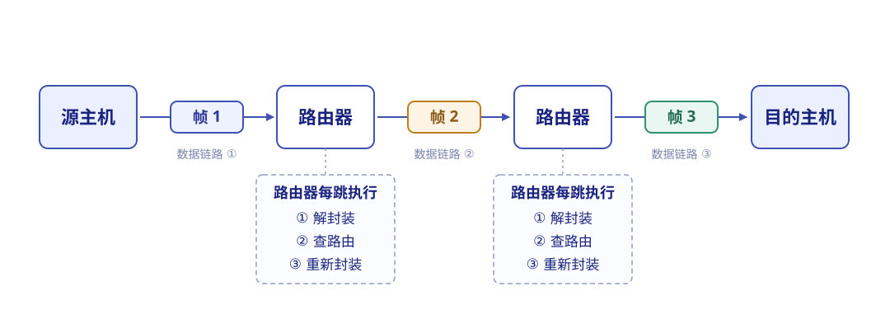{:width="90%"}

</figure markdown="1">

不同链路可以采用不同的帧格式，路由器在每一跳都要重复同样的封装与解封装过程。

除了 **封装成帧** 的功能之外，数据链路层还可以提供一些其他功能。根据采用的功能不同，在现代计算机网络中，数据链路层提供的服务一般分为三类：

| 链路层服务 | 怎样传送 | 适用场景 |
| --- | --- | --- |
| **无确认无连接服务** | 不预先建立连接，接收方不逐帧确认 | 误码率较低、实时性强的链路，例如以太网 |
| **有确认无连接服务** | 不预先建立连接，对需要可靠交付的帧进行确认与重传 | 无线链路，例如 802.11 的单播数据传输 |
| **有确认面向连接服务** | 先建立连接，再通过编号、确认等机制按序传送，完成后释放连接 | 需要在链路层维护可靠连接的场景 |

-   **链路管理**负责连接的建立、维持和释放；
-   **流量控制**限制**发送方的发送速度**，让接收方来得及处理；
-   **差错控制**处理比特出错、帧丢失和重复等问题，可以大致分为差错检测和差错纠正。    
    
    OSI 模型认为，数据链路层必须向上提供可靠的数据传输服务。而现在，是否采用可靠传输则由信道质量决定：在高质量的信道中，数据链路层只进行检错，而把纠正（重传）交由上层进行；质量较差的信道中，数据链路层会使用确认重传来提供可靠服务。

## 成帧

发送方为网络层交下来的数据添加控制信息，构成帧（frame）；接收方则从连续的比特流中找出帧的边界。

**透明传输**要求数据中可以出现任意比特组合。即使数据恰好与帧定界符相同，也应当作为普通数据交付给上层，而不会被误判为帧的边界。

### 字节计数法

在帧首部设置长度字段，接收方按长度确定帧的结束位置。若计数字段本身也计入帧长，那么发送 `A B C D` 四个字符、计数字段占 1 B 时，计数值应为 5。

这种方法的主要问题是：**计数字段如果出错，会使接收方找错帧边界，连带影响后续帧的同步**。所以实际应用中，采用这种方法的协议往往还结合了其他方法（例如下面要介绍的方法）。

### 字节填充法

用特殊字节 `FLAG` 标记帧边界，用 `ESC`（这是 ASCII 码中的单字节控制字符）表示转义。进一步地，还可以用不同的控制字符来表示帧的起始和结束（`SOH` / `EOT`）。发送方遇到数据中的 `FLAG` 或 `ESC`，就在它前面插入一个 `ESC`；接收方遇到 `ESC` 后，把紧随的字节作为普通数据恢复。

<figure markdown="1">

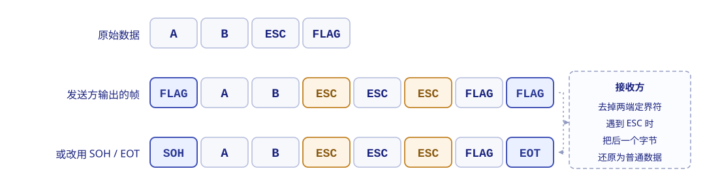{:width="90%"}

</figure>

**插入转义字节与添加首尾定界符都由发送方完成**；接收方做相反的变换：先去定界符，再把 `ESC` 后面紧跟的那个字节当作普通数据取出。

### 零比特填充法

用固定的比特串 `01111110` 作为帧的起止标志。在两个标志之间的部分，发送方每遇到 **5 个连续的 1**，就插入一个 0 ，以防止数据字段出现与标志相同的比特序列；接收方识别出帧边界后，删除每 5 个连续的 1 后面的填充 0。

例如，数据 `01111110` 填充后变成 `011111010`。**定界标志本身不参与填充**，所以接收方仍然能找到帧的边界。

### 物理层编码违例法

利用物理层编码中不用于表示普通数据的信号组合来定界。例如，曼彻斯特编码的每位中间都有跳变（“高-低”“低-高”），可以借助不符合正常数据编码规则的组合（“高-高”“低-低”）表示控制信息。这种方法需要底层编码保留可用的冗余状态。

!!! info "你知道吗..."
    -   早期的 HDLC 协议采用的是零比特填充法。
    -   局域网 IEEE 802 标准采用了物理层编码违例法。

## 差错检测与纠正

由于噪声等因素的影响，传输中可能出现帧内比特翻转，以及帧丢失、重复或错序等情况。检错与纠错编码主要处理帧内的比特差错；帧丢失与重复等问题则需要确认、重传和序号等机制处理。是否在数据链路层提供这些可靠传输机制，由具体协议决定。

对于差错，两种基本处理思路是：

- **检错后重传**：增加校验信息，检测出错后丢弃，由可靠传输协议安排重传。
- **前向纠错（FEC）**：增加足够的冗余，使接收方能直接恢复一定范围内的错误。

链路误码率低且反馈方便时，检错加重传通常更经济；重传代价高、时延要求严格时，纠错编码更有价值。

### 海明距离

我们定义两个等长码字的 **海明距离（Hamming distance）**，指的是它们对应位置上不同的比特数，也就是两码字异或后 1 的个数。一个编码集的**最小码距** $d_{\min}$，取所有不同合法码字之间距离的最小值。

检错要求错误发生后不会变成另一个合法码字，所以任意两个合法码字的距离应该大于错误的位数；纠错要求接收结果能够唯一地归到原码字，所以错误发生后，错误码字和原码字的距离应该小于和任意其他合法码字的距离。也就是说：

-   要检测至多 $e$ 位错误：$\quad d_{\min}\ge e+1$；
-   要纠正至多 $t$ 位错误：$\quad d_{\min}\ge2t+1$。

### 检错编码

#### 奇偶校验

**奇偶校验**在原数据基础上增设 1 位检测位，通过给检测位赋值使整个码字中 1 的总数保持为奇数（奇校验）或偶数（偶校验）。例如，对于 7 位数据 `1001101`，若采用奇校验，则其校验码是 `10011011`（最后一位是检测位）。

读者或许很容易发现，它能检测出所有奇数位翻转；而对偶数位翻转，由于会保持原有奇偶性，奇偶校验就不起作用了。

#### 校验和

**因特网校验和**把数据按 16 bit 分组，用反码加法求和：最高位产生的进位回卷加到最低位，最后对结果取反。计算时若数据长度为奇数字节，末尾补零参与运算。接收方把收到的校验和一起相加，正常结果为全 1。

#### 循环冗余校验

**CRC（Cyclic Redundancy Check，循环冗余校验）**把比特串视为系数为 0 或 1 的多项式。例如 `1101` 表示 $x^3+x^2+1$。运算在模 2 下进行，加法和减法都可以用异或表示。

设数据多项式为 $M(x)$，双方约定生成多项式为 $G(x)$。记生成多项式的最高次数为 $r$，对应的比特串长 $r+1$。

1. 在数据后补 $r$ 个 0，得到 $x^rM(x)$。
2. 用 $G(x)$ 做模 2 除法，得到余数 $R(x)$。
3. 把余数补足为 $r$ 位，替换末尾的 $r$ 个 0，作为**帧检验序列（FCS）**发送。
4. 接收方用相同的 $G(x)$ 除收到的整个码字，余数非零时，丢弃本次收到的帧。

接收方这么做的原理是，在模 2 除法规则下，如果将 $x^rM(x)$ 除以 $G(x)$ 得到的余数再加一遍，那就相当于抵消了这个余数（余数乘上了 2）。也即：

$$
T(x)=x^rM(x)+R(x),\qquad T(x)\bmod G(x)=0
$$

当然，若差错多项式 $E(x)$ 恰好能被 $G(x)$ 整除，就会漏检。但是，在实际工程场景中，如果恰当地选择生成多项式时，让常见差错尽可能破坏整除关系，这样的情况发生的概率极小。CRC 的生成和校验可以用专用的硬件电路来实现，所以速度也极快，几乎不会造成额外的延迟。

!!! example "CRC 计算"

    数据为 `1101011011`，生成多项式为 `10011`，所以 $r=4$。用 `10011` 除 `11010110110000`，余数为 `1110`，所以发送方最终发送 **`11010110111110`**。

    

    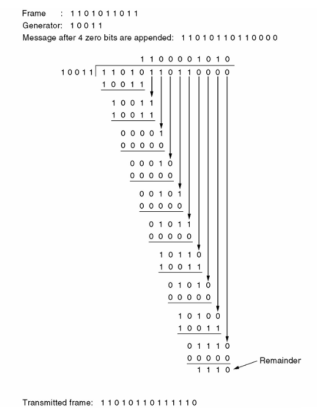{:width="60%" }

    

### 纠错编码

#### 海明码

海明码是最常见的一种纠错编码。根据海明距离的性质，我们可以构造出海明码。海明码可以检出错误、确定错误位置，进行单比特纠正。

-   海明码的位数
    
    既然我们需要纠错，那么需要满足前面讨论的海明距离的条件。假设信息有 $n$ 位数据，设需要的检验位有 $k$ 位，则应该满足：

    $$
    2^k \ge n+k+1
    $$

    ??? success "推导"

        单比特纠错要求 $d_{\min}\ge 2t+1$，取 $t=1$ 得 $d_{\min}\ge 3$。
        
        码长为 $n+k$，则一共可以组成 $2^{n+k}$ 个位串，其中有 $2^n$ 个合法码字。
        
        对于每个合法码字，一共可以有 $n+k$ 中单比特翻转的方式，再加上它本身，得到每个合法码字的可纠错范围。
        
        由 $d_{\min}\ge 3$，各自的可纠错范围应该互不重叠，否则，由于存在交集，交集中的串距离两个合法码字不会超过 $1$，两个合法码字的海明距离将不大于 $2$。所以

        $$
        2^n\,(n+k+1)\le 2^{\,n+k}
        $$

        约去 $2^n$，即得

        $$
        2^k\ge n+k+1
        $$

-   检验位的设置
    
    构造时，把校验位 $P_i$ 放在位号 $2^{i-1}$（$1,2,4,8,\ldots$），每个检验位作为一个校验组，其余位置按数据原顺序放数据各位。这样，每个信息位就可以由其所在的位号对应的二进制数中，哪些位上为 1，该位号对应的校验位就参与对这个信息位的检查。
    
    例如，$11=2^3+2^1+2^0$，所以第 11 位上的数据参加第 1、2、4 组的校验。

-   海明码的检验原理

    我们利用数据 $D_4\,D_3\,D_2\,D_1 =$ `1010` 来说明。由前面的方法我们得到其对应的海明码应该是 $1\,0\,1\,P_3\,0\,P_2\,P_1$。第 7 位的数据由第 1、2、3 组检验，第 6 位的数据由第 2、3 组检验，第 5 位的数据由第 1、3 组检验，第 3 位的数据由第 1、2 组检验。
    
    1.  首先，检验位的取值由其所参与检验的所有信息位求异或得到（或者说，其所形成的检验组中所有的信息位）。

        $$
        P_1 = 0 \oplus 1 \oplus 1 = 0 \\
        P_2 = 0 \oplus 0 \oplus 1 = 1 \\
        P_3 = 1 \oplus 0 \oplus 1 = 0 \\  
        $$

        所以海明码为 `1010010`。
    
    2.  对于每个检验组，用其对应的检验位以及参与形成的信息位进行奇偶性检查，构成一系列检验方程。例如，对四位数据：
    
        $$
        S_1 = P'_1 \oplus D'_1 \oplus D'_2 \oplus D'_4 \\
        S_2 = P'_2 \oplus D'_1 \oplus D'_3 \oplus D'_4 \\
        S_3 = P'_3 \oplus D'_2 \oplus D'_3 \oplus D'_4 \\ 
        $$
        
        读者可以发现，第一步中的检验位的赋值实际上是偶校验结果。所以如果这一系列检验方程的结果都为 0，那么说明传输没有错误；如果有某一位为 1，那么就说明产生了错误，而且 $\overline{S_3S_2S_1}$ 的值就是海明码中发生错误的位置的位号。例如如果 $\overline{S_3S_2S_1} = \overline{010}$，那么说明海明码的第 2 位传输错误，翻转该比特即可。

#### 其他纠错编码

- **卷积码**：输出既取决于当前输入，也取决于之前的输入，编码器具有记忆。
- **Reed–Solomon 码**：以多比特符号为单位，适合处理突发差错。一个码块含 $N$ 个符号，其中 $K$ 个为信息符号时，可纠正至多 $\lfloor(N-K)/2\rfloor$ 个未知位置的符号错误，或恢复至多 $N-K$ 个已知位置的擦除。
- **LDPC 码**：使用稀疏校验矩阵，通过迭代译码逼近合法码字，适合较长码块。

## 流量控制和可靠传输

!!! question "流量控制和可靠传输的必要性"
    考虑两个节点之间的数据传输。最简单的情况是：数据只从 A 发往 B，信道从不损坏或丢失帧；双方的网络层始终准备就绪，处理时间可以忽略，接收方还有足够的缓存。

    在这些条件下，发送方不断从网络层取分组，封装成帧后发送；接收方不断接收帧，取出分组交给网络层。接收方总能跟上发送方，也从不出错那这个时候我们自然不用考虑流量控制和可靠传输的问题。

    <figure markdown="1">

    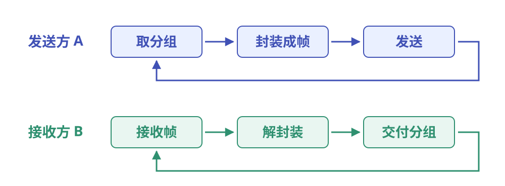{:width="80%"}

    </figure>

    但是，现实可没有这么理想。其一，实际情况中接收方的处理速度和缓存容量都是有限的，因此我们需要控制发送方的流量；其二，实际情况中信道往往可能因噪声或其他因素产生损坏、出错、丢失帧的情况，因此我们需要确保传输可靠。

### 停止—等待协议

#### 原理

接收方不一定是随时准备好的。如果发送方持续不停地发送，接收方就可能来不及处理。因此，需要由接收方告诉发送方何时可以继续。

**停止—等待（stop-and-wait）**规定：发送方每发送一帧，就停下来等待；接收方接收并处理该帧、准备好接收下一帧后，返回一个确认帧；发送方收到确认，才发送下一帧。

<figure markdown="1">

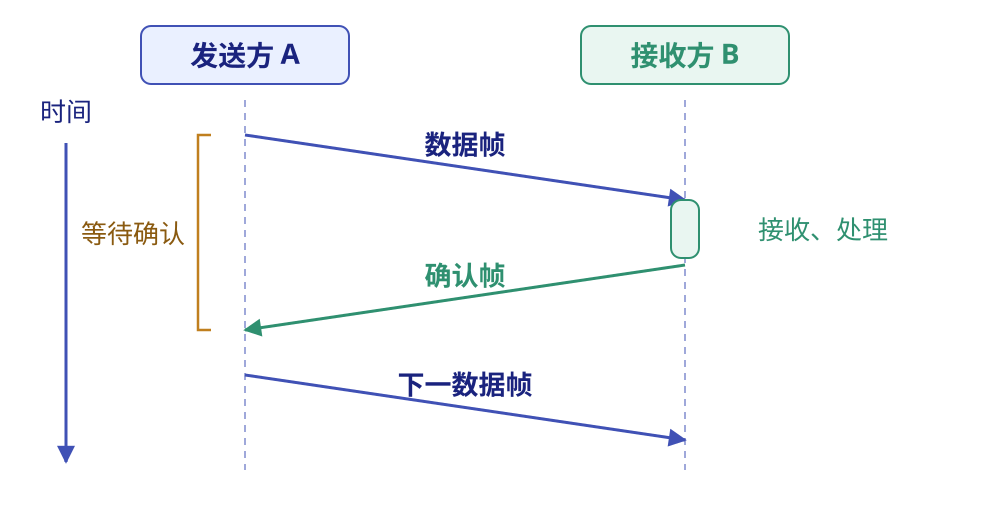{:width="90%"}

</figure>

链路上最多只有一帧数据处于等待确认的状态，发送速度就受到接收方的约束。这就是停止等待协议实现流量控制的原理。

#### 信道利用率

停止—等待每发一帧就等待一次。等待时间相对帧发送时间越长，链路空闲的比例就越大。

设数据帧长 $L$ bit，链路速率为 $R$ bit/s，单向传播时延为 $t_p$，确认帧发送时延为 $t_a$。忽略处理与排队，接收方立即确认，且数据和确认均正确到达，则数据帧的发送时延和发送一个数据帧的周期是：

$$
t_f=\frac LR,\qquad T_{\mathrm{周期}}=t_f+2t_p+t_a
$$

从开始发送一帧，到其确认完整返回，发送方只在 $t_f$ 内发送了数据帧，所以利用率为：

$$
U=\frac{t_f}{T_{\mathrm{周期}}}=\frac{t_f}{t_f+2t_p+t_a}
$$

确认帧很短、可忽略其发送时间时，令 $\alpha=t_p/t_f$，则：

$$
U=\frac{t_f}{t_f+2t_p}=\frac1{1+2\alpha}
$$

在讨论中，我们还经常使用**往返传播时延** $\mathrm{RTT} = 2t_p$ 这个概念。传播距离越长，或数据帧越短、链路速率越高，等待相对发送的开销就越明显。所以停等协议并不擅长往返时间较长的信道。

!!! note "有效载荷利用率"

    一个数据帧中也可能包含一些上层继承下来和本层添加的首部。如果我们进一步区分，我们可以定义数据帧中真正的数据为**有效载荷**，从而定义有效载荷利用率。
    
    假设某链路速率为 100 Mbit/s，单向传播时延为 $12\,\mu\mathrm{s}$；某一数据帧含 100 B 载荷和 40 B 首部，确认帧长 60 B。

    可计算出该数据帧发送耗时 $140 \times 8 / 10^8 = 11.2\,\mu\mathrm{s}$，确认帧发送耗时 $4.8\,\mu\mathrm{s}$，停等周期为 $11.2+24+4.8=40\,\mu\mathrm{s}$。

    - 按整个数据帧计算，利用率为 $11.2/40=28\%$。
    - 按有效载荷计算，利用率为 $8/40=20\%$，有效吞吐量为 20 Mbit/s。

### 可靠传输机制

#### 确认与超时重传

在停止-等待协议中，我们实际上已经接触了一种机制，即**确认**：接收方收到一个数据帧，就向发送方返回一个确认帧，表示该帧已被正确接收。但在实际情况中，信道可能损坏或丢失帧，这就意味着确认帧也可能出错或丢失。这样，发送方发出一帧后，就可能一直等不到确认。

我们还有一种叫**超时重传**的机制来解决这个问题：发送方在发送一个数据帧时启动一个计时器，并保留该帧的副本。若在规定时间内收到了有效确认，就停止计时并准备下一帧；若超时仍未收到，则认为该帧可能出错或丢失，就重传原帧，直到收到了确认。

这类通过确认与重传结合起来实现的可靠传输机制称为 **ARQ（Automatic Repeat reQuest，自动重传请求）**。以肯定确认为依据的重传机制也称为 **PAR（Positive Acknowledgement with Retransmission）**。

#### 帧序号

但是只增加计时器还不够覆盖所有情况。假设 B 已经收到并交付了数据，但返回的确认帧丢失，此时会触发 A 的重传。此时，若 B 把重传过来的重复帧当成新帧再次交付，网络层就会收到两份相同的数据。

所以还要给数据帧和确认帧**编号**。

- 发送方记录当前待确认帧的序号，只有收到与它匹配的确认，才切换序号并取下一份数据。
- 接收方记录期望的序号。收到期望帧时交付数据，再切换期望序号。
- 收到上一帧的重复副本时，不重复交付，但要再次确认，使发送方能够结束等待。

例如停止-等待协议（可简称停等协议）中，发送方只有一帧尚未确认，那么只需 1 位序号空间，交替使用 0、1 两个序号。例如，双方从序号 0 开始，且用 `ACK 0` 表示确认帧 0：

<figure markdown="1">

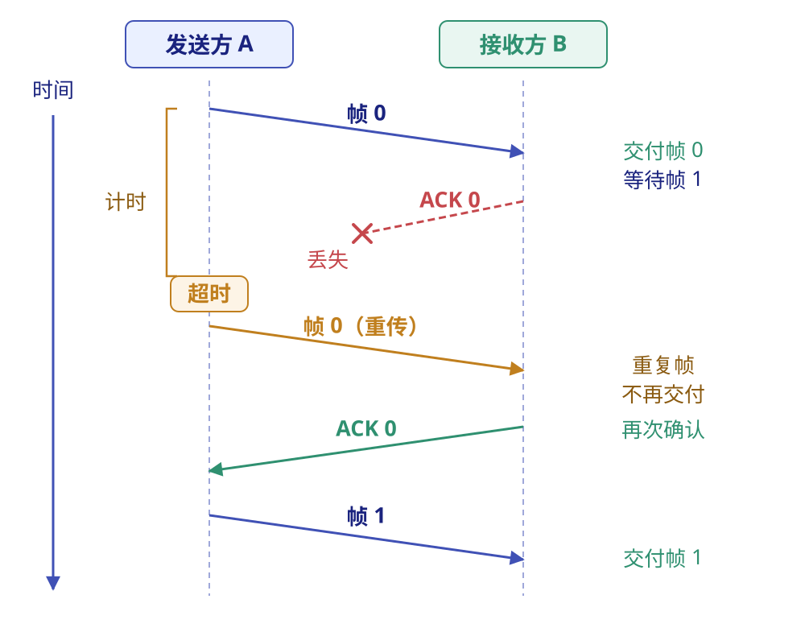{:width="90%"}

</figure>

于是，停止—等待负责限制未确认帧数量，确认与计时器负责恢复丢失，序号负责区分新帧和重复帧。三者结合，这样就得到了有差错信道上的**停等 ARQ**。

### 滑动窗口协议

#### 发送窗口和接收窗口

**发送窗口**是发送方当前允许使用的一组连续的序号范围。其中可以包括已发送未确认的帧，以及允许继续发送的新帧。窗口容量记为 $W_s$。

- **已发送未确认帧（outstanding frames）**占用发送窗口中的位置，发送方必须保留其副本。
- 发送新帧时，窗口内尚未使用的位置减少；全部占用后，就要等待确认。
- 窗口起点的连续帧得到确认后，窗口向前滑动，新的序号进入可发送范围。

例如，发送窗口为 4 时，初始允许发送 `0、1、2、3`。发出帧 0、1 后，还能继续发 2、3；若帧 0、1 被确认，窗口可前移为 `2、3、4、5`，于是又能发送 4、5。

<figure markdown="1">

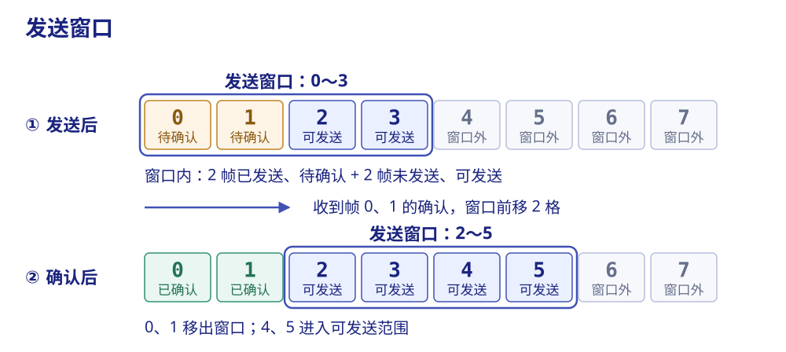{:width="90%"}

</figure>

**接收窗口**是接收方当前允许接收的一组连续的序号范围，容量记为 $W_r$。序号使用 $n$ bit 时，编号按模 $2^n$ 循环。

接收方收到帧时，先检查帧是否正确、序号是否在允许范围内，再决定接收、缓存还是丢弃。收到的数据占用缓存；按协议处理并交付后，缓存位置得以释放，接收窗口相应向前推进。

接收窗口为 1 时，只接受当前期望的帧；大于 1 时，可以允许窗口内的帧乱序接收。发送方与接收方的窗口**依据各自获得的信息更新**，**二者完全可以不相同**。

<figure markdown="1">

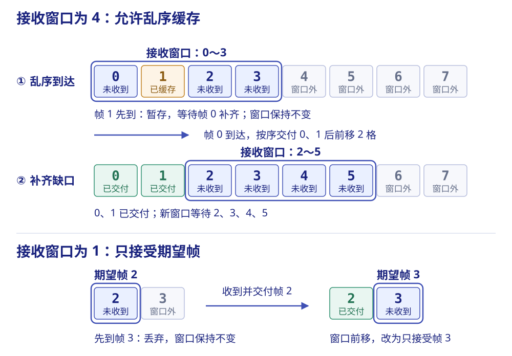{:width="90%"}

</figure>

不难发现，前面介绍的停止-等待协议就可以看作是发送窗口和接收窗口都是 1 的滑动窗口协议。

### 双向数据发送

到目前为止我们只讨论了一方发给另一方的情形。如果双方都有数据要发，那该怎么办呢？

#### 捎带确认

对于其中任意一方，我们可以采用不优先单独发送确认，而把确认号附在反方向的数据帧中，一起发回的方法。这种方法称为 **捎带确认（piggybacking）**。它减少了单独确认帧的首部和发送开销。

若一直没有反向数据，也不能总等待捎带。我们需要另外规定一个时间限制，超过时间限制时就应发送单独的确认，避免对方因等不到确认而超时。

#### 序号与确认号

双向数据发送同样需要解决重复帧的问题。一个双向数据帧可以记为 **`(seq, ack, packet)`**：

- **`seq`** 是本帧携带数据的序号，由本端尚未确认的数据及收到的确认决定。
- **`ack`** 确认反方向的数据，其序号由本端已正确接收的帧决定。常见的实现中，约定 `ack` 的序号表示最近一个按序收到的帧，我们下面举例也使用这个约定。
- **`packet`** 是本帧承载的数据（上层传递下来的网络层分组）。

需要注意的是，在数据发送时，发送方的 `ack` 值应该要保证：

$$
\mathrm{ack} = N - \mathrm{frame\_ expected} (\operatorname{mod} N)
$$

其中 $N$ 表示发送窗口大小，`frame_expected` 表示期望收到的帧序号。所以，初始发送时，期望第 0 帧，则 `ack` 应该设为 $N$，表示对方序号 0 的数据尚未收到。

假设采用 1 位序号编号；A 先发起，B 在收到 A 的第一帧后发送自己的第一帧；`A0`、`A1`、`B0`、`B1` 表示各数据的发送方和它们的编号：

| 方向 | 帧 | 接收方的处理 |
| --- | --- | --- |
| A → B | `(0, 1, A0)` | B 接收并交付 A0；准备向 A 发送自己这边的序号 0 的数据 |
| B → A | `(0, 0, B0)` | A 接收并交付 B0；其中 `ack=0` 确认 A0 |
| A → B | `(1, 0, A1)` | B 接收并交付 A1；其中 `ack=0` 确认 B0 |
| B → A | `(1, 1, B1)` | A 交付 B1；其中 `ack=1` 确认 A1 |

!!! question "若双方同时发送初始帧 `(0, 1, packet)` 呢？"
    这个时候，彼此都能接收对方的第一份数据，但帧中的 `ack=1` 表示尚未确认自己正在等待的对方序号 0。经过传输时延收到对方发来的帧后，如果立即回复，本端就会把原数据再发一遍，并带上新的确认号；对方按序号丢弃重复数据、处理确认，这样通信就可以继续了。
    
    不难发现，在这种交错时序下，双方之间会产生额外的重复帧，降低了传输效率。

### 后退 N 帧协议

**GBN（Go-Back-N，后退 N 帧）**允许发送方在未收到确认帧的状况下连续发送多帧（连续发送）。其中，后退 N 帧的意思是如果某个已发送的数据帧因为超时未确认而被判定为丢失/出错，那么发送方要重传**该帧及这之后所有已发送未确认的帧**（批量重传）：即使其中某些帧曾正确到达，接收方也已因失序而丢弃，所以还要重发。该机制要求接收方只按序接收，因此，其发送窗口和接收窗口满足：

$$
W_s>1,\qquad W_r=1
$$

#### 累计确认

由于连续发送了多个数据帧，接收方的确认帧必须要明确指示所确认的帧序号。逐个确认的开销很大，所以 GBN 协议采用**累计确认**机制，即连续收到若干正确数据帧后，仅对其中序号最大的帧发送确认，表示这个序号及之前的帧都已经得到确认。

!!! info "降低开销的其他措施"
    为了降低开销，发送方通常仅为最早未确认的帧维护一个超时计时器。当该帧被确认后，计时器移至下一个未确认帧。发送方就凭这个计时器进行批量重传。

例如，连续发送帧 `0、1、2、3`，其中帧 1 丢失：接收方收下帧 0，即使随后到达的帧 2、3，接收方也会丢弃；发送方等帧 1 超时后，重传 `1、2、3`。

<figure markdown="1">

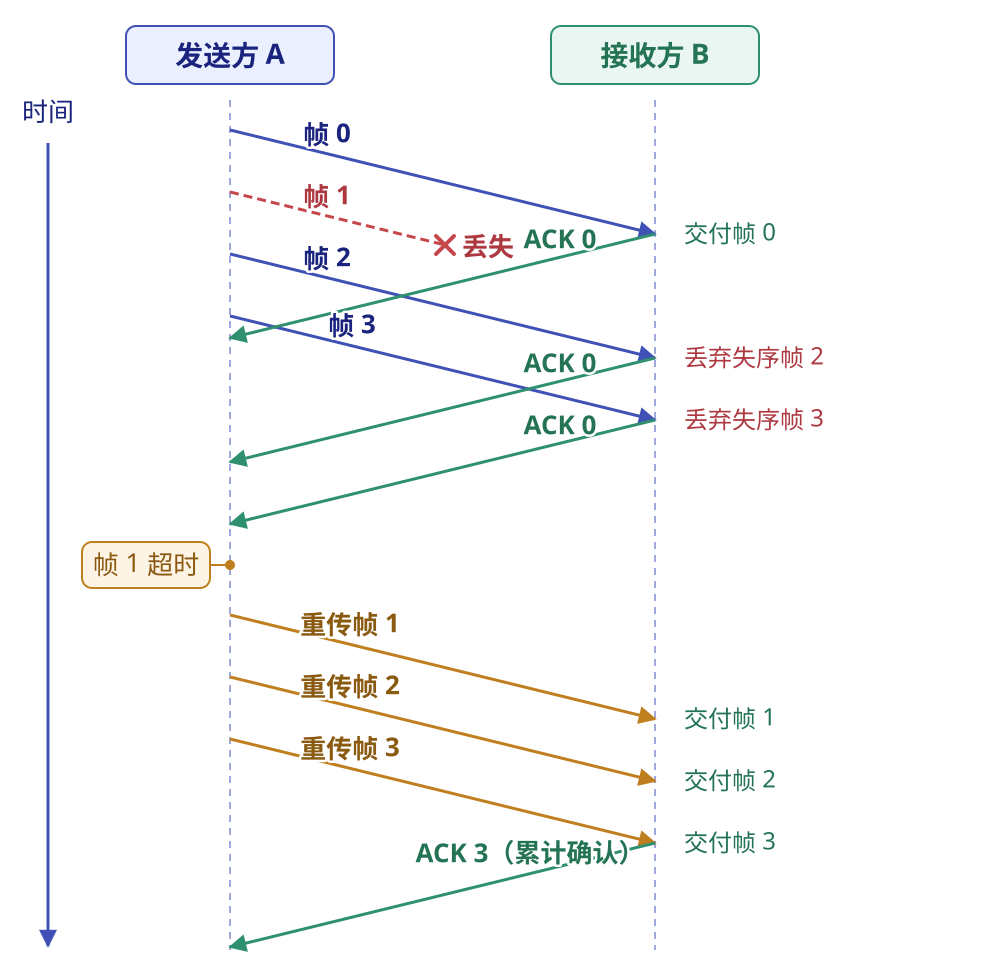{:width="80%"}

</figure>

#### 序号空间与窗口大小

假设我们使用 $n$ bit 对帧编号。GBN 的接收窗口大小恒为 1，而发送窗口大小应满足：

$$
1\le W_s\le2^n-1
$$

!!! question "$W_s \ge 2^n$ 会发生什么？"
    假设序号占用 3 bit，发送窗口设置为 8。发送方发出 `0～7`，接收方全部收到后，它开始等待下一轮的帧 8（由于 3 位限制发生**序号回绕**，编号还是 0）。若此时接收方发回的确认全部丢失，发送方按照机制超时重传旧帧 0。由于帧 8 和帧 0 的编号一样，接收方就会把它当成新一轮的数据。换句话说，由于存在序号回绕，如果占满序号空间，接收方将无法区分新帧和重传的旧帧。

    综上所述，序号空间中至少要留出一个编号。

GBN 的接收端处理简单，但一帧丢失就可能使后面已经正确到达的多帧被丢弃，这是很大的浪费。当信道误码率较高时，GBN 的性能甚至可能反而不如停等协议。

### 选择重传协议

了解了 GBN 的局限，人们设法让协议仅重传出错或超时的数据帧。**SR（Selective Repeat，选择重传）**就是这样的协议。

- 接收方接收、缓存正确到达且序号落在接收窗口内的帧，并对该帧单独确认。这一机制允许帧暂时失序到达。
- 接收窗口起点位置的帧到达后，接收方就可以把从窗口起点开始连续的数据按序交付网络层，再推进接收窗口。
- 发送方记录各帧的确认状态，**为每个未确认帧分别管理超时**，某帧超时就只重传该帧。
- 已经接收过的帧若因确认丢失而再次到达，接收方要识别重复并按协议再次确认，避免发送方一直重传。

同样发送 `0、1、2、3`，帧 1 丢失时，SR 接收方先交付 0，缓存并确认 2、3；发送方只需重传 1。待 1 到达，再依次交付 `1、2、3`。

<figure markdown="1">

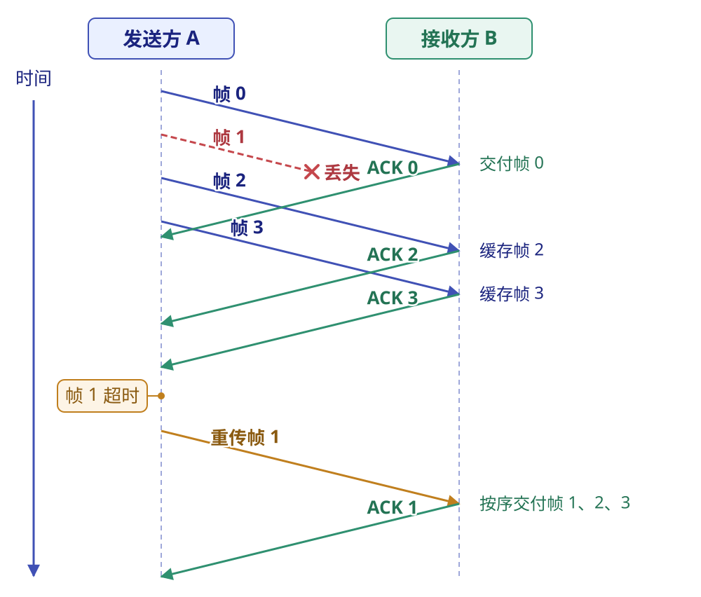{:width="80%"}

</figure>

#### 序号空间与窗口大小

由前面的分析，显然，SR 的发送窗口和接收窗口都大于 1。假设我们依然使用 $n$ bit 对帧编号，则 SR 的窗口设计应该满足两个条件：

-   $W_s + W_r \le 2^n$。否则，接收窗口向前滑动时，如果部分确认帧丢失，发送方此时需要重传旧序号的帧，这样就会发生因序号回绕造成无法区分的情况。
-   $W_r \le W_s$。因为接收窗口大于发送窗口的部分不可能被填充，因而浪费了资源。

这两个条件可以推出 $W_r \le 2^{n-1}$。实际应用中，通常令发送和接收窗口相等且尽可能大，以充分利用序号空间。

$$
W_s=W_r\le2^{n-1}
$$

#### 信道利用率

GBN 和 SR 都可以被称为**连续 ARQ 协议**。设发送窗口大小为 $N$，在其他条件理想的情况下，沿用前面的假设，信道利用率

$$
U = \min{\left\{1,\,\frac{Wt_f}{t_f + 2t_p + t_a}\right\}}.
$$

所以进一步可以推出，在理想情况下，完全利用链路需要的窗口大小

$$
W = \left\lceil\frac{t_f + 2t_p + t_a}{t_f}\right\rceil
$$

!!! tip "三类 ARQ 协议对比"

    | 比较项 | 停等 ARQ | GBN | SR |
    | --- | --- | --- | --- |
    | 发送窗口 | 1 | 至多 $2^n-1$ | $W_s+W_r\le2^n$ |
    | 接收窗口 | 1 | 1 | $1 < W_r \le W_s$ |
    | 窗口内乱序帧 | 不会提前接收后续新帧 | 丢弃 | 缓存 |
    | 确认方式 | 逐帧确认 | 累积确认 | 每帧单独确认 |
    | 超时重传 | 当前未确认帧 | 从最早未确认帧起， 重传后续已发送未确认帧 | 仅重传相应的未确认帧 |
    | 主要代价 | 往返等待较多 | 差错时可能重复发送多帧 | 乱序缓存与确认、计时管理更复杂 |

## 点对点协议 PPP

我们介绍一个数据链路层的协议实例，**PPP（Point-to-Point Protocol，点对点协议）**。它仅支持全双工的点对点链路，把网络层分组封装后传送。它常用于网络设备之间或主机到 ISP（本地互联网提供商）间的传输。

它有三个组成部分：

- **成帧方法**：识别帧边界，并用 FCS 检错。
- **LCP（链路控制协议）**：建立、配置、测试和终止链路，协商最大接收单元、鉴别方式等。
- **NCP（网络控制协议族）**：为不同网络层协议配置参数，例如 IPCP 用于 IPv4。

### 帧格式与透明传输

PPP 是面向字节的，即 PPP 帧的逻辑字段按字节组织。采用默认 16 位 FCS 的未压缩 PPP 帧的结构如下：

<figure markdown="1">

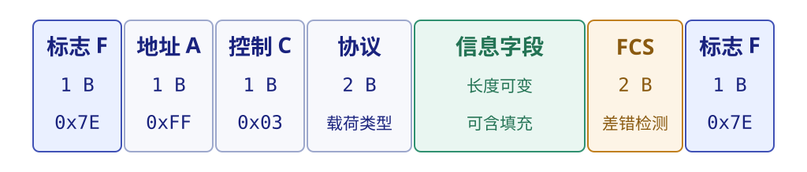{:width="90%"}

</figure>

协议字段指明载荷类型，例如 `0x0021` 表示 IPv4，`0xC021` 表示 LCP。信息字段的最大长度可以协商，常用值为 1500 B；点对点链路不争用共享介质，因此没有以太网式的最小数据字段要求。

- 异步传输时，信息字段采用**字节填充**：规定 `0x7E → 0x7D 0x5E`，`0x7D → 0x7D 0x5D`；其他控制字符按协商规则转义。
- 同步传输时，比特填充形式采用**零比特填充**，即连续 5 个 1 后插入 0。

### 链路建立与释放

<figure markdown="1">

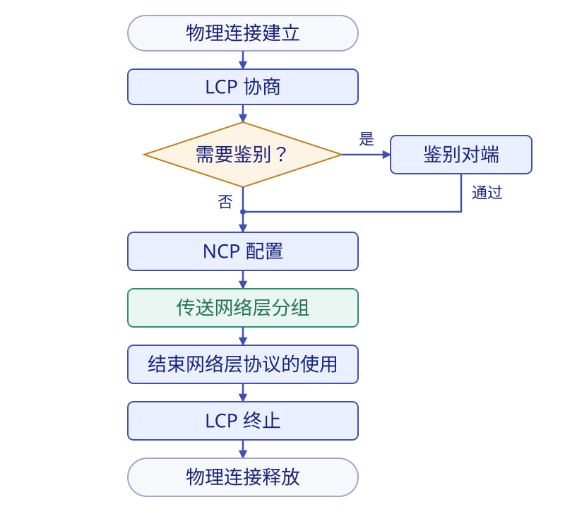{:width="70%"}

</figure>

**PPP 的数据传送不使用数据帧序号、逐帧确认和超时重传**。它发现校验错误就丢弃该帧，可靠交付由需要它的上层协议完成。这就是说，PPP 提供 **有连接的不可靠服务**。

PPP 规定了链路协议，下层的技术负责承载它。例如，Packet over SONET 使用 PPP 封装，再由 SONET 承载；ADSL 可以使用 PPPoE，先把 PPP 报文封装进以太网帧，也存在经 AAL5/ATM 承载的方式。
