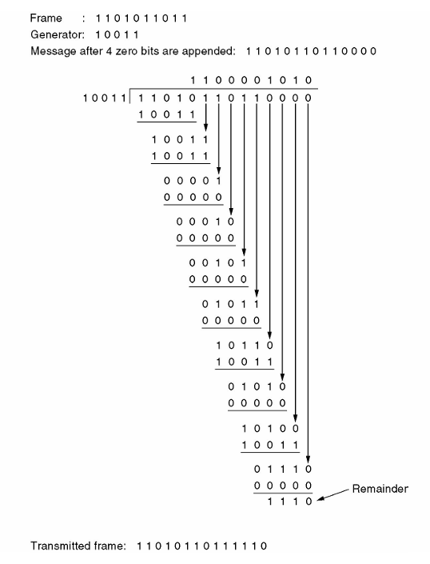

# 数据链路层

物理层把比特送到链路另一端，数据链路层进一步把这些比特组织成**帧（frame）**，向网络层提供相邻节点之间的数据传送服务。我们需要解决三个基本问题：**怎样识别一帧、怎样处理差错、怎样协调收发速度**。

## 数据链路层的服务

**链路**是相邻节点之间的一段物理通路；在链路上加上实现通信协议的软硬件，就形成了**数据链路**。主机跨网络通信时，沿途的每一段数据链路分别传送自己的帧。

```text
源主机 ── 帧 ── 路由器 ── 帧 ── 路由器 ── 帧 ── 目的主机
            ↑ 解封装、查路由、重新封装 ↑
```

不同链路可以采用不同的帧格式。路由器收到帧后取出网络层分组，再把它封装到下一段链路的帧中。

| 服务 | 怎样传送 | 适用场景 |
| --- | --- | --- |
| **无确认无连接服务** | 不预先建立连接，接收方不逐帧确认 | 误码率较低的链路，例如以太网 |
| **有确认无连接服务** | 不预先建立连接，对需要可靠交付的帧进行确认与重传 | 无线链路，例如 802.11 的单播数据传输 |
| **有确认面向连接服务** | 先建立连接，再通过编号、确认等机制按序传送，最后释放连接 | 需要在链路层维护可靠连接的场景 |

**链路管理**负责连接的建立、维持和释放；**流量控制**限制发送方的发送速度，使接收方来得及处理；**差错控制**处理比特出错、帧丢失和重复等问题。具体采用哪些功能，由链路协议决定。

## 成帧与透明传输

发送方为网络层交下来的数据添加控制信息，构成帧（frame）；接收方则从连续的比特流中找出帧的边界。

**透明传输**要求数据中可以出现任意比特组合。即使数据恰好与帧定界符相同，也应当作为普通数据交付给上层。

### 字节计数法

在帧首部设置长度字段，接收方按长度确定帧的结束位置。若计数字段本身也计入帧长，那么发送 `A B C D` 四个字符、计数字段占 1 B 时，计数值应为 5。

这种方法的主要问题是：**长度字段出错会使接收方找错帧边界，连带影响后续帧的同步**。实际协议可以把长度与定界标志、校验结合使用。

### 字节填充法

用特殊字节 `FLAG` 标记帧边界，用 `ESC` 表示转义。发送方遇到数据中的 `FLAG` 或 `ESC`，就在它前面插入一个 `ESC`；接收方遇到 `ESC` 后，把紧随的字节作为普通数据恢复。

```text
原始数据：       A B ESC FLAG
填充后的帧：FLAG A B ESC ESC ESC FLAG FLAG
```

帧首、帧尾的 `FLAG` 是定界符，中间经转义的 `FLAG` 是数据。

### 零比特填充法

用 `01111110` 作为帧的起止标志。在两个标志之间，发送方每遇到 **5 个连续的 1**，就插入一个 0；接收方识别出帧边界后，删除每 5 个连续的 1 后面的填充 0。

例如，数据 `01111110` 填充后变成 `011111010`。**定界标志本身不参与填充**，所以接收方仍然能找到帧的边界。

### 物理层编码违例法

利用物理层编码中不用于表示普通数据的信号组合来定界。例如，曼彻斯特编码的每位中间都有跳变，可以借助不符合正常数据编码规则的组合表示控制信息。这种方法需要底层编码保留可用的冗余状态。

## 差错检测与纠正

传输中可能出现孤立的比特错误，也可能连续一段受到干扰而形成**突发差错**。两种基本处理思路是：

- **检错后重传**：增加校验信息，检测出错后丢弃，由可靠传输协议安排重传。
- **前向纠错（FEC）**：增加足够的冗余，使接收方能直接恢复一定范围内的错误。

链路误码率低且反馈方便时，检错加重传通常更经济；重传代价高、时延要求严格时，纠错编码更有价值。

### 海明距离与码距

两个等长码字的**海明距离（Hamming distance）**，是对应位置上不同的比特数，也就是两码字异或后 1 的个数。一个编码集的**最小码距** $d_{\min}$，取所有不同合法码字之间距离的最小值。

$$
\text{检测至多 }e\text{ 位错误：}\quad d_{\min}\ge e+1
$$

$$
\text{纠正至多 }t\text{ 位错误：}\quad d_{\min}\ge2t+1
$$

检错要求错误发生后不会变成另一个合法码字；纠错还要求接收结果能够唯一地归到原码字。码距为 3 的编码可用于检测双比特错误，或纠正单比特错误。若要**纠正单错并识别双错**，需要最小码距至少为 4。

### 奇偶校验与校验和

**奇偶校验**增加 1 位，使整个码字中 1 的总数保持为奇数或偶数。它能检测所有奇数位翻转，偶数位翻转会保持原有奇偶性。

**因特网校验和**把数据按 16 bit 分组，用反码加法求和：最高位产生的进位回卷加到最低位，最后对结果取反。计算时若数据长度为奇数字节，末尾补零参与运算。接收方把收到的校验和一起相加，正常结果为全 1。

### 循环冗余校验

**CRC（Cyclic Redundancy Check）**把比特串视为系数为 0 或 1 的多项式。例如 `1101` 表示 $x^3+x^2+1$。运算在模 2 下进行，加法和减法都用异或，不进位、不借位。

设数据多项式为 $M(x)$，生成多项式为 $G(x)$，其**最高次数为 $r$，对应的比特串长 $r+1$**。

1. 在数据后补 $r$ 个 0，得到 $x^rM(x)$。
2. 用 $G(x)$ 做模 2 除法，得到余数 $R(x)$。
3. 把余数补足为 $r$ 位，替换末尾的 $r$ 个 0，作为**帧检验序列（FCS）**发送。
4. 接收方用相同的 $G(x)$ 除收到的整个码字，余数非零时丢弃。

$$
T(x)=x^rM(x)+R(x),\qquad T(x)\bmod G(x)=0
$$

若差错多项式 $E(x)$ 恰好能被 $G(x)$ 整除，就会漏检。选择生成多项式时，正是要让常见差错尽可能破坏整除关系。

!!! example "CRC 计算"

    数据为 `1101011011`，生成多项式为 `10011`，所以 $r=4$。用 `10011` 除 `11010110110000`，余数为 `1110`，最终发送 **`11010110111110`**。

    { width="550" style="display: block; margin: 0 auto;" }

### 海明码

设信息位为 $m$ 位、校验位为 $r$ 位。要区分“无错”和每一种单比特出错位置，需要：

$$
2^r\ge m+r+1
$$

构造时，把校验位放在位号 $1,2,4,8,\ldots$，其余位置放信息位。每个位置由其二进制位号中为 1 的那些校验位共同检查。例如，$11=8+2+1$，所以第 11 位参加第 1、2、8 组校验。

接收方重新计算各组奇偶性，把出错校验组对应的位号相加，得到**校正子（syndrome）**。在至多一位出错的条件下，非零校正子指出应翻转的位置。

!!! example "从校正子恢复数据"

    从左向右编号，收到 `1110 0100 1111`，采用偶校验且至多一位出错。第 1、4、8 组通过，第 2 组未通过，因此翻转第 2 位，恢复码字 `1010 0100 1111`。

    再去掉第 1、2、4、8 位，得到原始数据 `1010 1111`，即 `0xAF`。**先确认编号方向，再分组校验。**

### 其他纠错编码

- **卷积码**：输出既取决于当前输入，也取决于之前的输入，编码器具有记忆。
- **Reed–Solomon 码**：以多比特符号为单位，适合处理突发差错。一个码块含 $N$ 个符号，其中 $K$ 个为信息符号时，可纠正至多 $\lfloor(N-K)/2\rfloor$ 个未知位置的符号错误，或恢复至多 $N-K$ 个已知位置的擦除。
- **LDPC 码**：使用稀疏校验矩阵，通过迭代译码逼近合法码字，适合较长码块。

## 从停等到滑动窗口

### 停等协议怎样保证可靠传输

若信道完全无错、接收方始终准备就绪，发送方可以连续发送。接收方处理速度有限时，就需要**停止—等待（stop-and-wait）**：发送一帧，收到许可后再发下一帧。

在有差错的信道上，还要增加**确认、超时计时器和序号**，形成停等 ARQ。

| 情况 | 发送方与接收方的动作 |
| --- | --- |
| 数据帧正确到达 | 接收方交付数据并确认；发送方收到确认后发下一帧 |
| 数据帧丢失或校验失败 | 接收方未接收有效数据；发送方超时后重传 |
| ACK 丢失 | 发送方超时重传；接收方识别出重复帧，不重复交付，但再次确认 |

停等协议只需交替使用 0、1 两个序号。发送方在收到确认前保留原帧副本，接收方记住当前期望的序号。

### 捎带确认

双方都有数据要发时，可以把确认号放入反向数据帧中，这叫**捎带确认（piggybacking）**。它减少了单独 ACK 的开销；等待反向数据的时间需要受限，若迟迟没有数据，就应单独发送确认。

做题时先看 ACK 的定义：**ACK $n$ 可以表示“已经收到 $n$”，也可以表示“下一帧期望 $n$”**。后一种含义下，被累计确认的是 $n$ 之前的帧。TCP 的确认号采用“下一个期望字节”的含义。

### 发送窗口与接收窗口

**发送窗口**规定允许发送、但尚未全部确认的序号范围；**接收窗口**规定接收方当前允许接收的序号范围。发送方可以在确认返回前连续发送多个帧，形成流水线。

- 发出一个新帧，会占用一个未确认位置。
- 收到确认后，发送窗口向前滑动，新的序号进入可发送范围。
- 接收方按协议接收、缓存与交付数据，随后滑动接收窗口。

### 后退 N 帧与选择重传

| 比较项 | **GBN：后退 N 帧** | **SR：选择重传** |
| --- | --- | --- |
| 接收窗口 | $W_r=1$ | 通常 $W_r=W_s>1$ |
| 乱序帧 | 丢弃 | 在接收窗口内则缓存 |
| 确认方式 | 累积确认 | 逐帧确认 |
| 超时重传 | 从最早未确认帧开始，重传其后所有已发送但未确认的帧 | 仅重传超时的帧 |
| 缓存与管理 | 接收端简单 | 需要缓存乱序帧、管理各帧确认和计时 |
| $n$ bit 序号限制 | $W_s\le2^n-1$ | $W_s+W_r\le2^n$；等大时 $W_s\le2^{n-1}$ |

窗口限制用来避免**旧帧重传与新一轮同号帧混淆**。例如序号为 3 bit 时，GBN 最大发送窗口为 7，等窗口 SR 最大为 4。

假设连续发送帧 0、1、2、3，其中帧 1 丢失。GBN 接收方收下 0，丢弃失序的 2、3，发送方之后重传 1、2、3；SR 接收方先缓存 2、3，等待重传的 1 到达后，再按序交付 1、2、3。

## 信道利用率

设数据帧长 $L$ bit，链路速率为 $R$ bit/s，单向传播时延为 $t_p$，确认帧发送时延为 $t_a$。忽略处理与排队，且数据和确认均正确到达：

$$
t_f=\frac LR,\qquad T_{\mathrm{周期}}=t_f+2t_p+t_a
$$

停等协议的发送方利用率为：

$$
U=\frac{t_f}{t_f+2t_p+t_a}
$$

忽略确认帧长度，令 $a=t_p/t_f$，则 $U=1/(1+2a)$。传播时延相对发送时延越大，等待造成的浪费越明显。

窗口为 $W$ 的连续发送协议，在确认信道不成为瓶颈的上述理想条件下：

$$
U=\min\left\{1,\frac{Wt_f}{t_f+2t_p+t_a}\right\}
$$

要连续占满发送链路，窗口至少应为：

$$
W_{\min}=\left\lceil\frac{t_f+2t_p+t_a}{t_f}\right\rceil
$$

!!! example "有效载荷利用率"

    速率为 100 Mbit/s，单向传播时延为 $12\,\mu\mathrm{s}$；数据帧含 100 B 载荷和 40 B 首部，ACK 长 60 B。

    数据帧发送耗时 $11.2\,\mu\mathrm{s}$，ACK 发送耗时 $4.8\,\mu\mathrm{s}$，停等周期为 $11.2+24+4.8=40\,\mu\mathrm{s}$。

    - 按整个数据帧计算，利用率为 $11.2/40=28\%$。
    - 按有效载荷计算，利用率为 $8/40=20\%$，有效吞吐量为 20 Mbit/s。

    **分子是否包含首部，决定了算的是帧发送利用率还是有效载荷利用率。**

## 点对点协议 PPP

**PPP（Point-to-Point Protocol）**用于点对点链路，把网络层分组封装后传送。它有三个组成部分：

- **成帧方法**：识别帧边界，并用 FCS 检错。
- **LCP（链路控制协议）**：建立、配置、测试和终止链路，协商最大接收单元、鉴别方式等。
- **NCP（网络控制协议族）**：为不同网络层协议配置参数，例如 IPCP 用于 IPv4。

### 帧格式与透明传输

基本的未压缩 PPP 帧可写成：

```text
标志 F | 地址 A | 控制 C | 协议 | 信息字段 | FCS | 标志 F
 1 B      1 B      1 B     2 B     可变      2 B    1 B
 7E       FF       03
```

协议字段指明载荷类型，例如 `0x0021` 表示 IPv4，`0xC021` 表示 LCP。信息字段的最大长度可以协商，常用值为 1500 B；点对点链路不争用共享介质，因此没有以太网式的最小数据字段要求。

- 异步传输采用**字节填充**：`0x7E → 0x7D 0x5E`，`0x7D → 0x7D 0x5D`，其他控制字符按协商规则转义。
- 同步的比特填充形式采用**零比特填充**：连续 5 个 1 后插入 0。

### 链路建立与释放

```text
物理连接建立 → LCP 协商 → 按需鉴别 → NCP 配置 → 传送网络层分组
                                              ↓
物理连接释放 ← LCP 终止 ← 结束网络层协议的使用
```

PPP 的数据传送不使用数据帧序号、逐帧确认和超时重传。它发现校验错误就丢弃，可靠交付由需要它的上层协议完成。

**Packet over SONET** 使用 PPP 封装，再由 SONET 承载；ADSL 可以使用 PPPoE，先把 PPP 报文封装进以太网帧，也存在经 AAL5/ATM 承载的方式。这里要分清：**PPP 规定链路协议，下面的技术负责承载它。**
