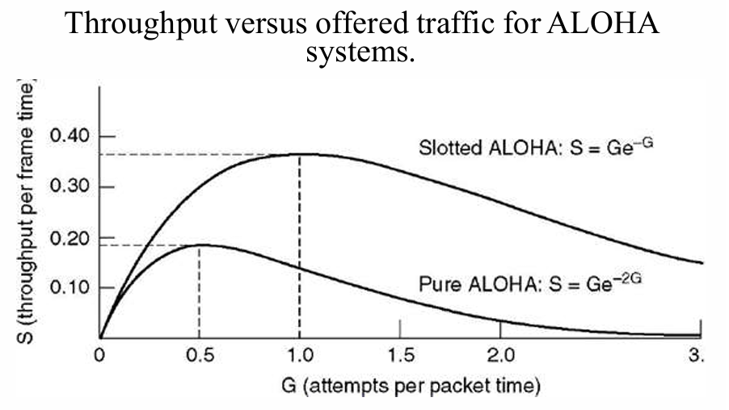
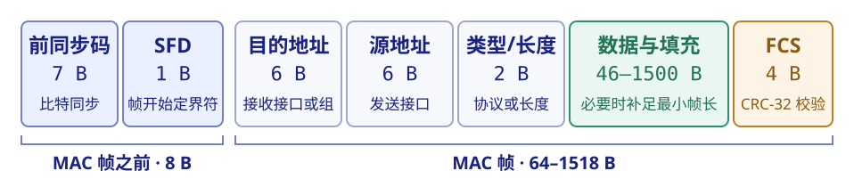
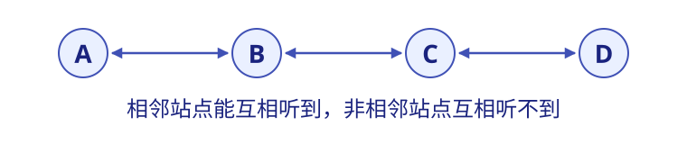
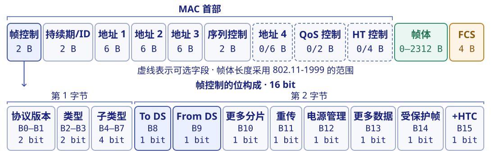
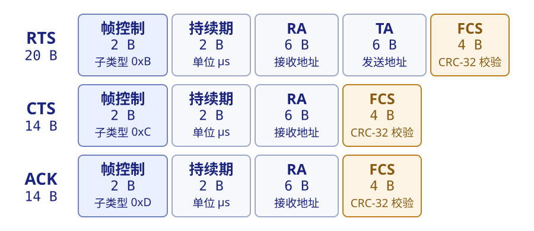
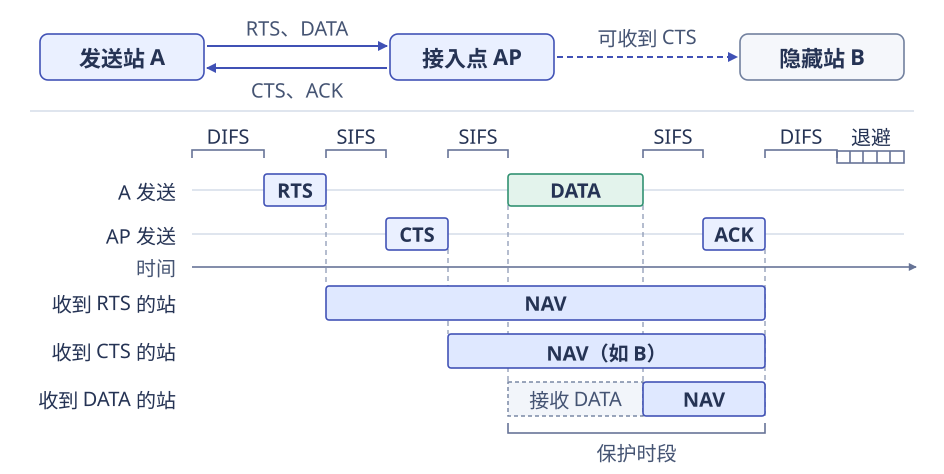
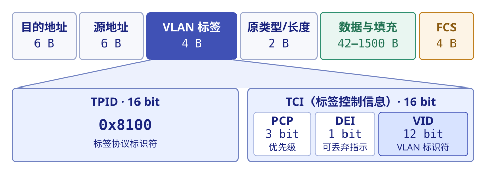

# 介质访问控制

前面我们主要聚焦在点对点信道的协议。而多个站点共享一条广播信道时，会带来另一个核心问题：**“谁可以在什么时候发送？”**也就是介质访问的问题。

IEEE 802 体系把数据链路层分为 **LLC（逻辑链路控制）**和 **MAC（Medium Access Control，介质访问控制）** 两个子层。LLC 提供与具体介质无关的链路服务；MAC 处理 **介质访问**、帧的封装与识别、MAC 寻址和差错检测。控制和协调介质访问是 MAC 层的主要功能。本章我们就会学习常见的介质访问控制方法。

在了解具体的方法之前，我们不妨先宏观把握一下：所谓介质访问，换个说法就是信道的分配。那我们当然有两类分配方式：

-   预先固定分配。我们将这类方式称为 **静态分配（Static Channel Allocation）**。
-   随发送需求灵活分配。我们将这类方式称为 **动态分配（Dynamic Channel Allocation）**。

## 静态复用方法

!!! warning "王道中将这种访问控制称为“信道划分介质访问控制”。由于名称上的高度重合，我没有采用其名称作为本节标题。"

我们在[复用](./physical.md#复用)已经讨论过一些复用的策略。事实上在 MAC 层，我们依然采用这些复用策略。

这种固定分配方式有一个很明显的局限性，那就是无法适应突发流量（Bursty traffic）：用户数量固定、业务持续时，这种方法简单有效；网络流量具有突发性时，空闲用户的份额会被闲置，而忙碌用户仍然需要等待。此外，当用户数动态变化时，扩展的成本也比较高。

!!! note "TDM 的改进——STDM"
    即统计时分复用。这是一种 **动态分配方式**，仅当用户有数据要发送时，才为其分配 STDM 帧中的时隙。

### 静态划分的排队代价 \*

本段内容是教材上的内容。但由于考试似乎不怎么考（考研更是没有），我这里也就不再赘述。

!!! info "拓展信息"
    参考教材：Tanenbaum、Feamster 和 Wetherall 的 [《Computer Networks》第 6 版 §4.1.1 “Static Channel Allocation”](https://unidel.edu.ng/focelibrary/books/103computer%20networks.pdf)（Global Edition 第 268–269 页）。

    书中采用的是 M/M/1 排队模型。有关 M/M/1 排队模型，可以参看[维基百科条目](https://zh.wikipedia.org/wiki/M/M/1)；其推导可以看 Bertsekas 和 Gallager 的 [《Data Networks》第 3 章 §3.3](https://web.mit.edu/dimitrib/www/Queueing_Data_Nets.pdf)。

## 随机访问协议

也可以叫多路访问协议。

### ALOHA

!!! info "你知道吗..."
    ALOHA 是夏威夷语里打招呼的语句。ALOHA 协议是 1968 年由夏威夷大学开发的最早无线数据通信协议，因而得名。

-   **纯 ALOHA**
    
    它的基本思想是，在总线形网络中有站点有数据要发送，那就发送，而无需检测信道状态。若在规定时间内未收到确认，就视为信道上产生了**冲突**，站点等待随机时间后重传。

    设每帧发送时间均为 $T$。对于从时刻 $t$ 开始的一帧，其他帧若在 $(t-T,t+T)$ 内开始发送，就会与它在发送阶段发生重叠，因此**冲突危险期**长 $2T$。

-   **时隙 ALOHA**

    纯 ALOHA 的冲突率很高，这导致其吞吐量很低。于是，人们提出一种改进：把时间分成长度为 $T_0$ 的时隙，要求各站同步时钟；各站只能在时隙起点发送，一帧的发送时延不能超过一个时隙长度。
    
    这种情况下，冲突只发生在选择同一时隙的帧之间，危险期可以缩短为 **$T_0$**。

在固定帧长、发送尝试服从泊松分布的模型下，设每帧时间内平均发送尝试次数为 $G$（其中包含新帧与重传帧），归一化吞吐量为 $S$：

| 协议 | 吞吐量 | 最大值 |
| --- | --- | --- |
| 纯 ALOHA | $S=Ge^{-2G}$ | $G=1/2$ 时取得，$S_{\max}=1/(2e)\approx18.4\%$ |
| 时隙 ALOHA | $S=Ge^{-G}$ | $G=1$ 时取得，$S_{\max}=1/e\approx36.8\%$ |

<figure markdown="1">

{:width="85%"}

</figure>

### 载波监听多路访问

ALOHA 协议冲突概率较高。一个很重要的原因是，它对站点发送前信道的状态没有要求。如果我们要求每个站点在发送前先监听信道，就可以显著降低冲突率了。

**CSMA（Carrier Sense Multiple Access，载波监听多路访问）**就在 ALOHA 协议的基础上，要求站点先监听信道，再决定是否发送。

| 协议 | 信道空闲时 | 信道忙时 | 主要取舍 |
| --- | --- | --- | --- |
| **1-坚持 CSMA** | 立即发送 | 持续监听，空闲后立即发送 | 等待站容易同时起发 |
| **非坚持 CSMA** | 立即发送 | 不再监听，等待随机时间后再监听 | 减少集中争用，但可能闲置已空闲的信道 |
| **p-坚持 CSMA** | 以概率 $p$ 立即发送，以概率 $1-p$ 推迟到下一时隙 | 等到下一时隙再监听 | 用概率在冲突与等待之间取舍 |

以 p-坚持 CSMA 为例计算平均等待时间。设时隙长为 $t$，不考虑信道忙的情况。p-坚持协议在首次判断时立即发送的概率为 $p$，那么发送前平均推迟 $\dfrac{1-p}p$ 个时隙，因此平均等待时间为 $\dfrac{(1-p)t}p$。

### CSMA/CD

**CSMA/CD** 是基于 CSMA 的改进，用于总线形或半双工的网络环境，其机制可概括为**先听后发，边发边听，冲突停发，随机重发**：

1. 监听信道，按 1-坚持规则等待发送机会。
2. 发送过程中继续检测冲突。
3. 检测到冲突，停止正常数据发送。
4. 按退避算法等待，然后重新竞争。

传播需要时间，所以一个站刚开始发送时，远处另一个站仍可能监听到空闲。设最远两站的单向传播时延为 $\tau$。一站开始发送后，最坏要经过 **$2\tau$** 才能发现冲突，这段时间称为**争用期**。只有争用期结束仍然没有检测到冲突，才能确定本次发送成功。

假设某站发了一个很短的帧，在发送完成前没有检测到冲突。但在传播过程中，该帧与其他正在传播的帧发生了冲突，导致目的站收到了错误帧并按策略丢弃，而发送站却不知情，如果网络采用了不可靠传输，那发送站也不会重传。这个问题是需要避免的。

所以我们需要一个最短帧长，使得站点能够在发送结束前检测到冲突，同时，任何长度小于最短真长的帧都应该是无效帧，需要丢弃。设最短帧长 $L_{\mathrm{min}}$，数据率 $R_b$，则：

$$
t_s = \frac{L_{\min}}{R_b}\ge2\tau \Rightarrow L_{\min}\ge2\tau R_b
$$

!!! success "$2\tau$ 的来历"
    假设现在线路空闲，有两个站点 A 和 B 都要发送数据。$t = 0$ 时，A 开始发送。在 $t = \tau - \delta\,(\delta \gt 0)$ 时，因为 B 站监听仍然认为线路空闲，B 开始发送数据。再经过 $\dfrac {\delta}2$ 时间，AB 两站的数据发生冲突。B 在 $t = \tau$ 时刻发现了冲突；A 在 $t = 2\tau - \delta$ 时刻发现了冲突。
    
    $$
    \delta \to 0, t \to 2 \tau
    $$

    所以对 A 站来讲，发现冲突的时刻最迟无限接近 $2\tau$。

!!! example "最短帧长与网络直径"

    假设某链路速率为 1 Gbit/s，长度为 1 km，传播速度为 $2\times10^8\,\mathrm{m/s}$，忽略中继等额外时延。

    则单向传播时延为 $5\,\mu\mathrm{s}$，需要的最短帧长至少为 $10^9\times10\times10^{-6}=10000$ bit，即 **1250 B**。

    距离固定时，速率越高，就需要越长的帧来覆盖争用期。

#### 截断二进制指数退避

CSMA/CD 采用这一算法来确定重传时机。第 $i$ 次冲突后，令：

$$
k=\min\{i,10\},\qquad r\in\{0,1,\ldots,2^k-1\}
$$

每次从允许的集合中均匀随机地选择 $r$，等待 $r$ 个基本退避时隙（$2\tau$）。前几次的选择范围依次为 $\{0,1\}$、$\{0,1,2,3\}$、$\{0,\ldots,7\}$，重传第 10 次以后，$k$ 不再变化，因而等待的退避时隙数最大为 1023；连续 16 次发送尝试都发生冲突时，则判定网络过于拥堵，放弃传输该帧并向上层报告失败。

## 有限竞争协议：自适应树遍历

把站点放在二叉树的叶子上。竞争发生冲突时，先让一半站点竞争，再让另一半竞争；仍冲突就继续细分。

**低负载时，让较多站点一起竞争；高负载时，缩小竞争组**，这样就可以兼顾随机访问的低等待与受控访问的高负载效率。

## 无冲突协议

!!! question "主播主播，有没有完全避免冲突的办法？"
    有的有的。避免冲突，那就不能让各站点随机发送信息，而需要一个角色来协调，或者让站点之间约定一个发送顺序。

### 令牌传递协议

**令牌（token）**是一个特殊的控制帧，代表一种“发送许可”，沿（逻辑上的）环形网络依次传递。站点持有令牌时才可以发送，完成后把令牌交给下一站；没有待发数据就直接传递。

一个环形网络上只有一个令牌，这样就确保了同一时刻只有一个站点独占信道，发送次序可控、不会因同时争用而冲突。既然说是逻辑上的令牌环，那也当然可以建立在不同物理拓扑之上。

!!! note "IEEE 802.5 令牌环网络中令牌和数据的传递"
    1.  网络空闲时，环路中只有令牌帧在循环传递；
    2.  当令牌传递到有发送需求的站点时，该站点修改令牌中的一个标志位，并在令牌中附加需要传输的数据，从而将令牌变成一个“数据帧”将其发送出去；
    3.  现在，含有数据的令牌沿着环路传输，经过每个站点时站点就转发该帧，同时检查目的地址：如果它的目的地址与站点自己的地址相同，那就复制数据帧自己处理（它会继续转发）；
    4.  令牌绕了一圈回到源站点，源站识别出这是自己发出的帧后便 **不再转发**，并通过检验返回的帧判断传输过程中是否出错，若出错就安排重传；
    5.  源站处理完（数据发送完成）后，**重新生成** 一个令牌，并传递给下一站点开始下一次令牌循环，同时让出信道控制权。

令牌传递协议不依赖时间或空间上的隔离，非常适合高负载的广播信道。它本质上是 **轮询访问机制** 的一种：通过一个集中控制的监控站，以循环方式轮询每个节点。

### 基本位图协议

设有 $N$ 个站，并给它们编号。每轮先设置 $N$ 个预约位，对应到每个站点。第 $i$ 个站想发送时，就在对应于自己的预约位写 1；预约阶段结束后，各站按编号顺序发送。

若数据帧长为 $d$ bit，忽略其他开销：假设一轮只传一帧，效率为 $\dfrac d{N+d}$；若一轮传 $N$ 帧，则 $N$ 个预约位的开销由 $N$ 帧分摊，效率为 $\dfrac d{d+1}$。预约的开销固定，因此更适合高负载的情形。

### 二进制倒计数协议

各竞争站从最高位开始发送自己的二进制地址，信道按位执行逻辑或。若一个站发送 0，却观察到 1，就退出竞争；最后**编号最大的站**获得发送权。

该协议用地址位完成仲裁。若有 $N$ 个站、地址长 $\lceil\log_2N\rceil$ bit，每帧长 $d$ bit，则忽略其他开销时效率为 $\dfrac d{d+\lceil\log_2N\rceil}$。固定编号会形成优先级差异，可以通过调整优先级改善公平性。

## 局域网

### 网卡和 MAC 地址

**网络适配器**（Adapter）是嵌在计算机主板上的，它实现了计算机与外界局域网的连接，也被叫做 **网络接口卡**（简称网卡，NIC）。其内部内置处理器和存储器，是属于数据链路层的设备。

它和局域网之间通过电缆或双绞线以串行方式通信，和计算机之间则通过 I/O 总线以并行方式通信。它能够进行串行与并行数据的转换，也负责物理连接与电信号匹配、帧的发送与接收、帧的封装与拆封、介质访问控制、数据的编解码，以及数据缓存等。当网卡收到正确的帧时，会以 **中断** 的方式通知主机，并将数据交付上层。

**MAC 地址** 是 IEEE 802 工作组为局域网规定的一种 **48 位的全球唯一地址**，固化在网卡的 ROM 中，也被称为物理地址。地址可以由厂商分配，也可以本地配置。

通常，MAC 地址写成 `00:1A:2B:3C:4D:5E` 十六进制数的形式，其用于标识链路层接口。MAC 地址可以被分成三种：

- **单播地址**：对应一个接口（一对一）。
- **多播地址**：对应一组接口（一对多）。
- **广播地址**：设定为全 1，即 `FF:FF:FF:FF:FF:FF`，面向同一广播域（一对 all）。

首字节的最低位区分单播与组地址，次低位区分全局管理与本地管理。网卡接收与自己匹配的单播、相应多播及广播帧；混杂模式允许向软件交付更多收到的帧。

### 以太网

!!! info "有线局域网的经典实现"
    经典的有线局域网（Wired LAN）有三种实现：

    -   **IEEE 802.5 令牌环**。这种实现我们已经介绍过。它的逻辑拓扑为环形结构，物理拓扑为星形结构。
    -   **以太网**。它的逻辑拓扑为总线形结构，物理拓扑为星形结构。
    -   **IEEE 802.8 光纤分布数字接口（FDDI）**。它的逻辑拓扑为环形结构，物理拓扑为双环结构。

    以太网规约的第一个版本是有 DEC、Intel、Xerox 联合提出的 DIX V1；随后它被修订为第二版规约 DIX Ethernet V2，成为世界上 **首个局域网产品的规范**。在此基础上，IEEE 802.3 工作组制定了第一个 IEEE 以太网标准 IEEE 802.3。

    虽然严格来说，以太网应该是符合 DIX Ethernet V2 标准的局域网，但由于 IEEE 802.3 标准和 DIX Ethernet V2 标准差异极小，所以也常常将 IEEE 802.3 局域网简称为以太网。

以太网是目前最流行的有线局域网技术。它采用两项措施来简化通信：

-   采用 **无连接** 的方式。即它提供的是 **无连接不可靠的尽最大努力交付服务**，差错纠正由上层协议完成；
-   在 **经典 10 Mbit/s 以太网** 中，发送的数据采用曼彻斯特编码，以便接收端提取位同步信息。

#### 共享式和交换式以太网

**经典以太网**通常指早期速率为 **10 Mbit/s** 的以太网，其典型形式是使用同轴电缆或集线器的共享式网络。

时间向前迈进，人们通过改进物理层编码和传输技术提高了以太网的速率。我们把速率提高到 **100 Mbit/s 及以上** 的以太网称为**高速以太网**：其中，100 Mbit/s 称为**快速以太网**，1 Gbit/s 称为**吉比特以太网（千兆以太网）**，10 Gbit/s 称为**万兆以太网**。这些高速版本仍然沿用以太网的基本 MAC 帧格式。

速率提高之外，以太网的另一项重要变化，是从共享介质走向交换连接。

-   **共享式以太网**中，多个站点共用一条通信信道，共享带宽并处于同一个冲突域。同轴电缆把各站直接接到一条总线上；集线器虽然把布线变成了星形，但只是把收到的信号转发到其他端口，因此逻辑上仍然共享信道。站点以半双工方式工作，使用 **CSMA/CD** 协调发送。
-   **交换式以太网**中，交换机根据目的 MAC 地址转发帧，各端口隔离冲突域，多对端口可以并行通信。主机与交换机之间通常采用全双工的点对点连接，两条线分别负责发送和接收，因而双方可以同时发送和接收，没有介质争用引起的碰撞，因此，采用全双工时，**不使用 CSMA/CD**。若多个输入端口的帧需要从同一个输出端口发出，交换机通过排队和缓存处理。

以太网发展过程中常见的四种传输介质是**粗同轴电缆、细同轴电缆、双绞线和光纤**。它们在 10 Mbit/s 以太网中的适用情况如下。

| 传输介质 | 10 Mbit/s 标准 | 最大段长 | 最多节点数量 |
| --- | --- | --- | --- |
| 粗同轴电缆 | 10Base-5 | 500 m | 100 |
| 细同轴电缆 | 10Base2 | 185 m | 30 |
| 非屏蔽双绞线 | 10Base-T | 100 m | 2 |
| 850 nm 光纤对 | 10Base-FL | 2000 m | 2 |

**高速以太网的常用介质是双绞线和光纤**。双绞线适合楼内终端接入等短距离连接；光纤适合楼宇互联、骨干链路和有较强电磁干扰的环境。常见高速标准的介质要求和最大段长如下：

| 速率 | 标准 | 传输介质 | 最大段长 |
| --- | --- | --- | --- |
| 100 Mbit/s | 100Base-TX | 双绞线 | 100 m |
| 100 Mbit/s | 100Base-T4 | 双绞线 | 100 m；仅支持半双工 |
| 100 Mbit/s | 100Base-FX | 多模光纤 | 半双工点对点链路：412 m；全双工：2000 m |
| 1 Gbit/s | 1000Base-T | 双绞线 | 100 m |
| 1 Gbit/s | 1000Base-SX | 多模光纤 | 220～550 m，取决于光纤芯径和模态带宽 |
| 1 Gbit/s | 1000Base-LX | 多模或单模光纤 | 多模：550 m；单模：5000 m |
| 10 Gbit/s | 10GBase-T | 双绞线 | 100 m |
| 10 Gbit/s | 10GBase-SR | 多模光纤接 | OM1 33 m；OM2 82 m；OM3 300 m；OM4 400 m |
| 10 Gbit/s | 10GBase-LR | 单模光纤 | 10 km |
| 10 Gbit/s | 10GBase-ER | 单模光纤 | 40 km |

**半双工使用 CSMA/CD，全双工不使用 CSMA/CD**。

例如，同样是 100 Mbit/s，主机通过集线器共享信道时要使用 CSMA/CD；主机与交换机之间建立全双工链路时则不用。即使接入交换机，只要某条链路仍工作在半双工模式，该链路就仍需使用 CSMA/CD。

#### 以太网的 MAC 帧

未加 VLAN 标签的以太网 MAC 帧格式如下：

<figure markdown="1">

{:width="90%"}

</figure>

-   **一个以太网 MAC 帧最小为 64 B**（512 bit），因而数据最小为 46 B。争用期也因此为 512 bit 时间，根据 [CSMA/CD](#csmacd) 中的时延计算，对于 10 Mb/s 的以太网，争用期规定为 $51.2 \mu\mathrm{s}$。
-   最大传输单元（MTU）决定了数据的长度上限为 1500 B。
-   在实践中，类型／长度两种标准机制可以并存。由于数据端最大不会超过 1500，所以，该字段的值小于等于 1500 时按长度解释，大于等于 1536（`0x0600`）时按类型解释。例如 IPv4 类型为 `0x0800`，ARP 为 `0x0806`。虽然理论上从 1501 开始就可以用来解释类型，但是 `0x0600` 显然是更方便的选择。
-   实际发送时，每个帧前会插入 8 B 的前导码，包含 7 B 用于比特同步的前同步码和 1 B 的帧开始定界符以标志 MAC 帧的开始。它们不计入 MAC 帧长。
-   以太网的 **帧间最小间隔总是 96 bit 时间**。对于 10 Mb/s 的以太网，这个间隔就是 $9.6 \mu\mathrm{s}$。

!!! note "以太网应用 CSMA/CD 的特定工程选择"
    -   在站点检测到冲突时，除了停止发送，还要继续发送 32 bit 或 48 bit 的认为干扰信号，这被称为 **强化冲突信号（jam signal）**。

!!! warning "以太网帧不需要帧结束定界符"
    因为以太网规定了最小帧间间隔，接收方只要找到帧开始定界符，就可以认为其后连续到达的比特流属于同一帧。

    此外，以太网还采用了违规编码法的思想。例如，曼彻斯特编码是在每个码元中间有一次电压跳变，当发送方发送完一个帧后，不再发送其他码元，此时电压也不再跳变，这样接收方也可以找到帧的结束位置。这个位置往前数 4B 就是 FCS 字段，数据字段的结束位置也就能随之确定。

### 无线局域网

#### 组成与接入

无线局域网可以分成两大类，它们都由 IEEE 802.11 系列协议标准所规定。

-   **有固定基础设施无线局域网**（802.11a/b/g/n, etc.）

    这一类别在逻辑上采用星形拓扑，中心节点称为 **接入点（AP）**，在 MAC 层使用 **CSMA/CA 协议**。采用 802.11 系列协议的局域网通常也称 Wi-Fi。
    
    AP 和与之关联的站点构成 **基本服务集（BSS）**，这也是 802.11 协议规定的最小构件；此时 AP 即成为 BSS 的基站，站内通信或与外部站点的通信都必须通过这个 BSS 的 AP。跨 BSS 的通信就被称为漫游。
    
    配置 AP 时，需要赋予其一个不超过 32 B 的 **服务集标识符（SSID）** 和一个工作信道。SSID 也是该无线局域网的名称。多个 BSS 通过 **分配系统（DS）** 互联（通过 AP 接入），形成 **扩展服务集（ESS）**，从而对上层呈现为一个单一的 BSS。ESS 通过 **门户（Portal）**为无线用户提供接入有线以太网的能力，所以门户的作用就相当于网桥。

-   **无固定基础设施的移动自组织网络**

    802.11 规定了此类网络的名称是 ad hoc network；事实上，自组织模式也是 802.11 规定的一种工作方式。它允许站点不通过固定 AP，直接组成网络；此时，各移动站地位平等，各中间节点可能需要转发其他节点的数据，所以每个节点都兼具 **终端和路由器的功能**。
    
    自组网络通常由若干可移动设备在彼此邻近且存在通信需求时自发组建，每个移动站都要主动参与路由的发现与维护。自组网络也因而不适用针对固定网络的路由协议，而有专门的路由协议，可以独立于互联网运行。

无线局域网在物理层可以采用扩频、OFDM 和 MIMO 等技术。

#### 隐藏终端与暴露终端

<figure markdown="1">

{:width="80%"}

</figure>

- **隐藏终端问题**：A 与 C 互相听不到，却都能到达 B。A 向 B 发送时，C 可能也认为空闲并向 B 发送，这时在 B 处就会冲突。例如，B 是某局域网的 AP，A 和 C 是移动站点。
- **暴露终端问题**：B 向 A 发送时，C 听到 B 要发送数据，便推迟了向 D 的发送；若两组收发实际互不干扰，这次推迟就浪费了并行机会，降低吞吐量。

#### CSMA/CA

无线局域网中，网卡接收到的信号强度通常远小于其发送信号的强度，而且无线信道中信号强度的动态范围也很大，实现冲突检测的硬件成本很高。即使实现了，由于隐藏终端问题，冲突检测机制也无法发现所有冲突。

因此，802.11 协议定义了广泛用于无线局域网的 CSMA/CA 协议，不再进行“冲突检测”，而是实现“冲突避免”，尽量降低冲突发生的概率。

!!! note "802.11 的两种介质访问控制方式"
    -   **分布式协调功能（DCF）**。即各站自己通过争用信道获得发送权。任何 802.11 协议都必须实现这一功能。
    -   **点协调功能（PCF）**。即使用 AP 集中控制，用类似探寻的方法轮流分配发送权。这是 802.11 协议的可选方式，但实际上很少实现这一功能。

    我们可以看出，只有 DCF 才可能采用 CSMA/CA。

假设某个站点 A 想要发送数据，CSMA/CA 的基本过程是：

1.  发送前先检测信道。如果信道忙，则禁止发送。
2.  如果信道空闲，则需要先等待一段时间（被称为帧间间隔，IFS），以确保信道持续空闲。
    -   IFS 有 DIFS、PIFS，分别对应 DCF 方式和 PCF 方式。IFS 还有一种 SIFS（短 IFS），用于分隔同一对话中的连续帧。DIFS 的长度最长，PIFS 次之，SIFS 最短。
3.  如果 A 是 **首次尝试发送** 数据，那么等待后直接发送；如果不是，则进入争用期执行随机退避。
4.  执行随机退避时，站点会设置一个 **退避计时器**。退避计时器的设置值采用[截断二进制指数退避](#截断二进制指数退避)。在每一个时隙，若信道忙，则冻结计时器（推迟接入）；若空闲，则计时器进行倒计时，每个时隙 -1。当计时器的值减至 0 时，站点才会发送整个数据帧并等待确认。
5.  接收方正确收到后，间隔返回确认；发送方若超时未收到确认，则依据阶段二进制指数退避规则扩大竞争窗口，重新进行随机退避。
    -   成功发送后若还有数据待发，也需遵循后续退避规则。这样可以避免同一站连续占住信道。

CSMA/CA 概括起来就是“先打招呼，再发数据”。由于 CSMA/CA 中，发送方接收到确认才能发下一帧，因此它实际上是一种 **停止-等待式的可靠传输协议**。

#### 无线局域网的 MAC 帧

802.11 的帧分为**数据帧、控制帧和管理帧**。这里主要介绍数据帧以及 RTS、CTS 和 ACK 三种控制帧。

常见 802.11 数据帧的格式如下所示。

<figure markdown="1">

{:width="100%"}

</figure>

-   图中帧控制的 B15 +HTC，同一位在 802.11-1999 标准中被称为 **Order（顺序位）**。
-   对于普通站点与 AP 之间的数据帧，**去往 AP（To AP）** 和 **来自 AP（From AP）** 分别对应图中的 **To DS** 和 **From DS**。DS 在这里指分配系统。
-   QoS 数据帧会包含 QoS 控制字段，满足相应条件时还可包含 HT 控制字段。

802.11 数据帧首部中最值得关注的是四个 MAC 地址字段，而它们的具体含义由帧控制字段中的两个标志位 To DS 和 From DS 共同决定。

| 方向 | To DS | From DS | 地址 1：接收方 | 地址 2：发送方 | 地址 3 | 地址 4 |
| --- | --- | --- | --- | --- | --- | --- |
| 站点发给 AP | 1 | 0 | AP | 源站点 | 目的地址 | —— |
| AP 发给站点 | 0 | 1 | 目的站点 | AP | 源地址 | —— |
| AP 发给 AP | 1 | 1 | 源 AP | 目的 AP | 最终目的地址 | 源目的地址 |

例如，我们考虑同一 BSS 内，A 经 AP 向 B 发送的过程：上行帧中的三个地址依次为 **AP、A、B**，下行帧中的三个地址依次为 **B、AP、A**。若目的主机在另一 IP 子网，上行的地址 3（目的地址）应填 **本子网网关的 MAC 地址**。

控制帧的格式则如下所示。

<figure markdown="1">

{:width="90%"}

</figure>

**RTS** 的 RA（接收地址）和 TA（发送地址）分别标识本次无线传输的接收方和发送方。**CTS** 回复 RTS 时，把 RTS 的 TA 填入自己的 RA。**ACK** 确认数据帧时，把该数据帧的地址 2 填入自己的 RA。RTS 和 CTS 的**持续期**字段用于下面的信道预约。

#### 信道预约

802.11 协议规定各站采用 **虚拟载波监听** 机制。源站发送数据前，利用帧首部的**持续期（Duration/ID）**字段，告知周围所有可达的站点本次占用信道的时间（包括接收站返回 ACK 所需的时间）。旁站正确收到 RTS、CTS 或 DATA 中的任一帧后，可以用其中的持续期更新自己的**网络分配向量（NAV，Network Allocation Vector）**。

即使在帧间隔内暂时检测不到无线信号，**只要 NAV 大于 0，站点就把信道视为忙**，推迟接入并冻结尚未完成的退避计时。这也是“虚拟”的含义：这一机制并不实际监听物理信道，而是根据得到的通知主动避让，等效于持续监听。只有物理载波监听判定信道空闲且 NAV 为 0，站点才按前文的 DIFS 和退避规则争用信道。

为了缓解隐藏终端问题，802.11 协议还允许站点进行 **信道预约**，可以提前把持续期告知发送方和接收方附近的站点。现在，我们假设有 A、B 两站互为隐藏站，而它们都能与 AP 通信。现在，A 想要发送数据，并检测到信道空闲，那么启用信道预约时会按照下图进行。

<figure markdown="1">

{:width="100%"}

</figure>

-   RTS（Request To Send）即请求发送，CTS（Clear To Send）即允许发送。
-   B 听不到 A 的 RTS 或 DATA，但能收到 **AP 发给 A 的 CTS**。B 由此设定 NAV，避让到 ACK 结束，从而减少自己向 AP 发送时与 A 的数据帧在 AP 处发生冲突的可能。
-   RTS 本身也可能发生冲突。A 若未能收到 CTS，就按退避规则重新争用信道。
-   这里的 NAV 就是前面提到的，各旁站以持续期信息设置自己的 NAV 来主动退避。图上蓝框就是各 NAV 的值，也就是对应帧设置的持续期字段值。NAV 可以认为是剩余避让时间的倒计时，如果期间有新的预约，新的预约结束得更晚时才会延长它。

RTS/CTS 预约是可选的。启用预约会增加两个短控制帧及相应的帧间隔，站点可以只在数据帧长度超过阈值时预约，以减少长数据帧因冲突而重传的开销。直接发送 DATA 时，旁站仍可用其持续期字段为后续 ACK 留出时间。

!!! warning "有关 DATA 帧的持续期"
    上图中的设置值是根据一般 IEEE 802.11 标准来绘制的。王道中给出的持续期（NAV）从 DATA 开始接收算起，直到 ACK 结束。

    IEEE 这么设置有其道理：旁站在接收站接收 DATA 的过程中，物理载波监听已经判定信道忙。DATA 接收结束后，虚拟载波监听接着让旁站避让，覆盖随后的 SIFS 和 ACK。更何况，如果旁站此前已经通过 RTS 或 CTS 设置了 NAV，那次预约也会覆盖 DATA 的传输。

    王道的解释是，如果等到数据帧传输结束再设置 NAV，可能会错过冲突避免的关键窗口。也有实现采用的是从数据帧开头就设置 NAV，如 ns-3 的 Wi-Fi。

## 数据链路层设备

### 广播域

**广播域**指网络中能接收任一设备发出的广播帧的所有设备的集合。同一广播域中的任意一个节点可以在数据链路层通过广播的方式到达任意一个节点。广播域和[冲突域](./physical.md#冲突域)的概念总是成对出现，读者朋友们需要注意结合。

### 网桥和交换机

我们知道，集线器是不能分隔冲突域的。但是，我们又想扩展网络，又不想扩大冲突域，所以不能再选择集线器了。那该怎么办？

在早期以太网中，人们采用 **网桥** 在数据链路层扩展以太网。这时，原来的每个以太网称为一个 **网段**。**网桥可以隔离两个冲突域**，因为它 **可以识别帧、转发帧**：根据帧首部的目的地址和自身保存的帧转发表，决定对收到的帧做转发还是丢弃。

不过，现代网络中已经使用 **以太网交换机** 来取代网桥的角色了。以太网交换机也称二层交换机，实质上来说是一个 **多端口的网桥**。

### 自学习与转发

网桥和交换机都 **通过源地址学习位置，通过目的地址决定转发**。

1.  学习源 MAC 地址：读帧的源 MAC 地址，把`{源 MAC, 入端口}`写入或更新到对应 VLAN 的转发表中。
2.  查目的 MAC 地址：读帧的目的 MAC 地址，根据帧的类型选择转发策略。
    -   单播：查转发表。如果能找到对应表项（已知目的地址），则仅从该表项所指的端口转发（精准交付）；如果找不到（位置目的地址），则在该 VLAN 内，向除入端口外的所有可转发端口转发（泛洪）。
        -   特别地，如果查到了已知地址对应的端口就在入端口，那交换机直接过滤而不再转发。因为这个时候转发是浪费资源的；这种情况对应集线器连着几台主机和交换机或者主机自己给自己发消息的情形。
    -   广播：不查表，直接进行泛洪。
    -   组播：通常默认也泛洪。
3.  转发表的表项按 **老化时间** 清除，这有助于适应主机移动和拓扑变化。

初始时，交换机的转发表为空。假设 A 从端口 1 发给 B，交换机记录 `A → 1`，然后泛洪。B 从端口 3 回复 A，交换机记录 `B → 3`，这时由于已经记录过 A 对应的端口，只向端口 1 转发。此后两者互通即可按表定向转发。

交换机有两种交换方式：

-   **存储转发交换**。先收齐整帧、检验帧是否正确（FCS），（可能还需要速率匹配或协议转换）再转发；帧出错时直接丢弃。
-   **直通交换**。在接收帧时，收到足够的目的地址信息后就立即开始转发而不必等待整个帧接收完毕。这种方式时延较小，但不会进行差错检测。

### 生成树协议

交换机组网常常会设有冗余链路。冗余链路提高了连通可靠性，但同时也可能形成二层环路。普通以太网帧没有类似 IP TTL 的跳数限制，泛洪帧会在环路中反复传播，造成 **广播风暴** 和 MAC 表抖动。

**STP（生成树协议）**通过交换控制报文，选出网桥 ID 最小的根网桥，再依据到根的路径代价选择根端口和各网段的指定端口，阻塞冗余转发路径。这种方法保留物理链路，在逻辑上阻塞冗余端口，构建出覆盖所有交换机的无环生成树。如果树中的某主链路阻塞，或者物理拓扑结构发生变化，STP 也会重新计算，重新激活阻塞端口。

## VLAN

一个以太网通常构成一个广播域。但如果网络中计算机数量过多，网络中就会出现大量广播帧，同时信息泄密和突破隔离的风险也会加大。通过 **VLAN（Virtual LAN，虚拟局域网）**可以把物理网络划分为多个逻辑广播域。

同一 VLAN 可以跨多台交换机而存在；不同 VLAN 间的站点不能直接通信，需要借助路由器或三层交换功能。

VLAN 目前主要有三种划分方式：

-   基于端口。即让交换机的若干物理端口划归同一个逻辑组，这也是最简单、最常用的方法。这样，如果主机更换了端口，那就有可能换到另一个 VLAN 去。
-   基于 MAC 地址。主机在交换机之间移动时，由于其 MAC 地址不变，所属的 VLAN 也不变。
-   基于 IP 地址。这类 VLAN 可以跨路由器扩展，多个物理局域网下的主机也可以属于同一 VLAN。

### IEEE 802.1Q 帧

IEEE 802.1Q 标准定义了支持 VLAN 的以太网帧格式扩展。

<figure markdown="1">

{:width="90%"}

</figure>

标签包含 TPID（802.1Q 标签类型）和标签控制信息。其中，VLAN 的 TPID 是 `0x8100`；标签控制信息的 16 bit 中，前 4 位保留，后面 12 bit 为 VID，标识 VLAN ID，最多可支持 4096 个 VLAN ID。

**干线链路（Trunk Link）**在交换机之间承载多个 VLAN。干线链路需要区分帧属于哪个 VLAN，因此，**干线链路上传输的是 802.1Q 帧**。源站所在的交换机会把源站发送过来的标准以太网帧插入 VLAN 标签，再送入干线链路；目的站所在的交换机则会在接收后剥离 VLAN 标签再送给目的站。这样，在两个主机看来，它们仍然使用标准以太网帧进行交换。

## 广域网 +

| 比较项 | 局域网（LAN） | 广域网（WAN） |
|---|---|---|
| 覆盖范围 | 较小，如一栋楼或一个园区 | 较广，通常跨地区 |
| 连接方式 | 通常支持广播，如以太网内的广播 | 节点之间通常采用点对点链路 |
| 组网涉及的 OSI 层次 | 物理层、数据链路层 | 物理层、数据链路层、网络层 |
| 着重点 | 数据传输 | 资源共享 |
| 联系 | 通过路由器接入广域网 | 为相距较远的局域网提供通信路径 |

在通信线路质量较差的年代，HDLC（高级数据链路控制）是主流的链路层协议。如今，在误码率很小的点对点有线链路上，最常使用的协议是更为简单的 [PPP](./datalink.md#点对点协议-ppp)。