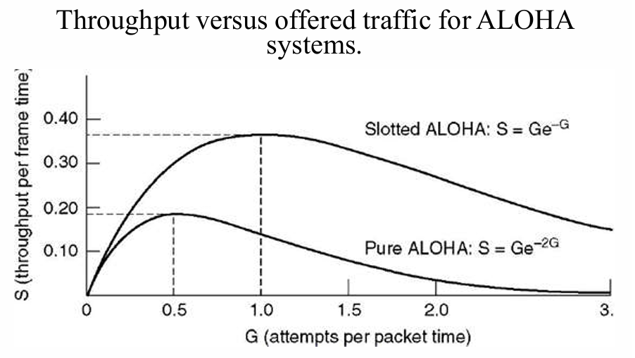

# 介质访问控制子层

多个站点共享一条广播信道时，需要回答：**谁可以在什么时候发送？** 负责协调这种访问的协议属于数据链路层的 **MAC（Medium Access Control，介质访问控制）子层**。

IEEE 802 体系把数据链路层分为 **LLC（逻辑链路控制）**和 **MAC** 两个子层。LLC 提供与具体介质无关的链路服务；MAC 处理介质访问、帧的封装与识别、MAC 寻址和差错检测。

## 信道分配

### 静态划分与动态分配

FDM、TDM 等方法预先划分频带或时隙。用户数量固定、业务持续时，这种方法简单有效；网络流量具有突发性时，空闲用户的份额会被闲置，而忙碌用户仍然需要等待。

动态分配根据发送需求决定信道的使用者，主要有两种思路：

- **随机访问**：允许站点争用信道，发生冲突后再按规则重试。
- **受控访问**：通过预约、轮询或令牌确定发送顺序。

分析共享信道时，我们常假设各站独立产生帧、共享一个信道、重叠发送会冲突，再分别讨论时间连续或分槽、是否能监听载波。

### 静态划分的排队代价

在 M/M/1 模型中，设帧到达率为 $\lambda$ 帧/s，平均帧长为 $1/\mu$ bit，链路容量为 $C$ bit/s。服务率为 $\mu C$ 帧/s，稳定条件是 $\lambda<\mu C$，平均逗留时间为：

$$
T=\frac1{\mu C-\lambda}
$$

若平均分成 $N$ 条独立子信道，每条到达率与容量均为原来的 $1/N$，则：

$$
T_N=\frac1{\mu C/N-\lambda/N}=NT
$$

这里的 $T$ 包括排队和发送时间。动态共享的好处在于，某个用户暂时没有数据时，其他用户仍能利用空出的容量。

## 随机访问协议

### ALOHA

**纯 ALOHA** 有数据就发送，不先监听信道。若在规定时间内未收到确认，就等待随机时间后重传。

设每帧发送时间均为 $T$。对于从时刻 $t$ 开始的一帧，其他帧若在 $(t-T,t+T)$ 内开始发送，就会与它重叠，因此冲突危险期长 **$2T$**。

**时隙 ALOHA** 把时间分成长度为 $T$ 的时隙，各站同步，只能在时隙起点发送。冲突只发生在选择同一时隙的帧之间，危险期缩短为 **$T$**。

在固定帧长、发送尝试服从泊松分布的模型下，设每帧时间内平均发送尝试次数为 $G$，其中包含新帧与重传帧，归一化吞吐量为 $S$：

| 协议 | 吞吐量 | 最大值 |
| --- | --- | --- |
| 纯 ALOHA | $S=Ge^{-2G}$ | $G=1/2$ 时，$S_{\max}=1/(2e)\approx18.4\%$ |
| 时隙 ALOHA | $S=Ge^{-G}$ | $G=1$ 时，$S_{\max}=1/e\approx36.8\%$ |

{ width="650" style="display: block; margin: 0 auto;" }

### 载波监听多路访问 CSMA

**CSMA（Carrier Sense Multiple Access）**要求站点先监听信道，再决定是否发送。传播需要时间，所以一个站刚开始发送时，远处另一个站仍可能监听到空闲。

| 协议 | 信道空闲时 | 信道忙时 | 主要取舍 |
| --- | --- | --- | --- |
| **1-坚持 CSMA** | 立即发送 | 持续监听，空闲后立即发送 | 等待站容易同时起发 |
| **非坚持 CSMA** | 立即发送 | 等待随机时间后再监听 | 减少集中争用，但可能闲置已空闲的信道 |
| **p-坚持 CSMA** | 以概率 $p$ 发送，以概率 $1-p$ 推迟到下一时隙 | 等待后续时隙再监听 | 用概率在冲突与等待之间取舍 |

若信道始终空闲、时隙长为 $t$，p-坚持协议在首次判断时立即发送的概率为 $p$，发送前平均推迟 $(1-p)/p$ 个时隙，因此平均等待时间为 $(1-p)t/p$。

### 带冲突检测的 CSMA/CD

**CSMA/CD**用于经典共享式、半双工以太网，可概括为**先听后发，边发边听，冲突停发，随机重发**。

1. 监听信道，按 1-坚持规则等待发送机会。
2. 发送过程中继续检测冲突。
3. 检测到冲突，停止正常数据发送，并发出短的**强化冲突信号（jam signal）**。
4. 按退避算法等待，然后重新竞争。

设最远两站的单向传播时延为 $\tau$。一站开始发送后，最坏要经过 **$2\tau$** 才能发现冲突，这段时间称为**争用期**。为在发送结束前检测到冲突，帧发送时间应满足：

$$
\frac{L_{\min}}R\ge2\tau,\qquad L_{\min}\ge2\tau R
$$

!!! example "最短帧长与网络直径"

    链路速率为 1 Gbit/s，长度为 1 km，传播速度为 $2\times10^8\,\mathrm{m/s}$，忽略中继等额外时延。

    单向传播时延为 $5\,\mu\mathrm{s}$，最短帧长至少为 $10^9\times10\times10^{-6}=10000$ bit，即 **1250 B**。

    这是给定 CSMA/CD 网络模型的计算结果。距离固定时，速率越高，就需要越长的帧来覆盖争用期。

### 截断二进制指数退避

第 $i$ 次冲突后，令：

$$
k=\min(i,10),\qquad r\in\{0,1,\ldots,2^k-1\}
$$

均匀随机选择 $r$，等待 $r$ 个基本退避时隙。前几次的选择范围依次为 $\{0,1\}$、$\{0,1,2,3\}$、$\{0,\ldots,7\}$，第 10 次以后最大为 1023；连续 16 次发送尝试都发生冲突时，放弃该帧并报告失败。

经典 10 Mbit/s 以太网的时隙为 **512 bit 时间，即 $51.2\,\mu\mathrm{s}$**。计算其他速率时，先确认题目给的是比特时间还是实际时间。

## 无冲突与有限竞争协议

### 基本位图协议

设有 $N$ 个站。每轮先设置 $N$ 个预约位，第 $i$ 个站想发送时，就在自己的预约位置写 1；预约结束后，各站按编号顺序发送。

若数据帧长为 $d$ bit，忽略其他开销：低负载下，一轮只传一帧，效率为 $d/(N+d)$；高负载下，$N$ 个预约位由 $N$ 帧分摊，效率为 $d/(d+1)$。预约开销固定，因此更适合高负载。

### 令牌传递

**令牌（token）**代表发送许可，沿逻辑环依次传递。站点持有令牌时才可以发送，完成后把令牌交给下一站；没有待发数据就直接传递。

正常情况下只有一个有效令牌，所以发送次序可控、不会因同时争用而冲突。协议还需要处理令牌丢失、重复和节点故障。逻辑上的令牌环可以建立在不同物理拓扑之上。

### 二进制倒计数

各竞争站从最高位开始发送自己的二进制地址，信道按位执行逻辑或。若一个站发送 0，却观察到 1，就退出竞争；最后**编号最大的站**获得发送权。

该协议用地址位完成仲裁。若有 $N$ 个站、地址长 $\lceil\log_2N\rceil$ bit，每帧长 $d$ bit，则忽略其他开销时效率为 $d/(d+\lceil\log_2N\rceil)$。固定编号会形成优先级差异，可以通过调整优先级改善公平性。

### 自适应树遍历

把站点放在二叉树的叶子上。竞争发生冲突时，先让一半站点竞争，再让另一半竞争；仍冲突就继续细分。

**低负载时让较多站点一起竞争，高负载时缩小竞争组**，这样兼顾随机访问的低等待与受控访问的高负载效率。

## 以太网

### 共享式与交换式以太网

经典以太网使用同轴电缆总线，或通过集线器组成物理星形、逻辑共享的网络。各站共享带宽和冲突域，采用 CSMA/CD；10 Mbit/s 以太网使用曼彻斯特编码。

**交换式以太网**由交换机按目的 MAC 地址选择输出端口，多对端口可以并行通信。主机与交换机以全双工方式点对点连接时，两个方向分别发送，**不使用 CSMA/CD**。多个输入同时争用同一个输出端口时，仍需排队和缓存。

高速以太网沿用基本 MAC 帧格式，但改进了物理层编码与介质。快速以太网为 100 Mbit/s，吉比特以太网为 1 Gbit/s，10 吉比特以太网采用全双工方式。

### MAC 地址

常见以太网 MAC 地址为 **48 bit，即 6 B**，通常写成 `00:1A:2B:3C:4D:5E`，标识链路层接口。

- **单播地址**：对应一个接口。
- **多播地址**：对应一组接口。
- **广播地址**：`FF:FF:FF:FF:FF:FF`，面向同一广播域。

首字节的最低位区分单播与组地址，次低位区分全局管理与本地管理。地址可以由厂商分配，也可以本地配置。网卡接收与自己匹配的单播、相应多播及广播帧；混杂模式允许向软件交付更多收到的帧。

### MAC 帧格式

无 VLAN 标签的以太网帧：

| 字段 | 长度 | 作用 |
| --- | --- | --- |
| 目的 MAC 地址 | 6 B | 指明接收接口或接收组 |
| 源 MAC 地址 | 6 B | 指明发送接口 |
| 类型／长度 | 2 B | Ethernet II 使用类型，802.3 长度形式表示数据长度 |
| 数据与填充 | 46～1500 B | 承载上层分组，不足最小长度时填充 |
| FCS | 4 B | CRC 差错检测 |

**MAC 帧长为 64～1518 B**，从目的地址计到 FCS。发送前还有 7 B 前导码和 1 B 帧开始定界符，用来完成同步；它们不计入上述 MAC 帧长。

类型／长度字段小于等于 1500 时按长度解释，大于等于 1536（`0x0600`）时按类型解释。例如 IPv4 类型为 `0x0800`，ARP 为 `0x0806`。

!!! note "最短帧、MTU 与线上开销"

    - 最短 MAC 帧为 64 B，扣去 18 B 首尾开销，数据与填充至少为 46 B。
    - 以太网常用 MTU 为 1500 B，指 MAC 帧能承载的上层分组长度。
    - 连续发送还应考虑 8 B 前导码与定界符，以及 96 bit 时间的帧间间隔。

以太网提供无连接、无逐帧确认的尽力交付服务。接收方丢弃检测出错的帧，重传由需要可靠性的上层协议处理。

## 无线局域网

### 组成与接入

**基础设施模式**中，一个接入点 **AP** 和与其关联的站点构成基本服务集 **BSS**；多个 BSS 通过分配系统 **DS** 互联，形成扩展服务集 **ESS**。**SSID** 是服务集的名称，**BSSID** 用来标识基本服务集。

**自组织模式（ad hoc）**允许站点不通过固定 AP 直接组成网络。加入基础设施网络通常涉及扫描、鉴别和关联；移动到另一 AP 时，通过重关联等机制改变接入位置。

无线物理层可以采用扩频、OFDM 和 MIMO 等技术。它们解决信号如何传送，MAC 则协调共享无线介质的使用。

### 隐藏终端与暴露终端

```text
+A —— B —— C —— D
+相邻站点能互相听到，较远站点听不到。
```

- **隐藏终端**：A 与 C 互相听不到，却都能到达 B。A 向 B 发送时，C 可能也认为空闲并向 B 发送，在 B 处冲突。
- **暴露终端**：B 向 A 发送时，C 听到 B，便推迟向 D 发送；若两组收发实际互不干扰，这次推迟就浪费了并行机会。

关键在于：**发送端听到的信道状态，与接收端是否会受到干扰并不完全相同。**

### CSMA/CA 与 DCF

无线发送时，本机信号远强于远处信号，难以边发边检测碰撞；隐藏终端又使本地监听无法覆盖所有干扰。因此 802.11 的**分布协调功能 DCF**采用 CSMA/CA，通过监听、随机退避和确认来减少冲突。

基本过程是：

1. 先进行物理载波监听，并检查虚拟载波监听状态。
2. 若已有退避过程，等待信道空闲一个 DIFS 后开始或恢复倒计时；退避计数只在空闲时隙递减，忙时冻结。
3. 计数减为 0 后发送；一个新的发送请求若到来时信道已持续空闲足够时间、且无退避要求，也可直接发送。
4. 单播接收方正确收到后，间隔 SIFS 返回 ACK；未收到 ACK 时，发送方扩大竞争窗口，重新退避。

成功发送后若还有数据待发，也需遵循后续退避规则。这样可以避免同一站连续占住信道。

### RTS、CTS 与 NAV

可选的预约过程是：

```text
+发送方：RTS ──────────→ 接收方
+发送方：    ←── CTS ── 接收方
+发送方：DATA ─────────→ 接收方
+发送方：    ←── ACK ── 接收方
+           相邻响应间隔 SIFS
```

**RTS** 请求发送，**CTS** 允许发送。其他站根据帧中的持续期信息设置 **NAV（网络分配向量）**，在预约期间推迟发送，这就是虚拟载波监听。

隐藏在发送方覆盖范围之外、却靠近接收方的站点，可以听到接收方的 CTS 并避让。RTS/CTS 增加了控制开销，但可减少长数据帧冲突造成的损失；RTS 本身仍可能冲突。

**MACA 与 802.11 的处理有区别**：MACA 中仅听到 RTS、未听到 CTS 的站点可在适当等待后尝试其他传输；802.11 对收到的预约信息采取更保守的 NAV 避让。

三种常见帧间间隔满足 **SIFS < PIFS < DIFS**：SIFS 用于 CTS、ACK 等优先响应，PIFS 用于集中协调访问，DIFS 用于普通 DCF 竞争；接收出错后还可能使用更长的 EIFS。

### 无线帧的地址字段 +

802.11 帧分为数据帧、控制帧和管理帧。数据帧可携带多组 MAC 地址，因为**本次无线传输的收发双方**与**链路层数据的原始源、最终目的**可能不同。

| 方向 | To DS | From DS | 地址 1：接收方 | 地址 2：发送方 | 地址 3 |
| --- | --- | --- | --- | --- | --- |
| 站点发给 AP | 1 | 0 | AP | 源站点 | 目的地址 |
| AP 发给站点 | 0 | 1 | 目的站点 | AP | 源地址 |

例如同一 BSS 内 A 经 AP 向 B 发送：上行帧的三个地址为 **AP、A、B**，下行帧为 **B、AP、A**。若目的主机在另一 IP 子网，上行的地址 3 应填**本子网网关的 MAC 地址**。

To DS、From DS 均为 1 的无线分布系统转发可使用第四个地址字段，分别容纳接收方、发送方、目的和源地址。

## 网桥、交换机与 VLAN

### 自学习与转发

网桥连接局域网，二层交换机可以看成多端口网桥。它们通过**源地址学习位置，通过目的地址决定转发**。

1. 读源 MAC 地址，把“源 MAC—入端口”写入或更新到对应 VLAN 的转发表中。
2. 查目的 MAC 地址：
    - 已知且在另一端口：只从该端口转发。
    - 已知且就在入端口一侧：过滤，不再转发。
    - 未知单播或广播：在该 VLAN 内向除入端口外的可转发端口泛洪。
3. 表项按老化时间清除，适应主机移动和拓扑变化。

!!! example "交换机怎样学到两台主机的位置"

    初始表为空。A 从端口 1 发给 B，交换机记录 `A → 1`，然后泛洪。B 从端口 3 回复 A，交换机记录 `B → 3`，并只向端口 1 转发。此后两者互通即可按表定向转发。

**存储转发**先收齐整帧、检验 FCS，再发送；**直通交换**在收到足够的目的地址信息后就开始转发，时延较小，但无法在开始转发前完成整帧校验。

### 生成树协议

冗余链路提高了连通可靠性，也可能形成二层环路。普通以太网帧没有类似 IP TTL 的跳数限制，泛洪帧会反复传播，造成广播风暴和 MAC 表抖动。

**STP（生成树协议）**通过交换控制报文，选出网桥 ID 最小的根网桥，再依据到根的路径代价选择根端口和各网段的指定端口，阻塞冗余转发路径。物理链路保留，逻辑转发拓扑形成无环树；拓扑改变后重新计算。

### VLAN 与广播域

**VLAN（Virtual LAN，虚拟局域网）**把物理网络划分为多个逻辑广播域。同一 VLAN 可以跨多台交换机；不同 VLAN 间的通信需要路由器或三层交换功能。

- **Access 端口**通常连接终端，归属一个 VLAN。
- **Trunk 链路**在交换机之间承载多个 VLAN，用标签区分帧的归属。
- **IEEE 802.1Q 标签**长 4 B，插在源 MAC 地址与类型／长度字段之间。

标签包含 TPID 和控制信息，其中 VID 为 12 bit，常规 VLAN ID 使用 1～4094。插入或移除标签会改变受校验内容，因此需要更新 FCS；带单个标签的常规最大帧长为 1522 B。

| 设备或连接 | 冲突域 | 广播域 |
| --- | --- | --- |
| 中继器、集线器 | 不分隔 | 不分隔 |
| 网桥、二层交换机 | 隔离各端口连接的共享网段；全双工点对点连接没有共享介质冲突 | 同一 VLAN 内仍连通 |
| VLAN 划分 | 不改变各端口的物理连接方式 | 不同 VLAN 分属不同广播域 |
| 路由器 | 隔离不同链路 | 隔离二层广播域 |
