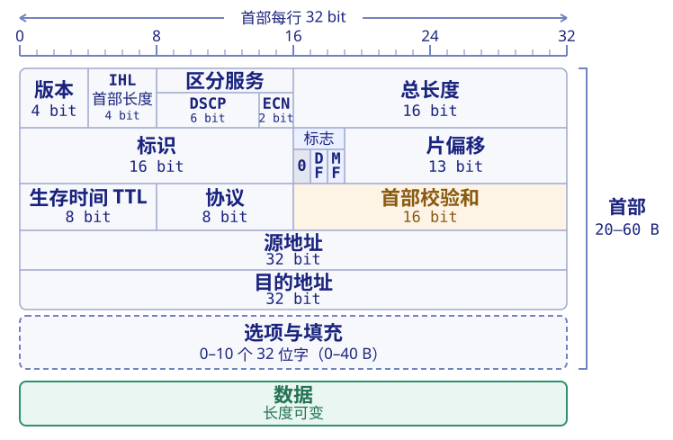
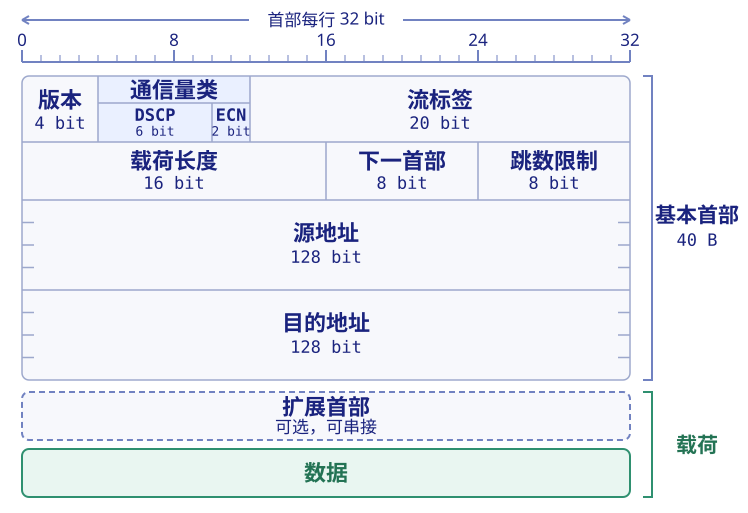
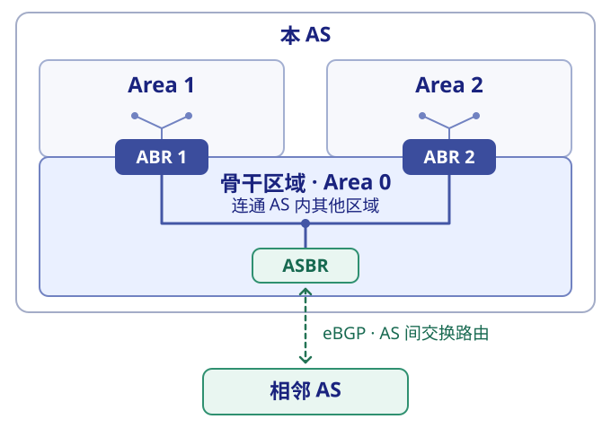
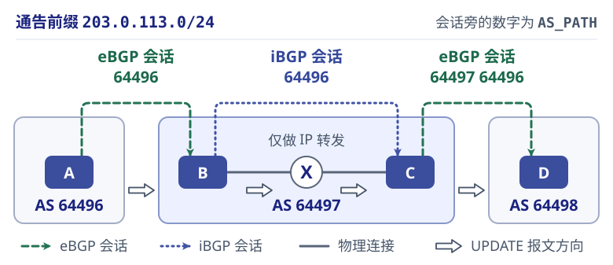

# 网络层

## 网络层提供的服务

简单来说，网络层向上层（传输层）提供的服务有两种：**无连接服务（Connectionless Service）** 和 **面向连接服务（Connection-Oriented Service）**。我们在物理层一章讲过[数据交换的方式](./physical.md#数据交换方式)，它们各具特点。而由于分组交换的利用率很高、线路分配非常灵活，同时多出来的开销在现代条件下瑕不掩瑜，现代网络基本都采用 **存储转发分组交换** 方式。我们也称这样的网络叫分组交换网。

### 数据报与虚电路

分组交换网根据其通信子网向各端点提供的服务，可以分为无连接的 **数据报（datagram）**与面向连接的 **虚电路（virtual circuit）**。这两种服务方式都 **由网络层提供**。

| 比较项 | 数据报网络 | 虚电路网络 |
| --- | --- | --- |
| 发送前 | 无须建立连接 | 先建立逻辑路径 |
| 分组中的主要寻址信息 | 完整目的地址 | 虚电路标识 |
| 中间节点状态 | 维护目的网络的转发信息 | 还需保存各虚电路的映射 |
| 同一次通信的路径 | 各分组独立选择，可能不同 | 通常沿建立时选定的路径 |
| 到达顺序 | 可能乱序 | 同一虚电路通常按序到达 |
| 中间节点故障时 | 路由收敛后可选择其他路径 | 经过该节点的虚电路需要恢复或重建 |
| 典型例子 | IP 网络 | X.25、帧中继、ATM 中的虚电路机制 |

-   虚电路表中的标识可以写成 `(入接口，入标签) → (出接口，出标签)` 的形式。
-   虚电路服务中未必需要为每段虚电路预分配带宽，是否预分配由具体协议决定。

!!! tip "提醒"
    虚电路的“电路”指的是逻辑路径，其仍然是分组交换的一种，一个连接与其他连接共享某段物理链路。在这一点上，虚电路和数据报是一样的。

我们后面还会提到服务质量控制（QoS Control）和拥塞控制（Congestion Control）。显然，相较于无连接的数据报服务，有连接的虚电路服务在资源足够的情况下，QoS 和拥塞控制都更容易实现。

例如，IP 协议提供的是无连接、尽最大努力交付的数据报服务，所以分组可能丢失、重复、乱序。这个时候，可靠传输通常由 TCP 等上层协议完成。

## 路由算法

路由算法，就是用来生成路由表中各项条目的计算方法。给定一组路由器和其互连链路，每个条目指示一条从源路由到目的路由的路径。我们想尽可能让这条路径是成本最小的。

### 静态路由与动态路由

- **静态路由**：预先计算或由管理员配置，网络状态变化后需要相应手动调整。实现简单、协议开销小，适合结构简单、变化较少的网络。
- **动态路由**：路由器交换信息，根据网络中拓扑或链路代价的变化更新路径（更新路由表）。适应性更强，同时也需要通信、计算和存储开销。

### 距离向量路由

!!! note "最优化原则"
    若 J 位于 I 到 K 的一条最优路径上，那么这条路径中 J 到 K 的部分也应为最优路径。固定一个目的节点，并一致地处理等代价选择，可以把各源到它的最优路径组织成一棵**汇集树（sink tree）**。

**DV（Distance Vector）算法** 基于 **Bellman-Ford 算法**。

每个路由器只需要知道与相邻节点的距离（下一跳距离），以及各邻居节点通告的邻居节点到目的节点的距离。在每一轮，每个路由器 $x$ 以自己为源点，到其他节点的距离可以看做是一个距离向量 $D_x$；$x$ 利用自己已知的两个信息找到当前距离节点 $y$ 的最小距离。数学表达为：

$$
D_x(y)=\min_{v\in N(x)}\{c(x,v)+D_v(y)\}
$$

其中，$N(x)$ 代表 $x$ 的邻居集合，$c(x,v)$ 是 $x$ 到邻居 $v$ 的链路代价（即下一跳距离），$D_v(y)$ 是邻居通告的到目的点 $y$ 的距离。$x$ 到自身的距离为 $0$。

!!! example "通过邻居更新距离"

    路由器 J 到邻居 A、I、H、K 的代价分别为 8、10、12、6。四个邻居通告到目的 D 的距离分别为 40、27、8、24。

    | 下一跳候选 | 到邻居的代价 | 邻居通告的到 D 的距离 | 经该邻居到 D 的总代价 |
    | --- | --- | --- | --- |
    | A | 7 | 40 | 47 |
    | I | 10 | 27 | 37 |
    | H | 12 | 8 | **20** |
    | K | 6 | 24 | 30 |

    因此，J 把到 D 的距离更新为 **20**，下一跳记为 **H**。其余目的地逐行做同样的计算；到自身的距离保持为 0。

经过如此迭代，最终可以收敛到全网一致的最短路径解。

#### 无穷计数问题和其解决方法

DV 的典型问题是**无穷计数**。在网络中发生故障后，由于消息传播的延迟，邻居可能互相把对方的旧信息当成仍可到达目的地的路径，这可能导致距离一轮一轮增大。因此我们常概括这个问题是“好消息传播快，坏消息传播慢”。

例如，A 直连某目的网络 N，B 原来经 A 到达 N。A 到 N 的链路断开后，若 A 先收到 B 的旧通告，就可能改为经 B 到 N；B 又根据 A 的新通告增大距离。此时双方实际在互相转发，通告的距离却持续增长。

我们有几种办法应对这个问题。在某条路由故障后：

- **水平分割**：不向提供这条路由的邻居通告该路由。
- **毒性逆转**：向该邻居通告这条路由的距离为无穷大。这可以消除两节点互相依赖的环路；多节点环路仍需要进一步收敛。
- **触发更新**：路由发生变化时，及时通告邻居。

### 链路状态路由

!!! note "非负权图的最短路径"
    把路由器看作图的节点，链路看作边，代价可以取跳数、时延、费用或带宽相关的权重。那么，我们学习过，对于非负边权，我们可以用 **Dijkstra 算法** 求最短路。

**LS（Link State）**指的是，本路由器与哪些邻居相连，以及对应链路的代价。LS 算法要求每个路由器获知整个区域内的拓扑，再独立计算最短路径：

1.  主动探测，发现邻居，并获知其地址。
2.  确定各条直连链路的代价。
3.  构造自己这里的链路状态信息，包含邻居、代价、序号和生存期等。
4.  定期通过受控泛洪将自己的链路状态信息传播给全网，并根据信息中的序号和生存期处理重复、旧通告。
5.  根据链路状态数据库运行 Dijkstra 算法。

!!! note "DV vs LS"
    | 比较项 | DV | LS |
    | --- | --- | --- |
    | 交换的信息 | 到各目的地的距离 | 本节点的链路状态 |
    | 报文大小 | 距离向量大小与节点数成正比 | 只包含本节点的局部信息 |
    | 主动交换对象 | 邻居 | 泛洪到相应整个区域 |
    | 本地保存 | 目的距离与下一跳 | 相应整个区域的拓扑 |
    | 核心算法 | Bellman–Ford | Dijkstra |
    | 代表协议 | RIP | OSPF、IS-IS |

!!! abstract "王道在这一部分只介绍了上面两种算法。下面是课程中的内容。"

### 分层路由

我们可以把路由器划分为区域（层次）：保留本区域（层次）的详细路径，对其他区域（层次）只保留汇总信息。这样就减少了表项和更新量。

例如，某区域有 720 个路由器，把区域分成 24 个子区域、每区 30 个路由器，简化模型下每个路由器只需约 $30+23=53$ 项；进一步分层还可缩减。均匀分层的理论模型给出，对于有 $N$ 个路由的整体，最优分区数（层数）约为 $\ln N$，此时，每个路由器约需保存（或路由表规模约为）$e\ln N$ 项。

### 广播、多播与任播路由

-   **广播/Boardcast**：交付给范围内所有目的节点。沿生成树转发时可以避免环路与多余副本。
    -   **反向路径转发（RPF）**：检查分组是否从本节点“通往源点”的首选接口到达；若是则向其他接口转发，否则丢弃。它可以利用已有单播路由表，但仍可能在非树边上产生随后被丢弃的副本。
-   **多播（组播）/Multicast**：交付给组成员。可以从转发树中剪去没有成员的分支，也可以构建共享的核心树。
-   **任播（选播）/Anycast**：交付给一组节点中按路由度量选出的一个，常用于让请求到达较近的服务节点；可以概括为“一址多用、就近交付”。

### 移动与自组织网络

**AODV** 按需发现路径：源点广播路由请求，中间节点记录反向路径；目的节点或具有合适路由的节点返回应答，沿途建立正向路由。

无线传感器网络常把数据汇集到一个汇聚节点。**CTP** 构建汇集树，可使用期望传输次数 **ETX** 作为可加的路径代价，并在网络稳定时减少信标频率。RPL 也面向低功耗、有损网络组织路由。

## IPv4

### 分组格式

IPv4 数据报由首部和数据组成。固定首部为 20 B，加入选项与填充后最长为 60 B。源地址和目的地址各占 32 bit。

{:width="100%"}

- **首部长度（IHL）**以 **4 B** 为单位，所以可以取值 5～15。以首字节 `0x45` 为例，高 4 位是版本号 4，低 4 位是 IHL=5，对应 20 B 的首部。**总长度**以 **字节** 为单位，统计首部和数据总体的长度，最大为 65535 B。
- **区分服务**字节的前 6 位是 DSCP（区分服务代码点），后 2 位是 ECN（显式拥塞通知）。
- **标识**用于识别同一原始数据报的分片。**标志**的 3 位从左到右依次是保留位（置 0）、DF（1 禁止分片，0 允许分片）和 MF（1 表示还有后续分片，0 表示最后一片或未分片）。**片偏移**以 **8 B** 为单位，从原始数据部分的起点算起，首片为 0。
- **生存时间（TTL）**每经一次路由转发递减，耗尽时丢弃。**协议**字段指出所承载的协议，如 ICMP=1、TCP=6、UDP=17。**首部校验和**只覆盖首部：计算时将校验和字段置零，对首部的各个 16 bit 字作反码求和，再取反写入该字段。路由器修改 TTL 等首部字段后，也要更新校验和。
- **选项与填充**部分共占 0～10 个 32 bit 字。选项可用于记录路由、时间戳等；必要时用 0 填充，使首部长度对齐到 4 B。

    | 可选选项 | 作用 |
    | --- | --- |
    | 安全性<br>Security | 指明数据报的保密等级。 |
    | 严格源路由<br>Strict source routing | 指定数据报必须逐跳经过的完整路径。 |
    | 松散源路由<br>Loose source routing | 指定数据报必须按顺序经过的路由器，允许在其间经过其他路由器。 |
    | 记录路由<br>Record route | 沿途路由器依次追加自己的 IP 地址。 |
    | 时间戳<br>Timestamp | 沿途路由器记录时间戳，也可同时记录自己的 IP 地址。 |

### 分片和重组

一个链路层数据帧能承载的最大数据量称为 **最大传送单元（MTU）**。IP 数据报产生在网络层，所以必然要被封装在链路层帧中，所以长度受到 MTU 的严格限制。此外，从源主机到目的主机也不一定就只经过一段链路，不同链路的 MTU 可能不同。例如，以太网的 MTU 常为 1500 B，很多广域网的 MTU 不超过 576 B。

所以当 IPv4 数据报超过出链路 MTU 时，如果该数据报允许分片（DF = 0），那就必须把 IPv4 **数据报中的数据** 分装。这些分装得到的小数据报就被称为分片。所以，**分片只可能在源主机或中间路由器上发生**；**重组由最终目的主机完成**。

- 每片都有自己的 IP 首部，各片保留原始标识。
- 由于片偏移以 8 B 为单位，除最后一片外，数据长度应为 8 B 的整数倍。
- 片偏移从**原始数据部分**起点计算，计算时不累计各片新增的首部。

!!! example "4000 B 数据报经过 MTU 为 1500 B 的链路"

    假设原始数据报首部为 20 B（即无选项），那么各片首部也为 20 B。数据共 3980 B，每片最多承载 $\lfloor(1500-20)/8\rfloor\times8=1480$ B。

    | 分片 | 数据长度 | 总长度 | 片偏移 | MF |
    | --- | --- | --- | --- | --- |
    | 第一片 | 1480 B | 1500 B | 0 | 1 |
    | 第二片 | 1480 B | 1500 B | $1480/8=185$ | 1 |
    | 第三片 | 1020 B | 1040 B | $2960/8=370$ | 0 |

    可以看到，第三片计算片偏移是基于已传输的效数据计算的，原数据仍为 $1480+1480+1020=3980$ B；分片后，新增两份首部，三片总长度为 4040 B。

如果数据报不允许分片（DF = 1）且无法通过时，路由器丢弃数据报，并用 ICMP 报告需要分片等信息。**路径 MTU 发现** 机制利用路径反馈让源端调整分组大小，尽量避免中间分片。

!!! note "分片再次分片"

    新片的偏移仍以原始数据报的数据起点为基准：**原片偏移 + 新片在原片内的数据偏移 / 8**。若原片 MF=1，它拆出的所有新片也都应置 MF=1，因为在原始数据报中，后面仍有数据。同样地，目的主机要收齐所需分片才能重组，某片丢失会使整个数据报无法按时交付。

!!! info "透明分片"
    IPv4 这种分片分别转发，最终在目的主机重组的分片方式称为**非透明分片**。一般的网络互连还可以采用**透明分片**：在某个网络入口分片、出口重组，对后续网络隐藏内部的分片过程。

### IPv4 编址

#### IPv4 地址

IP 地址 **唯一标识** 着连接到互联网上的每台主机或路由器的 **每个接口**。IPv4 地址是 IP 地址的一种，有 32 位。IP 地址的分配由互联网名字与数字分配机构（ICANN）统一管理。

为方便书写，通常将 32 位 IP 地址（IPv4 地址）分为 4 段，每段 8 位转换为等价的十进制数，并以小数点分隔，这就是 **点分十进制记法**。现今人们通常所说的 IP 地址就是指 IPv4 地址，所以本节以下也沿用这样的简称。

#### 分类的 IP 地址

在互联网早期，IP 地址是分类的。这些类别的共同点是，它们都由 **网络号** 和 **主机号** 构成，其中网络号标识主机（或路由器）的接口所连接到的网络，主机号标识该主机（或路由器）的接口。要求一个网络号在整个互联网范围必须唯一，一个主机号在其网络号所指代的网络中必须唯一。所以，网络号在高位，主机号在低位。

我们根据地址开头的比特区分出 5 个类别：

| 类别 | 开头比特 | 第一字节范围 |
| --- | --- | --- |
| A | `0` | 通常可分配的网络号为 1～126 |
| B | `10` | 128～191 |
| C | `110` | 192～223 |
| D | `1110` | 224～239 |
| E | `1111` | 240～255 |

A、B、C 类地址为 **单播地址**；D 类地址为 **多播地址**；E 类地址保留为将来使用。但其中有些特殊地址有特殊含义：

-   `0.0.0.0`：32 位全 0，表示尚未配置地址等情况下的未指定地址，本网络上的本主机。
-   主机号全 0：表示本网络本身（网络地址），例如 `202.98.174.0`。
-   主机号全 1：表示本网络的广播地址，例如 `202.98.174.255`。
-   `127.x.x.x`：保留用于本地环回测试，仅用于本地进程间的通信。目的地址为环回地址的 IP 数据报不会被发送到任何物理网络。
-   `255.255.255.255`：32 位全 1，表示受限广播地址，仅在本网络内广播。路由器不会转发目的地址为受限广播地址的 IP 分组。

近年来，随着无分类编址的广泛运用，传统分类的 IP 地址已经淡出大众视野。不过，这些特殊地址的含义现在还在广泛使用。

#### CIDR 与子网划分

无分类域间路由选择（CIDR）就是旨在消除传统分类的限制、提升 IP 地址空间利用率的机制。它不再区分网络类别，而使用统一使用“网络前缀”来标识网络部分。例如某单位只需要 2000 个 IP，那就可以为它分配一个包含 2048 个地址的连续块（前缀为 21 位），而不是给一整块 B 类网络。

CIDR 还给出了 CIDR 表示法：`IP 地址/前缀长度`。上面的例子我们就可以写分配了一个 `/21` 的网络。

CIDR 地址块的地址总数一定是 2 的整数次幂。若主机号部分占 $N$ 位，则其对应的子网地址块就包含 $2^N$ 个地址总数。但 **实际可以分配给主机的地址数** 通常只有 $2^N-2$ 个，因为最小值（全 0）要作为网络地址，最大值（全 1）要做为广播地址。

如果我们只采用两级 IP 地址结构（网络号 + 主机号），在网络尚不多的时候确实十分方便；但随着网络数量的增长，每个物理网络如果都要分配一个完整网络号，大量的主机号就没有被使用，同时路由表的规模也会膨胀，这大大增加了转发的开销。

自 1985 年起，人们在 IP 地址中加入“子网号”字段，形成 `{<网络号>, <子网号>, <主机号>}` 的三级结构，这就是 **划分子网** 机制。这也是现在互联网的正式标准。
划分子网是对两级地址的 **主机号部分再划分** 而不改变原网络号，这使得网络内部可以灵活划分子网，且对外仍然表现为单一网络。

外部路由器根据网络号向网络内转发数据报时，首先数据报会到达该网络边界路由，随后该路由结合子网号转发至对应子网路由，最后到达目的主机。

为了标识子网到哪里，人们设计了 **子网掩码**：它是一个与 IP 地址对应的 32 位地址串，先 1 后 0，其中，1 对应该位属于网络号或子网号，0 对应该位属于主机号。这样，主机和路由器就可以通过一个简单的与运算知道子网地址了。

互联网标准规定，每个网络都需要配置子网掩码。对于未划分子网的传统网络，依照其网络号位数设置默认子网掩码，如 A 类地址的掩码是 `255.0.0.0`（`/8`） 。一般来讲，主机在配置 IP 时，需要同时设置子网掩码；同一子网内部需要采用相同的子网掩码。CIDR 表示法的网络前缀长度就是掩码中连续 1 的数量。例如，`128.14.32.5/20` 能够看出其子网掩码是 `255.255.240.0`。

- **定长子网掩码 FLSM**：所有子网大小相同，按需求最大的子网确定容量。从主机部分借 $s$ 位，可划分 $2^s$ 个子网。
- **变长子网掩码 VLSM**：不同子网采用不同前缀长度。没有指定分配顺序时，通常先安排大块，再安排小块，便于保持对齐。

我们把本子网所连路由器接口的 IP 地址称为 **默认网关**。路由器中的路由表除了包含目的网络地址和下一跳地址，也需要包含子网掩码。

!!! example "把一个 /19 地址块分给不同规模的机构"

    `192.24.0.0/19` 共含 8192 个地址。给三个地方分配 2048、1024、4096 个地址，可以这样分：

    | 用途 | 地址块 | 地址范围 | 地址总数 |
    | --- | --- | --- | --- |
    | Cambridge | `192.24.0.0/21` | `192.24.0.0～192.24.7.255` | 2048 |
    | Edinburgh | `192.24.8.0/22` | `192.24.8.0～192.24.11.255` | 1024 |
    | —— | `192.24.12.0/22` | `192.24.12.0～192.24.15.255` | 1024 |
    | Oxford | `192.24.16.0/20` | `192.24.16.0～192.24.31.255` | 4096 |

    其中，`/20` 的第三字节必须从 16 的整数倍开始（因为第三字节还剩了 4 位是主机号）。因此，给 Oxford 的块从 `.16.0` 开始，中间留下的 `/22` 可供以后使用。
    
    需要注意，若需求改为分配 4096 个**可分配主机地址**，那么一个 `/20` 网络只有 4094 个可分配的主机地址，容量就需要重新计算。

在上面的例子中，我们看到中间产生了一块 1024 个地址的 **地址碎片**。因而，采用 VLSM 划分子网时，我们一般从 **最大的子网开始划分**。

#### 路由聚合

有的时候，一个路由器的多个端口有多个子网或多个较小的网络。这个时候，我们可以把这些小地址块用一个较大的地址块合并表示，这就是 **路由聚合** 方法。使用路由聚合，可以把多条路由转换成一条能够“代表这些路由”的路由，从而压缩路由表规模，提升转发性能。

可精确合并的块应该满足<u>连续、覆盖完整的二进制前缀范围，并具有适合的转发方向</u>。例如 `57.6.96.0/21`、`57.6.104.0/21`、`57.6.112.0/21`、`57.6.120.0/21` 连续覆盖第三字节的 96～127，因此它们可聚合为 **`57.6.96.0/19`**。

#### 最长前缀匹配

采用路由聚合方式后，我们从反方向考虑，一个目的地址可能匹配多条路由。其中有两种特殊路由：
-   默认路由 `0.0.0.0/0`，必然匹配所有地址；
-   特定主机路由 `/32`，匹配单个目的主机，便于网络管理员控制或测试。

这个时候，本着尽可能减少转发副本的原则，我们应该选择 **前缀最长、范围最具体** 的一条。例如，目的地址 `192.24.12.7` 在某路由表中同时匹配 `192.24.0.0/19` 和 `192.24.12.0/22`，应选择后者。一个聚合块中出现使用不同出口的小块时，可以保留大块路由，再增加一条更具体的路由。

查路由表时，对每条候选路由，路由器使用 **该表项自己的掩码** 与目的 IP 地址进行按位与运算。若结果等于该表项的网络地址，才算匹配；所有候选路由比较完成后，再从匹配成功的表项中选最长前缀。若没有任何匹配项，而且路由器没有配置默认路由，就丢弃分组并按条件报告不可达。

### 私有地址和 NAT

IANA 保留了 **三个私有 IP 地址块**，规定它们只能用于 LAN 内部而不得直接用于 WAN：

1.  `10.0.0.0/8`（一个 A 类网络）
2.  `172.16.0.0/12`（16 个连续 B 类网络）
3.  `192.168.0.0/16`（256 个连续 C 类网络）

所以，互联网中的所有路由器 **对目的地址为私有地址的数据报一律不予转发**。采用私有 IP 地址组建的网络被称为专用网络。这样的专用网络可以不止有一个，所以私有地址也被称为可重用地址。

专用网内部也需要访问互联网。这时候我们就需要**网络地址转换（NAT）**。它可以在地址空间之间进行转换，将私有地址转换为公网 IP 地址，从而实现与互联网的通信。

NAT 的实现通常依靠在专用网和互联网边缘的路由器上安装 NAT 软件，此时路由器成为 NAT 路由器。NAT 路由器通过 **NAT 转换表** 保存 `{私有 IP:端口 ↔ 全球 IP:端口}` 的映射，实现私有 IP 和全球 IP 的映射。这还使得多个私有 IP 地址能够共享同一个全球 IP 地址。

现在假设某 NAT 路由器保存了条目
```text
LAN 10.0.0.1:3345 ↔ WAN 138.76.29.7:5001
```

1.  专用网中的主机 `10.0.0.1` 使用 3345 端口向外部 Web 服务器发送请求。
2.  NAT 路由器收到这一分组时，将分组的源地址替换为自己的全球 IP 地址 `138.76.29.7`，源端口替换到分配的 5001 端口上。
    1.  如果是新出现的端口或 IP，那就新分配并记录（动态 NAT）；一段时间没有使用的映射会自动删除；
    2.  由管理员手动配置 NAT 转换表（静态 NAT）；这一般用来让公网用户能够访问内网服务器上的服务。
3.  Web 服务器恢复。此时其回复的目的地址是公网地址 `138.76.29.7`，目的端口 5001。
4.  到达 NAT 路由器后，路由器按转换表还原目的地址与目的端口，并更新受影响的校验和。

私有 IP 和 NAT 的出现有效缓解了 IPv4 地址短缺的问题。

### 逐跳交付和 ARP

主机发送数据时，会先用自己的 IP 地址和掩码判断目的 IP 地址是否在本子网。

- 在同一子网：直接交付给目的主机。
- 在不同子网：交给合适的下一跳，常见的是交给默认网关。

这样，同一网络内部的通信就无需再花费路由器的资源，跨网络通信时，也是基于这个子网（因为是发给网关）而不是主机自己。在主机数量远大于网络数量的今天，这可以显著压缩转发表的规模。

分组到达路由器时，路由器根据目的地址的网络前缀查找转发表，确定下一跳的位置，即转发表应该至少保存 `{目的网络地址, 下一条地址}`。确定下一跳时，采用我们前面所述的最长前缀匹配来依次查找。

我们知道了网络层位于数据链路层的上层，那么 IP 数据报必然会作为数据封装在 MAC 帧内，此时 MAC 层就感知不到 IP 地址了。那么交付如何实现呢？

在 IP 数据报到达目的地址所在最小网络后，在这个局域网内就可以通过 **ARP（地址解析协议）** 获取目的主机的 MAC 地址。ARP 实际上是一个将 IP 地址映射到 MAC 地址的机制。

每台主机和路由器都维护一个 ARP Cache，用于存放本局域网内各主机和路由器接口的 IP 地址与 MAC 地址的映射表，也被称为 ARP 表。ARP 表是动态更新的，每个表项具有生存时间，超时没有使用过就会被删除。

发送数据时，发送方先在自己的 ARP 高速缓存中寻找目标的 IP 地址。缓存命中则直接获取其 MAC 地址并发送；缓存未命中则自动通过以下步骤获取目标的 MAC 地址：

1.  构造 ARP 请求分组，封装在 **数据链路层的 MAC 帧** 中，并设置帧的 MAC 地址为 `FF-FF-FF-FF-FF-FF`，**广播发送**。请求分组的内容是在说，“我的 IP 是 xxx，MAC 地址是 xxx；我想知道 IP 地址是 xxx 的主机的 MAC 地址是多少？”
2.  目标收到广播帧后，**单播发送** ARP 响应分组（同样分装在 MAC 帧），内容是“我的 IP 地址是 xxx，MAC 地址是 xxx”。同时，目标会将发送方的 IP 和 MAC 写进自己的 ARP 缓存。
3.  发送方收到了相应分组，将其 IP 和 MAC 写进自己的 ARP 缓存，随后开始发送数据帧。

### DHCP

DHCP 指的是 **动态主机配置协议**，顾名思义，给主机动态分配 IP 地址。这使得计算机加入新网络后可以自动获取 IP 地址。它基于 UDP。

DHCP 使用 C/S 模型，服务端端口是 67，客户端端口是 68。在一次分配请求-响应中，我们称需要 IP 地址的主机为 DHCP 客户。

1.  DHCP 客户在启动时就在局域网 **广播“DHCP Discover”**发现报文，以期找到 DHCP 服务器；因为此时 DHCP 客户“什么也不知道”，只能采用广播的方式，且源地址是 `0.0.0.0`。网络中的所有主机都可以收到发现报文，而只有 DHCP 服务器才响应发现报文。
2.  DHCP 服务器收到发现报文后，**广播“DHCP Offer”**提供报文，其中包含提供给 DHCP 客户的 IP 地址、子网掩码、默认网关、DNS 服务器、租用期等配置信息。如果网络中存在多台 DHCP 服务器，那它们都需要发提供报文。
3.  DHCP 客户收到提供报文后，如果接收该 IP 地址，**广播“DHCP Request”**请求报文，向 DHCP 服务器请求提供 IP 地址。客户可能收到多份提供报文，其只能从中选择一个，广播的方式也利于其他服务器知道选择结果，未选中的服务器可以及时释放预留资源。广播时，客户使用的源地址仍然是 `0.0.0.0`。
4.  被选中的 DHCP 服务器收到请求报文后，**广播“DHCP ACK”**确认报文，正式将 IP 地址分给客户。客户收到确认后，配置正式生效。在有些实现中，这一步也可以采取单播形式。

上述流程中所有的广播都在本局域网内部进行，为了保证路由器不会转发，目的地址都是 `255.255.255.255`。

IP 地址有租期，所以配置信息里才含有租用期信息。

-   一般来说，在租用期过 **50%** 时，客户向为其分配地址的 DHCP 服务器发送续租请求。服务器同意续租，则 **单播发送** 确认报文；不同意则 **单播发送** 否认报文。客户收到否认报文时，必须 **立即停用当前 IP 地址**，重新申请。
-   若服务器未回复这次续租请求，则租用期过 **87.5%** 时，客户 **广播发送** 请求报文，以提高续租的成功率。若服务器回复，则流程与前面一致；若仍未回复，则租用期到后，客户停用当前 IP 地址，重新申请。

DHCP 中继可把客户端请求转交到其他网段的服务器。DHCP 提供网络配置，协议本身位于应用层。

### ICMP

**网际控制报文协议**（ICMP）使得主机和路由器能够向源点报告网络中的差错和异常情况，是网络层协议。其报文分为 ICMP 差错报告报文和 ICMP 询问报文。

**ICMP 差错报告报文** 的常用类型有：

- **目的不可达**：无法交付，例如端口不可达，或禁止分片而分组过大。
- **时间超过**：TTL 耗尽，或分片重组超时。
- **参数问题**：处理首部时遇到相应错误（某些字段的值不正确）。
- **重定向**：告知源主机存在更合适的下一跳。

!!! info "源点抑制"
    早先的 ICMP 协议在路由器或主机因拥塞而丢弃数据报时，会使用源点抑制请求源点降低发送速率。**现在的最新标准 [RFC6633] 已不再使用源点抑制报文**。

以下几种情形不会发送 ICMP 差错报告报文，以避免无限循环或无意义反馈：

- 对 ICMP 差错报告报文本身。
- 对某数据报第一个数据报分片 **之后的所有后续分片**。
- 对目的地址为广播或多播的数据报。
- 对具有特殊地址（`127.0.0.0` 或 `0.0.0.0` 等）的数据报。

**ICMP 询问报文** 的常用类型有：

- **回送请求和回答报文**：测试目的主机是否可达，并获取其状态信息。
- **时间戳请求和回答报文**：通过报文记录的时间戳，发送方可以据此估算当前往返时延。

**`traceroute`/`tracert`** 路由跟踪命令就是通过逐步增大 TTL 值，触发沿途路由器返回 **ICMP 时间超过报文**，从而能够追踪分组经过的路由路径的。**`ping`** 分组网间探测命令则利用 **ICMP 回送请求和回答报文**，测试两台主机间的连通性。

## IPv6

IPv4 协议是在上世纪 70 年代设计的。互联网经过了几十年的飞跃发展，到 2011 年 2 月，IPv4 地址已经宣告耗尽。为了解决“IP 地址耗尽”问题，人们采用了我们前面提到的 CIDR 方法、NAT 机制等。但这两种措施本质上只是延缓了 IPv4 的“寿命”，并非长久之计。

于是人们提出了 IPv6 协议，这是采用更大地址空间的新版本协议。IPv6 协议 **拥有扩展的地址层次结构**，**支持即插即用**（能自动配置 IPv6 地址），**支持资源的预分配**（支持实时音视频这种需要保证一定带宽和时延的应用）。但很遗憾的是，IPv6 和 IPv4 在协议上是不兼容的。

### IPv6 数据报基本首部

IPv6 分组以固定 **40 B** 的基本首部开头，之后可以接零个或多个扩展首部，再接上层报文。版本字段为 `6`，源地址和目的地址各占 **128 bit**，在图中各跨 4 行。

{:width="100%"}

- **通信量类（Traffic Class，8 bit）** 与 IPv4 的区分服务字节结构相同：前 6 位是 DSCP，用于区分转发待遇；后 2 位是 ECN，用于显式通知拥塞。
- **流标签（Flow Label，20 bit）** 由源端设置。流是指互联网从特定源点到特定终点的一系列数据报（如实时音视频），路径上的路由器可据此提供特定的 QoS 保证。同属一个流的所有数据报具有相同的流标号；`0` 表示未标记。
- **载荷长度（Payload Length，16 bit）** 以 **字节** 为单位，统计 **40 B 基本首部之后**的所有内容，**包括扩展首部、和来自上层的数据**，不像 IPv4 那样会计算首部（基本首部）。
- **下一首部（Next Header，8 bit）** 指出紧接当前首部的类型。没有扩展首部时，它的作用类似 IPv4 的**协议**字段，表示上层协议类型，如 `6` 表示 TCP、`17` 表示 UDP、`58` 表示 ICMPv6。有扩展首部时，它标识紧随其后的第一个扩展首部的类型；`59` 表示没有下一首部。
- **跳数限制（Hop Limit，8 bit）** 等价于 IPv4 的 **TTL**。路由器每转发一次就减 1，减到 0 或收到时已为 0 就丢弃分组。

!!! note "顺着“下一首部”读分组"
    例如一个读取顺序可以是 `IPv6 基本首部 → 逐跳选项首部 → UDP 报文`：基本首部中的“下一首部”为 `0`，表示第一个扩展首部是逐跳选项的首部；逐跳选项首部中的“下一首部”为 `17`，表示上层协议是 UDP。若逐跳选项首部为 8 B，UDP 报文（首部加数据）为 20 B，则载荷长度为 **28 B**，整个 IPv6 分组为 **68 B**。

和 IPv4 相比，IPv6 基本首部省去了首部长度（IHL）和首部校验和字段，因为基本首部的字节数是一定的，且由于传输层提供了差错检测，省去这里的检验可以加快路由器的处理速度。此外，由于 IPv4 中选项的功能和分片相关的信息（标识、标志、片偏移）等在 IPv6 中全部 **由对应的扩展首部承载**，这些字段也都被取消了。

在 IPv6 协议中，**只有源端可以分片**；路由器遇到超过出链路 MTU 的分组时会丢弃它，并向源端发送 ICMPv6「分组过大」（Packet Too Big）消息。参见 [RFC 8200 §3–5](https://datatracker.ietf.org/doc/html/rfc8200#section-3)。

### IPv6 地址

IPv6 地址为 **128 bit**，地址空间是 IPv4 的 **$\mathbf{2^{96}}$ 倍**！

16 B 的地址如果依旧沿用点分十进制表示，那就太冗长了。IPv6 协议采用 **冒号十六进制记法**，地址写成八组十六进制数，两组之间使用冒号分隔。为了书写简便，还规定每组的前导零可以省略，连续的全零组可以用 `::` 压缩，但一个地址中最多使用一次。例如，`2001:0db8:0000:0000:0000:0000:0000:0001` 可写为 `2001:db8::1`。

IPv6 的目的地址分为单播、多播和任播三种方式，不设广播地址。其中有关任播的概念，我们在[广播、多播与任播路由](#广播多播与任播路由)中介绍过。IPv6 地址分为五类：

-   `::/128` 为未指定地址；
-   `::1/128` 为环回地址；
-   `fe80::/10` 为本地链路单播地址范围；
-   `ff00::/8` 为多播地址范围；
-   剩下最多的全球单播地址范围，可以把整个 128 位都作为一个节点的地址；也可以用高 n 位作为子网前缀，剩下的作为接口标识符（相当于 IPv4 主机号）；还可以进一步从高到低位划为 n 位全球路由选择前缀、m 位子网标识符、(128 - n - m) 位接口标识符三级。

IPv6 使用 **ICMPv6 邻居发现** 完成本链路地址解析等工作，取代 IPv4 中 ARP 的相应功能。

## 异构网络互连

现在，IPv4 正在向 IPv6 逐步过渡，而且由于 IPv4 已经十分普及，新部署的 IPv6 必须要向后兼容 IPv4，即能够接收、转发 IPv4 数据报，并为其选择路由。

拓扑结构、寻址方案、路由选择机制等等不尽相同的网络，我们称之为 **异构网络**。可以想象到，在当前，互联网实际上是由全球范围内大大小小的异构网络互连起来的（internetworking）。不止 IPv4 和 IPv6 连接在一起时需要解决兼容性问题，以太网和 802.11，IP 和 MPLS 等等，只要是异构网络连接在一起，我们都需要解决兼容性问题。

-   **双栈**（双协议栈）让同一节点同时安装两个协议栈以同时支持它们，由此还有 **多协议路由器**；

-   **隧道技术**（Tunneling） 当一种协议的分组需要进入另一种协议的网络中时，把该协议的完整分组装入另一种协议的载荷中，穿越中间网络。例如，把 IPv6 分组封装进 IPv4 分组以穿过 IPv4 网络，在隧道出口解封装。

!!! info "MPLS 协议"
    **MPLS（多协议标签交换）** 是一种由 IETF 提出的基于“标签”进行高速数据转发的技术。入口分类并加标签，中间节点根据标签交换表转发、替换标签，出口移除标签。标签提供了与逐跳目的地址查表不同的转发组织方式。

## 路由选择协议

整个互联网是十分庞大的。它采用了自适应的分布式路由选择协议。但许多联网单位不愿意对外暴露其内部网络细节，因此采用分层次的路由选择协议。

为此，互联网被划分为很多个较小的 **自治系统（AS）**。每个 AS 对外通信都表现为一个单一且一致的路由选择策略。所以路由选择协议也被划为两类，内部网关协议（IGP）用于 AS 内部，外部网关协议（EGP）用于 AS 之间。路由选择协议和前面介绍的路由算法密不可分。

### RIP

路由信息协议（RIP）是 IGP 中最早得到广泛应用的协议之一。它是一种 **分布式的、基于[距离向量](#距离向量路由)** 的路由选择协议，以跳数衡量到达目的网络的远近，跳数越短越“好”，而不直接区分链路快慢。

RIP 规定一条路径最多包含 15 个路由器，所以距离最大记为 16，**16 表示目的网络不可达**。也正因此，RIP 适合规模较小的网络。

每个路由器都维护一个路由向量，每个路由表项包含三个字段 `<目的网络, 距离, 下一跳路由器地址>`，表示通过下一跳路由器到达目的网络的距离是多少。

收到邻居 X 的更新后，先进行“预处理”：把来自 X 的报文（包含整个路由表）所有距离字段加 1（路由器到直连网络的 RIP 距离记为 1），并将所有下一跳记为 X。

随后依照以下顺序处理（注意都是采用“预处理过”的 X 发来的报文）：

- 新目的网络：加入路由表。
- 原路由下一跳就是 X：采用 X 的新信息，即使距离变大也要更新。
- 原下一跳不是 X：若经 X 更近，则替换；若原路由更近，则不替换。
- 长时间（默认 180 秒）未收到相应更新：将依赖该信息的路由标记为不可达（16）。

RIP 通常每 30 秒周期更新，也可触发更新。

例如，原表中到 N 的距离为 2、下一跳为 X；现在 X 通告到 N 的距离为 4，则对该条目距离 +1 后，本路由器更新为 **到 N 的距离 5、下一跳 X**。若原下一跳是另一个邻居 Y，且距离为 2，则应保留经 Y 的路由。

-   RIP 实现简单、开销小、收敛过程较快。
-   当然，由于距离向量和交换路由表的开销随着网络规模的扩大而扩大，加之 RIP 限制了最大有效距离是 15，应用 RIP 的网络规模就会被限制。此外，网络发生故障时，RIP 会引发慢收敛现象。

!!! note "慢收敛和无穷计数"
    假设某链路原来的结构和 RIP 距离如下：
    
    ```text
    网络 N —— 4 —— 路由器 R1 —— 1 —— 路由器 R2
    ```

    现在，N 与 R1 的链路突发故障，于是 R1 把到 N 的距离设为 16。但如果不采取额外措施，R2 会在下一个周期才会收到 R1 的报文。在此之前，R2 可能先把自己的报文传给了 R1。R1 发现 R2 传过来的报文是 `<N, 5, R1>`，R1 此时发现 ① R2 给出的路由中到达 N 的下一跳不是原来的 N 而是 R1，② R2 给出的距离小于 16；于是将自己关于 N 的路由信息更新为 `<N, 6, R2>`。在此之后，R1 可能才会把报文传给 R2；二者循环往复，最后收敛到 16。

    这个过程相对很慢，所以称为 **慢收敛** 现象。如果我们把 16 的上限去掉，读者会发现它们会左脚踩右脚一直增大距离，于是就演变成了我们在讨论 DV 时说过的 **无穷计数** 问题。

### OSPF

开放最短路径优先（OSPF）协议是 **分布式[链路状态](#链路状态路由)算法** 的典型代表。虽然它的名字突出了“最短路径”，但实际上几乎所有 IGP 都旨在寻找一条“最短路径”，只不过是度量的标准不同。

OSPF 通过泛洪传播链路状态。划分区域后，描述区域拓扑的通告只在所属区域内传播。

!!! tip "我们之前介绍路由算法时也分别介绍了 DV 和 LS。读者可以发现它们的行为和这里路由协议的特征是一致的。这再次印证了路由协议和路由算法之间的强关联性。"

此外，不同于 RIP，OSPF：

-   还支持对每条路由设置不同的代价（不同的“评价标准”），可以针对不同业务类型计算 **差异化路径**；
-   存在多条道同一目的网络且代价相同的路径时，可实现 **负载均衡**；
-   分组具备 **鉴别** 功能，确保仅在可信路由之间进行信息交换；
-   支持可变长子网掩码（VLSM）和无分类编址。

为了支持大规模网络，OSPF 将 AS 划分为多个区域。各非骨干区域通过 **区域边界路由器（ABR）** 接入 **骨干区域**（一般配置为 Area 0）。ABR 汇总所连接区域的路由信息，由骨干区域在各区域之间传递。每台路由器掌握自己所属区域的详细拓扑。

<figure markdown="1">

{:width="75%"}

</figure>

图中，骨干区域内的 **自治系统边界路由器（ASBR）** 是本 AS 的出口，通过 [eBGP](#bgp) 与相邻 AS 交换路由。

OSPF 的主要分组（报文）分工如下：

| 分组 | 用途 |
| --- | --- |
| 问候 Hello | 发现邻居，维护邻居关系，确认双向连通性 |
| 数据库描述 DD | 交换链路状态数据库的摘要 |
| 链路状态请求 LSR | 请求缺少的或更新的链路状态信息 |
| 链路状态更新 LSU | 携带链路状态通告 LSA |
| 链路状态确认 LSAck | 确认收到的链路状态通告 |

具体来说，OSPF 的基本工作原理包括：

1.  领居发现和可达性维护
    -   相邻路由器需要每隔 10 s 交换 Hello 分组；若 40 s 内未收到邻居的 Hello 分组，则判定 **该邻居不可达**，并触发更新链路状态数据库（LSDB），随后再以自己为根运行 Dijkstra 最短路径算法。
    -   通常，网络中的大部分 OSPF 分组都是这些 Hello 分组。
2.  LSDB 的初始同步
    -   路由器刚启动时，仅能通过 Hello 分组发现其直连邻居，并获知本地链路的基本信息（LS、开销等）。向全网广播的开销太大，所以 OSPF 采用下面的方案：
    -   邻居通过 DD 分组交换各自 LSDB 中 LSA 的摘要；
    -   根据摘要对比，各路由器使用 LSR 向邻居请求自己这里缺失或过期的 LSA 详细内容；对方通过 LSU 发送所请求的 LSA；
    -   成功接收后，应向对方返回 LSAck 以确保可靠传输。这样，最终各邻居都可以实现 LSDB 的同步。
3.  LS 变更的实时传播
    -   路由器检测到自己的 LS 变化后，立即生成新的 LSA，并通过 LSU 向整个区域进行 **可靠的泛洪** 以传播这一消息。
    -   其他路由器收到后，也应返回 LSAck，并重新以自己为根运行 Dijkstra 算法计算路由。
4.  LSA 的定期更新
    -   每条 LSA 的最大生存时间是 60 分钟。
    -   为防止 LSA 丢失或异常，最初生成该 LSA 的路由器需要定期（通常是 30 分钟）刷新该 LSA，确保 LSDB 与实际网络拓扑始终一致。

这里也可以发现，与 RIP 不同的是，OSPF 在数据库同步后，各路由器对 **同一区域的拓扑认识一致，但各自计算出的下一跳可以不同**；每个路由器的 LS 信息与 **全网规模没有直接关联**。

### BGP

前面我们介绍了两个 IGP。但没有 EGP，每个 AS 将是一座座孤岛。

边界网关协议（BGP）就是一种 EGP，常用于互联网的 AS 之间。由于互联网实在是太庞大了，每个主干网络路由器表中的项目非常庞大，寻找最佳路由成本巨大；加之 AS 之间选择路由还必须考虑政治、安全和经济等有关因素，所以与 IGP 的目标不同，BGP 的目标是力求寻找一条能够达到目的网络的较好路由（不能出现环）。

BGP 路由的一般格式如下：

```text
BGP 路由 = <目的前缀, BGP 属性> = <目的前缀, AS_PATH, NEXT_HOP>
```

`AS_PATH`（自治系统路径）记录经过的 AS 序列；`NEXT_HOP` 表示接收该 BGP 路由的路由器去往目的网络时应该使用的下一跳地址。这里可以看出，BGP 不同于前面的 RIP 或 OSPF，采用的是 **路径向量** 路由选择协议。

BGP 对等方（交换 BGP 报文的路由器对）通过 **TCP 连接**（端口 179）交换路由信息。这条连接通常在交换路由后继续保持（半永久的 TCP 连接），称为 **BGP 会话**。按对等方是否属于同一个 AS，可分为两类：

- **eBGP** 会话：不同 AS 的对等方交换路由。
- **iBGP** 会话：同一 AS 内，对等方传播 BGP 路由信息。

<figure markdown="1">

{:width="100%"}

</figure>

图中，假设 A 的通告前缀是 `203.0.113.0/24`（前缀可以就理解为是目标网络的名字）。**空心箭头**标出三条会话各自发送的 UPDATE 报文：A → B、B → X → C、C → D。其中 B 和 C 是 iBGP 会话的端点；X 只按目的 IP 地址转发承载报文的分组。

B 向 C 通告时，`AS_PATH` 保持为 `64496`；C 向 D 通告时在路径最前面加上本 AS 号，D 收到 `64497 64496`（[RFC 4271 §5.1.2](https://datatracker.ietf.org/doc/html/rfc4271#section-5.1.2)）。

在选择路由时，BGP 按照以下优先顺序选择：

1.  **先受本地策略约束，首先选本地偏好值最高的路由**。BGP 路由的属性中有一个被称为本地偏好（`LOVAL-PREF`）的选项，可以由管理员根据其他因素（政治、经济等）策略设置。当然，这也意味着当某一条链路很拥挤时，如果设置了这个选项，BGP 无法自动将部分流量切换到较空闲的链路上去。
2.  **再比较 AS 路径，选择 AS 跳数最少（`AS_PATH` 最短）的路由**。需要注意的是，AS 跳数最少不代表路由器跳数最少。
3.  **前两种都不能决出最好路由时，在 AS 内部执行热土豆路由算法**，即使得分组能够 **经过最少转发** 离开本 AS。这时会结合 IGP 完成。BGP 的 NEXT_HOP 还需要通过 AS 内部路由解析，落实为实际转发接口。
4.  **最后可使用 BGP 标识符选择路由，选择标识符数值最小的路由**。

BGP 的基本报文有：建立会话的 **`OPEN`**、通告或撤销路由的 **`UPDATE`**、周期性维持会话的 **`KEEPALIVE`**（默认周期 60 s），以及报告差错并终止相应会话的 **`NOTIFICATION`**。此外，未检测对等方是否失效，每个 BGP 路由器维护一个保持时间计时器，每次收到任意 BGP 报文即清零。若在约定的保持时间（默认 180 s）内未收到任何 BGP 报文，则认为对等方已失效，就会关闭 BGP 会话。

!!! tip "三种路由协议的比较"

    | 协议 | 基本方法 | 主要特点 | 承载方式 |
    | --- | --- | --- | --- |
    | **RIP** | 距离向量 | 以跳数为度量，最大有效距离 15，16 表示不可达 | UDP 520 |
    | **OSPF** | 链路状态 | 区域内泛洪链路状态，运行 Dijkstra，支持等代价路径 | 直接封装在 IP 中，协议号 89 |
    | **BGP** | 路径向量 | 通告前缀及 AS 路径等属性，强调管理策略 | TCP 179 |

    由它们的承载方式我们也可以看出，RIP 和 BGP 是 **应用层协议**，OSPF 是 **网络层协议**。

## IP 多播与移动 IP

### 多播地址与成员管理

IPv4 多播（组播）让发送方发送一份，沿途只在需要分支时复制，最终抵达用一个组地址标识的若干目的主机（一对多通信）。与单播相比，多播节约了链路资源，减轻了服务器和网络的负载。多播依赖于多播路由器的支持。

在多播数据报中，源地址是源主机 IP 地址，目的地址属于 `224.0.0.0/4`（D 类地址，即 `224.0.0.0`~`239.255.255.255`）。每一个多播地址标识一个多播组。

局域网支持硬件多播，所以只需要把 IP 多播地址映射为对应的多播 MAC 地址；IP 多播数据报将被封装在以太网帧中，MAC 帧首部的目的地址字段将是映射得到的多播 MAC 地址。

IANA 保留的以太网多播地址范围是 `01-00-5E-00-00-00` 到 `01-00-5E-7F-FF-FF`（前 25 位固定）。以太网把 IPv4 多播地址的低 23 位映射到 MAC 地址的后 23 位。但是，这会导致 IP 组地址中有 5 bit 未映射，所以 **32 个不同 IP 多播地址会对应同一 MAC 地址**。主机在收到多播数据帧后，还要在 IP 层利用目的 IP 继续筛选。

为了管理多播组成员，我们需要利用 **网际组管理协议（IGMP）**。它作用于本地子网，使连接到本地局域网上的多播路由器知道本局域网是否有主机加入或退出了某个多播组；主机可以加入或退出多个组。

同时，因为多播组可能跨局域网，某个局域网上的多播路由器还必须和互联网上的其他多播路由器协同工作，这就需要 **多播路由选择协议**，以使用最小代价将多播数据报转发至所有组成员。可以看出，多播路由协议负责路由器之间的**转发树**，在这棵树上，每个分组在每条链路上只转发一次。

主机加入组时，会向该组对应的 IP 发送 IGMP 报文以报告成员关系，路由器收到后通过多播路由选择协议把组成员关系变化通告其他多播路由器以维护组状态。本地多播路由器会以周期性查询本地局域网上的主机的方式探测各多播组是否仍有活跃成员。只要某个组内有一台主机响应，就认为这个组在本地活跃。如果某个组连续多次查询无响应，则路由器判定该组在本地不活跃，停止向其他路由器通告该组成员关系。

IGMP 报文封装在 IP 数据报中传送（协议号为 2）。发送多播数据时，IP 首部的协议号按实际载荷填写，例如若携带 UDP 数据就填为 17，携带 IGMP 即填 2。一般我们不把 IGMP 视为一个单独的协议，而是作为 IP 协议的一个组成部分。

### 移动 IP

移动 IP 允许移动主机改变接入网络后仍保留其永久 IP 地址（被称为 **归属地址**）不变的协议机制。

移动 IP 定义了三种功能实体：

-   **移动节点**：指拥有归属地址、可在不同网络间移动的主机。
-   **归属代理**：也称本地代理。是连接在归属网络（初始连接的网络）上的路由器，负责截获并转发发往移动节点的数据。
-   **外地代理**：连接在被访网络（当前所在的网络）上的路由器，协助移动节点接收数据。

!!! warning "采用 DHCP 重新接入网络不属于移动 IP 的范畴，因为主机重新获取了一个 IP 地址。"

移动 IP 的基本通信原理包括：

1.  注册。移动主机在外地网络后，先向外地代理登记，通过外地代理获得 **转交地址（care-of address）** 表示当前位置；随后，外地代理将该转交地址注册至归属代理。
2.  移动主机接收数据。发往归属地址的分组，先到归属网络，这时会被归属代理截获。归属代理会构建一条通往转交地址的 IP 隧道，把原分组封装为新的 IP 包，通过隧道送往转交地址。外地代理解封装，向移动主机直接交付原分组。
3.  移动主机发送数据。仍然使用归属地址作为源地址，但可以直接经过被访网络的外地代理转发，而不用经过归属代理。
4.  移动和返回。移动主机再次换网时，新的外地代理会有新的转交地址，归属代理更新登记；移动主机返回归属网络后注销相应转交关系，恢复直接通信。

在这个过程中，网络层要增加一些新功能以支持移动 IP，包括 **登记协议**、**注册协议**、**隧道封装协议** 和 **隧道拆封协议** 等。

## 路由器

路由器是一种专用计算机，其任务是连接不同的网络（例如不同的 LAN/VLAN/WAN 互连），是工作在网络层的设备。

路由器的核心功能有两个：

- **路由选择（routing）**：核心是路由选择处理机，根据拓扑、所选路由选择协议和管理策略，构建、更新并维护 **路由表**，计算到各目的网络的路径。
- **分组转发（forwarding）**：包括 **输入端口、交换结构、输出端口** 三个部分。其中，交换结构在路由器内部连接输入和输出端口，负责根据 **转发表** 决定输入的分组应该从哪个接口送出去。

!!! note "路由表和转发表"
    **路由表** 侧重记录选路结果，对路由计算优化；**转发表** 由路由信息导出，侧重快速查找下一跳与出接口，对高速查找优化。

    此外，转发是单个路由器的行为，属于数据平面的操作；路由选择是多个路由器的协作，属于控制平面的操作。


路由器的端口要完成物理层、数据链路层和网络层处理：物理层模块接收比特流，数据链路层模块剥离帧头帧尾；对于普通数据分组，就交由分组转发；对于路由协议分组，就交由路由选择。

一般，路由器的物理端口兼具输入和输出功能。输入到达速度超过交换结构能力时，输入端会排队；多个输入同时争用某条输出链路时，输出端会排队。缓存耗尽或队列管理策略要求丢弃时，就会丢包。

!!! tip "常见设备如何分隔冲突域和广播域"
    | 设备或连接 | 主要依据 | 冲突域 | 广播域 |
    | --- | --- | --- | --- |
    | 中继器、集线器 | 收到的信号 | 不分隔 | 不分隔 |
    | 网桥、二层交换机 | MAC 地址 | 隔离各端口连接的共享网段；<br>全双工点对点连接没有共享介质冲突 | 同一 VLAN 内仍连通 |
    | VLAN 划分 | / | 不改变各端口的物理连接方式 | 不同 VLAN 分属不同广播域 |
    | 路由器 | IP 地址与转发表 | 隔离不同链路 | 隔离二层广播域 |

    二层交换机在一个 VLAN 内转发广播帧；路由器连接不同的 IP 网络，隔离二层广播域（即路由器可以划分广播域）。因此，跨 VLAN 通信需要路由功能，ARP 广播也不会由普通路由转发到另一个网络。

## 软件控制网络

说到底，网络的核心功能在于路由器，即分组转发与路由选择。所以网络层可以抽象地划分为两个逻辑平面：**控制平面** 和 **数据平面**（转发平面）。前者负责实现路由选择，生成并维护路由信息；后者负责执行分组转发。

**SDN（软件定义网络）** 是一种近年来广泛采用的网络架构，把控制平面与数据平面分离。在传统网络架构中，路由器要完成两个平面的功能，但在 SDN 架构中，控制功能不再交由路由器，而是由一个逻辑上集中的远程控制器（通常由多个服务器协同）实现。

控制器掌握着全网的拓扑和主机状态等，并给每个分组计算出最优转发路径，并下发 **流表** 至各个路由器。路由器因此之需要负责数据平面的功能，接收分组、匹配流表、执行转发。

!!! info "流表"
    流表就是 SDN 中的转发表，以“匹配 + 动作”组织规则，并包含优先级和计数器。“匹配”可以涉及入端口、MAC、VLAN、IP、TCP/UDP 端口等角色；“动作”可以是转发、丢弃、修改字段或上送控制器等。

    例如，链路故障时，交换机报告端口状态，控制器更新拓扑，路由应用重新计算路径，再把受影响的流表下发到相应设备。

SDN 提供标准化的编程接口，使得网络具有高度可编程性。SDN 架构主要包含三类接口：

- **北向接口** 面向路由、访问控制、负载均衡等应用。
- **南向接口** 连接控制器与转发设备，OpenFlow 是一种实现。
- **东西向接口** 用于控制器之间的协调与状态交换。

SDN 的构架是集中式的，这和互联网分布式的本质不同，SDN 也不可能把互联网改造成集中控制的模式。但是，某些特定条件下，SDN 架构可以显著提升网络的运行效率。当然，集中化的控制器也带来了安全风险。

## 拥塞控制与服务质量

### 拥塞形成

多个输入共同争用输出、处理能力不足或突发流量过大，都会使队列增长。缓存耗尽后丢包，重传又可能继续加重负载。

**流量控制**针对接收方处理能力；**拥塞控制**针对网络中的资源负载。常见措施包括扩容、流量感知路由、准入控制、通知发送端减速，以及必要时丢弃分组。

按是否依赖运行中的反馈，可区分为**开环控制**与**闭环控制**：前者通过预先设计的接纳、调度等策略预防拥塞；后者监测拥塞，把状态反馈给控制节点，再调整发送或转发行为。

- 抑制分组通知源端降低流量；逐跳抑制让沿途节点更早参与限制。
- **ECN** 由路由器标记拥塞，经接收端反馈给发送端。
- **RED** 在缓存完全耗尽之前，依据平均队列情况随机丢弃或标记分组，使发送端提前减速。

### 漏桶与令牌桶

QoS 关注带宽、时延、抖动和可靠性等要求。**流量整形** 控制进入网络的流量形态：

- **漏桶** 以规定速率输出，把突发流量平滑化，桶满时无法继续接纳。
- **令牌桶** 按速率 $r$ 产生令牌，最多积累 $b$；发送数据消耗令牌。空闲时积累的令牌允许随后突发发送。

若令牌按字节计量，长度为 $t$ 的时间内发送量满足 $D(t)\le b+rt$。链路峰值速率为 $M>r$、初始令牌桶满时，持续峰值突发时间至多为 $b/(M-r)$。

例如，每隔 $5\,\mu\mathrm{s}$ 产生一个令牌，每个令牌允许发送 48 B 数据，长期可持续数据率为 $48\times8/(5\times10^{-6})=76.8\,\mathrm{Mbit/s}$。桶容量决定可以积累多少突发额度，令牌产生速率决定长期上限。

### 调度与资源预留

普通按包轮询会偏向长包流；公平排队按数据量分配服务，**加权公平排队（WFQ）**进一步按权重分配份额。

在简化的虚拟时间模型中，同一流第 $i$ 个分组的完成标签为：

$$
F_i=\max(A_i,F_{i-1})+\frac{L_i}{w}
$$

这里 $A_i$ 是到达时对应的 **虚拟时间**，$L_i$ 是长度，$w$ 是权重，$F_{i-1}$ 是该流前一分组的完成标签。调度器优先选较小的完成标签。各项使用同一虚拟服务尺度，$F_i$ 用来确定顺序。

**IntServ（综合服务）** 按流预留资源，可借助 RSVP；**DiffServ（区分服务）** 把流量分类，由网络按类提供不同处理。准入控制则在接受新业务前检查带宽、缓存和处理能力是否足够。
