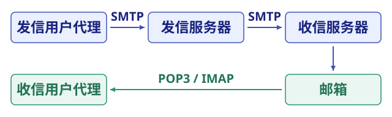

# 应用层

应用层把下层的通信能力组织成用户能够使用的服务，例如域名解析、文件传输、邮件和 Web。**应用层协议约定进程之间交换什么报文、报文怎样解释，以及收到报文后怎样行动。**

## 应用的组织方式

我们已经在概述的[信息访问](./cn_intro.md#信息访问)部分介绍了 C/S 模型和 P2P 模型。而对用户（请求方）来说，信息访问就是网络应用做的事。我们这里只讨论两种模型各自的优势和不足之处。

-   **C/S** 易于集中管理和访问控制；但服务器及其接入链路可能成为性能瓶颈（可扩展性不佳），故障也可能集中影响用户。
-   **P2P** 利用参与节点的计算、存储和上传能力，规模扩大时也能增加供给（可扩展性好）；但节点频繁加入、离开，会增加资源发现、一致性和安全管理的难度；节点在获取服务的同时，为其他节点提供服务，这也会占用过多系统资源。当然，P2P 系统也可以借助中心服务器完成登录、索引或节点发现；但核心服务仍然是各节点平等提供的。

!!! info "为什么现在不常提到 P2P 模式了？"
    除了上述缺点，据某些互联网调研机构统计，在某些年份，P2P 应用曾经占到互联网流量的 50%~90%，导致了严重的网络拥塞。所以，各 ISP（互联网服务提供商）通常对 P2P 应用持限制或反对态度。

## 域名系统 DNS

**DNS（Domain Name System，域名系统）** 是互联网采用的命名系统，把更便于人们记忆的特定的字符串与更便于机器处理的 IP 地址等资源信息联系起来。一个域名可以对应多个地址，一个地址也可以被多个域名使用。DNS 采用 **C/S 模型**，协议运行在 **UDP 之上**，服务端口 53。

### 域名空间与管理区域

互联网采用分层树状结构命名与分布式数据库。任何连接到互联网的主机或路由器都拥有唯一的层次结构名称，即 **域名（Domain Name）**。域就指名字空间中一个可被管理的划分，描述名字树中的子树。

域可以进一步划分为子域，子域还可以继续细分，从而形成顶级域、二级域、三级域等等。每一个域名由一系列标签（标号）组成，这些标签都各自在某个层次的域中，标签之间使用“.”分隔。

-   域名从右向左，层次由高到低。
-   标签中不区分 ASCII 字母大小写；标签中除了连字符（`-`）外，不可以使用其他标点符号。
-   每个标签最多 63 B，完整域名（含分隔点）在线格式下最多 255 B，包含长度字段与根标签。

!!! tip "“二级域名”指节点还是指注册名？"
    我们把 DNS 看成一棵树，把每个标签看作一个树中的节点。我们的教材（以及王道）按标签在域名树中的深度分级：[`www.zju.edu.com`](https://www.zju.edu.cn) 中，`cn` 是顶级域名，`edu` 是二级域名，`zju` 是三级域名，`www` 是四级域名。

    但在实际的注册与管理中，我们以 **完整注册名** 为单位。`zju.edu.cn` 合起来才称为三级域名，`www` 只是该域下的主机名（子域名）。
    
    !!! warning "两种说法视角不同、并不矛盾。应试时，一般都按教材的“按标号分级”作答。"

-   **顶级域**（TLD）：包括 `com`、`org` 等通用顶级域（gTLD），以及 `cn`、`uk` 等国家和地区顶级域（ccTLD），还有用于反向域名解析的基础结构域名（arpa）。
-   各级域名由其上一级的域名管理机构管理。顶级域名由 ICANN（互联网名称与数字地址分配机构）管理。
    -   国家顶级域名下的二级域名由相应国家自行规定和管理，例如，我国负责管理 `cn` 域，其中将 `edu.cn` 子域（二级域名）交由 CERNET 管理。
-   `www.zju.edu.cn.` 是完整绝对域名，末尾的 `.` 表示根。日常书写经常省略末尾点，配置文件中则要区分绝对名和相对名。


### 域名服务器

域名到 IP 的解析是由运行在 **域名服务器** 上的程序完成的。一个域可以通过委派划分为多个 **区（zone）**。每个区内的所有节点必须是连通的，并设有相应的权限域名服务器。

DNS 采用分层树形结构，那么域名服务器也是按层次组织的。没有一台域名服务器包含互联网上所有主机的映射，这些映射分布在各服务器上；每台服务器不仅要能解析部分域名到 IP 地址的映射，还要维护指向其他域名服务器的信息，当自身无法解析时，要能知道向哪个服务器进一步查询。有四种类型的域名服务器：

-   **根域名服务器**。DNS 层次结构中的最高层级，知道全部顶级域名服务器的域名与 IP 地址；本地域名服务器自身无法解析时，首先向它查询。全球共 13 个根域名服务器，每个实际上由多个冗余服务器组成集群以提高可靠性和性能；它通常不直接给出 IP 地址，而是返回下一步应查询的顶级域名服务器地址。
-   **顶级域名服务器**。负责管理在其下注册的所有二级域名，例如 `.com` 顶级域名服务器管理所有以 `.com` 结尾的域名。收到查询时，它可能返回最终解析结果，也可能返回下一步应查找的域名服务器的 IP 地址。
-   **权限域名服务器**（授权域名服务器/权威域名服务器）。<u>负责管理特定区的域名信息</u>；每个主机必须在所属区的权限服务器处登记，该服务器<u>总能将其管辖的主机名解析为对应的 IP 地址</u>。为提高可靠性，每个区通常建议配置至少两个权限服务器；许多本地域名服务器也同时承担这一角色。
-   **本地域名服务器**（本地解析器）。<u>主机发起查询的第一站</u>。主机域名解析请求首先发送给其配置的本地域名服务器；每家 ISP、一所大学甚至大学中的各院系通常都部署自己的本地域名服务器。事实上，Windows “本地连接”中填写的 DNS 服务器地址，就是该主机所用的本地域名服务器地址。

### 域名解析的过程

一般来说，域名解析有两种方式。

-   **递归查询** 要求被询问者代为完成解析，返回最终结果或失败。主机向本地域名服务器的查询一般都是递归查询。
-   **迭代查询** 允许被询问者返回委派线索，由询问者继续查询。本地域名服务器向外查询可以采用递归查询或迭代查询。

一次常见的迭代查询解析过程是：

1. 主机检查本地缓存；未命中则询问本地递归解析器。
2. 解析器检查缓存；**未命中则询问根服务器**，得到顶级域的指引。
3. 解析器询问顶级域服务器，得到相应权威服务器的指引。
4. 解析器询问权威服务器，取得地址或继续处理别名。
5. 解析器缓存结果，并把答案返回主机。

!!! warning "本地解析器向外查询实际上几乎不采用递归查询"
    我们已经知道，如果本地域名服务器没有对应缓存，那么会向根服务器发起查询。如果采用递归查询，那根服务器又要向下查询，又要负责解析域名，会给根域名服务器带来过重的负载。

缓存命中时，可以跳过部分乃至全部外部查询。解析得到的缓存可概括为五元组 **`(名称，TTL，类别，类型，值)`**。类别通常为 `IN`（表示 Internet），TTL 表示记录可缓存的时间。TTL 到期后需要重新按照查询流程取得信息。

!!! info "你知道吗..."
    设定上，RFC 1035 规定了四个类别，`IN` Internet，`CS` CSNET，`CH` Chaosnet，`HS` Hesiod。`CS` 现在已经不用了，公网的 DNS 实际上只用 `IN`，所以缓存里的记录类别几乎总是 `IN`。严格来说，运行时可以忽略这个字段。

<center markdown>

| 类型 | 主要用途 | 值的例子或含义 |
| --- | --- | --- |
| **A** | 域名对应的 IPv4 地址 | 一个 32 bit 地址 |
| **AAAA** | 域名对应的 IPv6 地址 | 一个 128 bit 地址 |
| **NS** | 指定区域的权威服务器 | 域名服务器名称 |
| **CNAME** | 别名指向规范名称 | 还需继续查询规范名称的记录 |
| **MX** | 指定邮件交换服务器 | 优先级与服务器名称，数值较小者优先 |
| **PTR** | 反向地址解析 | 从反向名字空间查找名称 |
| **SOA** | 区域管理信息 | 主服务器、序列号与相关计时参数 |
| **TXT** | 保存文本信息 | 域名相关的说明或验证数据 |

</center>

DNS 返回的可能是答案，也可能是别名或下一步查询的线索。DNS 报文中的附加记录可以顺带提供下一步所需地址，减少查询次数。

## 文件传输 FTP

**FTP（File Transfer Protocol，文件传输协议）** 采用 C/S 模型，基于 TCP 提供可靠的传输服务。它提供交互式访问，允许用户指定文件的类型与格式，并支持对文件设置存取权限。通过 FTP，用户可以实现：

-   支持不同类型 OS 之间的文件传输；
-   通过用户权限管理，提供对远程 FTP 服务器上文件的共享能力；
-   通过匿名 FTP 方式，实现公用文件的共享。

FTP 服务器进程分成两部分：**主进程** 负责接受新请求，若干 **从属进程** 分别处理单个客户的请求。

FTP 在工作时使用**两个并行的 TCP 连接**，把控制命令与文件数据分放在不同连接中；采用两个独立端口有助于协议的清晰实现，控制信息也因此属于**带外（out-of-band）**传送。

-   **控制连接**。服务器监听 **21** 端口等待客户连接，该连接用于传送登录、目录操作、传送命令等控制命令，并在**整个会话期间保持打开**。客户通过它发送文件传送请求，但控制连接本身不传送文件数据；传输过程中仍可经它发送中断等指令。
-   **数据连接**。服务器的控制进程收到文件传送请求后，创建数据传送进程并建立数据连接；该连接用于两端数据传送进程之间的通信，实际完成文件内容（或目录列表）的传输，传输结束后数据连接关闭，数据传送进程随之终止。

    数据连接有**主动（PORT）**与**被动（PASV）**两种模式：

    | 模式 | 建立过程 |
    | --- | --- |
    | **主动模式 PORT** | 客户登录后随机选择一个本地端口，用 `PORT` 命令把该端口号告知服务器；**服务器随后从其 20 端口** 主动连接该端口以传送数据。 |
    | **被动模式 PASV** | 客户登录后发送 `PASV` 命令；**服务器在本地随机开放一个端口**，并经控制连接把端口号返回客户，由客户再主动连接该端口传送数据。 |

    主动和被动是相对于服务器而言的：主动模式下，服务器主动连接客户；被动模式下，服务器被动响应客户的连接。需要注意，采用主动或被动由客户决定。许多教材未详细介绍这两种模式，若无特别说明，可默认采用主动模式。

此外，FTP 还支持 ASCII 和 Binary 两种方式的传输。

## 电子邮件

### 从发信到读信

电子邮件是一种**异步通信方式**，不要求通信双方同时在线：发送端把邮件发送至收件人所用的邮件服务器并存入其邮箱，收件人可随时登录自己的邮件服务器读取。

完整的电子邮件系统包含三个主要组成部分：**用户代理（User Agent，UA）**、**邮件服务器**，以及邮件所依赖的**协议**（如 SMTP、POP3 或 IMAP）。

-   **用户代理**。用户与电子邮件系统之间的接口，提供友好的操作界面，用于发送和接收邮件，至少应具备撰写、显示和处理邮件等基本功能；通常为运行在个人计算机上的客户端软件，如 Outlook、Foxmail。
-   **邮件服务器**。负责邮件的发送与接收，并向发件人反馈传送状态（如已投递、被拒收或丢失等）。它采用 C/S 模式，但具有双重角色：既能作为服务器接收邮件，又能作为客户发送邮件——邮件服务器 A 向 B 发信时，A 扮演 SMTP 客户，B 作为 SMTP 服务器，反之亦然。
-   **协议**。UA 用**发送协议**（典型代表为 SMTP）把邮件发送给邮件服务器，或在邮件服务器之间传递邮件；用**读取协议**（如 POP3、IMAP）从邮件服务器获取邮件。SMTP 采用**推（Push）**的方式，由 UA 或发送端服务器主动把邮件推送至目标服务器；POP3 采用**拉（Pull）**的方式，由 UA 主动请求，从邮箱中拉取邮件。

<figure markdown>



</figure>

以采用上面提到的协议为例，一次收发过程可概括为六个步骤：

1. 发件人通过用户代理撰写并编辑待发送的邮件。
2. 点击“发送”后，后续工作由用户代理自动完成：它使用 SMTP 把邮件传送给**发送端邮件服务器**。
3. 发送端邮件服务器把邮件暂存在**邮件缓存队列**中，等待发送。
4. 发送端服务器的 SMTP 客户端与接收端服务器的 SMTP 服务器建立 TCP 连接，依次把缓存队列中的邮件直接发送至接收端。
5. 接收端服务器的 SMTP 服务器进程收到邮件后，将其存入对应收件人的**邮箱**，等待收件人读取。
6. 收件人查收时启动用户代理，通过 POP3（或 IMAP）从接收端服务器的邮箱中下载邮件。

!!! note "基于 Web 的电子邮件服务"
    随着万维网 WWW 的普及，基于 Web 的电子邮件服务开始大量出现，如 Gmail。Web 邮箱的浏览器 **通过 HTTP/HTTPS **与邮件服务器交互（包括发送和读取邮件）。这时，仅在不同服务器之间才通过 SMTP 传送邮件。

### 邮件格式与 MIME

一封电子邮件由 **信封** 与 **内容** 两大部分组成，内容又分为 **首部、空行、主体**。RFC 822 规定了首部的格式，主体由用户自由撰写；用户只需填写首部信息，邮件系统会自动从中提取所需信息并生成信封，无须手动填写信封内容。

首部由若干 **首部行** 构成，每行由一个关键字、冒号及对应的值组成，关键字有的必需、有的可选：

-   `To`：必填，指定一个或多个收件人的电子邮件地址。地址格式为“**收件人邮箱名@邮箱所在主机的域名**”，例如 `abc@qq.com`；邮箱名 `abc` 在该域名对应的邮件服务器上必须唯一，以保证地址在整个互联网范围内唯一。
-   `Subject`：可选，标明邮件主题，简要反映邮件的主要内容。
-   `From`：必填，但通常 **由邮件系统自动填充**，用户一般无须手动输入。

首部与主体之间 **以一个空行分隔**，例如：

```text
From: fh@zju.edu.cn
To: abc@qq.com
Subject: Say hello to Internet

blahblah…
```

**SMTP 只支持传输 7 位 ASCII 码文本邮件**，因此无法直接传送中文、俄文等非英语字符，也无法传输可执行文件或其他二进制对象。**MIME（Multipurpose Internet Mail Extensions，多用途互联网邮件扩展）** 并未修改或取代 SMTP，而是在其基础上扩展：发送端先把非 ASCII 数据编码为 ASCII 格式，再交由 SMTP 传输；接收端收到邮件后再解码还原，恢复原始内容。

<figure markdown>


</figure>

MIME 主要包括三部分内容：

1. 定义了 5 个新的首部字段：MIME 版本、内容描述、内容标识、传送编码和内容类型。
2. 标准化了多种邮件内容的格式，为多媒体电子邮件的表示方法提供统一规范。
3. 定义了传送编码机制，能对任意类型的内容进行编码转换，而不会被邮件系统改变。

常见 MIME 字段有：

- `MIME-Version`：所用 MIME 版本。
- `Content-Type`：内容类型与子类型，例如 `text/plain`、`image/jpeg`、`application/pdf`；文本还可指定字符集。
- `Content-Transfer-Encoding`：传输编码，例如 Base64。
- `Content-Disposition`：内容作为正文显示还是作为附件处理，以及文件名等信息。

`multipart` 把一封邮件组织为多个部分，用边界字符串分隔；每部分可以有自己的类型与编码。MIME 解决的是内容表示，不负责把邮件从服务器送往另一服务器。

### Base64 编码

Base64 每次把 **3 B，即 24 bit** 分成四组，每组 6 bit，再映射为一个可打印字符：

<figure markdown>


</figure>

最后不足 3 B 时，补零完成 6 bit 分组，并用 `=` 标记：剩 1 B 时末尾补 `==`，剩 2 B 时补 `=`。忽略换行等附加开销，$N$ B 数据编码后的长度为：

$$
L=4\left\lceil\frac N3\right\rceil\ \mathrm B
$$

!!! example "Man 编码为什么是 TWFu"

    `M a n` 的 ASCII 值分别为 77、97、110，连起来是：

    ```text
    01001101 01100001 01101110
    010011   010110   000101   101110
      19       22        5       46
       T        W        F        u
    ```

    3 B 输入得到 4 B 输出，结果为 **`TWFu`**，无需填充。Base64 是编码，接收方可直接还原原数据。

### SMTP 的提交与传送

**SMTP（Simple Mail Transfer Protocol，简单邮件传输协议）** 用于提供可靠且高效的电子邮件传输，规范两个相互通信的 SMTP 进程之间如何交换信息。它采用 C/S 模式：负责发送邮件的进程作为 **SMTP 客户**，负责接收邮件的进程作为 **SMTP 服务器**；基于 TCP，服务器之间常用端口 **25**，邮件提交服务常用端口 587。

通信过程可分为三个阶段：

1. **连接建立**。邮件进入发送端服务器的缓存队列后，SMTP 客户会定期扫描该队列，一旦发现待发邮件，便主动与接收端服务器的 SMTP 服务器建立 TCP 连接（目标端口 25）。连接成功后，接收端先发送 `220 Service ready`；随后客户发送 `HELO`（或 `EHLO`）命令并附上发送端主机名，以标识自身身份。
2. **邮件传送**。以 `MAIL FROM: <发件人地址>` 开始，服务器准备好接收时返回 `250 OK`；随后客户发送一个或多个 `RCPT TO: <收件人地址>`，每个命令都会触发响应，例如 `250 OK` 或 `550 No such user here`。`RCPT` 的作用是预先验证收件人地址的有效性，避免发送长篇邮件后才发现地址错误、浪费通信资源。收到全部肯定响应后，客户发送 `DATA`，服务器回复 `354 Start mail input; end with <CRLF>.<CRLF>`；客户随后逐行发送邮件内容，并以 `<CRLF>.<CRLF>` 作为内容结束标志。
3. **连接释放**。邮件发送完成后，客户发送 `QUIT`；服务器返回 `221`（服务关闭），同意释放 TCP 连接，本次传送全部结束。

需要注意，**SMTP 不使用中间邮件服务器中继**：TCP 连接始终在发送端与接收端的邮件服务器之间直接建立，不论二者相距多远、数据经过多少个路由器。若接收端服务器因故障暂时无法响应，发送端服务器会等待一段时间后重新尝试连接。

实际投递依据的是**信封信息**，它与邮件正文前供用户阅读的 `From:`、`To:` 等首部字段分属不同层次。邮件服务器可以通过 DNS 的 **MX 记录**查找收件域的邮件服务器。

### POP3 与 IMAP

| 比较项 | POP3 | IMAP |
| --- | --- | --- |
| 主要思路 | 从邮箱取回邮件，便于本地处理 | 在服务器上组织、访问与同步邮箱 |
| 服务器状态 | 可按设置保留或删除已取邮件 | 保存文件夹、已读标记等状态 |
| 多设备使用 | 各客户端需协调本地副本 | 便于同步访问同一邮箱 |
| 基本服务端口 | TCP 110 | TCP 143 |

-   **POP3（Post Office Protocol 3，邮局协议第 3 版）** 结构简单但功能有限，采用 C/S 模式，基于 TCP，使用端口 **110**。

    用户代理需运行 POP3 客户程序，邮件服务器运行 POP3 服务器程序。它支持两种工作模式：
    -   **下载并保留**，用户读取后邮件仍留在服务器上，可供后续再次访问；
    -   **下载并删除**，邮件一旦被成功读取即从服务器上删除。

-   **IMAP（Internet Message Access Protocol，互联网报文存取协议）** 功能更强大：支持在服务器端创建文件夹、在不同文件夹之间移动邮件，以及对远程邮箱中的邮件进行搜索等在线操作，因此 IMAP 服务器需要维护用户的 **会话状态信息**。
    
    它还支持 **选择性获取**，即用户代理可以只下载邮件的特定部分，例如仅取首部，或只提取多部分 MIME 邮件中的某一部分；这在低带宽环境下尤为实用，用户无须下载整封含音频、视频等大附件的邮件，即可快速浏览或筛选内容。

使用隐式 TLS 的 POP3、IMAP 服务常用端口分别为 995、993。

## Web 的组成与一次访问

### URL、浏览器与服务器

**Web**通过链接组织资源，用 **URL（统一资源定位符）**指明怎样访问资源。URL 属于更一般的 **URI（统一资源标识符）**。

```text
https://www.example.com:443/course/network.html?chapter=5#routing
协议      主机名        端口       路径          查询      片段
```

片段标识符由客户端用于定位资源内部位置，不作为 HTTP 请求目标发送给服务器。省略端口时，HTTP 默认使用 80，HTTPS 默认使用 443。

浏览器先确定 URL，按需解析域名、建立传输与安全连接，发送请求，再处理响应。取得 HTML 后，还会根据内容请求样式、脚本和图像等资源，并构建页面。

服务器解析请求、检查权限与缓存，读取静态文件或调用程序生成内容，最后返回响应。缓存、并发处理和连接复用可以减少重复工作。

### 静态页面与动态页面

- **HTML**描述内容结构，**CSS**控制呈现，**JavaScript**负责交互逻辑。
- **服务器端动态生成**：服务器根据输入、数据库等信息生成响应，例如 CGI、PHP、JSP 等方式。
- **客户端动态更新**：脚本在浏览器中修改 DOM，并按需请求数据。

**AJAX**把异步请求与局部页面更新结合起来：请求等待期间界面仍可交互，数据到达后再更新需要变化的部分。名称中的 XML 是一种数据表示方式，也可以交换 JSON 等格式。

## HTTP

**HTTP（Hypertext Transfer Protocol，超文本传输协议）**规定请求与响应的语义。**HTTPS**通过安全传输保护 HTTP 通信；基于 TCP 时通常在 HTTP 与 TCP 之间使用 TLS。

### 请求与响应格式

HTTP/1.1 报文由**开始行、首部字段、空行与可选消息体**组成。请求行说明方法、请求目标与版本；响应状态行说明版本、状态码与原因短语。

```http
GET /course/network.html HTTP/1.1
Host: www.example.com
Accept: text/html

```

最后的空行标志首部结束。请求目标通常是路径与查询部分，`Host` 指明目标主机；它们共同帮助服务器确定所请求的资源。

```http
HTTP/1.1 200 OK
Content-Type: text/html; charset=utf-8
Content-Length: 16

<h1>Network</h1>
```

这里消息体按所示 ASCII 内容计算为 16 B，不包括首部与分隔空行。HTTP/2、HTTP/3 采用不同的线上帧格式，但继续使用方法、状态码和字段等语义。

### 常见方法与状态码

| 方法 | 作用 |
| --- | --- |
| **GET** | 获取目标资源的表示 |
| **HEAD** | 获取类似 GET 的响应首部，不返回消息体 |
| **POST** | 把数据交给目标资源处理，例如提交表单 |
| **PUT** | 用请求中的表示创建或替换目标资源 |
| **DELETE** | 请求删除目标资源的相应关联 |
| **OPTIONS** | 查询目标支持的通信选项 |
| **TRACE** | 请求应用层回环，辅助诊断 |
| **CONNECT** | 请求建立到目标的隧道 |

**HEAD 的“首部”是 HTTP 响应首部，不是 HTML 的 `<head>` 元素。** POST 的具体处理由目标资源定义。

| 类别 | 含义 | 常见状态码 |
| --- | --- | --- |
| **1xx** | 信息性响应 | 100 Continue |
| **2xx** | 成功 | 200 OK、204 No Content |
| **3xx** | 重定向或缓存验证相关响应 | 301 Moved Permanently、304 Not Modified |
| **4xx** | 客户端请求相关错误 | 400 Bad Request、403 Forbidden、404 Not Found |
| **5xx** | 服务器处理错误 | 500 Internal Server Error、503 Service Unavailable |

### 连接复用与版本演进

| 版本 | 连接与传输方式 | 关键特点 |
| --- | --- | --- |
| **HTTP/1.0** | 典型模型采用非持久 TCP 连接 | 每个对象单独建立连接 |
| **HTTP/1.1** | 默认持久连接 | 同一 TCP 连接可承载多个请求；流水线可连续发请求，但响应仍按请求顺序返回 |
| **HTTP/2** | 在 TCP 上使用二进制分帧 | 多流复用、首部压缩；协议还定义了服务器推送等机制 |
| **HTTP/3** | 在 QUIC 上运行 | 以独立流减少跨流的传输层队头阻塞 |

HTTP/2 中多个流可以交错传送，消除了 HTTP/1.1 流水线对响应顺序的限制；底层 TCP 缺失字节时，连接的后续字节仍需等待。HTTP/3 通过 QUIC 把可靠有序交付分别组织在各条流中。

### 访问时延怎样计算

忽略发送、处理与排队时间，设 DNS 解析耗时为 $T_D$，客户端到 Web 服务器的 RTT 为 $R$，不计 TLS 等额外握手。取得一个小对象通常需要 **1 RTT 建立 TCP + 1 RTT 请求与响应**，共 $T_D+2R$。

!!! example "HTML 页面还引用三个小对象"

    四个对象在同一服务器上，必须先取得 HTML 才知道另外三个对象；不使用并行连接：

    | 方式 | 总时间 |
    | --- | --- |
    | 非持久连接，逐个请求 | $T_D+4\times2R=T_D+8R$ |
    | 持久连接，非流水线 | $T_D+R+4R=T_D+5R$ |
    | 持久连接，流水线 | $T_D+R+R+R=T_D+3R$ |

    最后一行分别对应建立连接、获取 HTML、流水线获取三个对象。若题目允许并行连接，或给出对象大小与链路速率，应按实际时序重新累计。

### 缓存与条件请求

HTTP 缓存先判断已有响应是否仍新鲜；可以直接使用时，无须重新传送对象。需要验证时，客户端发送**条件 GET**：

- `If-None-Match` 携带已有 **ETag**，供服务器比较表示是否变化。
- `If-Modified-Since` 携带已有修改时间。
- 未修改时，服务器可返回 **304**，客户端继续使用缓存中的消息体。

`Cache-Control` 规定缓存行为。`no-cache` 要求复用前验证，`no-store` 要求不存储相应内容；两者针对的动作不同。

### Cookie 与会话

HTTP 的无状态语义使请求本身不自动携带上一轮业务状态。服务器可以通过响应中的 **`Set-Cookie`**设置名称与值，浏览器随后在符合条件的请求中使用 **`Cookie`**字段带回。

常见属性包括作用域 **Domain、Path**，有效期 **Expires、Max-Age**，以及 **Secure、HttpOnly、SameSite**等。Secure 限制安全传输，HttpOnly 限制脚本读取，SameSite 约束跨站发送条件。

Cookie 中可以只保存一个会话标识；购物车、登录状态等实际数据保存在服务器上，再按标识查找。**Cookie 是浏览器保存并回传的数据机制，会话是应用组织状态的方式。**

网站也可以利用 Cookie 或浏览器指纹识别访问者。隐私分析需要同时关注数据由谁收集、会在哪些请求中发送，以及是否跨站关联。
