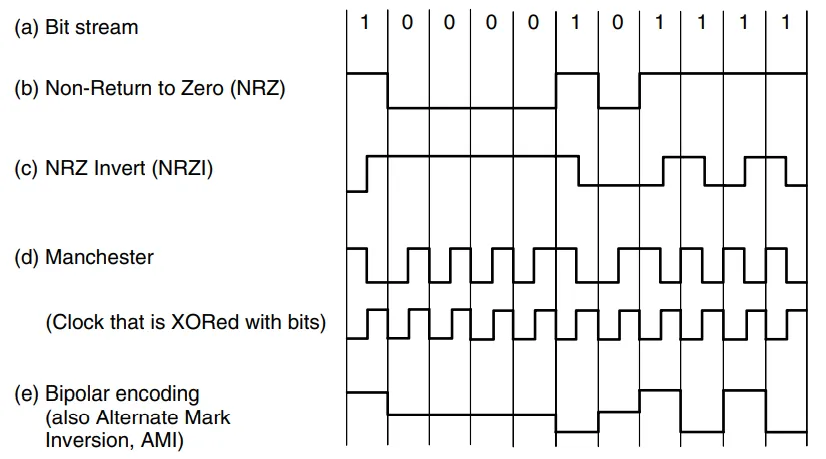
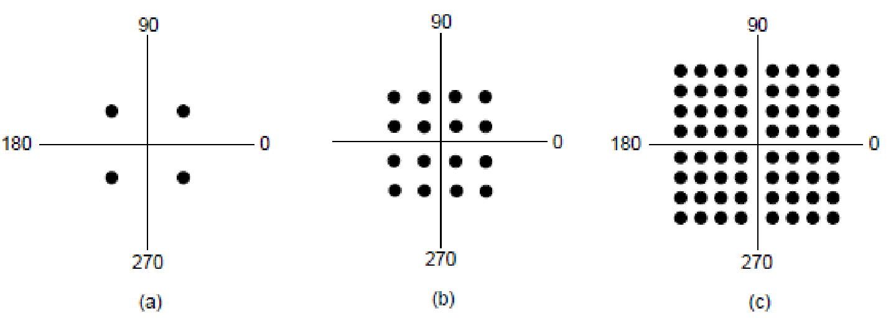
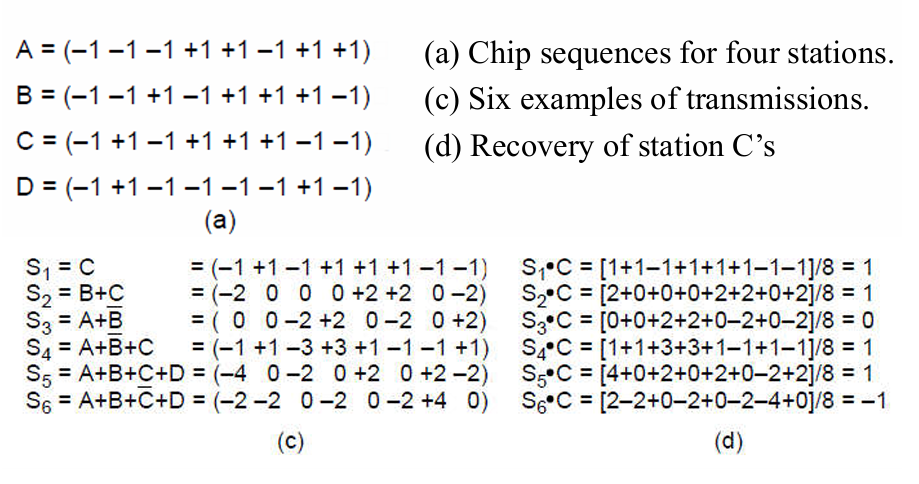
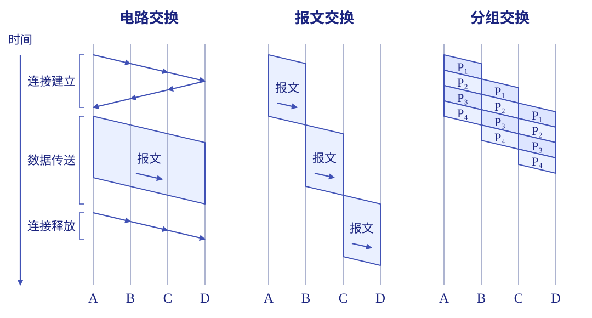
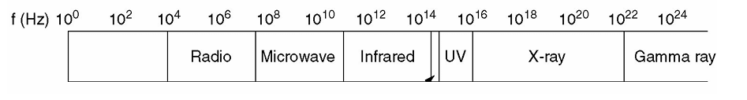

# 物理层

物理层要解决的是：**怎样把一串比特变成信号，经过传输介质，再让另一端把比特读出来。** 它关心电压、频率、光脉冲、接口和时序；至于这些比特组成什么帧、发给哪个地址，则交给上面的层处理。在我们的参考模型中，物理层位于最底层：它定义电气、时序等接口，使比特能够以信号的形式沿信道传输。

## 数据通信的理论基础

### 数据通信基本概念 +

**数据**是要传递的内容，**信号**是数据在传输时的物理表现。例如，一串 `0101` 是数据，网线上的电压变化或光纤里的光脉冲是信号。

- **模拟数据／模拟信号**：取值连续，例如话筒输出的语音电压。
- **数字数据／数字信号**：用有限个离散值表示，例如二进制比特，以及用高、低电平表示比特的信号。

数字信号在真实线路上也会经历上升、下降和失真。我们说「离散」，是指接收端将把接收到的数字信号判成有限种状态。

一个简化的通信系统可以写成：

```text
信源 → 发送器 → 信道 → 接收器 → 信宿
               ↑
              噪声
```

- **信源**产生要发送的数据，**信宿**接收最终的数据。
- **发送器**把数据变成适合信道传输的信号，**接收器**从信号中恢复数据。
- **信道**是信号传输的通路。**传输介质**是承载信号的实际材料或空间，例如双绞线、光纤、自由空间。一条介质可以通过复用承载多条信道。
- **噪声**是叠加在有用信号上的干扰，会影响接收端判断。

按信道允许通过的频率，常见的两种模型是：

- **低通信道**：可以通过从接近零频到某个上限的频率成分。
- **带通信道**：只允许某个频率区间内的成分通过，需要把信号搬到相应频段。

### 单工、半双工与全双工

| 通信方式 | 数据传输方向 | 例子 |
| --- | --- | --- |
| **单工 Simplex** | 只能单向传输 | 广播电台向收音机发送 |
| **半双工 Half-duplex** | 两端都能发送，但要轮流 | 对讲机 |
| **全双工 Full-duplex** | 两端可以同时发送 | 电话通话 |

<div class="supplement" markdown="1">
<p class="supplement__title">串行／并行，同步／异步 +</p>

- **串行传输**：比特按先后顺序发送；**并行传输**：多位同时在多条线上发送。
  - 计算机网络中长距离传输通常采用串行传输方式，计算机内部则通常采用并行传输方式。
- **异步传输**：通常以字符为单位，字符前后加起始位、停止位（标识符），字符之间的间隔可以变化。
- **同步传输**：以连续的数据块传输，收发两端需要保持比特时钟同步，再识别数据块的边界。时钟可以另线传送，也可以从信号跳变中恢复。

</div>

### 带宽、码元率、比特率

!!! question "为什么带宽会限制数据率？"
    从傅里叶分析来看，一个周期信号可以分解成不同频率的正弦、余弦分量。频率为 $f_0$ 的基本重复成分叫**基波**，$2f_0,3f_0,\ldots$ 是相应的谐波。

    想把方波的边沿表示得很陡，需要保留较多高频分量。实际信道只允许一定频率范围内的成分较好地通过，高频成分被削弱后，接收到的波形会变圆、展宽。符号排得太密时，前一个符号还没「收住」，后一个已经到来，就会产生**码间串扰**。

    因此，**信道带宽有限，会限制可分辨的符号传输速度。** 噪声又会进一步限制接收端区分不同状态的能力。

!!! example "例题：一组 8 位数据的谐波"

    把 8 位数据看成不断重复的一组模式，数据率为 $R_b\,\mathrm{bit/s}$，那么模式周期是 $T=8/R_b$，基波频率为 $f_0=R_b/8$。

    若理想化地只让 $3000\,\mathrm{Hz}$ 以内的成分通过，则可通过的最高谐波次数约为 $3000/(R_b/8)=24000/R_b$。数据率越高，保留下来的谐波越少，波形越难还原。

用 $W$ 表示频率带宽，$R_s$ 表示码元率，$R_b$ 表示比特率：

| 量 | 含义 | 单位 |
| --- | --- | --- |
| **频率带宽 $W$** | 信道能有效通过的频率区间宽度，通常写成 $f_{\mathrm{高}}-f_{\mathrm{低}}$ | Hz |
| **码元率 $R_s$** | 每秒传送多少个码元（符号），也叫<u>波特率</u> | Baud，即 symbol/s |
| **比特率 $R_b$** | 每秒传送多少个比特，也叫<u>数据率</u> | bit/s、b/s |

**码元**是在一个符号时间内发送的一种信号状态或波形，例如一个电平、一种载频或一种相位。连续两个码元可以相同。

若每个码元可独立选择 $M$ 种状态，并且采用等长二进制映射，$M=2^k$ 时：

$$
k=\log_2M,\qquad R_b=R_s\log_2M
$$

例如，8 种电平对应每码元 3 bit，即 $2400\,\mathrm{Baud}$ 对应 $7200\,\mathrm{bit/s}$。有编码冗余时，还要区分线路上发送的编码比特与原始有效数据。

网络语境也常把链路能达到的数据率称为「带宽」，单位是 bit/s。做奈奎斯特、香农计算时，公式里的 $W$ 都是 **Hz**。

### 奈奎斯特定理

**奈奎斯特定理（Nyquist's theorem）**指出：在理想、无噪声、带宽为 $W\,\mathrm{Hz}$ 的**低通信道**中，无码间串扰的最高码元率为：

$$
R_{s,\max}=2W
$$

若每个码元有 $M$ 种可区分状态，最高数据率为：

$$
R_{b,\max}=2W\log_2M
$$

从奈奎斯特定理，我们可以知道：增加带宽可以提高码元率；在相同码元率下，让每个码元携带更多比特也可以提高数据率。

!!! example "示例：8 kHz、8 电平"

    假设某无噪声低通信道的带宽为 $8\,\mathrm{kHz}$，每个信号包含 8 级（每个码元可从 8 中状态之一选择），则其理论最大波特率和数据率为：

    $$
    R_{s,\max}=16\,\mathrm{kBaud},\qquad
    R_{b,\max}=2\times8000\times\log_2 8=48\,\mathrm{kbit/s}
    $$

### 香农定理

**香农定理（Shannon's theorem）**指出：对于带宽为 $W\,\mathrm{Hz}$、受高斯白噪声干扰的信道，其信道容量为：

$$
C=W\log_2\left(1+\frac SN\right)\quad(\mathrm{bit/s})
$$

$S$ 是信号平均功率，$N$ 是带宽内的噪声平均功率。与奈奎斯特公式相比，这里没有限定某一种调制的电平数，而是由**带宽和信噪比**给出可靠传输速率的理论上限。

功率信噪比与分贝的换算为：

$$
\mathrm{SNR}_{\mathrm{dB}}=10\log_{10}\frac SN,
\qquad \frac SN=10^{\mathrm{SNR}_{\mathrm{dB}}/10}
$$

例如 $20\,\mathrm{dB}\Rightarrow S/N=100$，$30\,\mathrm{dB}\Rightarrow S/N=1000$。

!!! warning "同时给出两个限制"

    题目同时给出低通信道带宽、可用状态数与信噪比时，分别算两个上界，再取较小值：

    $$
    R_b\le\min\left\{2W\log_2M,\ W\log_2(1+S/N)\right\}
    $$

    !!! example "例 1：二进制信号，3 kHz，20 dB"

        奈奎斯特上界为 $2\times3000\times\log_2 2=6000\,\mathrm{bit/s}$。

        香农上界为 $3000\log_2 101\approx19975\,\mathrm{bit/s}$。

        题目限定二进制码元，因此两个上界中更紧的是 **$6000\,\mathrm{bit/s}$**。

    !!! example "例 2：理想低通信道，以 8 个离散电平传 B bit/s，信噪比 20 dB"

        奈奎斯特定理和香农定理分别要求：

        $$
        W\ge\frac{B}{2\log_2 8}=\frac B6,
        \qquad W\ge\frac{B}{\log_2 101}
        $$

        因而带宽下界是 $\max\{\dfrac B6,\,\dfrac {B}{\log_2 101}\}= \dfrac B6\,\mathrm{Hz}$。

## 编码与调制

我们想要传送的是比特（数据），信道中传播的却是电压、光强等物理量（信号）的变化。所以我们需要一些转换机制。

- **编码 Encoding**：将数据转换为数字信号。
- **调制 Modulation**：将数据转换为模拟信号。

总的来说，这两种转换方式分别能够与某一传输方式相配对：

- **基带传输 Baseband Transmission**：不先搬到一个高频载波上，而是直接发送编码后的基带信号；频谱位于零频附近到某个上限。
- **通带传输 Passband Transmission**：通过调制，把信号搬到载波频率附近的一段频带中，接收端再解调。

### 数字数据的基带编码

接收端必须知道每一位从哪里开始、到哪里结束，这被称之为**时钟恢复／位同步**。如果线路电平很久都不变，接收端就容易错读、漏读或者多读数据。下面的编码方案主要在同步能力和带宽开销之间取舍。

<figure markdown="1">
{:width="80%"}
</figure>

#### 不归零编码

**不归零编码（Non-Return-to-Zero，NRZ）**用两种电平表示 0 和 1，在一个比特时间内维持电平，位末不专门回到零。图中高电平表示 1，低电平表示 0。

这一编码方式的优点是简单（实际上也是编码效率最高的方式）；问题是长串 0 或长串 1 都没有跳变，不能靠这段信号持续校准时钟（不含同步信息，收发双方需要额外时钟线）。

#### 不归零倒相编码

**不归零倒相编码（Non-Return-to-Zero Inverted，NRZI）**不直接看高、低电平，而是看读到当前数据位时，信号**是否相对之前翻转（跳变）**。它和 NRZ 的区别就在关注点的不同。

课堂上的例图（上图）采用的约定是：翻转表示 1，不变表示 0；具体协议的约定可能与此不同，王道中给出的 NRZI 实现就是无跳变表示 1。

这样，有跳变时可以辅助时钟恢复。

#### 曼彻斯特编码

**曼彻斯特编码（Manchester encoding）**的**每个码元中间一定有一次跳变**，跳变方向代表数据，同时提供时钟信息。

我们常用**高 → 低（下降沿）表示 1**，**低 → 高（上升沿）表示 0**。当然，也有协议采用相反的约定。

每个数据位需要两个半比特信号单元，因此同数据率下的信号单元速率是 NRZ 的两倍。

!!! example "NRZ 与曼彻斯特编码的最低带宽"

    沿用理想低通模型，若要求有效数据率为 $B\,\mathrm{bit/s}$：

    - NRZ 的信号单元速率为 $B$，由奈奎斯特定理 $R_s\le2W$ 得 $W\ge B/2\,\mathrm{Hz}$。
    - 曼彻斯特的信号单元速率为 $2B$，因此 $W\ge B\,\mathrm{Hz}$。

<div class="supplement" markdown="1">
<p class="supplement__title">差分曼彻斯特编码 +</p>

**差分曼彻斯特编码（differential Manchester encoding）**与曼彻斯特编码一样，**每个码元中间都有跳变**；不同的是，跳变仅用于时钟同步，数据则由**码元起始处是否跳变**决定。

常见约定是**位首跳变表示 0，位首不跳变表示 1**。把整个波形的高、低电平对调后，比特含义不变，这也是“差分”的来源。

</div>

!!! example "编码示例"

    假设初始电平为高，我们发送 10110。下面表格中每格写「前半位／后半位」的电平：

    | 数据位 | 1 | 0 | 1 | 1 | 0 |
    | --- | --- | --- | --- | --- | --- |
    | 曼彻斯特（1 为高→低） | 高／低 | 低／高 | 高／低 | 高／低 | 低／高 |
    | 差分曼彻斯特（0 在位首跳变） | 高／低 | 高／低 | 低／高 | 高／低 | 高／低 |

    第二位是 0：前一位以低电平结束，所以位首先从低跳到高，中间再跳回低。

#### 归零编码

一般讨论归零编码（Return-to-Zero encoding，RZ）时默认为双极性归零，后者也称作**交替传号反转编码（Alternate Mark Inversion，AMI）**，因为单极性归零和 NRZ 在表示结果上没有区别。

双极性归零可用正、负脉冲分别表示 1、0，再在位末回零。

收发双方可利用归零的跳变校准时钟，但需要更快的信号变化（归零过程占用带宽）。

#### 块编码

**4B/5B 块编码**把每 4 位数据映射成一个 5 位码组，再交给后续线路编码。也就是说，**4B/5B 是码组映射，不是直接规定电平怎样变化。** 它需要与具体的线路编码配合。

所选的数据码组在拼接后，保证**最多出现 3 个连续的 0**，因此块编码适合解决上面“1 翻转、0 保持”的 NRZI 的长零串问题。

例如，`0010 → 10100`，`0100 → 01010`；连续发送时得到 `1010001010`。

相对原数据，采用 4B/5B 块编码映射后，发送位数增加 $5/4-1=25\%$，有效数据所占比例是 $4/5=80\%$。

!!! info "你知道吗..."
    
    -   USB 2.0 等标准就采用的是 NRZI 编码。
    -   经典的 **10 Mbit/s 以太网**（10Base-T）就使用了曼彻斯特编码。
    -   快速以太网采用 4B/5B 编码，就是在同步能力和编码开销之间取舍；它的冗余比曼彻斯特少。具体到 100BASE-TX，还会配合后续的 MLT-3 线路编码。

!!! info "扰码与 8B/10B"

    **扰码 Scrambling** 用可恢复的规则改变发送序列，使长串相同比特不那么常见。例如加性扰码可把数据与伪随机序列异或，接收端再用相同序列恢复。

    **8B/10B** 把 8 位数据映射为 10 位编码，在保证足够跳变的同时控制直流平衡；合法编码流的相同比特连续长度最多为 5。

    可参考 [NI 对高速串行编码的说明](https://www.ni.com/en/shop/electronic-test-instrumentation/digital-instruments/high-speed-serial-explained.html) 和 [Intel 的 8B/10B 用户指南](https://cdrdv2-public.intel.com/654488/ug_ed8b10b.pdf)。

### 数字数据的通带调制

载波可以写成 $s(t)=A\cos(2\pi ft+\varphi)$。所以，我们可以让数据的改变对应到振幅、频率或相位的改变，从而将数字数据在发送端调制为模拟信号。接收侧则将模拟信号还原为数字数据，这被称为解调。

| 调制方式 | 改变什么 | 二进制形式的直观理解 |
| --- | --- | --- |
| **ASK：幅移键控** | 振幅 $A$ | 两种振幅表示 0、1 |
| **FSK：频移键控** | 频率 $f$ | 两种频率表示 0、1 |
| **PSK：相移键控** | 相位 $\varphi$ | 两种相位表示 0、1 |
| **QAM：正交振幅调制** | 联合使用振幅和相位 | 用多个可区分的组合表示更多比特 |

!!! info "DPSK 调制"
    DPSK 调制和 PSK 调制不同，DPSK 是通过检测当前码元和前一个码元的载波相位差来传输数字信息的，例如用相位是否变化来表示 1 和 0。读者可以类比查分曼彻斯特编码和曼彻斯特编码。

#### QAM 调制

QAM 基于正交载波，通常使用两路载波，分别对应于正弦波和余弦波，因此信号可以在同一频带上独立传输而不会互相干扰。

为直观化，我们常使用**星座图（constellation diagram）**。它用两个正交分量作为坐标，每个点对应一种可发送的符号。例如：

- **4-QAM**：4 个点，每符号 $\log_2 4=2$ bit。
- **16-QAM**：16 个点，每符号 4 bit。
- **64-QAM**：64 个点，每符号 6 bit。

!!! note "408 统考会把数字放在后面，即 QAM-16、QAM-64 这种写法。"

{ width="680" style="display: block; margin: 0 auto;" }

相同码元率下，点越多，原始比特率越高；相同平均功率下，点越多，点之间通常也越近，噪声也更容易导致误判。

!!! example "示例"

    星座图有 $(1,1)$、$(1,-1)$、$(-1,1)$、$(-1,-1)$ 四个点，码元率为 $1200\,\mathrm{Baud}$。若每个符号携带 2 位数据且无额外冗余，数据率为 $1200\times2=2400\,\mathrm{bit/s}$。

!!! tip "QPSK vs 4-QAM"
    这两种调制方式虽然在数学结构上等价（每个码元都携带 2 比特信息），但它们终归属于不同的调制家族。QPSK 只改变相位，4-QAM 则同时改变振幅和相位。

### 模拟数据的编码和直接传输 +

模拟数据编码为数字信号的过程通常采用脉冲编码调制（PCM）技术。它通常包含三个步骤：采样、量化、编码。前两步就相当于先把模拟数据转换为数字数据，再使用前面所述的方法进行编码。

根据奈奎斯特定理，采样率**不得低于**信号最高频率的二倍。

当然，模拟信号也可以直接以模拟信号的形式传输。例如在传统的电话系统中，语音信号直接通过双绞线传到本地交换机。如果需要调制，也可以通过调幅（AM）、调频（FM）或调相（PM）等调制技术将信号加载到高频载波上。

!!! info "你知道吗..."
    电台广播常听到的 FM xx.x 和 AM xx.x 就是来源于调频和调幅的。

## 复用

**复用（multiplexing）**让多路通信共享一条传输介质，同时使接收端能够分离各路信号。

| 方式 | 怎样区分用户 | 核心理解 |
| --- | --- | --- |
| **FDM：频分复用** | 不同频段 | 同一时间各用各的频带，通常留保护频带 |
| **TDM：时分复用** | 不同时隙 | 轮流使用同一信道的传输能力 |
| **WDM：波分复用** | 不同光波长 | 光纤上的频分复用，$c=\lambda f$ |
| **CDM／CDMA：码分复用／码分多址** | 不同码片序列 | 在同一时间、频段中叠加，用对应码序列恢复 |

### 频分复用与正交频分复用

FDM 把各路信号搬到不同频段后一起发送，接收端再滤出目标频段。

**OFDM（正交频分复用）**把数据分到多个正交子载波上。子载波的频谱可以重叠，但在理想同步条件下，在一个子载波的中心频率处，其他子载波的频谱为零，因此仍能分离。这里的「正交」让频谱排得更紧密。

### 同步时分复用与统计时分复用

同步 TDM 把时间分成重复的帧，每帧给各路分配固定时隙。某一路暂时无数据，它的时隙也可能空着，因此固定分配在突发流量下会浪费容量。

<div class="supplement" markdown="1">
<p class="supplement__title">统计时分复用 +</p>

**统计时分复用（Statistical TDM，STDM）**不固定地给每个用户留一个空位，而是按实际数据需求动态安排时隙。这样可以提高利用率，但需要标识数据属于哪个用户；多路数据同时涌入时，还会发生排队。

</div>

### 码分复用的计算

给每个站分配一个长度为 $m$ 的**码片序列 Chip Sequence**，把每个码片写成 $+1$ 或 $-1$。在理想模型中，各站同步、接收功率合适，信号在线性信道里相加。

设 A 站的码片向量为 $\mathbf a$：

- 发送 **1**：发 $\mathbf a$。
- 发送 **0**：发 $-\mathbf a$。
- 不发送：在该时间段对叠加信号贡献零向量。

不同站码片正交，自身的归一化内积为 1：

$$
\frac1m\mathbf a\cdot\mathbf b=0\quad(A\ne B),\qquad
\frac1m\mathbf a\cdot\mathbf a=1
$$

接收端得到叠加向量 $\mathbf y$ 后，恢复 A 的数据就算：

$$
z_A=\frac1m\mathbf y\cdot\mathbf a
$$

结果为 $+1$ 表示 A 发 1，$-1$ 表示 A 发 0，$0$ 表示 A 未发送。**普通点积要除以码片长度 $m$**，不能把未归一化的自身点积写成 1。

!!! example "计算练习：两站同时发送"

    取 $\mathbf a=(+1,+1,-1,-1)$，$\mathbf b=(+1,-1,+1,-1)$，二者点积为 0。

    A 发 1、B 发 0 时，$\mathbf y=\mathbf a-\mathbf b=(0,2,-2,0)$。

    $$
    z_A=(0+2+2+0)/4=1,\qquad
    z_B=(0-2-2+0)/4=-1
    $$

    因而恢复出 A 发 1、B 发 0。

!!! example "四站码片计算"

    { width="680" style="display: block; margin: 0 auto;" }

## 数据交换方式

<figure markdown="1">
{:width="80%"}
</figure>

### 电路交换

**电路交换（circuit switching）**先**建立连接**，沿途交换设备为这次通信接通并预留资源；随后**传输数据**，结束时**释放连接**。最典型的电路交换网络就是传统电话网。

「独占」指占用分配好的电路资源，例如某条链路中的一个频带或时隙，不一定独占一整根电缆。资源一旦分配，即使用户暂时不说话，其他人也不能随意拿来用。

- 建立连接可能被拒绝，需要先付出建立时间。
- 建立后数据连续通过，中间节点不必等整份报文收齐再发送。
- 对连续业务较合适；对经常停顿的突发数据，预留资源可能被闲置。

### 报文交换 +

**报文交换（message switching）**以**完整报文**作为存储转发单位。中间节点先收齐整份报文、存下来，再等输出链路可用时转发。

它不需要提前建立专用电路，可以共享链路；但报文很长时，中间节点要准备较大的存储空间，而且每一跳都要等整份报文接收完，时延较大。

### 分组交换

**分组交换（packet switching）**把报文分成较小的**分组（packet）**，每个分组加上必要的首部。采用存储转发时，中间节点收齐一个分组就可以转发。

例如第一个分组已经从第二跳向前走，源主机还在发送第二、第三个分组，这就是**流水线**。代价是额外首部、排队、可能的拥塞，以及分组可能在传播过程中失序、丢失或重复，这需要接收端的重组工作。

#### 数据报与虚电路

**数据报（datagram）**与**虚电路（virtual circuit）**都是分组交换的组织方式：数据报逐个分组独立选择下一跳，虚电路则先建立逻辑连接，再沿这条路径转发分组。

| 对比项 | 数据报 Datagram | 虚电路 Virtual Circuit |
| --- | --- | --- |
| 发送之前 | 不建立连接 | 先建立逻辑连接 |
| 中间节点怎样转发 | 每个分组独立查转发表 | 按已建立的虚电路表转发 |
| 同一通信的路径 | 可以不同 | 通常沿已建立的同一路径 |
| 到达顺序 | 可能乱序 | 同一虚电路通常按序到达 |
| 典型例子 | IP 网络 | X.25、帧中继、ATM 中的虚电路机制 |

虚电路的「电路」是逻辑路径，仍然以分组传输、与其他连接共享链路。它与电路交换的共同点是先建立连接，关键区别是**是否以分组方式共享和转发**。

<div class="supplement" markdown="1">
<p class="supplement__title">两种方式的控制信息 +</p>

- **数据报**：分组携带目的地址，中间节点独立查转发表，不必为每条通信保存连接状态。
- **虚电路**：建立连接时，中间节点保存这条虚电路的转发状态；后续分组携带虚电路标识，节点据此查虚电路表转发。

</div>

!!! note "三种交换方式的比较"
    
    | 特性 | 电路交换 | 报文交换 | 分组交换 |
    | --- | --- | --- | --- |
    | 发送前 | 建立电路，预留资源 | 不建立专用电路 | 取决于具体的分组交换方式 |
    | 线路利用率 | 低 | 高 | 非常高 |
    | 线路分配 | 不灵活 | 灵活 | 非常灵活 |
    | 节点的转发单位 | 连续比特流 | 整份报文 | 一个分组 |
    | 差错控制 | 不支持 | 支持 | 支持 |
    | 额外控制信息 | 不需要 | 需要 | 需要且占比较大 |
    | 节点的缓存开销 | 无 | 较高 | 较低 |
    | 存储转发时延 | 无（数据阶段不采用存储转发） | 较高 | 较低 |

!!! note "时延计算"

    无论采用哪种方式，在整个数据传输过程中，我们主要关注下面的几种时延：

    - **发送时延** $L/R$：把 $L$ bit 全部推上速率为 $R\,\mathrm{bit/s}$ 的链路，要花多久。
    - **传播时延** $d = \ell/v$：一个比特的信号沿长度为 $\ell$ 的链路走到另一端，要花多久。
    - **处理时延**：每个节点处理数据时的用时。
    - **排队时延**：等待输出链路的用时。

    提高链路速率会缩短发送时延；距离和传播速度不变时，传播时延不变。

    ---

    例如，设源到目的地共经过 **$k$ 条等速率链路**，每条速率为 $R$，总传播时延为 $d$，报文长 $M$ bit。我们想要比较从源开始建立／发送，到最后一个数据比特到达目的端的时间。忽略处理、排队、首部及释放连接时间：

    | 方式 | 总时间 | 原因 |
    | --- | --- | --- |
    | 电路交换 | $t_{\mathrm{建立}}+M/R+d$ | 连接建立后连续通过，整份报文只计一次发送时间 |
    | 报文交换 | $kM/R+d$ | 每一跳都要收齐整份报文 |
    | 分组交换 | $(k+n-1)L/R+d$ | 等分为 $n$ 个分组，$L=M/n$；首组走 $k$ 跳，其余流水到达 |

## 传输介质

介质决定信号沿什么路径走，也会影响带宽、衰减、干扰和传输距离。

!!! question "带宽能决定时延吗？"
    想象我们用一种特别的方式传递数据：把大量数据写进磁带或可移动介质，再把它们运到目的地。一次运送的数据足够多时，平均吞吐量可以很高，但第一份数据到达则可能要等一天。

    这说明“一次能搬很多数据”和“数据能很快到达”完全是两码事，也就是说带宽和时延是两个独立的量。

### 导引型传输介质

#### 双绞线

**双绞线（twisted pair）**由两根相互绝缘的铜线绞合而成。「绞」起来有助于减轻外界电磁干扰和相邻线对之间的串扰。它成本低、铺设方便，常用于电话用户线和以太网。

- **UTP**：非屏蔽双绞线。
- **STP**：屏蔽双绞线，在绞合的基础上增加屏蔽。
- Cat 3、Cat 5 等类别的双绞线，其绞合程度和传输能力有所不同。类别、长度和所用以太网标准要一起考虑。
- 距离变长后信号会衰减，需要合适的中继设备恢复信号。

#### 同轴电缆

**同轴电缆（coaxial cable）**从里向外依次是**中心导体 → 绝缘层 → 外导体／屏蔽层 → 保护外套**。屏蔽层使它具有较好的抗干扰能力，曾用于长途通信和早期以太网，也用于有线电视接入。

#### 电力线

**电力线通信（power-line communication）**利用原有供电线路传输通信信号，例如抄表和室内联网。它能复用已有线路，但线路原本用于供电，通信时要面对电器开关等带来的噪声。

#### 光纤

**光纤（optical fiber）**利用光传输信息。光通信系统的基本组成是：**光源 → 光纤 → 光检测器**。发送端用 LED 或半导体激光器发光，接收端用光电检测器恢复电信号。

光纤由纤芯、包层和保护层组成。纤芯折射率高于包层，满足条件的光在界面发生全反射，沿光纤向前传播。

我们可以把光纤大致分成两类：

- **多模（Multi-mode）光纤**：利用全反射，允许多条不同角度入射的光纤（多模式）在同一根光纤中传输。光脉冲在多模光纤中损耗也相应较大，适合短距离通信。
- **单模（Single-mode）光纤**：根据全反射原理，光纤直径减小至接近光波的波长时，就只允许单一模式的光传播了。光脉冲在单模光纤中的损耗较小，适用于远距离通信。

光在光纤中的衰减随波长变化，常用的三个光通信波段以 $0.85\,\mu\mathrm{m}$、$1.30\,\mu\mathrm{m}$、$1.55\,\mu\mathrm{m}$ 为中心。连接光纤可以使用连接器、机械接续或熔接。

与铜线相比，光纤的主要优点是**带宽大、衰减小、不受电磁干扰、轻且细**；但接续和光电接口的要求更高。

### 无线传输

我们知道，电磁波的频率 $f$、波长 $\lambda$ 与传播速度满足 $v=f\lambda$；在真空中 $v=c\approx3\times10^8\,\mathrm{m/s}$。

{ width="680" style="display: block; margin: 0 auto;" }

| 类型 | 传播特点 | 主要用途 | 主要问题 |
| --- | --- | --- | --- |
| **无线电 Radio** | 低频段常有较好的绕射、穿透能力；可向多个方向传播 | 广播和移动通信 | 共享频谱会相互干扰 |
| **微波 Microwave** | 通常按视距传播；带宽大、容量高 | 地面中继、蜂窝通信 | 需要注意遮挡、多径衰落和雨衰，通常需要中继站接力 |
| **红外 Infrared** /<br>**激光 Lightwave** | 将电信号转换为光信号，在自由空间直接传播 | 遥控、短距离通信或室内通信 | 难穿透墙壁，易受遮挡和环境光影响 |

- **多径衰落**指的是同一个信号经反射等不同路径到达接收端，叠加后可能相互削弱的现象。
- **视距传播**则指的是要求收发天线之间有适合的直达路径。

**扩频**可以把信号分布到较宽的频带。

- **跳频扩频 FHSS**：收发双方按约定序列切换载频。
- **直接序列扩频 DSSS**：用高速码片序列展开原始数据，接收端用对应序列恢复。
- **超宽带 UWB**：使用很宽的频带传输。

### 通信卫星

我们可以把通信卫星看成「天空中的微波中继站」。地面站发出**上行**信号，卫星转发器接收后处理，再以**下行**信号送回地面；上、下行使用不同频段以减小相互干扰。

| 轨道类型 | 位置与运动特点 | 对通信的影响 |
| --- | --- | --- |
| **GEO：地球静止轨道** | 位于赤道上空约 $35\,800\,\mathrm{km}$，相对地面近似静止 | 覆盖广、地面天线跟踪简单，传播时延大 |
| **MEO：中地球轨道** | 高度介于 GEO 与 LEO 之间；例如 GPS 卫星 | 覆盖范围与时延介于 GEO 和 LEO 之间 |
| **LEO：低地球轨道** | 高度较低，卫星相对地面移动快；例如铱星 | 传播时延较小，需要更多卫星跟踪与切换 |

轨道越高，单星覆盖通常越大，传输时延越大；轨道越低则反过来。这也是卫星通信的主要取舍点。

VSAT 是小口径地面终端。星形 VSAT 系统由一个较强的中心地面站转发小站之间的通信，因此小站互通可能比一次地面—卫星—地面多走一轮卫星链路。

<div class="supplement" markdown="1">
<p class="supplement__title">物理层接口的四种特性 +</p>

接口标准需要让两端设备对下面四件事达成一致。

| 特性 | 规定什么 | 通俗来说 |
| --- | --- | --- |
| **机械特性** | 接口的形状、尺寸、引脚数量与排列、固定方式 | 插头长什么样，能不能插上 |
| **电气特性** | 信号的电压范围、阻抗等电气参数 | 线上用多大的电压 |
| **功能特性** | 各条信号线的用途，以及某条线上某种电平的含义 | 哪根线传数据，哪个信号表示「准备好了」 |
| **规程特性 /<br>过程特性** | 完成某项功能时，各种信号或事件出现的顺序 | 谁先请求，谁后响应，何时开始和结束 |

总结来说，**电气特性看数值，功能特性看含义，规程特性看顺序。**

</div>

## 物理层设备

### 冲突域

**冲突域**指共享介质上可能发生发送冲突的范围。前面提到的中继器和集线器都只处理信号，不分隔冲突域。

### 中继器 +

**中继器（repeater）**在物理层**整型、放大并转发**信号，来消除数字信号经过较长线路后的衰减、失真，从而扩展信号的传输距离。

中继器的原理是**信号再生**；与单纯放大器相比，关键是重新判决、恢复数字信号，而不只是把输入的信号和噪声一起放大。

!!! warning "中继器在事实上不能无限使用"
    虽然在理论上，中继器可以无限使用，网络也可以随之无限延长，但网络标准中对信号的传播延迟范围有明确的规定，中继器只能在此范围内有效工作。

### 集线器

**集线器（hub）**可以看成**多端口中继器**：一个端口收到的信号被复制到其他端口，不查目的 MAC 地址，不为不同通信选择独立的转发路径。

- 物理连接通常是星形，逻辑上仍是共享介质。
- 所有连接设备共享带宽，也处于**同一个冲突域**。
- 多个集线器级联，仍然没有分隔冲突域。

## 通信系统实例

### 公用交换电话网

**PSTN（Public Switched Telephone Network，公用交换电话网）**包含下面的三个部分：

- **本地回路 Local Loop**：用户到本地交换局的连接，传统上使用双绞线。
- **干线 Trunk**：交换局之间的高容量连接，承载多路通信。
- **交换局 Switching Office**：为通信接续路径，连接本地回路和不同干线。

同一交换局的两个用户可在局内接通；不同交换局之间则经过干线和更高层交换设备。

#### 本地回路接入技术

-   拨号接入

    传统电话用户线原本为话音设计，拨号 Modem 把数字数据调制到话音频带内。提高速率可以从提高码元率、增加每码元携带的比特数等方向入手，但受信道带宽和噪声限制。

    V.32 调制解调器使用 $2400\,\mathrm{Baud}$、32 个星座点：每符号共 5 位，其中 4 位为数据、1 位为冗余，因此**有效数据率为 $2400\times4=9600\,\mathrm{bit/s}$**。这也说明，不能总把星座点对应的全部位数当成用户数据。

-   非对称数字用户线

    ADSL 利用原有双绞线中比话音更宽的频带，使电话与数据可以共存。

    - **非对称**：下行与上行分配的容量不同，通常下行较大。
    - **DMT（离散多音调调制）**：把可用频段分成许多子信道，在不同子载波上传数据。
    - 用户侧用分离器区分话音与数据信号，局端的 **DSLAM** 汇集多条用户线，再接入 ISP 数据网络。
    - 用户离局端越远，线路衰减等影响通常越明显。

-   光纤到户

    把光纤延伸到家中，替代最后一段铜线。采用光分路器连接多个家庭的方式，属于被动光网络的共享结构，因此不要把「光纤到户」理解成每户独占整条骨干光纤。

#### 数字干线时分复用

-   语音的数字化

    电话用户产生的是模拟语音，数字干线需要传送比特。**PCM（Pulse Code Modulation，脉冲编码调制）**把模拟语音转换成数字比特流，便于在干线上复用和传输。

    <div class="supplement" markdown="1">
    <p class="supplement__title">采样、量化与编码 +</p>

    1. **采样**：每隔一段时间读一次模拟信号的幅值，把时间轴离散化。
    2. **量化**：把每次读到的幅值归入有限个等级，把幅值离散化。这一步会引入量化误差。
    3. **编码**：把量化等级的编号写成二进制。

    对最高频率为 $f_{\max}$ 的带限低通信号，采样定理给出理想采样条件 $f_s\ge2f_{\max}$；实际系统会留出滤波等余量。这里讨论的是模拟信号的采样，前面的奈奎斯特码元率公式讨论的是信道中的符号传输。若有 $Q$ 个量化等级，定长编码需 $n=\lceil\log_2Q\rceil$ 位。未经压缩的单声道 PCM 码率为：

    $$
    R_b=f_s n
    $$

    多声道还要乘声道数；若再加同步、控制等开销，线路总速率要继续增加。

    </div>

    例如若电话语音按每秒 **8000 次**采样、每次 **8 bit** 编码：

    $$
    T_s=\frac1{8000}=125\,\mu\mathrm{s},\qquad
    R_b=8000\times8=64\,\mathrm{kbit/s}
    $$

    Modem 把已有数字数据调制到载波上，再解调恢复；Codec 在这里负责把模拟语音采样、量化、编码，并在接收端还原成模拟语音。

    <div class="supplement" markdown="1">
    <p class="supplement__title">模拟信号的调制 +</p>

    模拟数据也可以直接调制模拟载波：**AM（调幅）**改变振幅，**FM（调频）**改变频率，**PM（调相）**改变相位。它们与前面 ASK、FSK、PSK 的区别在于，控制载波变化的原始数据是连续的模拟数据，而不是离散的数字数据。

    </div>

-   多路语音的复用

    经过 PCM 编码后，每路语音每隔 $125\,\mu\mathrm{s}$ 产生一个 8 bit 样本。利用前面讲过的时分复用，就可以轮流发送各路样本，把多路语音放到同一条数字干线上。

    **T1** 的帧结构是：24 个信道，每信道每帧占 8 bit，再加 1 bit 帧同步：

    $$
    L_{\mathrm{帧}}=24\times8+1=193\,\mathrm{bit}
    $$

    $$
    R=193\times8000=1\,544\,000\,\mathrm{bit/s}=1.544\,\mathrm{Mbit/s}
    $$

    在每信道「7 位数据 + 1 位信令」的传统模型中，用户数据率为 $24\times7\times8000=1.344\,\mathrm{Mbit/s}$。要把**单路 8 位 PCM 的 64 kbit/s、T1 总线路速率、上述模型中扣除信令后的数据率**分开。

#### 同步光纤干线

SONET／SDH 统一光纤干线的时序、帧结构、复用等规则，使不同设备和运营商的网络能够互连。SONET 是同步光网络，SDH 是同步数字体系。

基本 SONET 通道 **STS-1**每 $125\,\mu\mathrm{s}$ 发送一帧，每帧 9 行、90 列，每格为 1 Byte：

| 口径 | 每帧字节数 | 速率 |
| --- | --- | --- |
| 整帧 | $9\times90=810$ | $810\times8\times8000=51.84\,\mathrm{Mbit/s}$ |
| 去掉前 3 列传输开销后的 SPE | $9\times87=783$ | $50.112\,\mathrm{Mbit/s}$ |
| 再去掉 1 列路径开销后的用户部分 | $9\times86=774$ | $49.536\,\mathrm{Mbit/s}$ |

前三列用于段、线路等管理信息；余下是 **SPE（同步有效载荷信封）**，其中还包含路径开销。SPE 不必恰好从物理帧开头对齐，可以跨帧，由指针指出位置。

STS-$n$ 表示相应电信号等级，OC-$n$ 表示相应光载波等级；后缀 **c** 表示连接成一个整体的载荷流，而不是分别承载多个独立低速流。

### 蜂窝网络

把覆盖区域分成多个小区，每个小区由基站服务。相邻小区合理分配频率等资源；距离足够远的小区可以**复用频率**。用户密度增大时，可以缩小小区，在同一区域内复用更多资源；移动用户跨小区时需要切换。

移动通信的业务随代际演进：**1G 模拟语音 → 2G 数字语音 → 3G 语音与数据 → 4G 基于分组的业务 → 5G 的进一步演进**。

### 有线电视网

**HFC（Hybrid Fiber-Coax，混合光纤同轴网）**：骨干／分配部分用光纤，接近用户的一段用同轴电缆；同一节点下的用户共享相应容量。

!!! note "接入方式比较"

    | 接入方式 | 最后一段的典型介质 | 主要特点 |
    | --- | --- | --- |
    | ADSL | 电话双绞线 | 用户线相对独立，但速率明显受距离影响，上层汇聚仍共享 |
    | HFC／Cable | 同轴电缆，前段接光纤 | 同一接入段的用户共享容量 |
    | FTTH | 光纤 | 距离与容量优势明显；PON 等实现也会共享资源 |
    | 卫星接入 | 地面站与卫星间的无线链路 | 适合偏远地区、快速部署、广播和移动平台；时延取决于轨道和路径 |

    这些网络的骨干都可使用光纤，主要区别常在**最后一公里怎样接入**。比较共享程度时，要指明是在用户线、接入段还是骨干，不能只凭技术名称判断。

## 物理层的资源与制度 \*

除了信号和线路本身，频谱和基础设施的分配方式也会影响通信网络。

- **频谱分配**：不同无线系统共用有限频谱，需要协调频段、功率等使用规则。频谱可以通过评选、抽签、拍卖等方式分配，也有符合规定即可使用的免许可频段。
- **MVNO（移动虚拟网络运营商）**：不自行拥有完整无线接入基础设施，而是使用其他运营商提供的网络容量开展业务。
- **电话网监管案例**：美国 AT&T 拆分、本地业务与长途业务分开，以及后续业务融合，体现了制度对网络建设与互连的影响。

频谱与基础设施的使用规则，会影响网络的建设成本、运营方式和互连关系。
