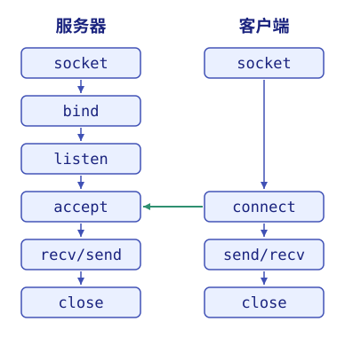
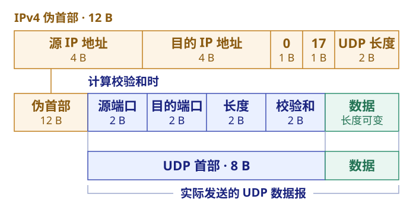
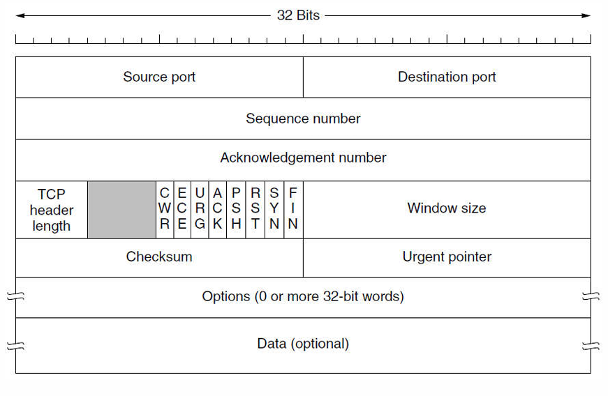
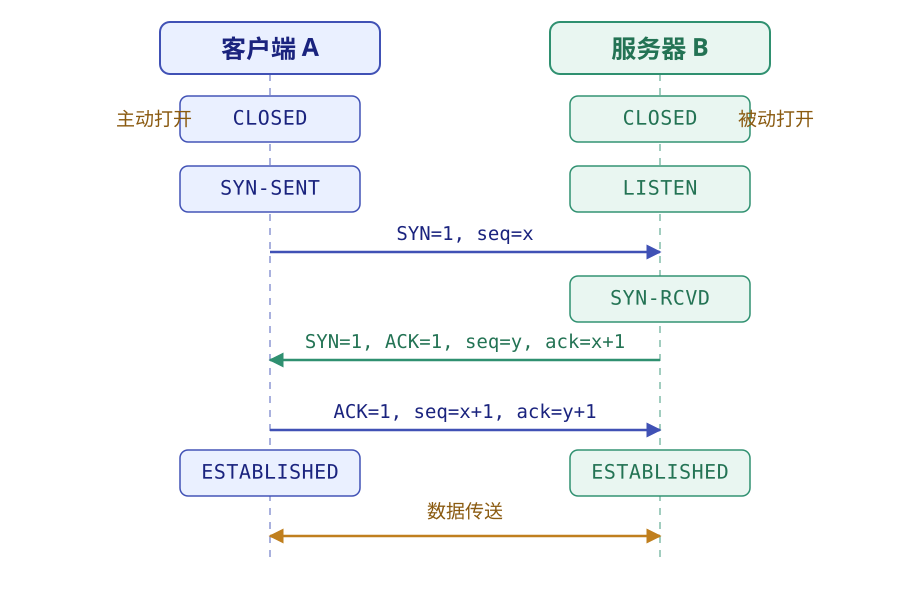
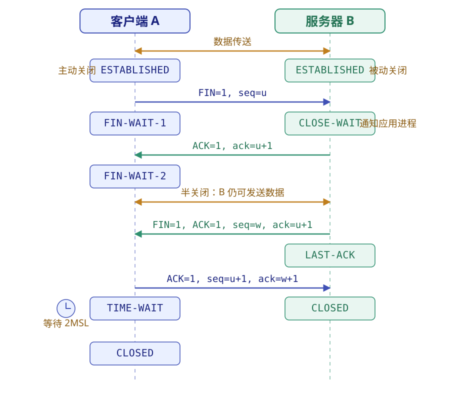
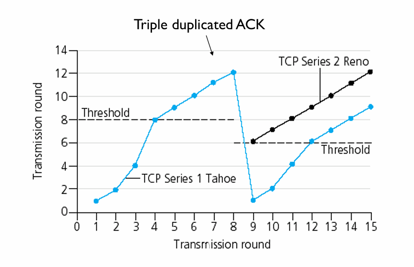

# 传输层

## 传输层的服务

### 进程寻址与端口

IP 地址标识了主机的网络接口，IP 可以把分组送到目的主机。但“主机之间的通信”实际上是主机上的某个应用进程之间的通信。IP 送来的分组仅停留在主机的网络层，并未交付给具体的应用进程。所以，传输层的视角从主机细化到进程，它运行在端系统中，为应用程序提供端到端服务。

**端口** 是传输层与应用层的接口，应用进程通过 **端口号** 标识。端口号长 16 bit，仅具有本地意义，不同主机的相同端口号没有关联，TCP 和 UDP 也各有自己的端口空间，同一个数字可以分别用于 TCP 和 UDP。

根据用途，端口号可以分为两类：

1.  **服务器端使用的端口号**。可以细分为：
    -   **熟知端口（0～1023）**。是由 IANA 分配给最重要的 TCP/IP 应用程序，供所有用户熟知；
    -   **登记端口（1024～49151）**。供未获熟知端口号的应用程序使用，需要在 IANA 登记。
2.  **客户端使用的端口号**，又称为 **短暂端口号（49152～65535）**，或者动态／私有端口。这类端口就是一个临时通信端点，在客户进程运行时动态分配。服务器从客户报文中提取源端口号，并将其作为回送数据的目的端口。通信结束后，该端口被系统回收供其他客户进程复用。

常见的熟知端口号（服务器端！）如下（考试需要记忆）：

<table>
  <tr>
    <th>应用程序</th>
    <td>FTP</td>
    <td>SSH</td>
    <td>TELNET</td>
    <td>SMTP</td>
    <td>DNS</td>
    <td>TFTP</td>
    <td>HTTP</td>
    <td>SNMP</td>
  </tr>
  <tr>
    <th>熟知端口号</th>
    <td>21</td>
    <td>22</td>
    <td>23</td>
    <td>25</td>
    <td>53</td>
    <td>69</td>
    <td>80</td>
    <td>161</td>
  </tr>
</table>

操作系统实际使用的临时端口范围由其配置决定。**复用** 允许多个应用的数据使用同一个传输层协议发送数据；**分用** 则指接收方根据端口、地址与协议等信息，在剥去报文首部后，能够把收到的数据正确交给相应端点。

TCP 是面向连接的，UDP 则是无连接的。一个 TCP 连接由 **`(源 IP，源端口，目的 IP，目的端口)`** 标识。同一个服务器监听端口可以接受多个客户端连接，它们由不同的端点组合区分。

### Socket 接口

Socket（套接字）是应用使用网络服务的 **编程接口**，其唯一标识网络中某台主机的某个应用进程，可以用 `(IP 地址: 端口号)` 来表示。面向连接的典型调用顺序是：

<figure markdown>

</figure>

| 操作 | 作用 |
| --- | --- |
| `socket` | 创建通信端点 |
| `bind` | 绑定本地地址与端口 |
| `listen` | 让端点进入监听状态， 设置待接受连接队列 |
| `accept` | 接受连接，获得与该客户端通信的 已连接 socket |
| `connect` | 主动请求建立连接 |
| `send`/`recv` | 发送／接收数据 |
| `close` | 关闭应用持有的 socket |

!!! note "我们可能会遇到监听 socket 与 `accept` 返回的已连接 socket 这两种服务端 socket。他们的分工是不同的，前者继续接受连接，后者服务于已经建立的连接。"

!!! question "为什么还需要端到端控制？"

    数据链路层处理相邻节点之间的帧，传输层面对跨越整个网络的通信：分组可能走不同路径、乱序到达，也可能在网络中停留较长时间。因此，确认、序号、超时和连接管理都要覆盖整个端到端过程。

    链路层的检错与重传可以减少局部错误的代价；**端到端校验与恢复负责检查最终交付的数据**。窗口大小则取决于速率、时延和缓存需求，链路层和传输层都可以使用滑动窗口。

## UDP

**UDP（User Datagram Protocol，用户数据报协议）** 在 IP 的数据报服务之上只增加 **复用、分用和差错检测** 的功能。

- UDP 是无连接的。发送前，UDP 无须建立连接。
- UDP 是 **面向报文** 的。UDP 会 **保留报文边界**：应用交来一个报文，UDP 会在添加首部之后直接传给 IP 层，即一次就发送一个完整的报文而不进行合并或拆分。
- UDP 的首部开销小。
- UDP 支持单播，也可用于广播与多播。相比之下，TCP 仅支持一对一单播。
- UDP 本身不负责重传、排序、流量控制与拥塞控制；需要这些可靠性机制的应用应自行实现，或采用提供相应能力的上层协议。

DNS、RTP、RIP 和 QUIC 等 **一次性传输少量数据** 的应用都常使用 UDP，因为 TCP 的连接建立、维护和释放会带来显著开销。UDP 也广泛用于多媒体应用，因为这些应用更关注 **低时延** 而非更可靠。

### UCP 的首部

| 字段 | 长度 | 含义 |
| --- | --- | --- |
| 源端口 | 16 bit | 标识发送端口；不需要对方回复时可置 0 |
| 目的端口 | 16 bit | 标识接收端口；所有 UDP 报文都必须有效 |
| 长度 | 16 bit | **UDP 数据报**（首部和数据总和）的字节数，最小为 8 |
| 校验和 | 16 bit | 由发送方传输层计算并写入，接收方据此检错 |

可见 UDP 首部固定为 **8 B**。以无选项 IPv4 为例，一个 1500 B 的 IP 分组可携带 $1500-20-8=1472$ B 的 UDP 数据。

当传输层从 IP 层收到 UDP 数据报时，就根据首部中的目的端口把 UDP 数据报通过相应的端口上交给应用进程。如果接收方发现报文中的目的端口号不正确（或不存在对应于该端口的进程），则丢弃该报文，并由 ICMP 发送“端口不可达”报文给发送方。

### 校验和与伪首部

计算校验和时，在 UDP 首部前临时加上**伪首部**。IPv4 伪首部为 **12 B**，包含源 IP、目的 IP、一个全零字节、协议号（值为 17，占 1 个字节）和 2 B 的 UDP 长度。

<figure markdown>

{:width="85%"}

</figure>

计算检验和的过程如下：

1.  把 UDP 校验和字段置零。
2.  对伪首部、UDP 首部和数据以 16 bit 为单位反码求和；奇数字节长度时补零参与计算。
    -   最高位产生进位时，应加至最低位。
3.  将和取反得到校验和，填入校验和字段；例如若计算结果为全 0，则传送全 1。

伪首部用于检查数据报是否被交给正确的网络端点，**不随 UDP 报文实际发送**。IPv4 中，校验和字段全置为 0 表示未使用 UDP 校验；IPv6 中通常强制必须使用 UDP 校验和。

!!! note "UDP 校验"
    1.  若 UDP 检验和检验出数据报错误，则通常丢弃该报文。虽然 RFC 允许其交付上层并附带错误指示，但实际实现极少采用。
    2.  通过伪首部，UDP 不仅可以校验端口和数据内容是否有错，也可以校验 IP 地址是否有错。

## TCP 的特点与报文段 

**TCP（Transmission Control Protocol，传输控制协议）**是在不可靠的 IP 层之上实现的可靠数据传输协议，主要解决可能的分组丢失、失序、重复和差错等问题。

-   TCP 是面向连接的。
-   TCP 一个连接只涉及两个端点，只支持单播。
-   TCP 支持全双工通信。为此，TCP 连接的两端均设有收发缓存。
-   TCP 是 **面向字节流** 的。TCP 不保留应用写入的消息边界将应用数据视为无结构的字节流，并不关心应用进程一次向缓存写了多少数据，而是根据对方通告的窗口大小和当前网络的拥塞程度，动态决定一个报文段应包含多少字节。

    对于过长的数据块，TCP 可能会分块；对于较短的数据块，TCP 可能会暂存，直到积累到合适长度后再发送。发送方连续写入四次 512 B，接收方可以分多次读，也可能一次读出 2048 B。应用若需要区分消息，应自行规定长度字段、分隔符或固定长度等规则。

**MSS（最大报文段长度）指 TCP 段的数据部分上限**，不含 TCP 与 IP 首部。例如，常见以太网 MTU 为 1500 B，若 IPv4 和 TCP 首部均为 20 B，则对应 MSS 为 $1500-20-20=1460$ B。

### 首部字段

TCP 基本首部为 **20 B**，含选项时最长为 60 B。

<figure markdown>

{:width="85%" }

</figure>

| 字段 | 长度 | 作用 |
| --- | --- | --- |
| 源端口、目的端口 | 各 16 bit | 标识应用端点 |
| 序号 `seq` | 32 bit | 本段第一个数据字节的序号 |
| 确认号 `ack` | 32 bit | 期望收到对方的下一个字节序号 |
| 数据偏移 | 4 bit | TCP 首部长度，单位为 4 B |
| 窗口 | 16 bit | 以 B 为单位，通告当前还能接收的最大数据量；可通过窗口扩大选项扩展 |
| 校验和 | 16 bit | 检查 TCP 首部及数据 |
| 紧急指针 | 16 bit | 在 URG 有效时指示紧急数据边界 |
| 选项与填充 | 可变 | MSS、窗口扩大、时间戳、SACK 等 |

需要注意的是，TCP 的校验和在计算时也需要在首部前面添加 12 B 的 **伪首部**。相比于 UDP，协议字段从 17 改成 6（TCP 对应 6），长度改成 TCP 长度。

常见控制位：

- **SYN**：同步序号，用于建立连接。
- **ACK**：确认号字段有效。
- **FIN**：本端没有更多数据要发送，请求关闭这个方向。
- **RST**：复位或拒绝相应连接。
- **PSH**：请求及时向接收应用推送数据，不用来划分应用消息。
- **URG**：紧急指针字段有效。`URG=1` 表示本报文段中包含紧急数据，应优先处理。
- **ECE、CWR**：配合显式拥塞通知。

## TCP 连接管理

### “三次握手”

指 TCP 连接建立的过程。以客户端 A 主动连接、服务器 B 被动监听为例，双方初始序号分别为 x、y：

<figure markdown>

{:width="85%"}

</figure>

-   仅在前两次握手的报文段中，`SYN=1`。
-   仅在第一次握手的报文段中，`ACK=0`，因为此时未接收到任何报文段。
-   第三次握手可以携带数据；若不携带数据，就不额外消耗序号（即开始数据传输时的 `seq` 仍然是 `x+1`）。主流操作系统一般都实现为不携带数据。

三次交换使双方同步初始序号，并确认通信能够双向进行。

!!! question "两次握手不可以吗？第三次握手的意义是什么？"
    考虑接下来的情况：客户端在之前发送了一个连接请求，但由于网络拥塞，在客户端规定的时间内没有送达服务器，客户端放弃了本次连接。在这之后，连接请求才送达服务器。如果没有第三次握手，那服务器就会仅凭迟到的请求建立起一个无效连接，浪费了资源。

    所以，考虑到对旧连接请求的处理，我们需要最后一次确认，避免上面这种无效连接的情况。

### “四次挥手”

指 TCP 连接释放的过程。TCP 的两个方向是分别关闭的。假设 A 先关闭，且图中各 FIN 报文段均不携带数据：

<figure markdown>

{:width="85%"}

</figure>

第二次与第三次之间是**半关闭**：A 已发完，但仍能接收 B 尚未发完的数据。若 B 已无数据要发，它的 ACK 和 FIN 可以合并，因此释放连接也不必总是恰好四个报文段。

主动关闭方通常在 **TIME-WAIT 等待 2MSL（Maximum Segment Lifetime，最长报文段寿命）** 后关闭，主要考虑到两点：一方面保留重发最后 ACK 的机会，确保发送的最后一个 ACK 能够到达对方；另一方面让旧连接中的报文在网络中自然消失。由此，可以说，从客户发出 FIN 的时刻算期，客户端释放连接的最短时间为 **1 RTT + 2 MSL**，服务器释放连接的最短时间为 **1.5 RTT**。

## TCP 的可靠传输

### 序号与累计确认

TCP 对每个方向的字节分别编号，序号按 **模 $2^{32}$** 循环。确认号 `ack=n` 表示：**编号 n 之前的数据已连续收到，接下来期望 n 号字节**。

!!! example "根据序号判断数据量"

    A 连续发送两个普通数据段，序号分别为 90 和 110，则第一段携带 $110-90=20$ B 数据。

    若第一段丢失、第二段先到，且 B 此前正等待字节 90，则累计确认号仍为 **90**。即使后面的字节已缓存，也要等缺口补齐后才能推进累计确认。

**SYN 和 FIN 报文各占用一个序号，纯 ACK 不占用序号**。

接收端可以利用 **SACK（选择确认）**选项报告已经收到的不连续字节块，帮助发送端减少不必要的重传；累计确认号仍指向最前面的缺口。

### 超时重传

TCP 每发送一个报文段，就对该报文段设置一个超时计时器。

但在互联网环境下，固定超时值难以适应不同路径。所以，TCP 根据 RTT 样本更新 **平滑往返时间 SRTT** 与 **偏差估计 RTTVAR**。对新样本 $R$，先使用旧 SRTT 计算偏差：

$$
\mathrm{RTTVAR}_{\mathrm{new}}
=\frac34\mathrm{RTTVAR}_{\mathrm{old}}
+\frac14\left|\mathrm{SRTT}_{\mathrm{old}}-R\right|
$$

$$
\mathrm{SRTT}_{\mathrm{new}}
=\frac78\mathrm{SRTT}_{\mathrm{old}}+\frac18R
$$

忽略时钟粒度、上下限等细节时，超时重传时间 RTO 估计为：

$$
\mathrm{RTO}=\mathrm{SRTT}_{\mathrm{new}}+4\mathrm{RTTVAR}_{\mathrm{new}}
$$

若重传后才收到确认，难以判断它确认的是原段还是重传段。**Karn 算法** 避免用这类有歧义的样本更新 RTT；发生超时后，对 RTO 进行指数退避。时间戳选项可以帮助区分相应发送。

### 冗余确认

超时重传有一个问题需要考虑，那就是超时周期往往太长。为了提高效率，我们还有冗余确认机制来检测丢包情况。

接收方发现缺失某段报文时，可以通过向发送方发送某段已确认报文的 ACK，反复确认当前期望的序号。假设发送方 A 发送了 1、2、3、4、5 的 TCP 报文段，2 号报文在链路中丢失而未到达接收方 B，其他报文正常到达。那么此时 3、4、5 号报文段对 B 就是失序的。

-   TCP 规定，每当比期望序号大的失序报文段到达时，接收方立即发送一个冗余 ACK。在上面的例子中，3、4、5 分别到达 B，则在它们到达 B 时，B 分别向 A 发送一次 1 号报文段的 ACK。
-   TCP 规定，发送方收到 3 个冗余 ACK（除了正常确认之外还有 3 次）后，就认为接收方反复期望的报文段缺失，重传缺失报文段。在上面的例子中，在 5 号报文段到达 B、B 发送第三次冗余 ACK 到达 A 后，A 立即对 2 号报文段执行重传。这种方式不必一直等超时到期，所以也被称为 **快重传** 技术。

## TCP 流量控制

### 发送缓存、接收缓存与窗口

发送方把未确认的数据保留在发送缓存中，以便需要时重传；接收方缓存到达的数据，按序交给应用。

我们之前说，流量控制本质上就是一种速度匹配。在 TCP 中，流量控制由滑动窗口机制来实现。**接收窗口 `rwnd`** 由接收方维护，表示接收方允许发送的字节范围；**拥塞窗口 `cwnd`** 发送方维护，反映发送方对网络承载能力的限制。因而，发送方可保持的在途数据量（发送窗口的上限）受两者共同约束：

$$
W=\min\{\mathrm{rwnd},\mathrm{cwnd}\}
$$

若当前已有 $F$ 字节发出但未确认，可继续发送的数量最多为 $\max\{0,W-F\}$。

接收方通告零窗口（`rwnd=0`）后，发送方暂停普通数据发送，直到接收方发出一个新的窗口值。

如果只依靠接收方单方通告，那么窗口更新报文可能就会丢失，使双方一直等待进入死锁。所以，TCP 规定每个连接设置一个 **持续计时器**，在发送方收到零窗口通告后开始计时。如果计时器超时，发送方就发送 **零窗口探测** 报文段，对方在确认这一报文段后会给出当前的窗口值。这样，如果窗口仍然是 0，则发送方收到确认后重置计时器；若不是 0，就打破了死锁状态。

### 小数据段与糊涂窗口综合征

发送方一次只写入很少数据（发送端应用进程产生数据速率过低），或接收方每次只腾出很小缓存（接收端应用进程处理接收缓冲区数据速率过低），都可能使大量短段占用网络。这一场景也被称为糊涂窗口综合征（SWS，Silly Window Syndrome）。为此，有两种比较常用的解决办法：

- **Nagle 算法**：有小数据尚未确认时，先合并后续小块；等确认到达或积累到足够数据后再发。
- **接收方的避免策略**：不要刚腾出一点空间就通告极小窗口，等待达到合适阈值后再更新。

这两种策略分别从发送端与接收端减少短段。交互应用还需要在等待时间与封装效率之间取舍。

## TCP 拥塞控制

### 慢启动与拥塞避免

经典 TCP 用 `cwnd` 控制在途数据。初始的 `cwnd` 通常设为 1 MSS（最新的 RFC 允许以更大 MSS 开始）。下面按满窗口发送、每个数据段都有一个新确认、无丢包的简化模型分析，窗口用 MSS 计量：

| 阶段 | 每收到一个确认新数据的 ACK | 约一个 RTT（一个传输轮次）后 |
| --- | --- | --- |
| **慢启动** | `cwnd` 增加 1 MSS | 窗口近似翻倍 |
| **拥塞避免** | `cwnd` 增加 $\mathrm{MSS}^2/\mathrm{cwnd}$ | 窗口约增加 1 MSS |

为了防止 `cwnd` 无限增长，还设置了 **`ssthresh`（慢启动阈值）**。 当 `cwnd < ssthresh` 时采用慢启动；大于阈值时采用拥塞避免。等于阈值时，两种算法都可以使用，但一般是采用拥塞避免。特别地，如果在慢启动阶段某次窗口值为 x，而 `x < ssthresh < 2x`，则下一次窗口值就是 `ssthresh` 了。

发送方判断网络拥塞时，会对 `cnwd` 和 `ssthresh` 进行调整，以迅速减少进入网络的流量：

-   将 `ssthresh` 调整为 **当前 `cwnd`** 的一半；
-   将 `cnwd` 重置为 1；
-   重新开始进行慢启动。

数据充足且接收窗口不限制时，平均发送速率可近似写成 $\mathrm{cwnd}/\mathrm{RTT}$。

### 快重传与快恢复

有时，个别报文丢失，但网络并未真正拥塞，如果等待超时再发，那就太浪费时间了。所以，TCP 拥塞控制也引入了 **快重传**。

TCP tahoe 就是最早的 TCP 版本。在收到 3 个冗余 ACK 后，tahoe 会进行快重传，同时采用前面介绍的拥塞策略：降低 `ssthresh` 到原 `cwnd` 的一半、`cwnd` 回到 1 MSS、重新慢启动。

但是，实际上，能够收到 3 个冗余 ACK，和超时不一样，这说明网络其实并没有完全瘫痪，后续数据包仍在到达。所以，tahoe 显得有些太过保守了。于是，TCP 做出了改进（即 TCP Reno），进一步引入 **快恢复** 机制。

TCP Reno 在面对超时（严重拥塞）时的处理方案和 TCP Tahoe 一样，重新开始慢启动。但在连续收到 3 个冗余 ACK 后，Reno 进入快恢复：先把 `ssthresh` 到原 `cwnd` 的一半，然后将 `cwnd` 也设置为原来的一半（等于 `ssthresh`），然后直接进入拥塞避免。

| 事件 | TCP Tahoe | TCP Reno |
| --- | --- | --- |
| 超时 | 降低 `ssthresh`，`cwnd` 回到 1 MSS，重新慢启动 | 同样重新慢启动 |
| 3 个重复 ACK | 快重传后，`cwnd` 回到 1 MSS | 快重传并进入快恢复，避免回到 1 MSS |

!!! note "Reno 快恢复中的临时窗口"

    在快恢复过程中，收到第 3 个重复 ACK 时，暂把 `cwnd` 设为 `ssthresh + 3 MSS`，以反映已收到的 3 个冗余 ACK 所指示的、仍滞留在网络中的数据量。快恢复期间，每收到一个额外的冗余 ACK 还会再增加 1 MSS，以反映又有数据离开网络。收到覆盖相应重传数据的新确认后，再把 `cwnd` 收回到 `ssthresh`，进入拥塞避免。

    因此，“减半后线性增长”描述的是恢复后的窗口变化。

{ width="650" style="display: block; margin: 0 auto;" }

!!! warning "408 考纲中关于 TCP 拥塞控制部分直接默认的是 TCP Reno。"

### 带宽时延积与 BBR

把路径想成一条可以容纳在途数据的管道。若瓶颈带宽为 $B$、往返传播时间为 $T$，填满路径大约需要 **$B\times T$** 的数据，这就是管道的容量，也就是带宽时延积。继续增加在途量，常会使数据积压在瓶颈队列中，排队时延随之增长。

**BBR** 通过估计瓶颈带宽与往返传播时间，调整发送节奏和在途数据量；其基本思路是建立路径模型，而不是只在丢包后缩小窗口。这里要把无排队时的传播时间与包含排队的实际 RTT 区分开。

## 基于传输服务的协议

### RPC

**RPC（Remote Procedure Call，远程过程调用）** 让客户端以类似本地函数调用的方式请求远程服务：客户端桩打包参数，服务器桩解包并调用过程，再把结果返回。

RPC 可以建立在 TCP 或 UDP 等传输服务之上。参数需要统一的编码规则；本地指针不能直接拿到另一台机器上使用。发生超时或服务器崩溃时，还要处理“请求没执行”与“执行了但回复丢失”的区别。

例如，先确认再持久化可能在崩溃时丢失已确认操作；先持久化再确认，又可能使重试重复执行。应用需要结合请求标识、去重、幂等操作或事务来定义完成语义。

### RTP 与 RTCP

**RTP（实时传输协议）** 常运行在 UDP 之上，用序号识别丢失与乱序，用时间戳支持播放时序，并标明载荷类型与同步源。它提供实时媒体所需的信息，播放端仍需处理丢包与抖动。

**RTCP** 配合 RTP 交换接收质量与同步等控制信息。接收端的抖动缓冲可以平滑到达时间变化；缓冲越深，通常越能容忍抖动，但播放等待也越长。

### QUIC

**QUIC** 在 UDP 之上实现可靠传输、流量控制、拥塞控制与安全握手，并支持一个连接内的多条流，HTTP/3 使用它传送 HTTP 数据。

TCP 按整个连接的字节流有序交付，一处缺失会阻塞其后的字节。QUIC 把有序交付限制在各条流内：**如果有一条流丢失数据，其他独立流不需要等待它补齐**；发生丢包的流本身仍要等待缺口恢复。
