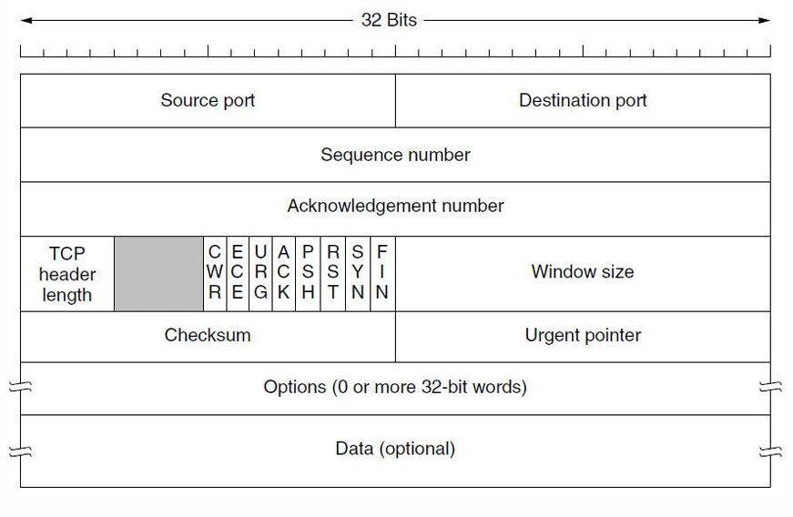
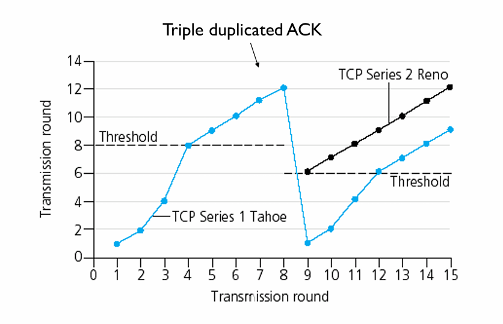

# 传输层

网络层把分组送到目的主机，传输层进一步解决：**主机上的哪个进程接收数据，以及两端进程怎样完成通信。** 它运行在端系统中，为应用程序提供端到端服务。

## 传输层的服务

### 进程寻址与端口

**IP 地址标识网络接口，端口号区分传输层的应用端点**。端口长 16 bit，TCP 和 UDP 各有自己的端口空间；同一个数字可以分别用于 TCP 和 UDP。

| 端口范围 | 名称 | 常见用途 |
| --- | --- | --- |
| 0～1023 | 熟知端口 | HTTP 80、HTTPS 443、DNS 53 等服务 |
| 1024～49151 | 登记端口 | 为应用登记使用 |
| 49152～65535 | 动态／私有端口 | 可用于临时通信端点 |

操作系统实际使用的临时端口范围由其配置决定。**复用**把多个应用的数据交给传输层发送；**分用**则根据端口、地址与协议等信息，把收到的数据交给相应端点。

一个 TCP 连接由 **`(源 IP，源端口，目的 IP，目的端口)`** 标识。同一个服务器监听端口可以接受多个客户端连接，它们由不同的端点组合区分。

### Socket 接口

Socket 是应用使用网络服务的编程接口。面向连接的典型调用顺序是：

```text
服务器：socket → bind → listen → accept → recv/send → close
                                  ↑
客户端：socket ────────────────→ connect → send/recv → close
```

| 操作 | 作用 |
| --- | --- |
| `socket` | 创建通信端点 |
| `bind` | 绑定本地地址与端口 |
| `listen` | 让端点进入监听状态，设置待接受连接队列 |
| `accept` | 接受连接，获得与该客户端通信的已连接 socket |
| `connect` | 主动请求建立连接 |
| `send`、`recv` | 发送、接收数据 |
| `close` | 关闭应用持有的 socket |

监听 socket 与 `accept` 返回的已连接 socket 分工不同：前者继续接受连接，后者服务于已经建立的连接。

### 为什么还需要端到端控制

数据链路层处理相邻节点之间的帧，传输层面对跨越整个网络的通信：分组可能走不同路径、乱序到达，也可能在网络中停留较长时间。因此，确认、序号、超时和连接管理都要覆盖整个端到端过程。

链路层的检错与重传可以减少局部错误的代价；**端到端校验与恢复负责检查最终交付的数据**。窗口大小则取决于速率、时延和缓存需求，链路层和传输层都可以使用滑动窗口。

## UDP

**UDP（User Datagram Protocol，用户数据报协议）**在 IP 之上增加端口分用与校验等功能，提供无连接、面向报文的传输。

- 发送前无须建立连接，首部开销小。
- **保留报文边界**：应用交来一个报文，UDP 就把它作为一个数据报处理。
- UDP 本身不负责重传、排序、流量控制与拥塞控制；需要这些能力的应用应自行实现，或采用提供相应能力的上层协议。
- 支持单播，也可用于广播与多播。DNS、RTP、RIP 和 QUIC 等都可以使用 UDP。

### 首部与长度

| 字段 | 长度 | 含义 |
| --- | --- | --- |
| 源端口 | 16 bit | 标识发送端口；不需要时可置 0 |
| 目的端口 | 16 bit | 标识接收端口 |
| 长度 | 16 bit | **UDP 首部加数据**的字节数，最小为 8 |
| 校验和 | 16 bit | 检查伪首部、UDP 首部和数据 |

UDP 首部固定为 **8 B**。以无选项 IPv4 为例，一个 1500 B 的 IP 分组可携带 $1500-20-8=1472$ B 的 UDP 数据；更大的 UDP 数据报可能导致 IP 分片。

### 校验和与伪首部

计算校验和时，在 UDP 首部前临时加上**伪首部**。IPv4 伪首部为 12 B，包含源 IP、目的 IP、一个全零字节、协议号 17 和 UDP 长度。

1. 把 UDP 校验和字段置零。
2. 对伪首部、UDP 首部和数据做 16 bit 反码求和；奇数字节长度时补零参与计算。
3. 将和取反，填入校验和字段；若计算结果为全 0，则传送全 1。

伪首部用于检查数据报是否被交给正确的网络端点，**不随 UDP 报文实际发送**。IPv4 中校验和字段全 0 表示未使用 UDP 校验；IPv6 中通常必须使用 UDP 校验和。

## TCP 的服务与首部

**TCP（Transmission Control Protocol，传输控制协议）**提供面向连接、可靠、有序、全双工的字节流服务，一个连接只涉及两个端点。

### 字节流与 MSS

**TCP 不保留应用写入的消息边界**。发送方连续写入四次 512 B，接收方可以分多次读，也可能一次读出 2048 B。应用若需要区分消息，应自行规定长度字段、分隔符或固定长度等规则。

**MSS（最大报文段长度）指 TCP 段的数据部分上限**，不含 TCP 与 IP 首部。常见以太网 MTU 为 1500 B，若 IPv4 和 TCP 首部均为 20 B，则对应 MSS 为 $1500-20-20=1460$ B。存在选项或其他封装时，还要计入相应开销。

### 首部字段

TCP 基本首部为 **20 B**，含选项时最长为 60 B。

{ width="650" style="display: block; margin: 0 auto;" }

| 字段 | 长度 | 作用 |
| --- | --- | --- |
| 源端口、目的端口 | 各 16 bit | 标识应用端点 |
| 序号 `seq` | 32 bit | 本段第一个数据字节的序号 |
| 确认号 `ack` | 32 bit | 期望收到对方的下一个字节序号 |
| 数据偏移 | 4 bit | TCP 首部长度，单位 4 B |
| 窗口 | 16 bit | 通告接收窗口；可通过窗口扩大选项扩展 |
| 校验和 | 16 bit | 检查伪首部、TCP 首部及数据 |
| 紧急指针 | 16 bit | 在 URG 有效时指示紧急数据边界 |
| 选项与填充 | 可变 | MSS、窗口扩大、时间戳、SACK 等 |

常见控制位：

- **SYN**：同步序号，用于建立连接。
- **ACK**：确认号字段有效。注意区分标志位 ACK 与具体确认号 `ack`。
- **FIN**：本端没有更多数据要发送，请求关闭这个方向。
- **RST**：复位或拒绝相应连接。
- **PSH**：请求及时向接收应用推送数据，不用来划分应用消息。
- **URG**：紧急指针有效。
- **ECE、CWR**：配合显式拥塞通知。

### 序号与累计确认

TCP 对每个方向的字节分别编号，序号按 **模 $2^{32}$** 循环。确认号 `ack=n` 表示：**编号 n 之前的数据已连续收到，接下来期望 n**。

!!! example "根据序号判断数据量"

    A 连续发送两个普通数据段，序号分别为 90 和 110，则第一段携带 $110-90=20$ B 数据。

    若第一段丢失、第二段先到，且 B 此前正等待字节 90，则累计确认号仍为 **90**。即使后面的字节已缓存，也要等缺口补齐后才能推进累计确认。

**SYN 和 FIN 各占用一个序号，纯 ACK 不占用序号**。普通数据段若 `seq=x`、携带 $L$ B，则下一个数据字节的序号为 $x+L$；若同段还有 FIN，还要再加 1。

接收端可以利用 **SACK（选择确认）**选项报告已经收到的不连续字节块，帮助发送端减少不必要的重传；累计确认号仍指向最前面的缺口。

## TCP 连接管理

### 三次握手

以客户端 A 主动连接、服务器 B 被动监听为例，双方初始序号分别为 x、y：

| 次序 | 方向 | 主要字段 | 状态变化 |
| --- | --- | --- | --- |
| 第一次 | A → B | `SYN=1, seq=x` | A 进入 SYN-SENT |
| 第二次 | B → A | `SYN=1, ACK=1, seq=y, ack=x+1` | B 进入 SYN-RECEIVED |
| 第三次 | A → B | `ACK=1, seq=x+1, ack=y+1` | A 进入 ESTABLISHED；B 收到后进入 ESTABLISHED |

第三次握手可以携带数据；若不携带数据，就不额外消耗序号。三次交换使双方同步初始序号，并确认通信能够双向进行；对旧连接请求的处理也需要最后一次确认，避免仅凭迟到的请求建立无效连接。

### 四次挥手与半关闭

TCP 的两个方向分别关闭。假设 A 先关闭，且下表中的 FIN 均不携带数据：

| 次序 | 方向 | 主要字段 | 主要状态 |
| --- | --- | --- | --- |
| 第一次 | A → B | `FIN=1, seq=u` | A：FIN-WAIT-1 |
| 第二次 | B → A | `ACK=1, ack=u+1` | B：CLOSE-WAIT；A 收到后为 FIN-WAIT-2 |
| 第三次 | B → A | `FIN=1, ACK=1, seq=w, ack=u+1` | B：LAST-ACK |
| 第四次 | A → B | `ACK=1, seq=u+1, ack=w+1` | A：TIME-WAIT；B 收到后关闭 |

第二次与第三次之间是**半关闭**：A 已发完，但仍能接收 B 尚未发完的数据。若 B 已无数据要发，它的 ACK 和 FIN 可以合并，因此释放连接不必总是恰好四个报文段。

主动关闭方通常在 **TIME-WAIT 等待 2MSL** 后关闭：一方面保留重发最后 ACK 的机会，另一方面让旧连接中的报文在网络中消失。MSL 是报文段最大生存时间。

## TCP 的可靠传输与流量控制

### 发送缓存、接收缓存与窗口

发送方把未确认的数据保留在发送缓存中，以便需要时重传；接收方缓存到达的数据，按序交给应用。

**接收窗口 `rwnd`**表示接收方允许发送的字节范围；**拥塞窗口 `cwnd`**反映发送方对网络承载能力的限制。发送方可保持的在途数据量受两者共同约束：

$$
W=\min(\mathrm{rwnd},\mathrm{cwnd})
$$

若当前已有 $F$ 字节发出但未确认，可继续发送的数量最多为 $\max(0,W-F)$。窗口是允许范围，不意味着每次发送都必须把它填满。

接收方通告零窗口后，发送方暂停普通数据发送，并通过**持续计时器与零窗口探测**了解窗口是否重新打开，避免窗口更新报文丢失使双方一直等待。

### 小数据段与糊涂窗口综合征

发送方一次只写入很少数据，或接收方每次只腾出很小缓存，都可能使大量短段占用网络。

- **Nagle 算法**：有小数据尚未确认时，先合并后续小块；等确认到达或积累到足够数据后再发。
- **接收方的避免策略**：不要刚腾出一点空间就通告极小窗口，等待达到合适阈值后再更新。

这两种策略分别从发送端与接收端减少短段。交互应用还需要在等待时间与封装效率之间取舍。

### 重传超时与 RTT 估计

固定超时值难以适应不同路径。TCP 根据 RTT 样本更新**平滑往返时间 SRTT**与**偏差估计 RTTVAR**。对新样本 $R$，先使用旧 SRTT 计算偏差：

$$
\mathrm{RTTVAR}_{\mathrm{new}}
=\frac34\mathrm{RTTVAR}_{\mathrm{old}}
+\frac14\left|\mathrm{SRTT}_{\mathrm{old}}-R\right|
$$

$$
\mathrm{SRTT}_{\mathrm{new}}
=\frac78\mathrm{SRTT}_{\mathrm{old}}+\frac18R
$$

忽略时钟粒度、上下限等细节时，超时估计为：

$$
\mathrm{RTO}=\mathrm{SRTT}_{\mathrm{new}}+4\mathrm{RTTVAR}_{\mathrm{new}}
$$

若重传后才收到确认，难以判断它确认的是原段还是重传段。**Karn 算法**避免用这类有歧义的样本更新 RTT；发生超时后，对 RTO 进行指数退避。时间戳选项可以帮助区分相应发送。

## TCP 拥塞控制

### 慢启动与拥塞避免

经典 TCP 用 `cwnd` 控制在途数据，以 **`ssthresh`（慢启动阈值）**区分增长阶段。下面按满窗口发送、每个数据段都有一个新确认、无丢包的简化模型分析，窗口用 MSS 计量：

| 阶段 | 每收到一个确认新数据的 ACK | 约一个 RTT 后 |
| --- | --- | --- |
| **慢启动** | `cwnd` 增加 1 MSS | 窗口近似翻倍 |
| **拥塞避免** | `cwnd` 增加 $\mathrm{MSS}^2/\mathrm{cwnd}$ | 窗口约增加 1 MSS |

当 `cwnd < ssthresh` 时采用慢启动；大于阈值时采用拥塞避免。**等于阈值时按题设约定处理**。传输轮次题常从 1 MSS 开始，得到 `1、2、4、8……` 的慢启动序列。

数据充足且接收窗口不限制时，平均发送速率可近似写成 $\mathrm{cwnd}/\mathrm{RTT}$。这里 `cwnd` 若用字节表示，所得速率为 B/s。

### 快重传与快恢复

接收方发现缺口时，可以反复确认当前期望的序号。发送方收到 **3 个重复 ACK**后，就重传缺失报文段，不必一直等超时，这叫**快重传**。三个重复 ACK 是在原有相同确认之外再出现三次。

**超时**与**重复 ACK**反映不同的反馈状态：前者迟迟得不到足够确认，后者说明后续数据仍在到达。经典算法据此采取不同的窗口收缩方式。

| 事件 | TCP Tahoe | TCP Reno |
| --- | --- | --- |
| 超时 | 降低 `ssthresh`，`cwnd` 回到 1 MSS，重新慢启动 | 同样重新慢启动 |
| 3 个重复 ACK | 快重传后，`cwnd` 回到 1 MSS | 快重传并进入快恢复，避免回到 1 MSS |

**按传输轮次画图的简化模型**：满窗口发送时，将 `ssthresh` 置为丢包前窗口的一半；Reno 在快恢复结束后把 `cwnd` 置为新阈值，继续线性增长。例如窗口为 12 MSS 时触发快重传，恢复后从 6 MSS 继续增长。

!!! note "Reno 快恢复中的临时窗口"

    细看快恢复过程，阈值按在途数据量减半，且至少为 2 MSS；收到第 3 个重复 ACK 时，暂把 `cwnd` 设为 `ssthresh + 3 MSS`。后续每个重复 ACK 可临时增加 1 MSS，以反映又有数据离开网络。收到覆盖相应恢复数据的新确认后，再把 `cwnd` 收回到 `ssthresh`，进入拥塞避免。

    因此，轮次图中的“减半后线性增长”描述的是恢复后的窗口，分析逐个 ACK 的变化时还要计入这段临时调整。

{ width="650" style="display: block; margin: 0 auto;" }

### 带宽时延积与 BBR

把路径想成一条可以容纳在途数据的管道。若瓶颈带宽为 $B$、往返传播时间为 $T$，填满路径大约需要 **$B\times T$** 的数据。继续增加在途量，常会使数据积压在瓶颈队列中，排队时延随之增长。

**BBR**通过估计瓶颈带宽与往返传播时间，调整发送节奏和在途数据量；其基本思路是建立路径模型，而不是只在丢包后缩小窗口。这里要把无排队时的传播时间与包含排队的实际 RTT 区分开。

## 基于传输服务的协议

### RPC

**RPC（Remote Procedure Call，远程过程调用）**让客户端以类似本地函数调用的方式请求远程服务：客户端桩打包参数，服务器桩解包并调用过程，再把结果返回。

RPC 可以建立在 TCP 或 UDP 等传输服务之上。参数需要统一的编码规则；本地指针不能直接拿到另一台机器上使用。发生超时或服务器崩溃时，还要处理“请求没执行”与“执行了但回复丢失”的区别。

例如，先确认再持久化可能在崩溃时丢失已确认操作；先持久化再确认，又可能使重试重复执行。应用需要结合请求标识、去重、幂等操作或事务来定义完成语义。

### RTP 与 RTCP

**RTP（实时传输协议）**常运行在 UDP 之上，用序号识别丢失与乱序，用时间戳支持播放时序，并标明载荷类型与同步源。它提供实时媒体所需的信息，播放端仍需处理丢包与抖动。

**RTCP**配合 RTP 交换接收质量与同步等控制信息。接收端的抖动缓冲可以平滑到达时间变化；缓冲越深，通常越能容忍抖动，但播放等待也越长。

### QUIC

**QUIC**在 UDP 之上实现可靠传输、流量控制、拥塞控制与安全握手，并支持一个连接内的多条流，HTTP/3 使用它传送 HTTP 数据。

TCP 按整个连接的字节流有序交付，一处缺失会阻塞其后的字节。QUIC 把有序交付限制在各条流内：**一条流丢失数据，不要求其他独立流等待它补齐**；发生丢包的流本身仍要等待缺口恢复。
