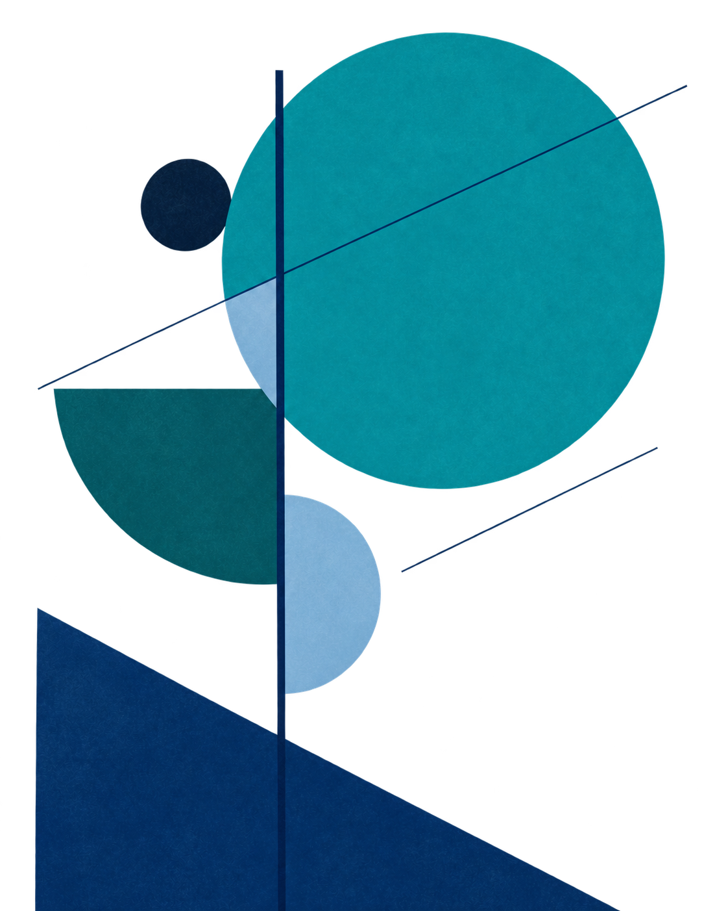

欢迎来到

# Undertree 的小站

这里大概会更新一些零零散散的内容...

---

<nav class="home-links" aria-label="站点相关" markdown="1">

[更新日志 :material-arrow-right:](changelog.md)
[GitHub :fontawesome-brands-github:](https://github.com/Undtree/Notes/)

</nav>

<figure class="home-gallery" aria-label="画廊" markdown="1">

{ width="1122" height="1402" decoding="async" fetchpriority="high" }

</figure>

